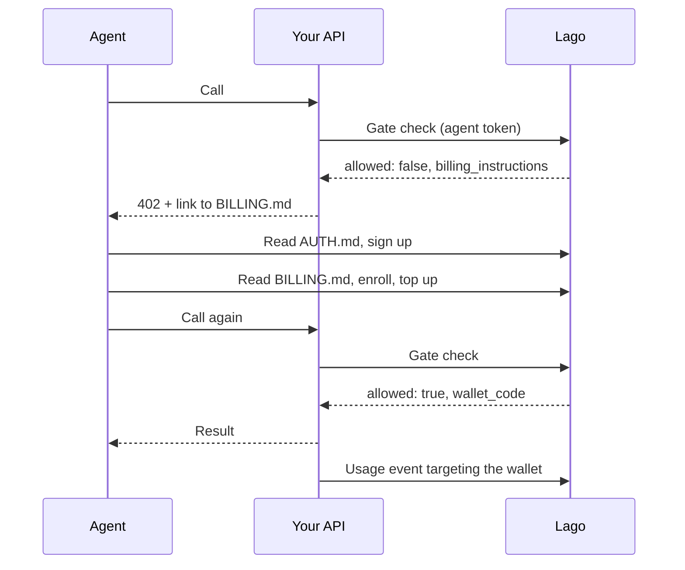

## Overview

An AI agent that finds your API today hits a wall: a signup form, an email to confirm, a card to enter, sometimes a sales call. None of that works for a program running on its own at 3 a.m.

The **Agent Storefront** removes the wall. You connect it once, pick the plans agents can buy, and Lago publishes two Markdown documents an agent reads at run time:

- **`AUTH.md`**: how to sign up and get a token.
- **`BILLING.md`**: what you sell, at what price, and how to pay.

From there the agent signs up, enrolls in a plan, funds a prepaid wallet and calls your API. No human in the loop on either side. Your API keeps its code. It asks Lago one question before each paid call: can this agent pay?

<Info>
**Premium add-on, on request.** [Contact us](mailto:hello@getlago.com) to enable it on your organization.
</Info>

## How it works



1. **The agent calls your API.** Your API runs a [gate check](#gate-your-api). An unknown or unfunded agent gets a `402` with the link to your `BILLING.md`.
2. **The agent signs up.** It follows `AUTH.md`: it proves it holds a key and gets a short-lived token.
3. **The agent enrolls and pays.** It follows `BILLING.md`: it picks one of your plans, which creates its Lago customer, subscription and wallet, then funds the wallet.
4. **The agent calls again.** The gate check passes. You serve the call and send a usage event to Lago, which debits the wallet.

Every agent is a regular Lago customer. Its invoices, wallet transactions and usage show up in the app, the API and your webhooks like any other customer's.

## AUTH.md: signup for agents

Each connection serves `AUTH.md` at `<agent_url>/AUTH.md`. It tells an agent how to register and authenticate, in plain steps it can follow without a human:

1. Generate an Ed25519 key pair and store the private key somewhere durable. **The key is the account.** A new key is a new identity, and nobody can restore a lost one.
2. Request a challenge, sign it, and submit the proof to sign up.
3. Receive a 5-minute access token. Renew it the same way, with the same key.

The agent can also revoke its own registration for good, with a signed challenge.

### Why Lago ships it

The idea comes from [auth.md](https://github.com/workos/auth.md), WorkOS's open protocol for agent registration: a Markdown file at a known URL that tells an agent how to sign up. Identity is WorkOS's domain. Their protocol covers identity providers, signed identity assertions and a human claim step, and it is the right fit when your service already runs OAuth.

Most API businesses don't run agent identity yet. Without it, they can't take money from an agent, because there is no account to bill. So Lago embeds a signup of its own in the Storefront. It keeps the Markdown discovery file and swaps the OAuth machinery for an Ed25519 key proof. It is not an implementation of the auth.md protocol, and an agent follows Lago's `AUTH.md`, not the generic one.

What embedding it buys you:

- **No identity provider to set up.** Signup works the day you connect.
- **No passwords or emails.** Proof of key possession is something an agent can do alone.
- **One account per key.** The registration maps one-to-one to a Lago customer and wallet, so billing can't drift from identity.

Lago checks tokens, not your API. You never handle the agent's key.

## BILLING.md: pricing an agent can read

Each connection also serves `BILLING.md` at `<agent_url>/BILLING.md`. It is generated from your Lago configuration on every request, so it can't go stale. It contains:

- **The plans you sell.** Interval, currency, top-up limits, free credits, and one action per charge: metric code, name, description, charge model and price properties.
- **How to enroll.** Get a billing token, then pick a plan. Enrolling creates the customer, a subscription and an empty wallet `agent_credits`.
- **How to add credits.** The agent pays a top-up with a [Stripe Shared Payment Token](/integrations/payments/stripe/shared-payment-tokens) granted from its own Stripe account. Lago charges it on your Stripe account, issues the credit invoice and credits the wallet once the payment settles.
- **How to get claimed.** See [Claim an agent](#claim-an-agent).

Agents hold two kinds of tokens. An **API token** works on your API only. A **billing token** works on the billing endpoints only. Your API never sees a token that can spend money.

<Tip>
`BILLING.md` writes your metric descriptions straight into the agent's context. Describe each metric in terms an agent can act on: what counts as one call, what makes it expensive.
</Tip>

## Set up a connection

### Prerequisites

- **Events targeting wallets** enabled on your organization. Usage events debit the agent's wallet directly.
- **Real-time wallet refresh.** Gate checks read a wallet balance that must stay current between calls. On self-hosted Lago, this needs a Redis cache URL and wallet refresh left on.
- **A Stripe connection**, to collect top-ups. Set its **Seller profile**: the Stripe network business profile agents grant their tokens to. Without it, `BILLING.md` tells agents you don't accept payments yet.

### Connection fields

In the app, go to **Settings > Integrations > Lago Agentic Storefront** and add a connection. You can also use `POST /api/v1/agent_storefronts`.

| Field | Required | What it does |
|---|---|---|
| **Name** | Yes | Shown to agents as the title of `AUTH.md` and `BILLING.md`, and to owners on the claim page. |
| **Code** | Yes | Identifies the connection in API calls and gate checks. Also sets the token scope, `<code>:use`, fixed at creation. |
| **Payment connection** | Yes | The Stripe connection that charges agent top-ups. Locked once an agent has paid through it. |
| **Endpoint** | No | Your API's HTTPS URL. Listed in `AUTH.md` so the agent knows where to go after signup. |
| **Agent instructions** | No | HTTPS URL of your API's own docs. Listed in `AUTH.md` next to the endpoint. |

Once created, the connection page lists the URLs to hand out: the agent URL, `AUTH.md`, `BILLING.md` and the claim page.

### Choose the plans agents can buy

Agents enroll with no one from your team in the loop, so you decide upfront what they can buy. On the connection page, click **Sell a plan** and set:

| Setting | What it does |
|---|---|
| **Plan** | Any plan of your organization that is [usage-only](#usage-only-plans). |
| **Minimum top-up** | The smallest amount an agent can add per payment. Keeps card fees from eating small top-ups. |
| **Maximum top-up** | The largest amount per payment. Caps your exposure to a single disputed charge. |
| **Free credits** | Credits granted once to a [claimed](#claim-an-agent) agent's owner. Leave empty or at zero for no offer. |

Amounts are in the plan's currency. The same settings go through the `plans` array of the API:

```json
{
  "agent_storefront": {
    "code": "search_agents",
    "name": "Acme Search",
    "payment_provider_code": "stripe_prod",
    "resource_endpoint": "https://api.acme.example/search",
    "plans": [
      {
        "plan_code": "search_per_call",
        "minimum_topup_cents": 500,
        "maximum_topup_cents": 10000,
        "free_credits_cents": 1000
      }
    ]
  }
}
```

An agent can move between sold plans of the same currency, at most 3 times an hour. Its wallet keeps its credits.

Top-up limits are copied to the wallet at enrollment. A later change applies to new enrollments and plan changes, not to agents already on the plan. **Stop selling** a plan and enrolled agents keep calling on it. New agents can't pick it.

### Usage-only plans

<Warning>
A sold plan must be fully usage-based: no subscription fee, no fixed charges, no minimum commitment, no charge minimums. Lago refuses anything else with `plan_not_usage_only`.
</Warning>

Agents pay from a prepaid wallet, call by call. A fixed fee has no call to attach to, and a minimum commitment bills money the wallet may not hold. Lago enforces the rule everywhere: when you sell the plan, when an agent enrolls, and when you edit a sold plan later. Adding a fee to a sold plan is refused with `plan_sold_by_agent_storefront`.

Each charge must also accept a target wallet, and pay-in-advance charges must be invoiceable. Otherwise every gate check on that metric is refused.

## Gate your API

Before each paid call, ask Lago whether the agent can pay. Pass the agent's API token, the metric of the call and your cost estimate:

```bash
curl -X POST "$LAGO_API_URL/api/v1/agents/gate_checks" \
  -H "Authorization: Bearer $LAGO_API_KEY" \
  -H "Content-Type: application/json" \
  -d '{
    "gate_check": {
      "storefront_code": "search_agents",
      "token": "<agent API token>",
      "billable_metric_code": "search_call",
      "estimated_call_cost_cents": 10
    }
  }'
```

"Cannot pay" is a normal answer, so it comes back as `200`:

| Situation | Answer | What your API does |
|---|---|---|
| Enrolled, the wallet covers the estimate | `allowed: true`, with `external_subscription_id` and `wallet_code` | Serve the call |
| Not enrolled | `allowed: false`, `reason: "enrollment_required"` | Answer `402` with `billing_instructions` |
| The wallet does not cover it | `allowed: false`, `reason: "insufficient_credits"` | Answer `402` with `billing_instructions` |
| Bad, expired or billing token | `422`, `invalid_token` | Answer `401` |
| Revoked agent | `422`, `registration_inactive` | Answer `403` |

`billing_instructions` is the URL of your `BILLING.md`. An agent that receives it knows how to fix the problem on its own.

The check reserves the estimate against the wallet, so parallel calls can't all spend the same credits. After the call, send a usage event for the agent's subscription that targets its wallet:

```json
{
  "event": {
    "transaction_id": "call_8f2c",
    "external_subscription_id": "<external_subscription_id from the gate check>",
    "code": "search_call",
    "properties": {
      "target_wallet_code": "<wallet_code from the gate check>"
    }
  }
}
```

The API key you use needs the `agent` resource. Existing keys with explicit permissions don't get it automatically.

## Claim an agent

An agent that signs up with a key is anonymous: its customer is `Agent · <registration id>`, with no email. Claiming ties it to the person who runs it.

1. The enrolled agent requests a claim code. It shows the code and your claim page URL to its owner, then keeps working. Nothing waits for the claim.
2. The owner opens the claim page, enters the code and an email address, then types the 6-digit code they receive. The email carries your billing entity's name.
3. The agent's customer gets the verified email. Lago sends `customer.updated`.

### Why claims matter

- **You know who is behind an agent.** The verified email lands on the customer record, for receipts, support and fraud review.
- **Free credits go to people, not keys.** Keys cost nothing to generate. Mailboxes are scarcer. Free credits require a claim, and each owner gets them **once per storefront**, however many agents they claim. Lago normalizes the address, so `anna+agent2@acme.example` counts as `anna@acme.example`.

Once claimed, the agent collects the free credits of its plan with one call. They land as granted credits, so the balance moves at once and you get `wallet_transaction.created`.

## Try it

[getlago/billing.md](https://github.com/getlago/billing.md) is a sample merchant API built on the Agent Storefront. Point a coding agent at its URL and watch it go from a `402` to signup, enrollment, payment and a result.

## Good to know

- **Stripe only, for now.** Top-ups use Stripe Shared Payment Tokens, in public preview at Stripe.
- **Any currency.** Each wallet uses its plan's currency. An agent can't move to a plan in another currency.
- **Deletion is guarded.** You can't delete a connection with enrolled agents, or a plan that a connection sells.
- **No dunning on agents.** Agent customers are excluded from dunning and skip zero-amount invoices.
