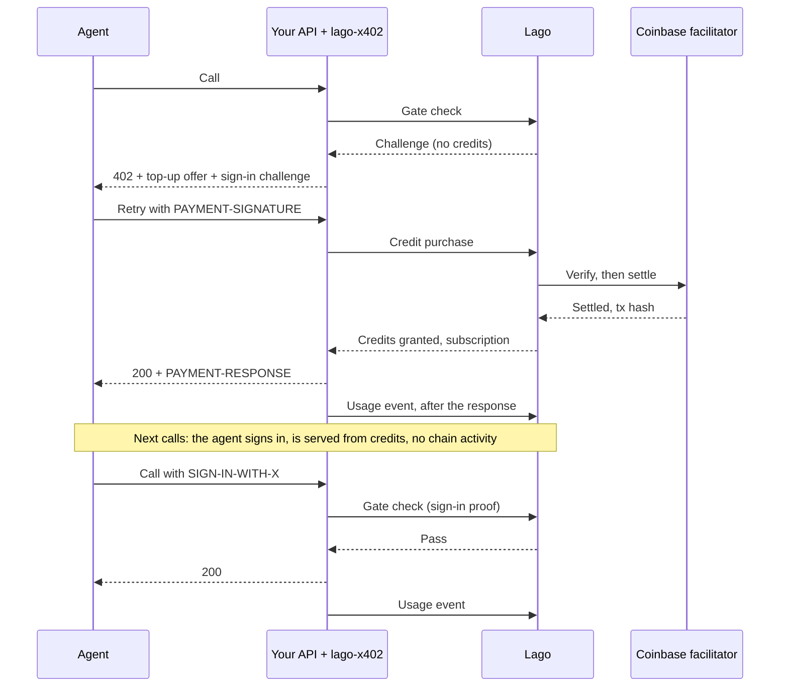

## Overview

An agent that calls a paid API can't fill a signup form or enter a card. [x402](https://www.x402.org) gives it another way: the API answers `402 Payment Required`, the agent signs a USDC payment, and retries.

Raw x402 settles one on-chain payment per call. That is fine for a $1 report and ruinous for a $0.002 search: every call pays a settlement and waits for one, and nothing ties the calls to a customer, a plan or an invoice.

Lago puts prepaid credits between the two. The agent pays **once** to top up, then makes thousands of calls against its credits, off chain. Each call is metered as a usage event and priced by your Lago plan. When the credits run out, the next call gets a `402` again.

[`lago-x402`](https://www.npmjs.com/package/lago-x402) is the middleware that runs this in front of your API, for Express, Hono and Next.js. Payments settle through the [Coinbase (x402) integration](/integrations/payments/coinbase-x402).

<Info>
**Premium feature, on request.** x402 needs a premium license and the `x402_payments` feature flag. [Contact us](mailto:hello@getlago.com) to enable it.
</Info>

## How it works



1. **No credits.** The agent calls a gated route. The middleware asks Lago for a [gate check](#the-gate-check), and Lago answers with a challenge. The agent gets a `402` whose `PAYMENT-REQUIRED` header offers a top-up in USDC on each network of your connection, plus a sign-in-with-x challenge.
2. **Top-up.** The agent signs the payment and retries with `PAYMENT-SIGNATURE`. The middleware forwards it to Lago, which verifies and settles it through the facilitator, creates the agent's customer, subscription and wallet on its first purchase, and grants the credits. The call is served.
3. **Served from credits.** On later calls the agent signs in with `SIGN-IN-WITH-X`, which proves it holds the address that paid. Lago passes the call while the wallet covers one more call. No chain activity.
4. **Metered.** After every served call, the middleware sends Lago one usage event with what the call consumed. Lago draws it from the agent's wallet at your plan's price.
5. **Empty again.** When the credits no longer cover a call, the gate challenges, and the agent tops up again.

The `402` is a top-up request, not a price. It asks for your route's top-up amount. What a call costs is set by your plan, and applied to the usage event after the call.

Every agent is a regular Lago customer. Its usage, wallet, invoices and payments show up in the app, the API and your webhooks like any other customer's.

## Set up Lago

### 1. Connect Coinbase

Create an x402 connection in **Settings > Integrations > Coinbase**. See [Coinbase (x402)](/integrations/payments/coinbase-x402#connect-coinbase) for the fields. For the middleware, two matter most:

- **Allowed origins** must contain the public origin your API is called on, port included. Without it every sign-in is refused, and the middleware answers `503`.
- **Auto-create customers** must be on for agents Lago has never seen to top up. Off, an unknown paying address gets `403 buyer_not_recognized`.

### 2. Create a billable metric per route

A `sum` aggregation on the field `value`, with no expression, not recurring. Each usage event carries the call's units in `properties.value`: tokens, rows, searches.

### 3. Create a plan per route

The plan an agent is subscribed to on its first top-up. It must be:

- **Usage-only**: no subscription fee, no fixed charges, no minimum commitment, no charge minimums. Lago refuses anything else with a `plan_*` or `charge_*` error.
- **In USD.**
- **Charged in arrears**, with the charge on the route's metric set to **accept target wallets**, so usage drains the route's wallet and nothing else.

<Warning>
Wallet targeting is not optional. The gate reads one wallet. If usage could drain another one first, such as a promotional wallet, the gate would keep passing on credits the route never spends. Lago refuses a route whose charge does not target the wallet (`charge_not_targeted`).
</Warning>

### 4. Create an API key

If your organization restricts API keys with permissions, the key needs `x402` write, `event` write and `billable_metric` read.

You don't create customers, wallets or subscriptions. Lago creates them on an agent's first top-up.

## Install the middleware

```bash
npm install lago-x402
```

Node `>=22.12`, with one of: Express 4.21+ or 5, Hono 4.6+ on `@hono/node-server`, or Next.js 16 on the Node runtime. The package is ESM, typed, and has one runtime dependency, `@x402/core`.

### Configure your routes

One config for the whole app. Each route has a name and the Lago objects that bill it.

```ts lago.ts
import type { LagoX402Config } from "lago-x402";

export const config: LagoX402Config = {
  apiUrl: "https://api.getlago.com/api/v1", // or your self-hosted Lago's /api/v1
  apiKey: process.env.LAGO_API_KEY!,
  connectionCode: "coinbase_prod", // your x402 connection
  origin: "https://api.example.com", // the public origin agents call, in allowed_origins
  routes: {
    generate: {
      billableMetric: "generated_tokens", // sum on "value"
      planCode: "agents_usage", // usage-only, USD
      walletCode: "agent_credits",
      topUpAmountCents: 100, // an agent without credits pays $1.00 to top up
      estimatedCallCostCents: 2, // served from credits while they cover 2¢
      fallbackUsage: 4000, // billed when the handler reports no valid usage
      wallet: { name: "Agent credits", rateAmount: "0.01" }, // 1 credit = 1¢
    },
  },
};
```

| Route field | What it does |
|---|---|
| `billableMetric` | The route's billable metric code. Usage events carry it as their `code`. |
| `planCode` | The usage-only USD plan an agent is subscribed to on its first top-up. |
| `walletCode` | The wallet Lago creates for each agent. Top-ups fill it, usage events target it. |
| `topUpAmountCents` | What every `402` asks for, in US cents. |
| `estimatedCallCostCents` | What one call is expected to cost. The gate serves an agent while its balance covers this amount. |
| `fallbackUsage` | Units billed when the handler reports no usage or an invalid one. Set it to the most one call can consume, so a forgotten report never serves a call for free. |
| `wallet.rateAmount` | Dollar value of one credit, up to 5 decimals: `"1"` is one credit per dollar, `"0.01"` one per cent. |
| `wallet.paidTopUpMinAmountCents`, `paidTopUpMaxAmountCents` | Optional top-up limits on the wallet. `topUpAmountCents` can't exceed the maximum. |
| `resource`, `discoverable`, `discovery` | Optional. Describe the route in its `402` and list it in the [Bazaar](#bazaar-discovery). |

`createLagoX402` validates the config, then checks every route against Lago at boot: the metric's shape and a gate check. It refuses to start on a route Lago can't bill, with a `LagoX402ConfigError` naming every refused route. An unreachable Lago is not a refusal: that route answers `503` and its check retries in the background.

### Attach the gate to a route

The middleware never matches paths. You attach it to each paid route through your framework's router.

<Tabs>
<Tab title="Express">

```ts server.ts
import express from "express";
import { createLagoX402 } from "lago-x402";
import { lagoX402 } from "lago-x402/express";
import { generate } from "./generate.js";
import { config } from "./lago.js";

const x402 = await createLagoX402(config); // checks every route against Lago

const app = express();
app.use(express.json());

app.post("/v1/generate", lagoX402(x402, "generate"), async (req, res) => {
  const result = await generate(req.body);
  res.locals.lagoUsage = result.tokens; // the units this call consumed
  res.json(result);
});

const server = app.listen(3000);

process.once("SIGTERM", () => {
  // Stop taking requests, then deliver the usage events still in flight.
  server.close(() => void x402.close());
});
```

</Tab>
<Tab title="Hono">

```ts server.ts
import { serve } from "@hono/node-server";
import { Hono } from "hono";
import { createLagoX402 } from "lago-x402";
import { lagoX402, type LagoX402Variables } from "lago-x402/hono";
import { generate } from "./generate.js";
import { config } from "./lago.js";

const x402 = await createLagoX402(config);

const app = new Hono<{ Variables: LagoX402Variables }>();

app.post("/v1/generate", lagoX402(x402, "generate"), async (c) => {
  const result = await generate(await c.req.json());
  c.set("lagoUsage", result.tokens); // the units this call consumed
  return c.json(result);
});

const server = serve({ fetch: app.fetch, port: 3000 });

process.once("SIGTERM", () => {
  server.close(() => void x402.close());
});
```

</Tab>
<Tab title="Next.js">

```ts x402.ts
import { createLagoX402 } from "lago-x402";
import { config } from "./lago";

// One instance for the whole app. Each request awaits it.
export const x402 = createLagoX402(config);
```

```ts app/api/generate/route.ts
import { withLagoX402 } from "lago-x402/next";
import { generate } from "../../../generate";
import { x402 } from "../../../x402";

export const POST = withLagoX402(x402, "generate", async (req) => {
  const result = await generate(await req.json());
  return { response: Response.json(result), usage: result.tokens };
});
```

`next build` evaluates route modules, so a module-scope `createLagoX402` boots against Lago at build time. To boot on the first request instead, pass a lazy promise-like. See the [package README](https://www.npmjs.com/package/lago-x402).

</Tab>
</Tabs>

### Report usage

The handler reports how many units of the route's metric the call consumed:

| Framework | How |
|---|---|
| Express | `res.locals.lagoUsage = n`, before the response ends. |
| Hono | `c.set("lagoUsage", n)`, on an app typed with `LagoX402Variables`. |
| Next.js | Return `{ response, usage: n }` instead of a bare `Response`. |

The middleware sends one `POST /events` per served call, after the response has gone out, never batched:

```json
{
  "event": {
    "transaction_id": "5f0a3c1e-0b5e-4f7a-9c2d-3e8f1a6b7c90",
    "code": "generated_tokens",
    "external_subscription_id": "<named by Lago for this agent>",
    "timestamp": 1795768027.793,
    "properties": { "value": "1250", "target_wallet_code": "agent_credits" }
  }
}
```

- A response with a status of 400 or more sends no event.
- `transaction_id` and `timestamp` are fixed when the call is served and reused on every retry, so Lago counts the event once.
- A missing, negative or non-numeric usage bills `fallbackUsage` and reports `usage.extract`. Alert on it: a handler that forgets to report usage bills every call at the fallback, and nothing else looks wrong.

## The gate check

Every request to a gated route costs one gate check against Lago, before your handler runs. Lago serves a signed-in agent when:

```text
wallet balance − usage already counted − calls in flight  ≥  estimatedCallCostCents
```

Lago computes a wallet's ongoing usage on a refresh cycle, every 5 minutes by default (`LAGO_WALLET_ONGOING_BALANCE_REFRESH_INTERVAL_SECONDS`). Between two refreshes, a per-wallet counter reserves `estimatedCallCostCents` for each call it passes, so concurrent calls can't all spend the same balance. Each refresh replaces the reservations with the metered usage.

The gate is a guardrail, not a ledger. A wallet can go slightly negative:

- The estimate is exact only when every call costs the same. With a token metric, a large call can cost more than the estimate.
- Calls in flight when a refresh runs are counted late.
- Credits offset the whole invoice, including anything outside the gated route.

Set `estimatedCallCostCents` close to the real cost of a typical call. Too low, and agents overdraw more. Too high, and the gate refuses agents that still have credits for one call.

## What the agent gets

Refusals are JSON, `{"error": "<code>"}`, with `Cache-Control: no-store`.

| Answer | When |
|---|---|
| `200` | Served from credits, or after a settled top-up with a `PAYMENT-RESPONSE` header. |
| `402` | No credits, or not signed in. The `PAYMENT-REQUIRED` header carries the offer, and an `error` when a payment was refused. Nothing was charged. |
| `401 sign_in_rejected` | The sign-in proof was refused, with a `reason`. A failed sign-in never turns into a payment. |
| `403 buyer_not_recognized` | Auto-create customers is off and Lago doesn't know the address. |
| `409 payment_already_settled` | This payment was already recorded for another request. Nothing served, nothing billed. |
| `503 payment_pending` | The payment may have moved but isn't confirmed. Comes with `Retry-After`. |
| `503 unavailable` | Lago gave no clear answer: unreachable, timed out, or the route's configuration was refused. |

The gate fails closed. When the middleware can't get a clear answer from Lago, the call is not served. It never answers `402` after a payment may have settled, so an agent is never asked to pay twice for the same call.

### Replay protection

Everything in a settled payment can be read from the chain, so a payment alone can't prove who sent it. The middleware sends Lago a random `idempotency_key` with each paid request, and Lago answers a recorded payment only under that key. A settled payment presented again, by the agent or anyone else, gets `409 payment_already_settled`. A payment serves exactly one request. Its credits serve the rest, through sign-in.

### Errors and observability

Every failure goes to `onError(err, where)` and to `console.warn`, so nothing fails silently:

```ts
const x402 = await createLagoX402({
  ...config,
  onError: (err, where) => Sentry.captureException(err, { tags: { lago_x402: where } }),
});
```

| `where` | What happened |
|---|---|
| `boot` | A route's boot check failed. |
| `gate.check` | A gate check failed or was refused. The agent got `503 unavailable`. |
| `gate.purchase` | A credit purchase failed or its outcome is unknown. Money may have moved. Worth a look. |
| `usage.extract` | A served call reported no valid usage and was billed `fallbackUsage`. |
| `usage.send` | A usage event was not delivered after retries, or the queue was full. |

Messages carry route names, endpoint names, statuses and Lago error codes only. Never the API key, a payment or sign-in header, or a response body.

## For agent builders

An API behind `lago-x402` speaks standard x402 v2 with the sign-in-with-x extension. With the official TypeScript client:

```ts agent.ts
import { ExactEvmScheme } from "@x402/evm/exact/client";
import { createSIWxClientExtension } from "@x402/extensions/sign-in-with-x";
import { wrapFetchWithPayment, x402Client } from "@x402/fetch";
import { privateKeyToAccount } from "viem/accounts";

const account = privateKeyToAccount(process.env.AGENT_PRIVATE_KEY as `0x${string}`);

const client = new x402Client();
client.register("eip155:*", new ExactEvmScheme(account));
// Sign in, so calls are served from the credits a top-up bought.
client.registerExtension(createSIWxClientExtension({ signers: [account] }));
// The stock client refuses payments above $1 unless you raise its cap.
client.setSpendControls({ maxAmountPerPayment: "$5" });

const fetchWithPayment = wrapFetchWithPayment(fetch, client);

const res = await fetchWithPayment("https://api.example.com/v1/generate", {
  method: "POST",
  headers: { "Content-Type": "application/json" },
  body: JSON.stringify({ prompt: "Hello" }),
});
```

- **Sign in.** Without the sign-in-with-x extension, every call is a new top-up.
- **Raise the spend cap** when the top-up is above $1.
- **Allow about 45 seconds** on the request that carries the payment.
- **Never resend a payment after `503 payment_pending`.** Wait `Retry-After`, then call again and sign in. Once Lago confirms the payment, the call is served from its credits.
- **Python agents need `httpx`.** The sync `requests` client can't run the extension's hooks.

## Bazaar discovery

The [x402 Bazaar](https://docs.cdp.coinbase.com/x402/bazaar) is the Coinbase facilitator's catalogue of paid resources. Agents search it to find APIs. A route can be listed:

```ts
search: {
  billableMetric: "searches",
  planCode: "agents_usage",
  walletCode: "agent_credits",
  topUpAmountCents: 100,
  estimatedCallCostCents: 1,
  fallbackUsage: 1,
  wallet: { name: "Agent credits", rateAmount: "0.01" },
  resource: {
    description: "Web search for agents: 0.2¢ per query, prepaid in $1.00 top-ups.",
    mimeType: "application/json",
    serviceName: "Example Search",
    tags: ["search", "0.2c-per-query"],
  },
  discoverable: true,
  discovery: {
    method: "GET",
    queryParams: { q: "usage-based billing" },
    inputSchema: { properties: { q: { type: "string" } }, required: ["q"] },
  },
},
```

The facilitator catalogues a route when a payment carrying its listing settles, and keeps it while the route has a settlement in the trailing 30 days.

<Warning>
**The listed price is the top-up**, the `402`'s amount, not what one call costs. The Bazaar has no other price field, and its price filter compares against it. State the per-call rate in `resource.description` and `resource.tags`.
</Warning>

Only static routes can be listed: no path parameters. The middleware refuses at boot what the facilitator would silently drop: a `serviceName` over 32 characters, more than 5 tags, a `description` over 500 characters, an invalid `iconUrl`.

## Limits

- **Node only.** Express, Hono on `@hono/node-server`, and the Next.js Node runtime. No edge runtimes. A Python middleware is not available yet.
- **x402 v2 only.** USDC on Base and Solana, through the Coinbase facilitator.
- **No streaming metering.** One usage value per call, read once the response has gone out.
- **Every request costs a gate check.** Nothing is cached, by design. Put a rate limiter per client in front of the gate: a flood of anonymous requests costs a gate check each, and on Solana connections it can exhaust the facilitator's rate limit.
- **Paid requests take up to 45 seconds.** Agents' HTTP clients, proxies, load balancers and platform timeouts must allow it.
- **Usage events live in memory.** Events still queued are lost if the process crashes, is killed, or `close()` times out. Those calls stay unbilled. Await `x402.close()` on shutdown.
- **Long paths break sign-in.** A path that pushes the sign-in URI past 512 characters makes sign-in fail with `401`.
- **Next.js bills clients that left.** `after()` runs even when the client disconnected first. Express and Hono bill only once the headers were sent.
- **Keep clocks in sync.** Lago dates each call by your server's clock. Keep it NTP-synced.

The [package README](https://www.npmjs.com/package/lago-x402) lists every measured behaviour, timeout and error mapping.
