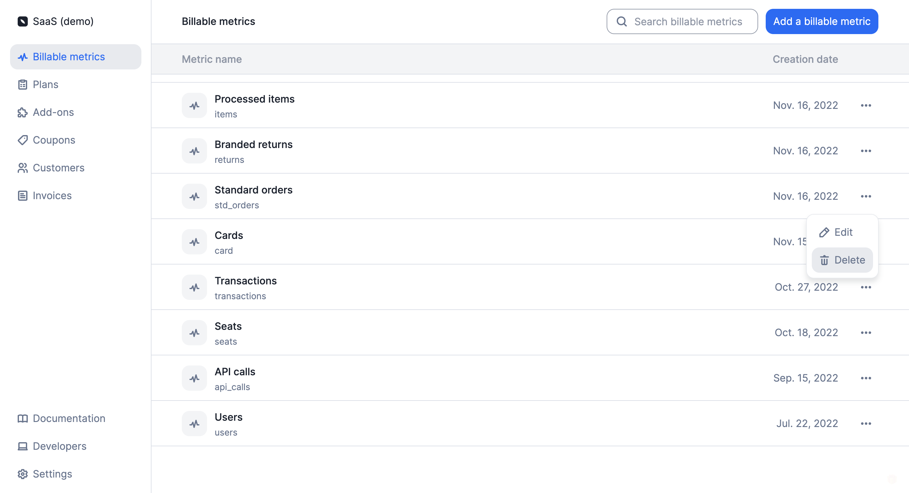

You may delete a billable metric linked to [charges](/guide/plans/charges) associated
with existing [subscriptions](/guide/subscriptions/assign-plan).

If you do so:

- Lago removes the charges that use this billable metric from all plans and
  existing subscriptions;
- Those charges no longer count towards the
  [current usage](/api-reference/customer-usage/customer-usage-object) of the
  customers concerned;
- Lago refreshes the `draft` invoices linked to these subscriptions and drops
  those charges from them; and
- Lago deletes the [usage alerts](/guide/alerts/usage-alerts) set on this
  billable metric.

The events you already sent are kept. Lago deletes the billable metric and its
charges, not your usage data.

The charges that use this billable metric stay on the `finalized` invoices
linked to these subscriptions.

<Info>
  After deleting a billable metric, you can create a new one using the same
  code. However, past events will not be linked to this new billable metric.
</Info>

<Tabs>
  <Tab title="Dashboard">
    
  </Tab>
  <Tab title="API">
      <CodeGroup>
        ```bash Delete "Storage" metric
        LAGO_URL="https://api.getlago.com"
        API_KEY="__YOUR_API_KEY__"

        curl --location --request DELETE "$LAGO_URL/api/v1/billable_metrics/storage" \
          --header "Authorization: Bearer $API_KEY"
        ```
      </CodeGroup>
  </Tab>
</Tabs>