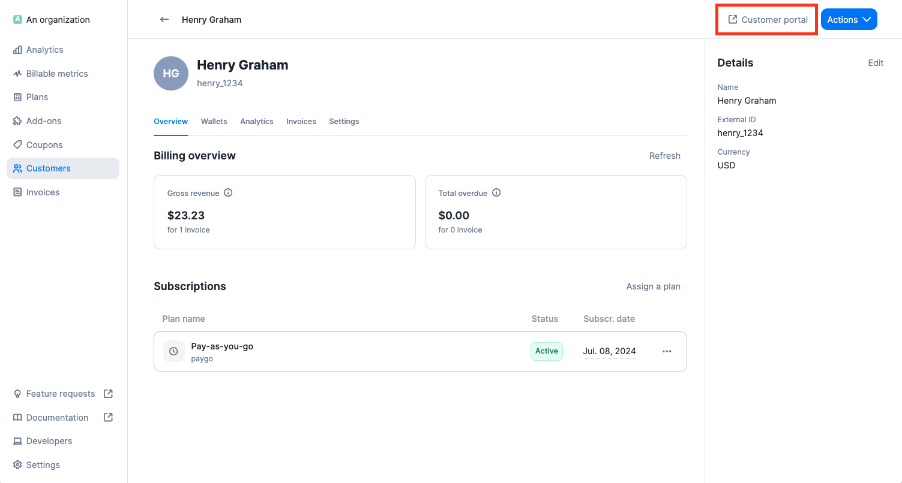
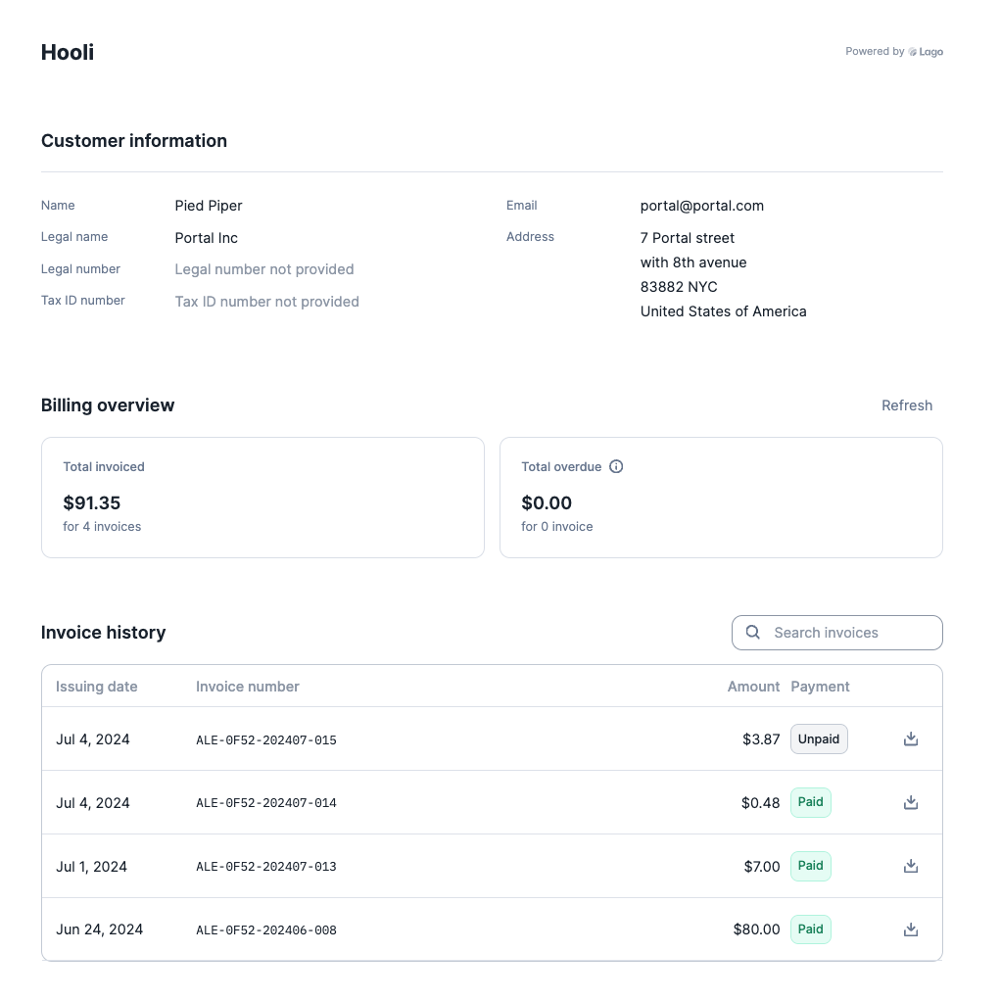
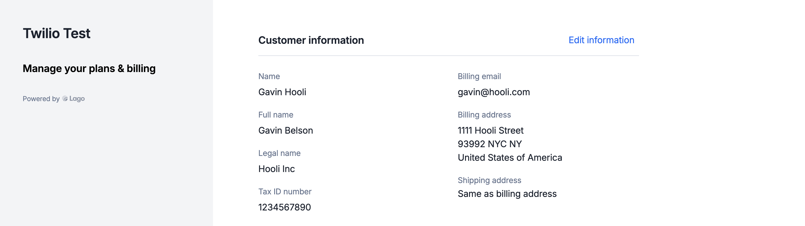
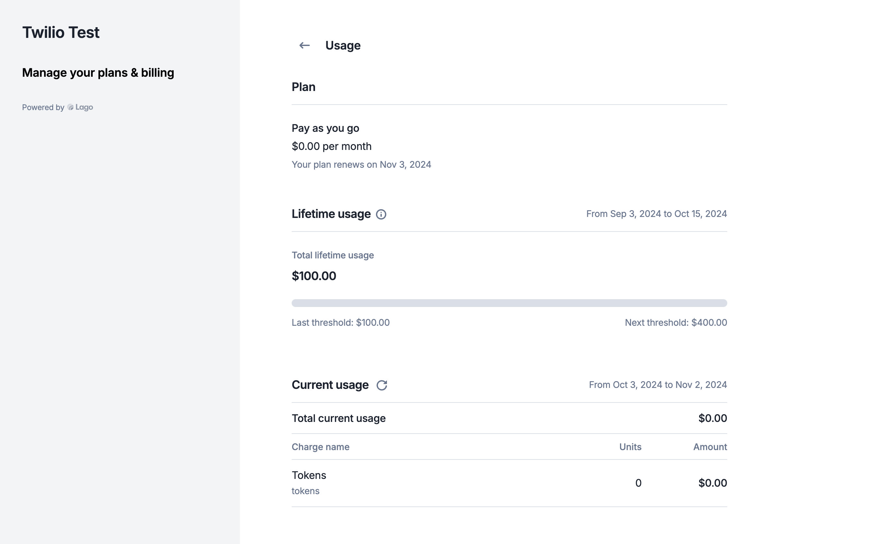
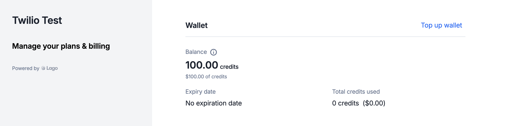

The Lago customer portal shares billing information, such as past invoices, with your end customers.

## Generate a customer portal link
To generate a customer portal URL that can be embedded into your product, you have two options:
1. Use the [API endpoint](/api-reference/customers/customer-portal); or
2. Click **"Customer portal"** in the upper right corner of the customer view.

<Frame caption="Customer portal access">
  
</Frame>

## Embed the customer portal
You can also embed the customer portal in your own application with an iframe. Use the `/customers/:external_customer_id/portal_url` endpoint to generate the URL to embed.

<CodeGroup>
```bash Generate a customer portal URL
LAGO_URL="https://api.getlago.com"
API_KEY="__YOUR_API_KEY__"
EXTERNAL_CUSTOMER_ID="hooli_1234"

curl --location --request GET "$LAGO_URL/api/v1/customers/$EXTERNAL_CUSTOMER_ID/portal_url" \
--header "Authorization: Bearer $API_KEY"
```
</CodeGroup>

The endpoint returns the embeddable URL:

```json Response
{
  "customer": {
    "portal_url": "https://app.lago.com/customer-portal/1234567890"
  }
}
```

<Info>
For security reasons, the URL returned by the API **expires after 12 hours**. Generate a new one every time a customer opens or refreshes the billing page.
</Info>

## Customer portal preferred language
By default, the embedded portal is displayed in English. To change the language for a specific customer, adjust the document language in their settings.

To access document language settings:
1. Go to the specific customer's profile;
2. Click the **Settings** tab;
3. In the **Document language** section, click **Add** or **Edit**; and
4. Select the preferred language.

You can also update the language of a customer directly from the API, using the `document_locale` field inside `billing_configuration`:

<CodeGroup>
```bash Set the customer portal language
LAGO_URL="https://api.getlago.com"
API_KEY="__YOUR_API_KEY__"

curl --location --request POST "$LAGO_URL/api/v1/customers" \
--header "Authorization: Bearer $API_KEY" \
--header 'Content-Type: application/json' \
--data-raw '{
  "customer": {
    "external_id": "hooli_1234",
    "billing_configuration": {
      "document_locale": "fr"
    }
  }
}'
```
</CodeGroup>

<Info>
If the language you are looking for is not yet available, please [visit this page](/api-reference/resources/locales).
</Info>


## Customer portal information

### 1. Invoice history
The invoice history section summarizes total invoices (everything invoiced since the customer was created) and overdue invoices (every invoice past its due date).

Your customers can retrieve and download all past invoices. Lago displays the issuing date, invoice number, amount, and payment status (paid or unpaid). Your customers can also filter the list and search for a specific invoice.

<Frame caption="Invoices list - Customer portal">
  
</Frame>

### 2. Customer information
In addition to viewing their invoice list, customers can retrieve essential billing information, including legal name, tax identification number, billing email, and billing/shipping addresses.

Customers can also update this information directly through the portal. You choose which fields they can edit in **Settings** > **General** > **Customer portal**. Country, zip code and tax identification number are read-only by default, because they drive the taxes applied to the customer.

<Frame caption="Customer information - Customer portal">
  
</Frame>

### 3. Plans and usage information
In addition to viewing their invoices and customer details, customers can access their subscriptions and usage directly through the portal.

For subscription details, they can view key information such as the plan name, recurring fee, and subscription renewal date.

Customers also have access to their usage details, including:
- Total lifetime usage and the next threshold for subscriptions using progressive billing;
- A detailed usage report, showing the number of units consumed and associated costs; and
- A full breakdown of usage by billing filters and groups.

<Frame caption="Plans and usage - Customer portal">
  
</Frame>

### 4. Prepaid credits information
The customer portal shows your customers their prepaid credit balance, including the remaining credits based on their current usage.

Customers can also top up their prepaid credits from the portal.

<Frame caption="Prepaid credits - Customer portal">
  
</Frame>