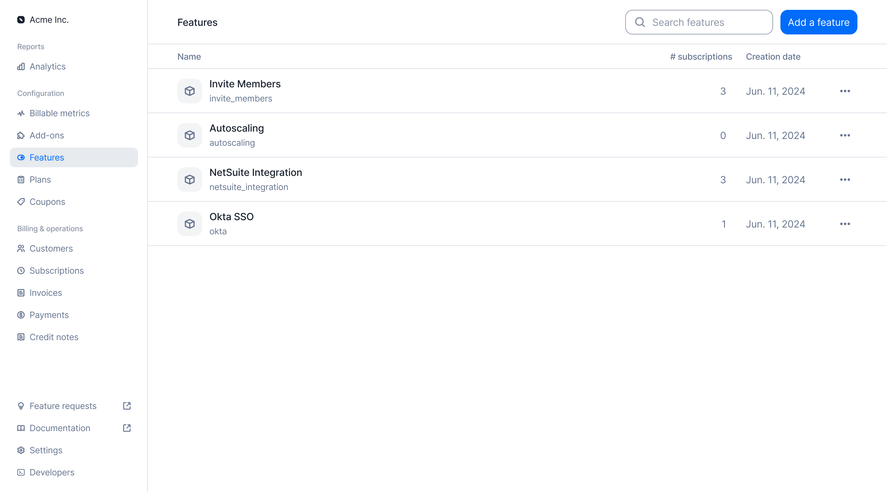
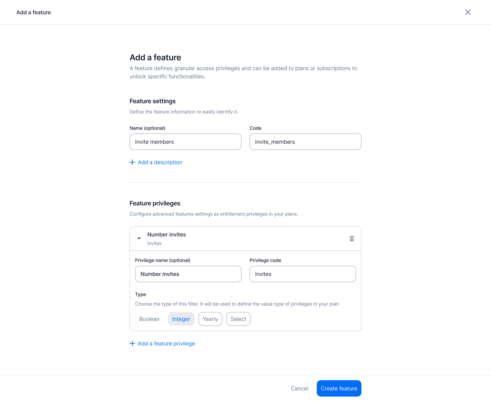
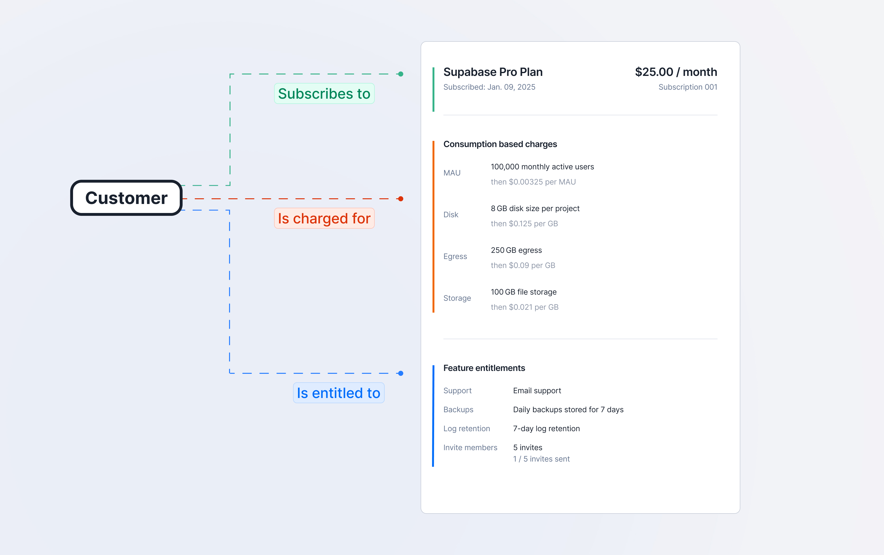
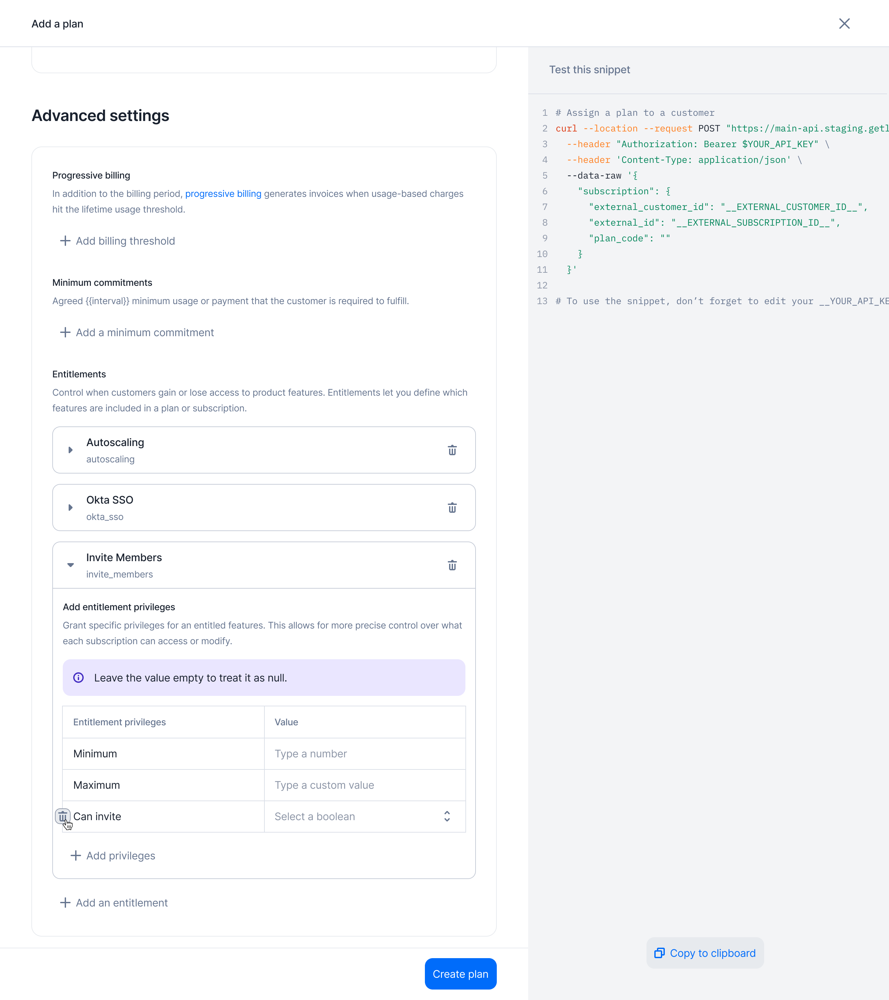

Entitlements define what a customer can access and how much they can use, based
on their subscription or contract. They cover four things:

- **Feature gates** control whether a feature is enabled for a customer.
- **Feature privileges** determine the level of access within a feature, such
  as basic or advanced functionality.
- **Allowances** represent the usage included in a plan, like 100 API calls per
  month.
- **Quotas** are the maximum usage limits, which may trigger overage charges or
  access restrictions.

Together, these enforce product limits, manage access, and support usage-based
billing. Lago handles allowances and quotas through its usage-based engine, and
feature gates and privileges through Features and Entitlements.

## Set up your features

<Tabs>
  <Tab title="Dashboard">
      To create a feature:

        1. Navigate to the **Features** section in the sidebar;
        2. Click on **Add a feature** to start a new entry;
        3. Give it a unique `code` (used for programmatic actions). The name is optional;
        4. Assign one or more **privileges** to the feature (optional); and
        5. Click **Create feature** to finalize and save the feature to your instance.

      A feature is a capability you gate behind a plan. You do not always bill for it directly: it is what a customer gains access to through their subscription.

    <Frame caption="Features section with the list of features">
      
    </Frame>

  </Tab>
  <Tab title="API">
      <CodeGroup>
      ```bash Create a feature
      curl --request POST \
        --url https://api.getlago.com/api/v1/features \
        --header 'Authorization: Bearer __YOUR_API_KEY__' \
        --header 'Content-Type: application/json' \
        --data '{
          "feature": {
            "code": "seats",
            "name": "Number of seats",
            "description": "Number of users that can be added to the account"
          }
        }'
      ```
      </CodeGroup>

      `code` is the only required field.
  </Tab>
</Tabs>

## Define feature privileges

<Tabs>
  <Tab title="Dashboard">
    You can also define privileges for a specific feature. Privileges give you more granular access controls across plans. For example, the `invite_member` feature can allow 1 member on the *Free plan* and unlimited invites on the *Pro plan*.

    Feature privileges can be associated with the following types:
    - **`boolean`**: The privilege value is either `true` or `false`.
    - **`integer`**: The privilege value is a numeric limit (for example `10 GPUs`).
    - **`string`**: The privilege value is freeform text.
    - **`select`**: The privilege value is chosen from a predefined list of options, which you list in `config.select_options`.

    `value_type` defaults to `string` and cannot be changed once the privilege exists.

    At this stage, you only define the **type** of each privilege. You set the values later, when you entitle the feature to a plan or a subscription.

    <Info>
      You can add an unlimited number of privileges to a feature.
    </Info>

    <Frame caption="Add feature privileges">
      
    </Frame>

  </Tab>
  <Tab title="API">
      <CodeGroup>
      ```bash Create feature with privileges
      curl --request POST \
        --url https://api.getlago.com/api/v1/features \
        --header 'Authorization: Bearer __YOUR_API_KEY__' \
        --header 'Content-Type: application/json' \
        --data '{
          "feature": {
            "code": "seats",
            "name": "Number of seats",
            "description": "Number of users that can be added to the account",
            "privileges": [
              {
                "code": "max",
                "name": "Maximum seats",
                "value_type": "integer"
              },
              {
                "code": "min",
                "name": "Minimum seats",
                "value_type": "integer"
              },
              {
                "code": "allow_admin_user",
                "name": "Allow admin user",
                "value_type": "boolean"
              },
              {
                "code": "tier",
                "name": "Seat tier",
                "value_type": "select",
                "config": {
                  "select_options": ["standard", "admin"]
                }
              }
            ]
          }
        }'
      ```
      </CodeGroup>
  </Tab>
</Tabs>

## Map entitled features to your plans

<Tabs>
  <Tab title="Dashboard">
    Once your features exist, you add them to your plans through **Entitlements**.
    An entitlement defines which features a plan unlocks, and the limits, values or privileges of each feature.
    By assigning features to plans, you control access to functionality across your pricing tiers.

    <Frame caption="Subscription and entitlement workflow">
        
    </Frame>

    To assign features to a plan:

    1. Create a new plan or edit an existing one;
    2. Navigate to the **Advanced settings** section;
    3. Select the features you want to entitle for that plan; and
    4. Configure the values for each feature's privileges according to the plan's rules.

    <Frame caption="Entitle features to a plan">
        
    </Frame>

  </Tab>
  <Tab title="API">
      <CodeGroup>
      ```bash Create plan entitlements
      curl --request POST \
        --url https://api.getlago.com/api/v1/plans/{code}/entitlements \
        --header 'Authorization: Bearer __YOUR_API_KEY__' \
        --header 'Content-Type: application/json' \
        --data '{
          "entitlements": {
            "seats": {
              "max": 20,
              "min": 10,
              "allow_admin_user": false
            },
            "sso": {
              "provider": "okta"
            }
          }
        }'
      ```
      </CodeGroup>

      `POST` replaces every entitlement on the plan. Use `PATCH` on the same
      path to change only the features you send.
  </Tab>
</Tabs>

## Override entitlements for a subscription

<Tabs>
  <Tab title="Dashboard">
    Some customers subscribe to a standard plan but negotiate custom entitlements as part of their contract.

    **You can override any entitlement value** for a specific subscription, in the same way you override charges.
    Lago stores the override on the subscription itself, so it applies **only** to that subscription. The base plan and the other subscriptions keep their values.

    To override the entitlements of a subscription:

    1. Open the subscription and select the **Entitlements** tab;
    2. Click **Add an entitlement** to entitle a feature the plan does not include, or open the actions menu of an entitled feature and click **Edit entitlement**; and
    3. Set the privilege values for this subscription and save.

    To take a feature away from this subscription, click **Delete entitlement** in the same actions menu.

  </Tab>
  <Tab title="API">
      <CodeGroup>
      ```bash Override subscription entitlements
      curl --request PATCH \
        --url https://api.getlago.com/api/v1/subscriptions/{external_id}/entitlements \
        --header 'Authorization: Bearer __YOUR_API_KEY__' \
        --header 'Content-Type: application/json' \
        --data '{
          "entitlements": {
            "seats": {
              "max": 30,
              "min": 20,
              "allow_admin_user": true
            },
            "sso": {
              "provider": "okta"
            }
          }
        }'
      ```
      </CodeGroup>
  </Tab>
</Tabs>

## Get entitlements for a subscription

This endpoint returns the current list of entitled features for a subscription:

```bash
curl --request GET \
  --url https://api.getlago.com/api/v1/subscriptions/{external_id}/entitlements \
  --header 'Authorization: Bearer __YOUR_API_KEY__'
```

## Track entitlement changes

Lago sends a [webhook message](/api-reference/webhooks/messages) for every
entitlement change:

- [`feature.created`](/api-reference/webhooks/messages#param-feature-created),
  when you create a feature.
- [`feature.updated`](/api-reference/webhooks/messages#param-feature-updated),
  when you update a feature or one of its privileges.
- [`feature.deleted`](/api-reference/webhooks/messages#param-feature-deleted),
  when you delete a feature.
- [`plan.updated`](/api-reference/webhooks/messages#param-plan-updated), when you
  change the entitlements of a plan. Lago also sends it for every plan that
  entitles a feature you update or delete.
- [`subscription.updated`](/api-reference/webhooks/messages#param-subscription-updated),
  when you override or remove an entitlement on a subscription.
