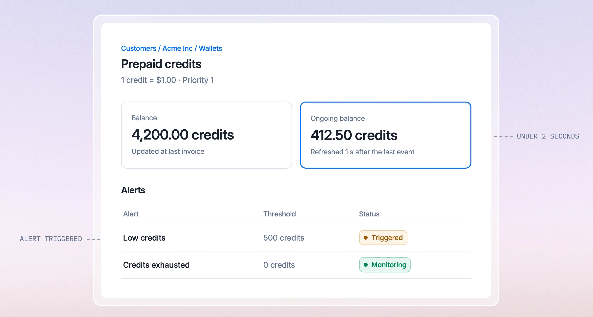

<Info>
  **PREMIUM ADD-ON** ✨

  Real-time usage is available on Lago Cloud upon request only. Please [**contact us**](mailto:hello@getlago.com) to enable it for your organization.
</Info>

Without the add-on, Lago refreshes a wallet's ongoing balance on a periodic cycle. Between two refreshes, your customers keep consuming against a number that is already out of date.

With real-time usage, every event you send updates the balance your product reads. Your app, gateway or agent can top up, throttle or block based on a number that is seconds old, not minutes.

<Frame>
  
</Frame>

## What changes for you

<CardGroup cols={3}>
  <Card title="Stop serving unpaid usage" icon="shield-check">
    Balances drop as usage happens. Your product sees a wallet run dry before it goes deep into negative.
  </Card>
  <Card title="Show balances customers trust" icon="gauge">
    The balance in your customer-facing UI matches what they just consumed. Fewer billing tickets, fewer surprises on the invoice.
  </Card>
  <Card title="Warn before budgets break" icon="bell">
    Usage and wallet alerts fire seconds after a threshold is crossed, while there is still time to top up or slow down.
  </Card>
</CardGroup>

## How it works

<Steps>
  <Step title="You send events">
    Send usage events the same way you do today, through the API or any [supported connector](/guide/events/ingesting-usage). Nothing changes in your integration.
  </Step>
  <Step title="Lago aggregates usage as events stream in">
    Usage is aggregated continuously per subscription, charge and charge filter, instead of being recomputed from raw events on each refresh.
  </Step>
  <Step title="The ongoing balance refreshes">
    The wallet's [ongoing balance](/guide/wallet-and-prepaid-credits/overview) reflects the event from under a second to a few seconds later. A burst of events collapses into a single refresh, so the balance stays current under load.
  </Step>
  <Step title="Alerts are evaluated right away">
    As soon as usage or a balance moves, Lago evaluates your [usage alerts](/guide/alerts/usage-alerts) and [credits consumption alerts](/guide/alerts/credits-consumption-alerts), and sends `alert.triggered` when a threshold is crossed.
  </Step>
  <Step title="Your product acts">
    Your app reads the balance or reacts to the webhook, then tops up, throttles or blocks. Lago supplies the state. Enforcement stays in your request path.
  </Step>
</Steps>

<Note>
  The ongoing balance is not a spending cap. Two concurrent requests can read the same balance and both proceed, and the balance can go below zero. To enforce a hard limit, authorize the work in your application before it starts.
</Note>

## Capabilities

### Real-time wallet balance

The ongoing balance of every wallet tied to a covered charge refreshes from under a second to a few seconds after an event, instead of on the periodic cycle. Read it in the dashboard, or through the API:

```bash Retrieve a wallet
LAGO_URL="https://api.getlago.com"
API_KEY="__YOUR_API_KEY__"

curl --location --request GET "$LAGO_URL/api/v1/wallets/__WALLET_ID__" \
  --header "Authorization: Bearer $API_KEY"
```

`ongoing_balance_cents` and `credits_ongoing_balance` carry the refreshed values. Automatic [top-ups triggered by a threshold](/guide/wallet-and-prepaid-credits/wallet-top-up-and-void) monitor the same ongoing balance, so they also react within seconds.

### Real-time alerts

Usage alerts and wallet alerts are evaluated as usage streams in, instead of waiting for the next periodic check.

- A burst of events triggers a single alert, not one per event.
- Alerts and webhooks keep the same payloads, thresholds and [resolution rules](/guide/alerts/alert-resolution). Your webhook handlers need no change.

See [real-time alerts](/guide/alerts/real-time-alerts) for use cases and a setup example.

### Real-time current usage

[Current usage](/guide/events/retrieve-usage) for a subscription is served from the continuously aggregated data. The amounts you show your customers in a usage page match the events they just sent.

## Coverage

Real-time refresh applies to charges whose billable metric uses one of these aggregations:

| Aggregation | Code | Refresh |
| --- | --- | --- |
| [Count](/guide/billable-metrics/aggregation-types/count) | `count_agg` | Real-time |
| [Sum](/guide/billable-metrics/aggregation-types/sum) | `sum_agg` | Real-time |
| [Max](/guide/billable-metrics/aggregation-types/max) | `max_agg` | Real-time |
| [Latest](/guide/billable-metrics/aggregation-types/latest) | `latest_agg` | Real-time |
| [Count unique](/guide/billable-metrics/aggregation-types/count-unique) | `unique_count_agg` | Periodic |
| [Weighted sum](/guide/billable-metrics/aggregation-types/weighted-sum) | `weighted_sum_agg` | Periodic |
| [Custom](/guide/billable-metrics/aggregation-types/custom-agg) | `custom_agg` | Periodic |

A charge is refreshed in real time when it also meets these conditions:

| | Real-time refresh |
| --- | --- |
| Charge timing | In arrears |
| Charge models | Standard, graduated, package, volume, graduated percentage, dynamic |
| Not yet covered | Pay-in-advance and prorated charges, the percentage charge model, plans from the product catalog |

Other charges keep the periodic refresh. Their events are billed exactly as before. Only the refresh delay differs.

## Reliability

- **Same invoice.** The add-on changes how fast balances refresh, not how invoices are computed. Invoices are still produced from the full event store.
- **Automatic fallback.** If the real-time path is delayed, the periodic refresh takes over. No event is dropped and no balance is skipped.
- **No integration change.** Events, endpoints, webhooks and payloads stay the same. Turning the add-on on or off requires no code change on your side.

## Get started

1. [Contact us](mailto:hello@getlago.com) with the organization you want to enable. We recommend starting on a sandbox organization.
2. Create a wallet with a [credits consumption alert](/guide/alerts/credits-consumption-alerts) on its ongoing balance.
3. Send events and watch the ongoing balance and the `alert.triggered` webhook follow them.
