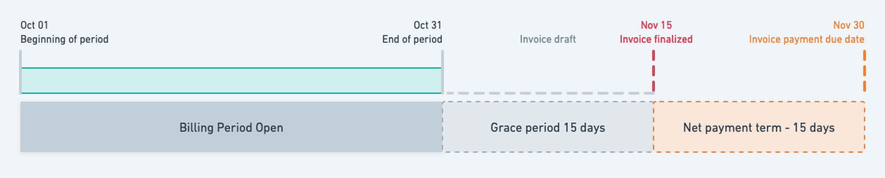

Payment terms define **when your customer must pay an invoice**. For example, Net 30 gives them 30 days from the invoice's issuing date to pay. The resulting due date appears on the invoice and its PDF.

You can set a default for a billing entity or customer, then choose different terms for a subscription, wallet, or one-off invoice. You can also choose terms for individual billing items when preparing a quote.

## Choose a payment term

Lago offers six payment-term types. The examples below all use an invoice dated **April 10, 2026** so you can compare the results.

| Payment term | How it works | Example setting | Payment due date |
| --- | --- | --- | --- |
| **Due on receipt** | Payment is due on the invoice's issuing date. | No additional days | **April 10, 2026** |
| **Net days** | Add the selected number of days to the issuing date. | 30 days (Net 30) | **May 10, 2026** |
| **End of month** | Use the last day of the month in which the invoice is dated. | End of April | **April 30, 2026** |
| **Net days after end of month** | Go to the end of the invoice month, then add the selected number of days. | 30 days after April 30 | **May 30, 2026** |
| **Days end of month** | Add the selected number of days to the issuing date, then go to the end of that month. | Add 30 days to reach May 10, then go to month-end | **May 31, 2026** |
| **Day of month** | Choose a day of the month and how many months after the invoice month to use. | Day 15, month offset 1 (the following month) | **May 15, 2026** |

<Tip>
  **The two terms that combine days and month-end use a different order.** For an invoice dated April 10, adding 30 days **after month-end** gives May 30. Adding 30 days **before moving to month-end** gives May 31. Check the example due date in the payment-term form before saving.
</Tip>

### Choose the number of days

For **Net days**, **Net days after end of month**, and **Days end of month**, enter the number of days agreed with your customer. The 30-day examples above are not a fixed duration.

For example, an invoice dated April 10 with **Net 15** is due on **April 25**. With **15 net days after end of month**, it is due on **May 15**. With **15 days end of month**, it is due on **April 30**.

Days are calendar days, including weekends. For example, Net 30 on an invoice dated January 31, 2026 gives a due date of **March 2, 2026**.

You can enter from 0 to 365 days. With 0 days, these terms match a simpler one, and the invoice shows the simpler label:

- **Net 0** is shown as **Due on receipt**.
- **0 net days after end of month** and **0 days end of month** are shown as **End of month**.

### Choose a day of the month

For **Day of month**, set **Day of month** and **Month offset**. The offset counts months from the invoice month; it defaults to **1**, meaning the following month.

| Setting | Example |
| --- | --- |
| Day 15, offset 0: the invoice month | An invoice dated April 10 is due April 15. If it is dated April 20, April 15 has already passed, so payment is due May 15. |
| Day 15, offset 1: the following month | An invoice dated April 10 is due May 15. |
| Day 15, offset 2: two months later | An invoice dated April 10 is due June 15. |
| Day 31 in a shorter month | An invoice dated January 10, 2026 with offset 1 is due February 28. In a leap year, it would be due February 29. |

You can choose a day from 1 to 31 and a month offset from 0 to 12. When the selected day does not exist in the target month, Lago uses that month's last day.

## Which payment term applies?

Lago uses the most specific setting available, in this order:

1. The term set on the **subscription, wallet, or one-off invoice**.
2. The **customer's** term, if the item has no term of its own.
3. The **billing entity's** term, if the customer has no term of their own.
4. **Due on receipt**, if no term is configured at any of these levels.

Using the setting from the level above is called **inheritance**. To return to the default, choose the inheritance option instead of entering a term of your own. Selecting **Due on receipt** sets an explicit term; it does not mean "use the default."

For example, your billing entity uses **Net 30**, but one customer has negotiated **Net 45**. That customer's invoices use Net 45 unless you set a more specific term. You can make their wallet purchases **Due on receipt** while leaving their subscription on Net 45.

If you change an inherited default, future invoices follow the new default. A subscription or wallet with its own term keeps that term until you change it or restore inheritance.

## Set the billing entity default

<a id="define-a-net-payment-term-at-entity-level" />

Use this setting for the standard terms offered by your billing entity, such as Net 30 for an invoice dated April 10 to be due May 10.

<Tabs>
  <Tab title="Dashboard">
    1. Open **Settings** and select the billing entity.
    2. Open **Invoicing settings**.
    3. Click **Edit** in **Payment terms**.
    4. Choose a **Term type** and enter any days or month settings it requires.
    5. Review the example due date, then save your changes.
  </Tab>
  <Tab title="API">
    This example sets **End of month** on a billing entity with the `payment_term` object. An invoice dated April 10 is due April 30. See [Set payment terms from the API](#set-payment-terms-from-the-api) for every term type.

    ```bash Set End of month on a billing entity
    LAGO_URL="https://api.getlago.com"
    API_KEY="__YOUR_API_KEY__"
    BILLING_ENTITY_CODE="acme_corp"

    curl --location --request PUT "$LAGO_URL/api/v1/billing_entities/$BILLING_ENTITY_CODE" \
      --header "Authorization: Bearer $API_KEY" \
      --header 'Content-Type: application/json' \
      --data-raw '{
        "billing_entity": {
          "payment_term": { "term_type": "end_of_month" }
        }
      }'
    ```
  </Tab>
</Tabs>

## Set a customer's payment terms

<a id="define-a-net-payment-term-at-customer-level" />

Use a customer setting when you have agreed different terms with that customer. For example, Net 45 gives them until May 25 to pay an invoice dated April 10, instead of May 10 under a Net 30 billing-entity default.

<Tabs>
  <Tab title="Dashboard">
    1. Open **Customers** and select the customer.
    2. Open their **Settings** tab.
    3. In **Payment terms**, add or edit the customer's term.
    4. Choose a **Term type** and enter its days or month settings.
    5. Review the example due date, then save your changes.

    To use the billing entity's default again, choose the inheritance option in the term selector. The customer's settings display the inherited term.
  </Tab>
  <Tab title="API">
    This example sets **Net 45 days** for a customer. An invoice dated April 10 is due May 25. Send `"payment_term": null` to clear it and inherit the billing entity's term again.

    ```bash Set Net 45 days on a customer
    LAGO_URL="https://api.getlago.com"
    API_KEY="__YOUR_API_KEY__"

    curl --location --request POST "$LAGO_URL/api/v1/customers" \
      --header "Authorization: Bearer $API_KEY" \
      --header 'Content-Type: application/json' \
      --data-raw '{
        "customer": {
          "external_id": "hooli_1234",
          "payment_term": { "term_type": "net", "days": 45 }
        }
      }'
    ```
  </Tab>
</Tabs>

## Set terms for a subscription, wallet, one-off invoice, or quote item

Choose a term when you create or edit the item, or keep the inherited term. On subscriptions, wallets, and one-off invoices, the term is in **Invoicing settings**. Each item can use any of the six [payment-term types](#choose-a-payment-term).

| Where you set the term | What it applies to | Example |
| --- | --- | --- |
| [Subscription](/guide/subscriptions/assign-plan#payment-terms) | Invoices for that subscription | Net 60 for an enterprise subscription: an April 10 invoice is due June 9. |
| [Wallet](/guide/wallet-and-prepaid-credits/overview#payment-terms) | Invoices for purchased credits in that wallet | Due on receipt: an April 10 top-up invoice is due April 10. |
| [One-off invoice](/guide/one-off-invoices/create-one-off-invoices#payment-terms) | That one-off invoice | Net 15 for a setup fee: an April 10 invoice is due April 25. |
| [Quote item](/guide/quotes/quote-editor#payment-terms-for-quote-items) | The subscription, wallet, or one-off invoice configured in that quote item | Net 30 for the subscription and due on receipt for its wallet purchases: April 10 invoices are due May 10 and April 10, respectively. |

Payment terms on a quote belong to its individual billing items. A subscription and a wallet in the same quote can have different terms.

Subscriptions with different effective payment terms are billed on separate invoices. Terms that always give the same due date, such as Net 0 and Due on receipt, count as the same term. See [invoice consolidation](/guide/subscriptions/assign-plan#invoice-consolidation).

## Set payment terms from the API

Send a `payment_term` object on billing entities, customers, subscriptions, wallets, and one-off invoices. `term_type` sets the rule, and each type accepts only its own fields.

| `term_type` | Fields | Example | Due date for an April 10, 2026 invoice |
| --- | --- | --- | --- |
| `due_on_receipt` | None | `{ "term_type": "due_on_receipt" }` | April 10 |
| `net` | `days` (0 to 365) | `{ "term_type": "net", "days": 30 }` | May 10 |
| `end_of_month` | None | `{ "term_type": "end_of_month" }` | April 30 |
| `net_end_of_month` | `days` (0 to 365) | `{ "term_type": "net_end_of_month", "days": 30 }` | May 30 |
| `days_end_of_month` | `days` (0 to 365) | `{ "term_type": "days_end_of_month", "days": 30 }` | May 31 |
| `day_of_month` | `day_of_month` (1 to 31), `month_offset` (0 to 12, defaults to 1) | `{ "term_type": "day_of_month", "day_of_month": 15, "month_offset": 1 }` | May 15 |

A missing field, an extra field, or a value out of range returns a `422` validation error. Send `"payment_term": null` to clear a term and inherit from the level above.

Invoices expose the term they were created with in `payment_term`, next to `payment_due_date`.

### Legacy `net_payment_term` field

Billing entities and customers still accept and return the integer `net_payment_term` field. The organization returns it for its default billing entity.

- Sending `net_payment_term: 15` alone sets `{ "term_type": "net", "days": 15 }`.
- When a request sends both fields, `payment_term` wins.
- In responses, `net_payment_term` returns the days for `net`, `0` for `due_on_receipt`, and `null` for the four other types. Use `payment_term` to read the full term.

Subscriptions, wallets, and one-off invoices only accept `payment_term`. If you send `net_payment_term` to these endpoints, Lago ignores it and the inherited term applies.

## Invoice dates and later changes

Payment terms are calculated from the **issuing date shown on the invoice**. The billing period describes the service being billed. The [grace period](/guide/invoicing/invoicing-settings/grace-period) gives your team time to review a draft invoice before finalization. These are separate settings.

In this Net 15 example, the issuing date matches finalization on **November 15**, so payment is due **November 30**:

<Frame caption="Net 15 when the invoice's issuing date and finalization date are both November 15">
  
</Frame>

If you configure the invoice to keep an earlier issuing date, payment terms count from that date instead. See [issuing date preferences](/guide/invoicing/invoicing-settings/issuing_date).

The issuing date follows the customer's timezone, or the billing entity's when the customer has none. For example, an invoice finalized on April 30 at 23:00 UTC for a customer in Pacific/Auckland is dated May 1, so End of month gives May 31.

Lago stores the applicable payment term when it creates an invoice. Changing a customer's, billing entity's, subscription's, or wallet's terms affects **future invoices**. Existing invoices, including drafts, keep the term they were created with.

For example, a draft invoice dated April 10 with Net 30 keeps Net 30 after you change the customer's default to Net 60. Its due date remains May 10. If that draft's issuing date later changes to April 12, its stored Net 30 term gives a new due date of May 12.

## Overdue invoices

<a id="application-scope" />

An unpaid invoice is marked overdue after its payment due date has passed. Lago emits the `invoice.payment_overdue` [webhook message](/api-reference/webhooks/messages).

The invoice remains overdue until its payment succeeds, a payment dispute is recorded as lost, or the invoice is voided.
