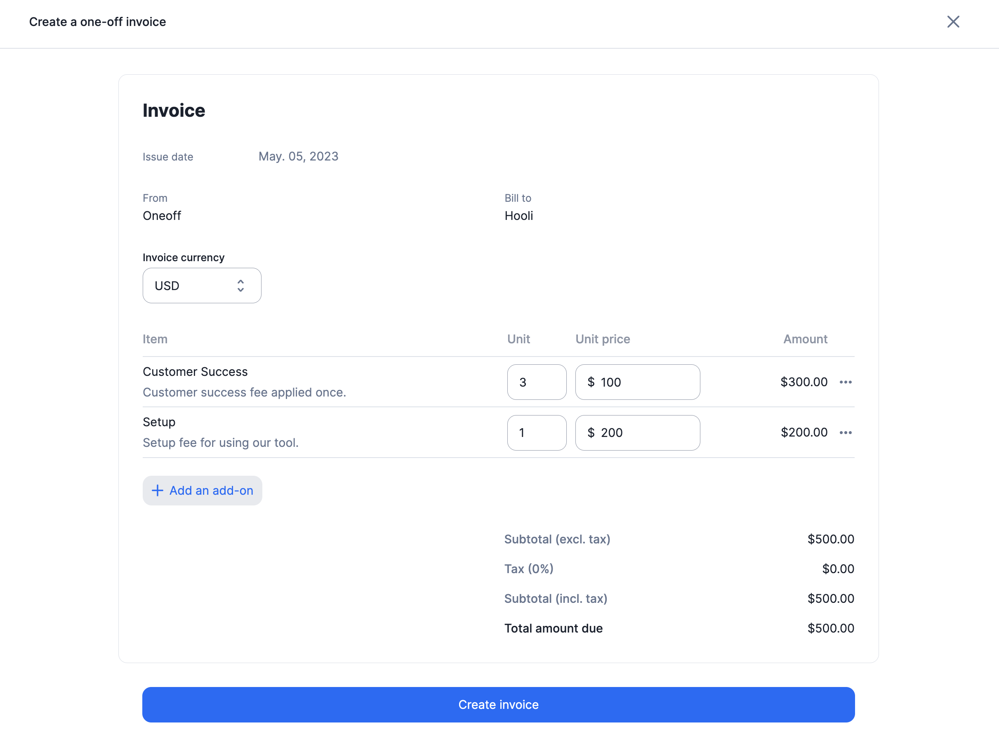

## Create a one-off invoice
To create a one-off invoice for a specific customer:

1. Select the customer from the list of customers
2. Click the **Actions** button in the upper-right corner, then select **Create one-off invoice**

## Add add-ons to the invoice
Once you have started the flow, add one or several add-ons to the invoice:

<Tabs>
  <Tab title="Dashboard">
    1. Define a purchase order number, if needed
    2. Click **Add an add-on** to add a line item to the invoice
    3. Set the number of units for the add-on
    4. Define the add-on billing period (past, present, or future)
    5. Edit the unit price, if needed (you can set it to 0)
    6. Edit the description displayed on the invoice
    7. In **Invoicing settings**, keep the inherited [payment term](#payment-terms) or choose one for this invoice
    8. Click **Create one-off invoice** to issue it

    <Frame caption="Adding add-ons to create a one-off invoice">
      
    </Frame>
  </Tab>
  <Tab title="API">
    <CodeGroup>
    ```bash Assign add-ons to create a one-off invoice
    LAGO_URL="https://api.getlago.com"
    API_KEY="__YOUR_API_KEY__"

    curl --location --request POST "$LAGO_URL/api/v1/invoices" \
      --header "Authorization: Bearer $API_KEY" \
      --header 'Content-Type: application/json' \
      --data-raw '{
        "invoice": {
          "external_customer_id": "hooli_1234",
          "currency": "USD",
          "billing_entity_code": "default",
          "purchase_order_number": "po-1234",
          "fees": [
            {
              "add_on_code": "setup_fee",
              "units": 1,
              "unit_amount_cents": 50000,
              "description": "Implementation fee with a solution engineer",
              "from_datetime": "2025-01-01T00:00:00Z",
              "to_datetime": "2025-12-31T23:59:59Z"
            },
            {
              "add_on_code": "customer_success",
              "units": 2,
              "unit_amount_cents": 100000,
              "description": "One off customer success fee",
              "from_datetime": "2025-01-01T00:00:00Z",
              "to_datetime": "2025-12-31T23:59:59Z"
            }
          ]
        }
      }'
    ```
    </CodeGroup>
  </Tab>
</Tabs>

## Payment terms

You can choose a payment term for this invoice without changing the customer's default. In **Invoicing settings**, select a term and enter its days or month settings before issuing the invoice. If you keep inheritance, the customer's term applies. When the customer has none, the term of the billing entity selected for this invoice applies.

For example, your customer's subscription invoices use **Net 30**, but you agree **Net 15** for a one-off setup fee. Set Net 15 on the setup-fee invoice. If both invoices are dated **April 10, 2026**, the setup fee is due **April 25**, while the subscription invoice is due **May 10**.

See [Payment terms](/guide/invoicing/invoicing-settings/payment-term#choose-a-payment-term) for all six options and examples. The one-off invoice is issued immediately; the chosen term determines its payment deadline. Later changes to customer defaults do not change the term stored on this invoice.

From the API, send `payment_term` when you [create the one-off invoice](/api-reference/invoices/create-oneoff). This endpoint does not accept the legacy `net_payment_term` field: if you send it, Lago ignores it and the inherited term applies.

## Application scope of one-off invoices

- A one-off invoice can include the same add-on several times.
- The currency and billing entity of the one-off invoice can differ from the customer's defaults: the invoice is issued in the currency and by the billing entity you select for it. Set `billing_entity_code` to pick the billing entity from the API.
- You can reuse the same add-on for several customers, even when their subscriptions use different currencies. You can also charge a different amount to each of them.
- Coupons or prepaid credits (discounts) **do not apply** to one-off invoices.
- One-off invoices are subject to taxes. For each fee, Lago applies the `tax_codes` sent in the payload. If there are none, it falls back to the taxes of the add-on, then to the taxes of the customer, then to the default taxes of the billing entity. When the customer is connected to a tax provider such as [Anrok](/integrations/taxes/anrok) or [Avalara](/integrations/taxes/avalara), the provider computes the taxes and the `tax_codes` of the payload are ignored.

<Tip>

When using the API endpoint, if `unit_amount_cents` is null, Lago applies the default amount of the add-on. If `units` is null, Lago bills 1 unit. If `currency` is null, Lago uses the currency of the customer. When the customer has no currency yet, the currency of this invoice becomes the customer's currency.

</Tip>

## Invoicing

A one-off invoice is issued straight away. Lago then sends the `invoice.one_off_created` webhook message.
