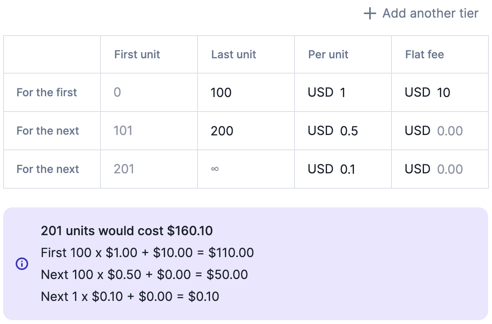

Select the graduated charge model if you want to define **several price tiers**.
This charge model allows you to apply a discount depending on the number of
units consumed. You can also apply a **flat fee** to an entire tier.

Let's take back the example of the API company, where each unit is an API call:

| Tier   | First unit | Last unit | Unit price | Flat fee |
| ------ | ---------- | --------- | ---------- | -------- |
| Tier 1 | 0          | 100       | \$1.00     | \$0      |
| Tier 2 | 101        | 200       | \$0.50     | \$0      |
| Tier 3 | 201        | ∞         | \$0.10     | \$0      |

In this case, 250 API calls would cost (100 x \$1.00) + (100 x \$0.50) + (50 x \$0.10) = \$155.

Please refer to the tooltip in the user interface for more information.

<Frame caption="Configuration of the graduated charge model" >
    
</Frame>