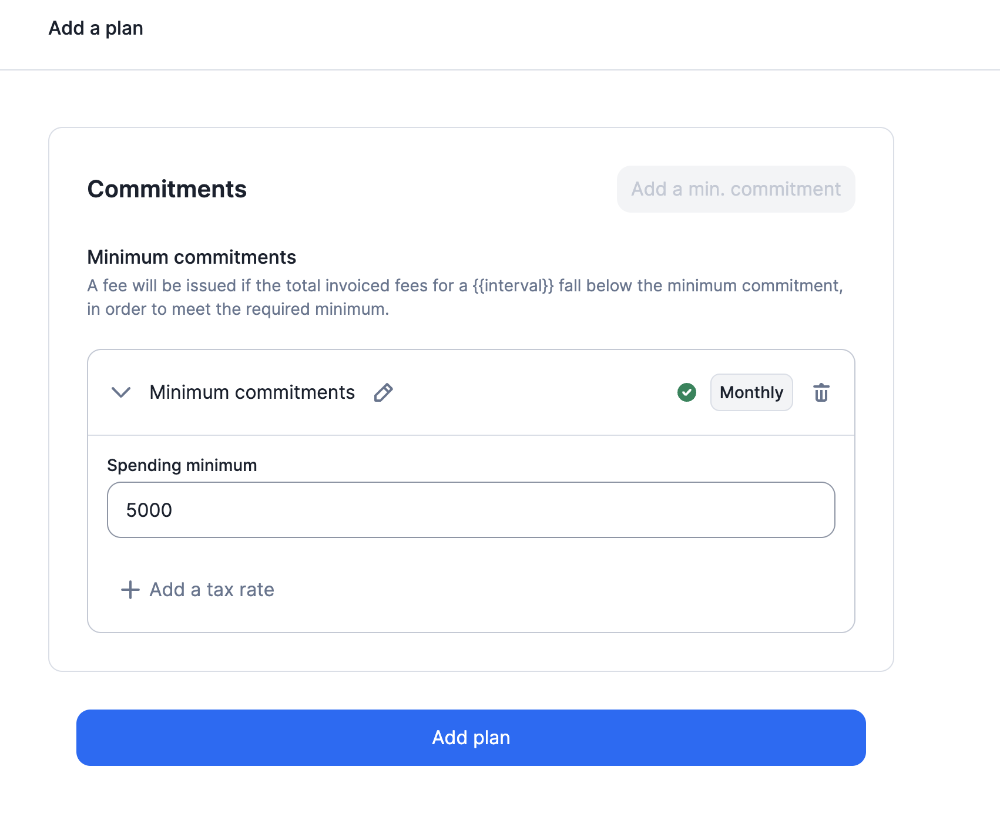
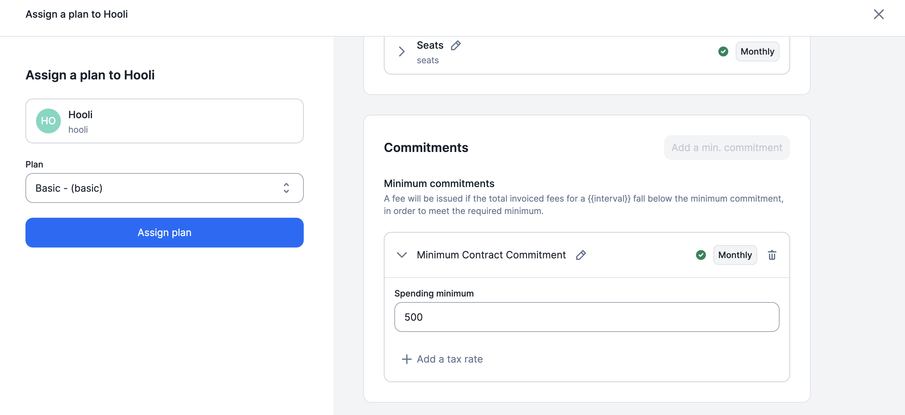

<Info>
**Premium feature ✨**:

This feature is only available to users with a premium license. Please **[contact us](mailto:hello@getlago.com)** to get access to Lago Cloud and Lago Self-Hosted Premium.
</Info>

A plan can define a minimum spending commitment for an enterprise contract. Combine it with negotiated usage rates, and [override the plan for each customer](/guide/subscriptions/assign-plan#overriding-a-plan). These workflows are available with managed [Lago Cloud](/guide/lago-cloud) and Lago Self-Hosted Premium.

Use a minimum commitment when the customer agrees to spend at least an amount over a billing period. Use [prepaid credits](/guide/wallet-and-prepaid-credits/overview) when the customer buys a balance up front to pay future invoices. Both can be part of a negotiated offer; they represent different billing rules.

## Minimum commitment

### Guidelines
Besides [spending minimums per charge](/guide/plans/charges/spending-minimum),
you can define minimum invoice totals. A minimum commitment makes a customer
meet a minimum spend per billing period. It applies to the total spending in the
billing period, including, if applicable, the subscription fee and all
usage-based fees.

- **Commitment interval:** The minimum commitment is aligned with the billing interval of the plan. For instance, if the plan is billed monthly, the minimum commitment is also established on a monthly basis;
- **Customizable commitments:** When assigning a plan to a customer, you have the option to override the default commitment. This allows for customized minimum commitments per customer, accommodating negotiated contract terms; and
- **Arrears calculation:** The commitment is calculated in arrears, meaning Lago waits until the end of the billing period to assess whether users have met their minimum spending commitment. This approach ensures accurate billing based on actual usage.

### True-up fee
If the total spending falls below the minimum commitment at the end of the billing period, Lago will **apply a true-up fee to adjust the invoice and meet the minimum spending requirement**. 
Conversely, if spending exceeds the minimum commitment, Lago will generate an invoice for the actual consumption, without issuing a true-up fee.

<Info>
  The minimum commitment is calculated based on the pre-tax amount and before any discounts (such as coupons or credits) are applied.
</Info>

### Annual commitment with monthly usage invoices

Set the [plan interval](/guide/plans/plan-model#plan-interval) to `yearly` and enable monthly billing for usage-based charges (`bill_charges_monthly: true`). The minimum commitment follows the yearly plan interval. Lago invoices usage each month and assesses the annual shortfall at the end of the commitment period.

For example, a customer starts on January 1 with a **\$120,000 annual minimum commitment**, no subscription fee, and usage billed monthly in arrears. Assume a full calendar year with no plan changes, taxes, discounts, or credits, and \$8,000 of billable usage each month:

| Billing step | Amount |
| --- | ---: |
| January through November usage invoices | 11 × \$8,000 = \$88,000 |
| December usage | \$8,000 |
| Annual usage total | \$96,000 |
| Year-end true-up | \$120,000 − \$96,000 = \$24,000 |
| Invoice closing the year | \$8,000 usage + \$24,000 true-up = \$32,000 |
| Total billed for the year | \$120,000 |

If annual spending reaches or exceeds the commitment, Lago bills the actual spending without adding a true-up. A \$120,000 annual minimum allows usage to vary across the year; twelve \$10,000 monthly minimums assess a separate shortfall each month.

For customer-specific changes, see [edit a subscription](/guide/subscriptions/edit-subscription). Finance can reconcile [past usage](/guide/events/retrieve-usage), the invoice's usage lines, and its true-up fee, then [export invoices](/guide/invoicing/export) or sync them to [NetSuite](/integrations/accounting/netsuite).

### Defining a minimum commitment
<Tabs>
  <Tab title="Dashboard">
    To create or update a minimum commitment from the user interface:

      1. Open an existing plan, or create a new one;
      2. Navigate below usage based charges;
      3. Define a **minimum commitment**; and
      4. Click **"Add plan"** to confirm.

  <Frame caption="Define a minimum commitment">
    
  </Frame>

    <Info>
      The minimum commitment must follow the plan's interval. You can add a specific tax rate for this minimum commitment.
    </Info>

  </Tab>
  <Tab title="API">
    <CodeGroup>
    ```json Define a minimum commitment {16-22}
    {
        "plan": {
          "name": "Basic",
          "invoice_display_name": null,
          "created_at": "2024-02-23T16:01:04Z",
          "code": "basic",
          "interval": "monthly",
          "description": "",           
          "amount_cents": 10000,
          "pay_in_advance": true,
          "bill_charges_monthly": null,
          "customers_count": 2,
          "active_subscriptions_count": 2,
          "draft_invoices_count": 0,
          "parent_id": null,
          "minimum_commitment": {
            "plan_code": "basic",
            "invoice_display_name": "Minimum Contract Commitment",
            "amount_cents": 50000,
            "interval": "monthly",
            "taxes": []
            },
          "charges": [
              {
                "id": "ca205886-cf09-4e42-aed6-34cb2afd0c29",
                "billable_metric_id": "5b320600-715b-4ef5-88c1-4f88c0ec5c50",
                "invoice_display_name": "",
                "billable_metric_code": "storage",
                "created_at": "2024-02-23T16:01:04Z",
                "charge_model": "standard",
                "invoiceable": true,
                "pay_in_advance": false,
                "prorated": false,
                "properties": {
                    "amount": "1"
                },
                "filters": [],
                "taxes": []
              },
              {
                "id": "1d5c78c6-0e22-424f-af8d-6784f6ff44ec",
                "billable_metric_id": "4cbc5940-32fb-48a8-aa39-ad664b34a062",
                "invoice_display_name": null,
                "billable_metric_code": "seats",
                "created_at": "2024-02-23T16:04:09Z",
                "charge_model": "standard",
                "invoiceable": true,
                "pay_in_advance": true,
                "prorated": false,
                "min_amount_cents": 0,
                "properties": {
                    "amount": "7"
                },
                "filters": [],
                "taxes": []
              }
            ],
          "taxes": []
        }
    }
    ```
    </CodeGroup>
  </Tab>
</Tabs>

### Overwriting a minimum commitment
<Tabs>
  <Tab title="Dashboard">
  To overwrite the minimum commitment for a specific customer, follow these instructions:

  1. Access a specific customer;
  2. Choose to assign a new plan or edit an existing subscription; and
  3. Override the default plan's minimum commitment with a new value.

  <Frame caption="Overwriting a minimum commitment">
    
  </Frame>

  </Tab>
  <Tab title="API">
    <CodeGroup>
    ```json Overwrite a minimum commitment
        {
        "subscription": {
          "external_customer_id": "5eb02857-a71e-4ea2-bcf9-57d3a41bc6ba",
          "plan_code": "premium",
          "name": "Repository A",
          "external_id": "my_sub_1234567890",
          "billing_time": "anniversary",
          "subscription_at": "2022-08-08T00:00:00Z",
          "plan_overrides": {
            "amount_cents": 10000,
            "amount_currency": "USD",
            "description": "Plan for early stage startups.",
            "invoice_display_name": "Startup plan",
            "name": "Startup",
            "tax_codes": [],
            "minimum_commitment": {
              "plan_code": "basic",
              "invoice_display_name": "Minimum Contract Commitment",
              "amount_cents": 50000,
              "interval": "monthly",
              "taxes": []
            },
            "charges": []
          }
        }
  }
    ```
    </CodeGroup>
  </Tab>
</Tabs>
