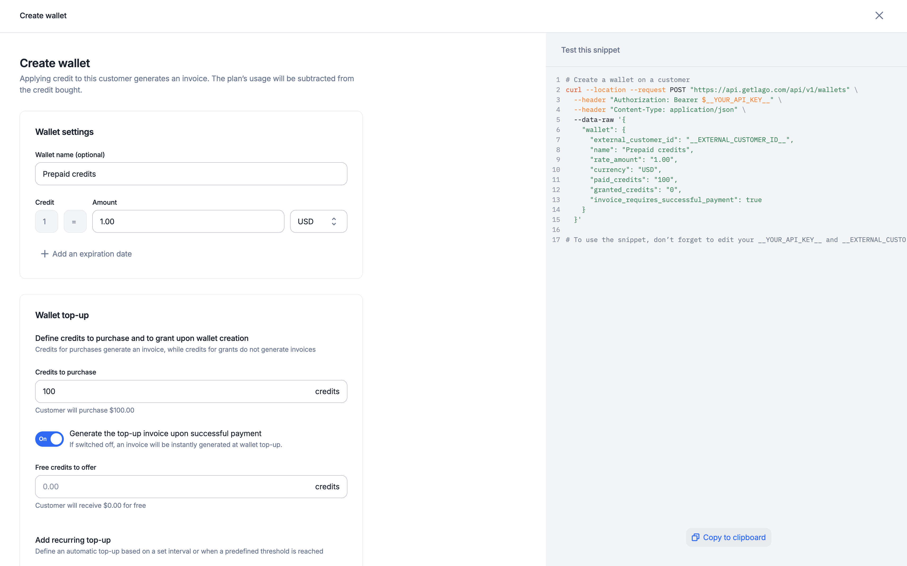
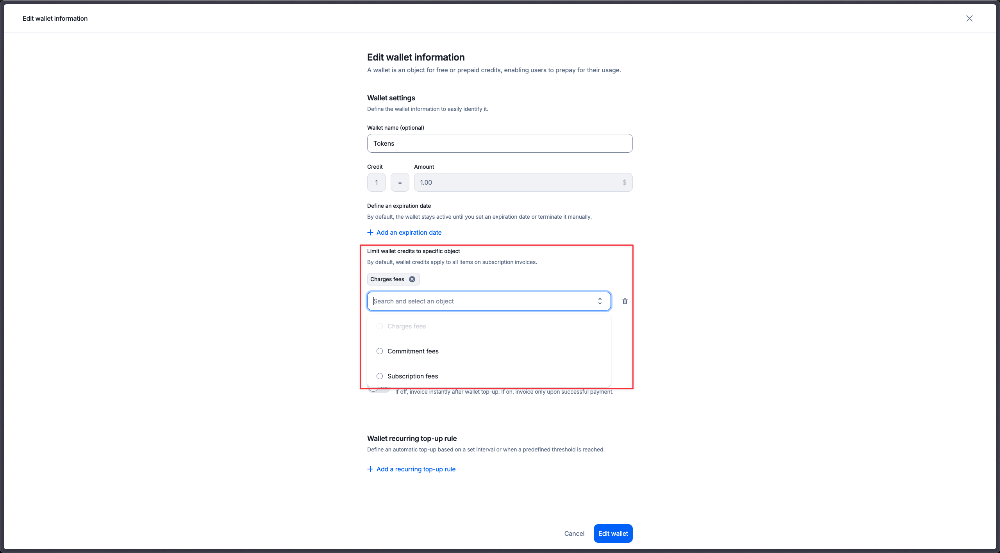
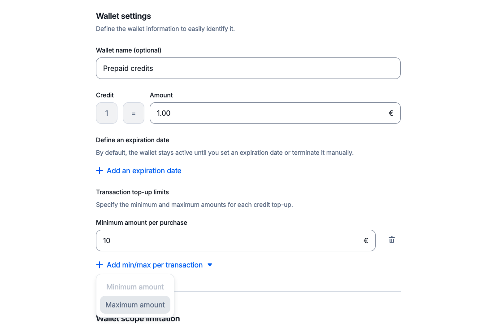
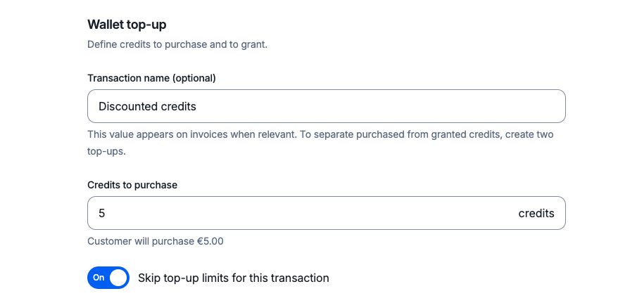

Lago wallets let you collect payment up front, track the remaining credit balance as customers use your product, and apply credits to invoices. Use [Lago Cloud](/guide/lago-cloud) to run this workflow as a managed service, or choose a self-hosted deployment.

For a customer-facing spend view, use the [ongoing balance](#real-time-wallet-balance). It typically refreshes in under a second after a new event is included in usage. Connect [credits consumption alerts](/guide/alerts/credits-consumption-alerts) and [recurring top-ups](/guide/wallet-and-prepaid-credits/wallet-top-up-and-void#setup-recurring-top-ups), and use [wallet traceability](/guide/wallet-and-prepaid-credits/traceability) to reconcile the credits applied to invoices.

## Create wallets
You can create up to 6 active wallets per customer, each with its own settings. A wallet can be scoped to specific fees or billable metrics, include usage limitations, and define its own recurring top-up rules.

When a subscription or progressive billing invoice is generated, Lago automatically applies available wallet credits to reduce the invoice total.

Wallet priority controls the order in which wallets are applied, from 1 to 50, where 1 is applied first and 50 last.

When several wallets share the same priority, the wallet that expires soonest is applied first, and wallets without an [expiration date](#expiration-date-and-termination) are applied after those with one. Wallets with the same priority and expiration date are applied in creation order, oldest first.

<Tabs>
  <Tab title="Dashboard">
    To create a wallet for one of your customers through the user interface:

    1. Access the **"Customers"** section via the side menu;
    2. Select a customer from the list;
    3. Open the **"Wallets"** tab and click **"Add wallet & credits"** on the right;
    4. Choose a name for the wallet (optional);
    5. Set the credit value (e.g. 1 credit = $5);
    6. Define the wallet priority;
    7. Enter the number of credits to be purchased and/or granted for free;
    8. Determine whether the wallet transaction generates an invoice after a top-up or only following a successful payment;
    9. Define a PO number to be used on invoices generated from this wallet;
    10. Set the [expiration date](#expiration-date-and-termination) (optional); and
    11. Click **"Add wallet & credits"** to confirm.

    <Info>
      The currency of the wallet can differ from the default currency of the customer.
      Prepaid credits only apply to invoices sharing the same currency as the wallet.
    </Info>

  </Tab>
  <Tab title="API">
    ```bash Create a credit wallet
    LAGO_URL="https://api.getlago.com"
    API_KEY="__YOUR_API_KEY__"

    curl --location --request POST "$LAGO_URL/api/v1/wallets" \
      --header "Authorization: Bearer $API_KEY" \
      --header 'Content-Type: application/json' \
      --data-raw '{
        "wallet": {
          "external_customer_id": "hooli_1234",
          "name": "Prepaid credits",
          "rate_amount": "1.0",
          "paid_credits": "100.0",
          "granted_credits": "50.0",
          "currency": "USD",
          "expiration_at": "2022-07-07T23:59:59Z",
          "invoice_requires_successful_payment": false,
          "transaction_metadata": [
            {
              "key": "top-up-type",
              "value": "manual"
            }
          ]
        }
      }'
    ```

  </Tab>
</Tabs>



Free credits are added to the customer's wallet instantly, while purchased credits are added to the wallet when payment is confirmed (see below).

## Payment terms

A wallet's payment terms determine when invoices for its purchased credits are due. They apply to credit purchases, including manual and recurring top-ups. They do not set the payment terms of subscription invoices that use those credits.

When creating or editing the wallet, open **Invoicing settings**. Keep the inherited customer term, or choose a payment-term type and its days or month settings, then save. If the customer has no term of their own, the billing entity's default applies. To return to the default later, choose inheritance.

For example, your customer uses **Net 30** for subscriptions, but you set their wallet to **Due on receipt**. A top-up invoice dated **April 10, 2026** is due **April 10**; a subscription invoice dated the same day is due **May 10**.

See [Payment terms](/guide/invoicing/invoicing-settings/payment-term#choose-a-payment-term) for all six options and examples. Changes apply to future invoices; existing invoices retain their stored term. From the API, send `payment_term` when you [create](/api-reference/wallets/create) or [update](/api-reference/wallets/update) the wallet.

<Info>
  Giving a customer more time to pay does not make purchased credits available before payment. For example, a Net 15 top-up invoice dated April 10 is due April 25, but the credits are added only when payment is confirmed. The [invoicing after successful payment option](#invoicing-after-successful-payment-option) separately controls when the invoice is issued.
</Info>

## Real-time wallet balance

<Info>

**PREMIUM FEATURE** ✨

This feature is only available to users with a premium license. Please
**[contact us](mailto:hello@getlago.com)** to get access to Lago Cloud and Lago
Self-Hosted Premium.

</Info>

Lago provides two balances for different parts of the prepaid workflow:

1. **Balance:** the invoiced balance, which reflects the prepaid credits left in the wallet. It updates each time an invoice is finalized for the customer.
2. **Ongoing balance:** the balance that accounts for current usage, including taxes and draft invoices. It typically refreshes in **under a second after a new event is included in usage**, and also updates when an invoice is finalized.

The [event processing pipeline](https://getlago.com/platform/usage-metering/ingestion) waits for usage to include the triggering event before refreshing the wallet. The sub-second figure describes typical wallet refresh, not a guaranteed end-to-end ingestion or webhook delivery time.

For example, a wallet with a \$100 invoiced balance and \$12 of current usage, taxes included, has an \$88 ongoing balance. With no further usage or adjustments, finalizing the \$12 invoice reduces the invoiced balance to \$88. The ongoing balance lets you show that spend before invoicing.

Read these values with the [retrieve a wallet API](/api-reference/wallets/get-specific). Use [ongoing-balance alerts](/guide/alerts/credits-consumption-alerts#alert-types) for low-balance notifications and your application's access controls to decide whether to accept another request.

### How the ongoing balance updates

Each usage event triggers a refresh of the customer's wallets. Lago groups these triggers, so a burst of events produces one refresh per customer.

Before refreshing, Lago waits until the usage that caused the trigger is readable. It checks every 100 ms, for up to 5 seconds. It then computes current usage, allocates it across the customer's wallets in priority order, and writes the ongoing balance. [Credits consumption alerts](/guide/alerts/credits-consumption-alerts) and threshold top-ups are evaluated on the same refresh.

In Lago's production tests, the ongoing balance reflected an event about 1.2 seconds after it was sent (p50). See [Production benchmarks](/guide/events/usage-performances#production-benchmarks) for the figures and how they were measured.

This applies to usage from [charges served from pre-aggregated usage](/guide/events/retrieve-usage#charges-served-from-pre-aggregated-usage). Usage from other charges reaches the ongoing balance on the periodic wallet refresh.

### If the refresh is delayed

If the usage is not readable within 5 seconds, the customer stays flagged and the periodic wallet refresh updates the ongoing balance. No usage is lost. The balance is correct, later.

### What the ongoing balance is not

The ongoing balance is not a spending cap. Two concurrent requests can read the same balance and both proceed, and the ongoing balance can go below zero. To enforce a hard limit, authorize the work in your application before it starts.

## Application scope

Prepaid credits settled in a wallet are applied to upcoming **subscription invoices**. They are deducted from the post-tax subtotal, after any credit notes have been applied.

```
## EXAMPLE OF INVOICE

All subscriptions fee    $50.00
All usage-based fees     $20.00
Coupons                 -$10.00
-------------------------------
Subtotal (excl. tax)     $60.00
Tax (10%)                $ 6.00
-------------------------------
Subtotal (incl. tax)     $66.00
Credit notes            -$20.00
Prepaid credits         -$30.00
-------------------------------
Total                    $16.00
```

<Info>Prepaid credits do not apply to one-off invoices.</Info>

By default, prepaid credits apply to every fee type. You can refine this behavior by configuring limitation rules directly in the wallet. The [create a wallet](/api-reference/wallets/create) endpoint lists the fee types a wallet can be restricted to.

<Tabs>
  <Tab title="Dashboard">
    To limit the scope of prepaid credits through the user interface:
    1. Create or edit an existing wallet;
    2. In the **"Limit wallet credits to specific objects"** section, add one or more object limitations; and
    3. Limit the prepaid credits to specific billable metrics, if you need to.

    <Info>Selecting every item has the same effect as selecting none. Leave the options unselected unless you need a restriction.</Info>

    <Frame caption="Limit wallet prepaid credits to specific objects">
      
    </Frame>
  </Tab>
  <Tab title="API">
    ```bash Scope wallet to specific fee
    LAGO_URL="https://api.getlago.com"
    API_KEY="__YOUR_API_KEY__"

    curl --location --request POST "$LAGO_URL/api/v1/wallets" \
      --header "Authorization: Bearer $API_KEY" \
      --header "Content-Type: application/json" \
      --data-raw '{
        "wallet": {
          "external_customer_id": "hooli_1234",
          "name": "Prepaid credits",
          "rate_amount": 1.0,
          "paid_credits": 100.0,
          "granted_credits": 50.0,
          "currency": "USD",
          "applies_to": {
            "fee_types": ["charge", "commitment", "subscription"]
          }
        }
      }'
    ```

  </Tab>
</Tabs>


## Invoicing after successful payment option

When enabled, this option delays issuing an invoice for a wallet top-up until a successful payment is made. If disabled, the invoice is issued immediately upon the wallet top-up, whatever the payment status. This setting applies to all the transactions of the wallet, and you can override it on individual transactions or on recurring rules.

With this option enabled, the invoice is issued on the day the payment succeeds and is due that same day, whatever the wallet's payment term.

## Wallet transaction limits
<Tabs>
  <Tab title="Dashboard">
    For each wallet, you can set minimum and maximum limits per paid transaction.
    When these limits are defined, any top-up attempt must fall within the specified range. Transactions below the minimum or above the maximum are rejected.

    <Frame caption="Wallet transaction limits">
      
    </Frame>

  </Tab>
  <Tab title="API">
    ```bash Add wallet min and max limits
    LAGO_URL="https://api.getlago.com"
    API_KEY="__YOUR_API_KEY__"

    curl --location --request POST "$LAGO_URL/api/v1/wallets" \
      --header "Authorization: Bearer $API_KEY" \
      --header "Content-Type: application/json" \
      --data-raw '{
        "wallet": {
          "external_customer_id": "hooli_1234",
          "name": "Prepaid credits",
          "rate_amount": 1.0,
          "paid_top_up_min_amount_cents": 1000,
          "paid_top_up_max_amount_cents": 100000
        }
      }'
    ```
  </Tab>
</Tabs>

You can ignore these limits on a top-up by adding the `ignore_paid_top_up_limits` flag to the payload, or by enabling **"Skip top-up limits for this transaction"** in the dashboard. It works on single top-ups and on automatic ones (recurring wallet transactions).

<Frame caption="Skip wallet limits for a single transaction">
  
</Frame>

## Expiration date and termination

If you don't set an expiration date, prepaid credits are carried over to the next billing period until the wallet balance is zero.

If you define an expiration date, all the remaining credits are **automatically voided** when that date is reached.

To modify the expiration date of the prepaid credits through the user interface:

1. Open the **"Wallets"** tab and click **"Edit wallet"** on the right;
2. Select **"Edit information"**;
3. Modify the expiration date; and
4. Click **"Edit information"** to confirm.

The expiration date displayed in the app is based on the organization's timezone.

You can also terminate a wallet manually, before its expiration date:

1. Open the **"Wallets"** tab and click **"Edit wallet"** on the right;
2. Select **"Terminate wallet"**; and
3. Click again to confirm.

<Warning>
  Terminating a wallet instantly voids all the remaining credits. This action
  **cannot be undone**.
</Warning>
