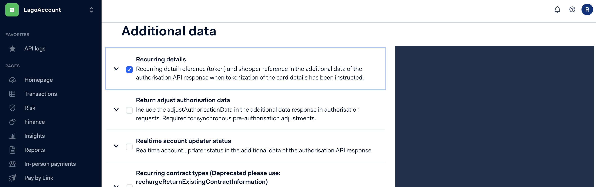
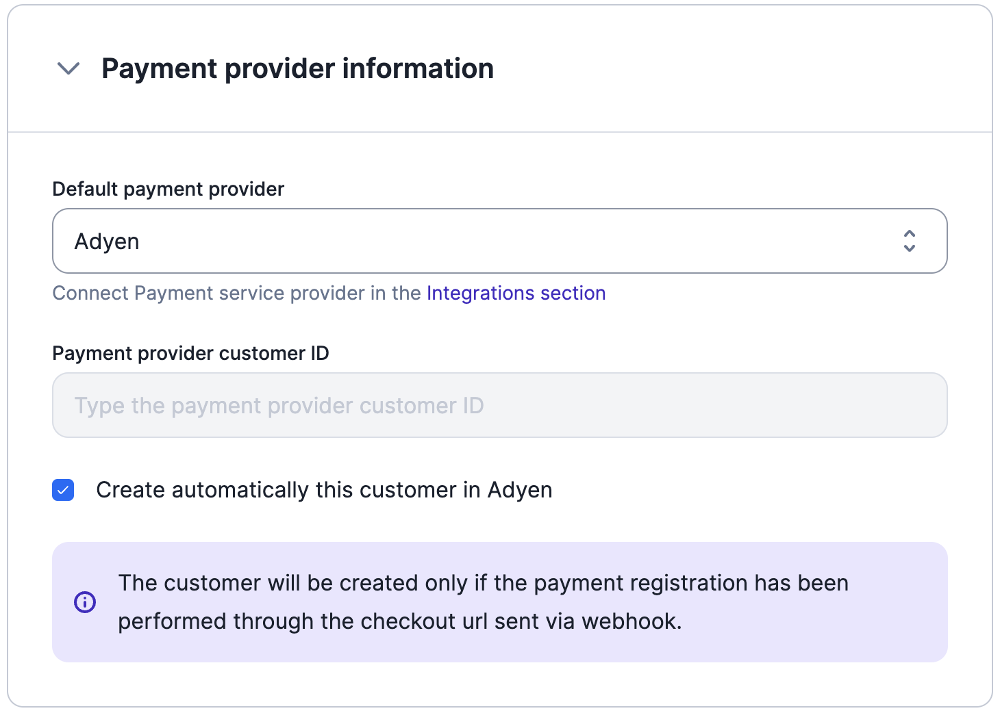
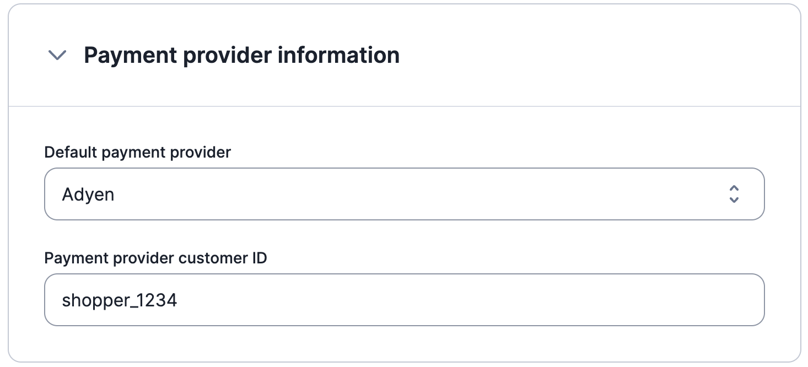
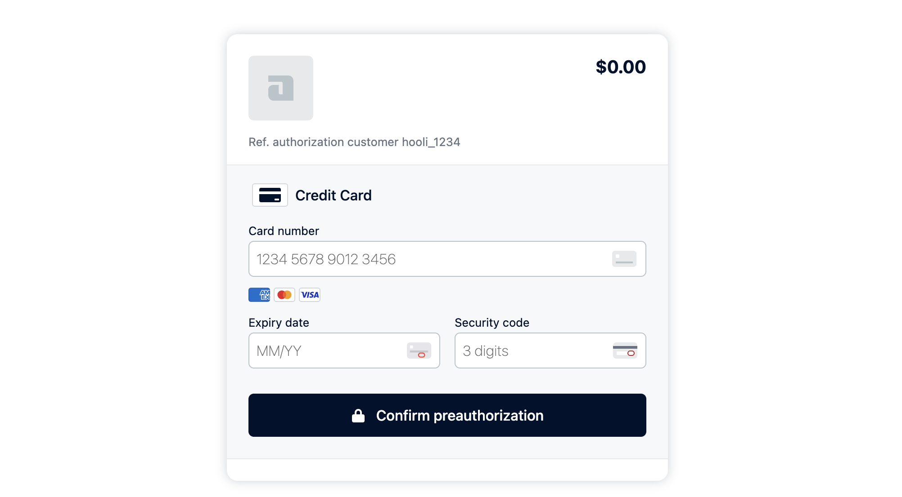

Lago's native integration with Adyen supports a wide range of payment options. Supported payment methods include:

- Card payments (Visa, Mastercard, CB)
- Apple Pay
- PayPal
- American Express
- Amazon Pay
- Google Pay

Adyen supports more methods than this list. Check the [Adyen payment methods](https://docs.adyen.com/payment-methods/) for the full list.

<Warning>
Please ensure that you have added payment methods to your Adyen account before setting up the integration ([see Adyen documentation](https://docs.adyen.com/payment-methods/add-payment-methods/)).
</Warning>

## Connecting Lago to Adyen
To set up the Adyen integration in Lago from our user interface, follow these steps:

1. In the side menu of your Lago app, navigate to **Settings**;
2. Select the **Integrations** tab;
3. Click **"Adyen"** to create a connection;
4. Give a name to this connection;
5. Assign a code for easy identification;
6. Enter the required connection fields (described in the next section); and
7. Click **Connect to Adyen** to confirm the integration.

## Adyen connection fields
When connecting Lago to Adyen, you need to provide information for the following fields.

<AccordionGroup>
  <Accordion title="1. API Key (mandatory)">
    The API Key is a mandatory field and can be found in your Adyen account. Follow these steps to retrieve the API Key:

    - Go to your Adyen account and navigate to **Developers** > **API Credentials**;
    - On the API Credentials page, create new credentials with a type of **Web service user**;
    - Click on the **Create credentials** button to generate the API Key; and
    - Copy the API Key and paste it in the corresponding field in Lago. Remember to save the changes.
  </Accordion>
  <Accordion title="2. Merchant Account (mandatory)">
    The Merchant Account is required to ensure that Lago targets the correct Adyen account. To find the Merchant Account:

    - Go to **Settings** > **Merchant accounts** in your Adyen account; and
    - Copy the **Account code** of the targeted account you want to use with Lago.
  </Accordion>
  <Accordion title="3. Live Prefix (optional)">
    The Live Prefix represents the prefix url of your live Adyen account. This field is optional. If left empty, you can connect a test account. However, for live accounts, you must provide a Live Prefix. Follow these steps to obtain the Live Prefix:

    - Go to **Developers** > **API URLs** > **Prefix** in your Adyen account.
  </Accordion>
  <Accordion title="4. HMAC Signature (optional)">
    Adyen's HMAC signatures are used to protect webhook endpoints and messages created by Adyen. Lago requires this signature to properly decrypt outgoing webhooks from Adyen. To find the HMAC Signature:

    - Create or edit a webhook in Adyen by accessing **Developers** > **Webhooks**;
    - Choose a webhook, e.g. Standard webhook; and
    - Under "Security" settings, you can find the HMAC Key.

    <Tip>
    The Live Prefix and HMAC Signature fields are optional and may not be required depending on your use case.
    </Tip>
  </Accordion>
</AccordionGroup>

## Setting up Adyen's payments auto-capture
To enable automatic payment capture in your Adyen account, ensure that you have configured the account settings accordingly. Automatic payment capture allows for immediate processing without manual intervention. Refer to Adyen's documentation for instructions on [setting up auto capture](https://docs.adyen.com/online-payments/capture#automatic-capture).

## Turn on Adyen's recurring details
In Adyen, to enable recurring payments for a stored payment method, follow these steps:
1. Go to Developers > Additional Data;
2. Check the box for Recurring Details; and
3. Click Save.

<Frame caption="Adyen recurring details option">
  
</Frame>

## Setting up the Adyen webhook for important events
**This step is crucial and mandatory** for Lago to receive and process messages from Adyen, enabling functionalities such as customer creation/update, payment processing, and refunds. To configure Adyen webhook and establish communication with Lago, follow the steps below:

1. Access your Adyen application and navigate to the **Developers** section;
2. Select **Webhooks** and create a new webhook of type **Standard**;
3. In the **Server configuration** section, locate the **General** settings; and
4. Copy and paste the following URL: **`https://api.getlago.com/webhooks/adyen/{{your_organization_id}}?code={{connection_code}}`**.

<Tip>
You can find your Organization ID in Lago under the Developers section in Lago, specifically in **API keys & ID** > **Organization ID**.
</Tip>
<Tip>
To find your **connection code**, navigate to the Integrations section in Lago and select the appropriate connection code for your Adyen integration.
</Tip>

**Please ensure that you complete this setup correctly, as your Adyen integration will not function without this vital step.**

## Setting Adyen as a payment provider for a customer
To collect payments automatically, the customer must exist in both the Lago and Adyen databases. In Adyen, customers are called **Shoppers**.

### Adding a new customer in Adyen

If the customer does not already exist in Adyen, you can create them in Lago using either the user interface or the **[API](/api-reference/customers/create)**. When providing customer information, please ensure the following:

1. Set Adyen as the customer's **default payment provider**;
2. Select the Adyen connected account;
3. Keep the field associated with the **Adyen Payment Provider Customer ID** empty; and
4. **Enable** the option to automatically create the customer in Adyen.

<Frame caption="Adyen as PSP for new customer">
  
</Frame>

Once the customer is added in Lago, they are automatically synchronized with Adyen. Adyen generates a unique Shopper ID, which is stored in Lago. Adyen uses the Lago customer's **`external_id`** as the Shopper ID.

Upon successful customer creation, you will receive two **[webhook messages](/api-reference/webhooks/messages)** to keep you informed:

1. **`customer.checkout_url_generated`**: This message includes the checkout URL that provides access to the default payment method. It allows you to perform a pre-authorization payment and store the payment method securely; and
2. **`customer.payment_provider_created`**: This message confirms the successful creation of the customer in Adyen, indicating that the customer's details have been added to the Adyen database.

<Warning>
You may need to enable Developers -> Additional Data -> Payment -> Recurring details for the customer to be automatically created.
</Warning>

<Warning>
Please note that the customer will be created in Adyen only if the payment method has been stored through the checkout URL and pre-authorization payment.
</Warning>

### Using an existing customer from Adyen
If the customer and direct debit mandate already exist in Adyen, you can create the customer record in Lago using either the user interface or **[the API](/api-reference/customers/create)**. Follow these steps when adding customer information:

1. Set Adyen as the **default payment provider** for the customer in Lago;
2. Select the Adyen connected account;
3. Provide the **Adyen [Shopper Reference](https://docs.adyen.com/point-of-sale/card-acquisition/identifiers#:~:text=Shopper%20reference%3A%20a,contract%20payments.)** as the Lago **Payment provider customer ID**.
4. **Disable** the option to automatically create the customer in Adyen.

<Frame caption="Adyen as PSP for existing customer">
  
</Frame>

## Redirect URL after checkout
After you connect Adyen, set a success URL where your end customer lands after completing the checkout.
If you do not define one, your end customer is redirected to Adyen's website.

You can edit or delete the redirect URL. The change only applies to checkout URLs created afterwards.

<Warning>
  URL defined should always begin with `http://` or `https://`.
</Warning>

## Adyen Checkout: storing customer's payment method information
When Lago automatically creates a customer in Adyen, Lago returns a checkout link that your customer uses to store their payment method information.

The payload sent by Lago will have the following structure, with the checkout link stored under **`checkout_url`**:

```json
{
  "webhook_type": "customer.checkout_url_generated",
  "object_type": "payment_provider_customer_checkout_url",
  "payment_provider_customer_checkout_url": {
    "lago_customer_id": "88d23508-47fd-46bb-a87e-50c50f3cb371",
    "external_customer_id": "hooli_1234",
    "payment_provider": "adyen",
    "payment_provider_code": "adyen_test",
    "checkout_url": "https://test.adyen.link/PLEEA656869B11DF6B"
  }
}
```

<Info>
Note: The checkout link automatically expires after 69 days.
</Info>

With this checkout link, your customers can perform a pre-authorization payment. The pre-authorization does not collect any funds from the customer. Once it is confirmed, Lago sends the payment method details to Adyen, which stores them for future transactions.

<Frame caption="Adyen checkout with Lago">
  
</Frame>

## Regenerate checkout link on demand
If your end customer has not completed the checkout, or wants to change their saved payment information,
generate a new checkout link with the dedicated [endpoint](/api-reference/customers/psp-checkout-url).

```bash
POST /api/v1/customers/:customer_external_id/checkout_url
```

The new checkout link is returned in the endpoint response, not through a webhook message.
It inherits the same expiration setting as the original one.

If the customer is not associated with any payment provider, the response contains an error message.


## Creating payments from Lago invoices
When a customer has Adyen defined as their payment provider, Lago triggers a payment in Adyen each time a new invoice is generated. No manual action is needed.

## Creating refunds from Lago credit notes
When a customer has Adyen defined as their payment provider, Lago triggers a refund in Adyen each time a refund is initiated through a credit note. No manual action is needed.

## Payment disputes
When a chargeback (dispute) is **lost** in Adyen, Lago marks the relevant invoice as disputed lost. It fills the `dispute_lost_at` field with the timestamp of the lost dispute. After that update:

- The invoice becomes non-voidable;
- Generating a credit note is possible; however, refunding the payment back to the original payment method is not permitted; and
- The invoice cannot be resent for collection.

## Watch the demo video
<iframe width="100%" height="400" src="https://www.youtube.com/embed/Zh7NNbgS7Bo" title="YouTube video player" frameborder="0" allow="accelerometer; autoplay; clipboard-write; encrypted-media; gyroscope; picture-in-picture; web-share" allowfullscreen></iframe>
