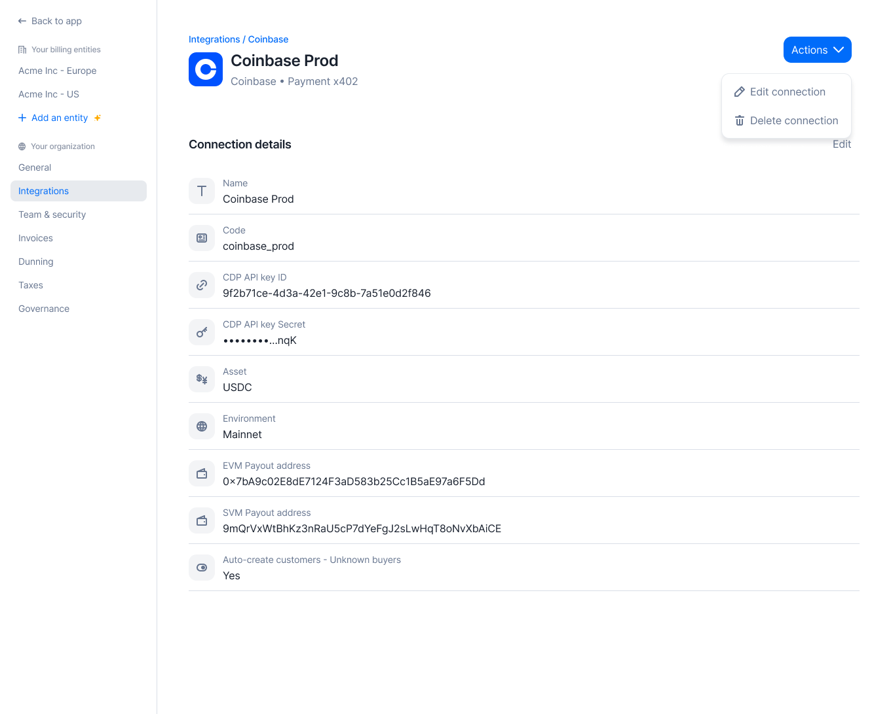

## Overview

[x402](https://www.x402.org) is an open protocol that uses the HTTP `402 Payment Required` status to ask a client for a payment. The client signs a USDC transfer authorization, retries the request with it, and a facilitator settles it on chain. No signup, no card, no checkout page. That is why agents use it.

Lago connects to the [Coinbase Developer Platform](https://docs.cdp.coinbase.com/x402/welcome) (CDP) facilitator and handles the billing side of each payment:

- **Credit purchases.** An agent tops up a prepaid wallet in USDC, then spends the credits call by call. This is the main flow, driven by the [`lago-x402` middleware](/guide/ai-agents/x402) in front of your API.
- **Invoice payments.** A finalized invoice gets an x402 payment URL. The buyer pays the amount due by signing against it, with no payment method on file.

Lago prices and records. The facilitator verifies and settles. USDC moves straight from the buyer's address to your payout address. Lago never holds funds, your payout keys or the buyer's keys.

<Info>
**Premium feature, on request.** x402 payments need a premium license and the `x402_payments` feature flag on your organization. [Contact us](mailto:hello@getlago.com) to enable it.
</Info>

### Why it is not a regular payment provider

Every other [payment provider](/guide/payments/payment-providers) in Lago is **pull-based**: Lago stores a payment method and charges it when an invoice is due. x402 is **push-based**. Nothing can collect from an agent address without a fresh signature from its key, per payment. So an x402 connection has no stored payment method, no automatic collection, no dunning and no payment retries. The buyer pays because it signed. Lago records the result.

## Prerequisites

- **Premium license** with the `x402_payments` feature flag.
- **Events targeting wallets**, the premium integration that lets a usage event name the wallet it draws from. x402 gates read one wallet, so the usage must drain that same wallet. Without it, gate checks answer `charge_not_targeted`.
- **Wallet balance refresh.** Gate checks read a wallet's ongoing balance. On self-hosted Lago this needs a Redis cache (`LAGO_REDIS_CACHE_URL`) and `LAGO_DISABLE_WALLET_REFRESH` left unset. Memcached does not run the refresh.
- **A CDP project** with a [Secret API key](https://docs.cdp.coinbase.com/get-started/authentication/cdp-api-keys) and payout accounts created in that project (CDP Server Wallet accounts).

## Connect Coinbase

In the app, go to **Settings > Integrations > Coinbase** and click **Add a connection**. You can also use `POST /api/v1/x402_connections`.

| Field | Required | What it does |
|---|---|---|
| **Connection name** | Yes | Display name in the app. |
| **Connection code** | Yes | Unique per organization. The middleware and the invoice payment URL reference the connection by this code. |
| **CDP API key ID** and **CDP API key secret** | Yes | Credentials of your CDP Secret API key. Write-only: the API never returns them. Lago uses them for every verify and settle call. |
| **Asset** | Yes | `usdc`. The only asset in this version. |
| **Environment** and **Network** | Yes | The networks buyers can pay on. Testnet: Base Sepolia, Solana devnet. Mainnet: Base, Solana. All networks of one connection belong to one environment. |
| **EVM payout address** | If an EVM network is selected | Where USDC paid on Base lands. Must be an EVM account of your CDP project. |
| **SVM payout address** | If a Solana network is selected | Where USDC paid on Solana lands. Must be a Solana account of your CDP project. |
| **Allowed origins** | For the middleware | The public origins of your API, such as `https://api.example.com`. Agents sign in for one origin, and Lago only accepts sign-ins for these. Up to 10. `http://` only for `localhost`, `127.0.0.1` and `[::1]`. |
| **Auto-create customers** | Yes | On: an unknown address that pays becomes a new Lago customer. Off: unknown buyers are refused, known ones keep working. Use it as a kill switch. |

```json
POST /api/v1/x402_connections
{
  "x402_connection": {
    "code": "coinbase_prod",
    "name": "Coinbase Prod",
    "facilitator": "coinbase_cdp",
    "cdp_api_key_id": "<cdp_api_key_id>",
    "cdp_api_key_secret": "<cdp_api_key_secret>",
    "asset": "usdc",
    "networks": ["eip155:8453", "solana:5eykt4UsFv8P8NJdTREpY1vzqKqZKvdp"],
    "payout_addresses": {
      "evm": "0x7bA9c02E8dE7124F3aD583b25Cc1B5aE97a6F5Dd",
      "svm": "9mQrVxWtBhKz3nRaU5cP7dYeFgJ2sLwHqT8oNvXbAiCE"
    },
    "allowed_origins": ["https://api.example.com"],
    "auto_create_customers": true
  }
}
```

<Frame caption="An x402 connection to Coinbase in Settings > Integrations">
  
</Frame>

Networks use [CAIP-2](https://chainagnostic.org/CAIPs/caip-2) identifiers:

| Network | Identifier | Environment |
|---|---|---|
| Base | `eip155:8453` | Mainnet |
| Base Sepolia | `eip155:84532` | Testnet |
| Solana | `solana:5eykt4UsFv8P8NJdTREpY1vzqKqZKvdp` | Mainnet |
| Solana devnet | `solana:EtWTRABZaYq6iMfeYKouRu166VU2xqa1` | Testnet |

### What Lago checks on save

A bad connection fails when you save it, not when an agent tries to pay. On create and update, Lago:

1. Validates the shape: every selected network's family has a payout address, EVM addresses pass the EIP-55 checksum, Solana addresses decode as base58, and all networks belong to one environment.
2. Calls the facilitator with your credentials. A wrong key or secret fails the save, and every selected network must be supported.
3. Looks each payout address up in your CDP project. An address outside the project fails with `not_in_cdp_project` on that family.

### Testnet first

New organizations run on testnet: Base Sepolia and Solana devnet. Lago switches an organization to mainnet on request. A connection whose networks belong to the other environment is refused with `environment_not_enabled`, at save and on every gate check, credit purchase or invoice payment. Test the full flow on testnet with faucet USDC, then ask for mainnet.

<Warning>
**Solana payout accounts need a USDC token account.** The x402 `exact` scheme on Solana does not create the payout account's associated token account. A CDP Solana account that has never held USDC cannot receive a first settlement. Send it any amount of USDC once, or create the associated token account yourself, before you go live.
</Warning>

## Credit purchases

A credit purchase turns one settled USDC payment into prepaid credits. The [`lago-x402` middleware](/guide/ai-agents/x402) drives it from your API. Lago does this on each purchase:

1. **Verifies** the signed payment with the facilitator, and checks it against your connection: network, asset, payout address and amount.
2. **Records a pending settlement**, then **settles** through the facilitator.
3. **Creates what the agent needs**, on its first purchase only: a customer keyed on the paying address, a subscription to the route's plan and the route's wallet.
4. **Grants the credits** on the wallet. They are spendable as soon as the response returns.
5. **Issues the fiscal trail** asynchronously, within seconds: a credit invoice, an x402 payment and a receipt.

From then on the agent is a regular prepaid-credit customer. Usage events draw its wallet down at your plan's price, and its invoices, wallet transactions and payments show in the app, the API and your webhooks like any other customer's.

### Credit math

USDC is booked 1:1 to USD. Credits follow the wallet's rate, as for any [wallet top-up](/guide/wallet-and-prepaid-credits/wallet-top-up-and-void):

```text
amount_cents = floor(settled_usdc_atomic_units / 10,000)
credits      = floor_5dp(amount_cents / 100 / wallet.rate_amount)
```

USDC carries 6 decimals and Lago money columns carry 2, so sub-cent dust is dropped. Credits are floored to 5 decimals, never rounded up.

| Settled | Wallet rate | Credits |
|---|---|---|
| $10.00 | 0.01 | 1,000.00000 |
| $10.00 | 0.001 | 10,000.00000 |
| $10.00 | 0.0007 | 14,285.71428 |

Top-up limits on the wallet apply in part. Lago enforces the **maximum** before it settles, so a payment above it is refused and no money moves. It waives the **minimum**: settling a few cents of USDC costs a fraction of a card fee, which is what minimums exist to absorb.

### Identity

The paying address is the identity: one address, one customer, whichever network of its family it pays on. An agent that pays from an EVM address and a Solana address becomes two customers.

## Invoice payments

Any finalized USD invoice of a customer with an x402-enabled wallet can be paid over x402. Typical case: an agent's usage outran its credits during the period, and the invoice carries the remainder.

### Get the payment URL

```bash
curl -X POST "https://api.getlago.com/api/v1/invoices/<lago_invoice_id>/x402_payment_url" \
  -H "Authorization: Bearer $LAGO_API_KEY" \
  -H "Content-Type: application/json" \
  -d '{ "connection_code": "coinbase_prod" }'
```

```json
{
  "invoice_x402_payment_details": {
    "lago_invoice_id": "1a901a90-1a90-1a90-1a90-1a901a901a90",
    "x402_connection_code": "coinbase_prod",
    "x402_payment_url": "https://api.getlago.com/api/v1/x402/invoice_payments/<token>"
  }
}
```

The call binds the invoice to that connection. The URL carries an unguessable token, which is its only authentication: treat it like a payment link and send it only to the buyer. Calling the endpoint again with the same connection returns the same URL.

The invoice must be finalized, not yet paid, with an amount due above zero, in USD, and its customer must have an active x402-enabled wallet. Otherwise the call answers `422` with the rule that failed.

### How the buyer pays

The payment URL is a standard x402 resource:

1. **The buyer requests it without a payment.** Lago answers `402` with a `PAYMENT-REQUIRED` header: one payment requirement per network of the connection, for the invoice's full amount due.
2. **The buyer signs and posts** the payment in a `PAYMENT-SIGNATURE` header, with `POST`.
3. **Lago verifies, settles and records** it: an x402 payment on the invoice, `payment_status` set to `succeeded`, and the existing invoice and payment webhooks. The answer is `200` with a `PAYMENT-RESPONSE` header carrying the transaction hash.

| Answer | Meaning |
|---|---|
| `402` | Unpaid. The header carries the challenge, plus an `error` when a payment was refused. Nothing moved. |
| `200` | Paid. A buyer that lost the answer and resends the same payment gets the same receipt back. Nothing settles twice. |
| `409 invoice_payment_pending` | A settlement for this invoice is still being confirmed. Wait, then request the URL again. |
| `410` | The invoice is paid or voided. |

The payment must equal the amount due. Partial payments are not supported.

## Reading a payment in Lago

x402 payments show in **Payments** with the method **Coinbase x402**. The detail view adds an **x402 settlement** section: kind (credit purchase or invoice payment), agent address, payout address, network, asset, settled amount, settlement status and the credits granted.

## Pending settlements

A settlement broadcasts a transaction. When the facilitator does not confirm it in time, or the connection drops, Lago cannot tell a failure from a success. It never guesses:

- The settlement stays **pending**, and Lago tells the caller to retry later. The middleware answers the agent `503 payment_pending` with a `Retry-After`.
- A reconciliation job reads the chain once the authorization window has closed, then settles or fails the row for good. Lago reads the chain rather than resending the settle call, because a resend can broadcast a second transaction.
- While a payer or an invoice has a pending settlement, Lago issues no new challenge for it. A second authorization on top of one that may have landed is what would double-charge.

## Refunds

There is no refund endpoint and no on-chain void. A settle is final, and returning funds would require holding your payout keys. Chargebacks don't exist on this rail. To give money back:

1. Issue a [credit note](/guide/invoicing/credit-notes/overview) in Lago. For a credit purchase, void the unused credits on the wallet first. Lago fires the credit-note webhook. It enqueues no refund job for an x402 payment.
2. Send the USDC back to the agent address, from your own treasury. The address is on the payment record.

## Limits

- **USDC only, USD only.** Wallets, plans and invoices paid over x402 must be in USD. Non-USD merchants run a parallel USD wallet and plan for agent traffic.
- **Base and Solana only**, mainnet and testnet. One facilitator: Coinbase CDP.
- **x402 v2 only.** v1 `X-PAYMENT` headers are not accepted.
- **Every payment settles through Lago.** Lago does not record a payment settled by another facilitator or by your own gate.
- **No partial invoice payments.** A payment must equal the amount due.
- **No refunds through Lago.** See [Refunds](#refunds).
- **Terminating an agent's wallet forfeits its balance.** Lago neither moves nor refunds it, and usage already prepaid but not yet invoiced is billed at period close. The next payment creates a fresh wallet with the same code.
- **The Bazaar lists the top-up, not the call price.** See [Bazaar discovery](/guide/ai-agents/x402#bazaar-discovery).
