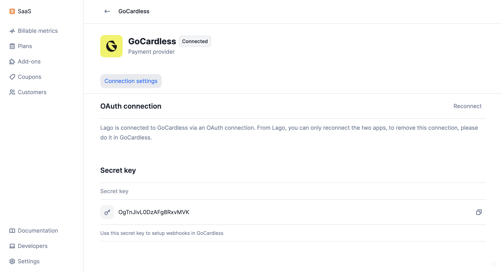
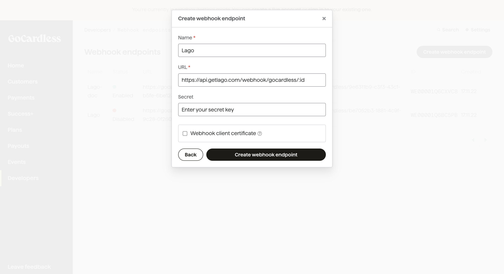
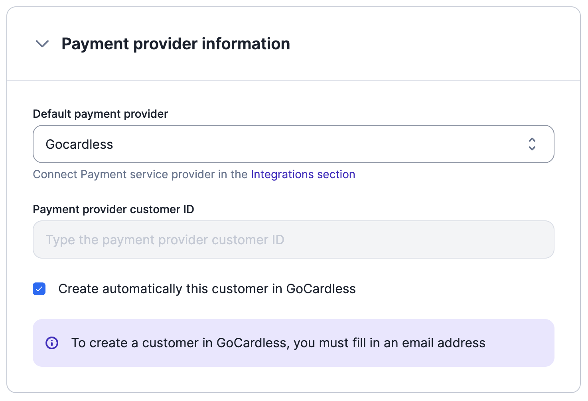
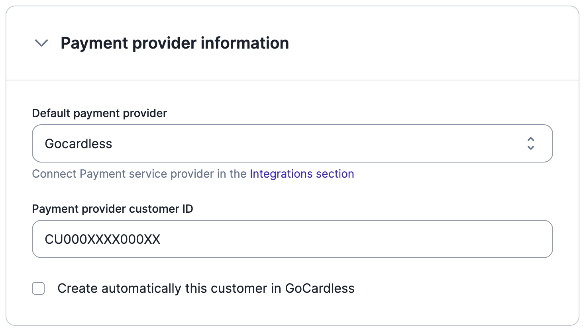
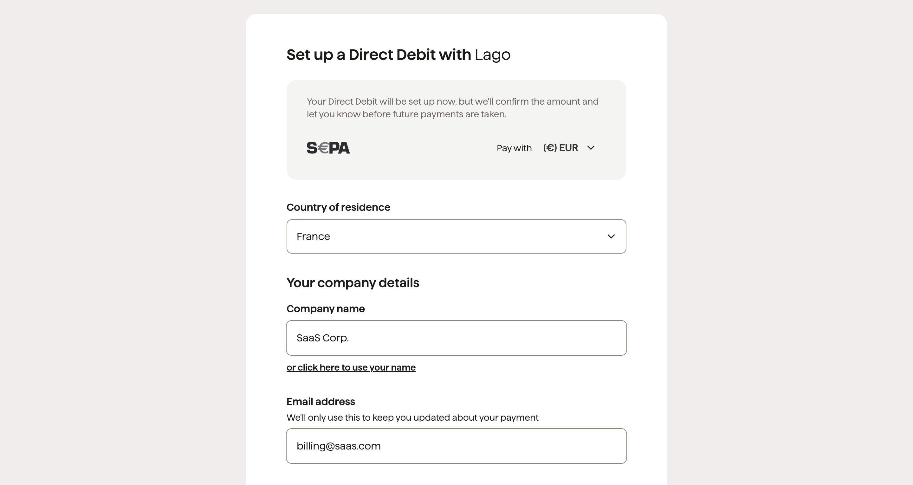

## Integration setup

### Connect your GoCardless account

To connect to GoCardless through the user interface:

1. In the side menu, select **"Settings"**;
2. Open the **"Integrations"** tab;
3. Click **"GoCardless"** to create a connection;
4. Give a name to this connection;
5. Assign a code for easy identification;
6. Click on **"Connect to GoCardless"** to be redirected to the GoCardless application;
7. Create a GoCardless account or log in to your existing account; and
8. Connect your account to be redirected to the Lago application.

When the OAuth connection is active, you will see the screen below, with your
secret key.

<Frame caption="Active OAuth connection with GoCardless">
  
</Frame>

### Create webhook endpoints

<Tip>
To complete this process, you will need:

- Your Lago **organization ID**, available in the **"API keys & ID"** tab of the
  **"Developers"** section; and
- Your **secret key**, available in the **"Integrations"** tab of the
  **"Settings"** section ([learn more](#connect-your-gocardless-account)).

</Tip>

If you want Lago to automatically retrieve the status of the payments processed
via GoCardless, you must create a webhook endpoint in GoCardless. To do so:

1. Log in to your [GoCardless account](https://manage.gocardless.com/sign-in);
2. Go to the **"Developers"** section;
3. In the upper right corner, click **"Create"** and then select **"Webhook
   endpoint"**;
4. Choose a name for this webhook (e.g. Lago);
5. Enter the following URL: `https://api.getlago.com/webhooks/gocardless/{{organization_id}}?code={{connection_code}}` (you must replace `organization_id` with your Lago organization ID, and the `connection_code` by the targeted Lago connection);
6. Enter your secret key; and
7. Click **"Create webhook endpoint"**.

<Frame caption="Webhook endpoint creation in GoCardless">
  
</Frame>

In addition to this, you must create a webhook endpoint in Lago to retrieve the
checkout URL associated with each customer account
([learn more](#direct-debit)). To do so:

1. Go to the **"Developers"** section of the Lago application;
2. In the **"Webhooks"** tab, click **"Add a webhook"** on the right;
3. Enter your webhook URL; and
4. Click **"Add webhook"** to confirm.

For more information about our webhooks, please refer to the
[API documentation](/api-reference/webhooks/format---signature).

## Redirect URL after checkout
After you connect GoCardless, set a success URL where your end customer lands after completing the checkout.
If you do not define one, your end customer is redirected to GoCardless's website.

You can edit or delete the redirect URL. The change only applies to checkout URLs created afterwards.

<Warning>
  URL defined should always begin with `http://` or `https://`.
</Warning>


## Customer information

To collect payments automatically, the customer must exist in both the Lago and
GoCardless databases.

### New customer

If the customer does not already exist in GoCardless, you can first create them
in Lago, either via the user interface or
[the API](/api-reference/customers/create). When adding customer information, you
must:

1. Provide the customer's email address;
2. Define GoCardless as the **default payment provider**;
3. Select the GoCardless connected account;
4. Leave the field associated with the **GoCardless customer ID** blank; and
5. **Enable** the option to automatically create the customer in GoCardless.

The customer will automatically be added to GoCardless. GoCardless will then
return the customer ID, which will be stored in Lago.

<Frame caption="Creation of a new customer with GoCardless">
  
</Frame>

When the customer is successfully created, you will receive two
[webhook messages](/api-reference/webhooks/messages):

- `customer.payment_provider_created` that confirms the creation of the customer
  in GoCardless; and
- `customer.checkout_url_generated` that includes the checkout URL to set up the
  direct debit ([learn more](#direct-debit)).

### Existing customer

If the customer and direct debit mandate already exist in GoCardless, then you
should create the customer record in Lago, either via the user interface or
[the API](/api-reference/customers/create). When adding customer information, you
must:

1. Provide the customer's email address;
2. Define GoCardless as the **default payment provider**;
3. Select the GoCardless connected account;
4. Provide the **GoCardless customer ID**; and
5. **Disable** the option to automatically create the customer in GoCardless.

<Frame caption="Migration of an existing GoCardless customer">
  
</Frame>

## Direct debit

To collect payments via direct debit, a mandate must be created. To do so:

1. Retrieve the checkout URL included in the `customer.checkout_url_generated`
   webhook; and
2. Redirect your customer to the checkout page, so that they can complete the
   online form and approve the mandate.

GoCardless must validate the mandate before the first payment can be processed.
Validating a new mandate can take up to six business days. For more information
about payment timings, see the
[GoCardless FAQ](https://gocardless.com/faq/merchants/direct-debit/).

<Warning>
  To collect payments via direct debit, the currency of the mandate must match
  the currency of the plan associated with the customer's subscription.
</Warning>

<Frame caption="Direct debit setup with GoCardless">
  
</Frame>

Each time a new invoice with an **amount greater than zero** is generated by
Lago, a payment will automatically be created. GoCardless will record the
invoice ID and process the payment. Payments via direct debit are usually
processed within five business days. If the payment is successful, the status of
the payment will switch from `pending` to `succeeded`.

If the payment fails, the status of the payment will switch from `pending` to
`failed` and Lago will generate an `invoice.payment_failure`
[webhook](/api-reference/webhooks/messages).

<Tip>
  If you have signed up for [GoCardless
  Success+](https://gocardless.com/solutions/success-plus/), failed payments may
  be automatically resubmitted, in which case Lago will automatically update the
  invoice payment status.
</Tip>

## Regenerate checkout link on demand
If your end customer has not completed the checkout, or wants to change their saved payment information,
generate a new checkout link with the dedicated [endpoint](/api-reference/customers/psp-checkout-url).

```bash
POST /api/v1/customers/:customer_external_id/checkout_url
```

The new checkout link is returned in the endpoint response, not through a webhook message.
It inherits the same expiration setting as the original one.

If the customer is not associated with any payment provider, the response contains an error message.
