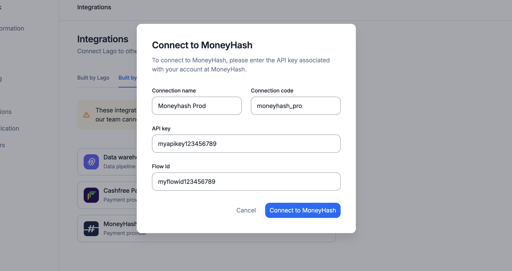

<Info>
    This integration is community-maintained, and therefore Lago provides only limited support.
</Info>


## About MoneyHash
MoneyHash is a leading payment infrastructure software in Africa and the Middle East.
They help businesses across Emerging Markets to optimize payment performance, scale operations, cut costs, and grow revenue through their all-in-one orchestration platform.

## Connect MoneyHash to Lago

To connect MoneyHash to Lago, navigate to your Lago UI, then go to **Integrations** > **Built by community**, and add a new **MoneyHash Payments** connection:

1. Click **Add a connection**;
2. Type a connection **name**;
3. Type a unique connection **code**;
4. Paste your MoneyHash **API key**; and
5. Paste your MoneyHash **Flow Id**.

<Frame caption="Connect your MoneyHash account from Lago UI">
  
</Frame>

## Create a webhook endpoint
<Tip>
    To complete this process, you will need:

    - Your Lago **organization ID**, available in the **"API keys & ID"** tab of the
    **"Developers"** section;
    - The **connection code** you created during the MoneyHash setup process.
</Tip>

If you want Lago to automatically retrieve the status of the payments processed
via MoneyHash, you must create a webhook endpoint in MoneyHash. To do so:

1. Log in to your MoneyHash account;
2. Add the following Webhook URL in the **Webhooks** section of the MoneyHash dashboard;
3. Enter the following URL: `https://api.getlago.com/webhooks/moneyhash/{{__YOUR_ORG_ID__}}?code={{__YOUR_CONNECTION_CODE__}}` (replace `__YOUR_ORG_ID__` with your Lago organization ID and `__YOUR_CONNECTION_CODE__` with the connection code); and
4. Save the creation of this webhook endpoint.

## Collect payments via MoneyHash

### Connect a Lago customer to MoneyHash
To begin collecting payments for your Lago invoices via MoneyHash, you need to link a Lago customer to a MoneyHash connection.
When creating or editing a customer in Lago, select the relevant MoneyHash connection under **external apps** to enable invoice payments.

### Generate a checkout link
Note that payments through MoneyHash do not proceed automatically when Lago generates an invoice. You need to programmatically generate a checkout link by calling the [following endpoint](/api-reference/invoices/payment-url):

```bash Request
curl --request POST \
  --url https://api.getlago.com/api/v1/invoices/{lago_id}/payment_url \
  --header 'Authorization: Bearer <token>'
```

Forward the checkout link to your customer so they can pay with their preferred local method. Once the payment is processed, Lago retrieves the invoice status from MoneyHash.

```json Response
{
  "invoice_payment_details": {
    "lago_customer_id": "1a901a90-1a90-1a90-1a90-1a901a901a90",
    "lago_invoice_id": "1e501a90-938d-1a90-1a90-1a901a901a80",
    "external_customer_id": "hooli_1234",
    "payment_provider": "moneyhash",
    "payment_url": "https://moneyhash.payment_link"
  }
}
```

### MoneyHash payment errors
If an error occurs during the MoneyHash payment process for a Lago invoice, Lago sends a [`payment_request.payment_failure`](https://docs.getlago.com/api-reference/webhooks/messages#param-payment-request-payment-failure) webhook containing the error details.
