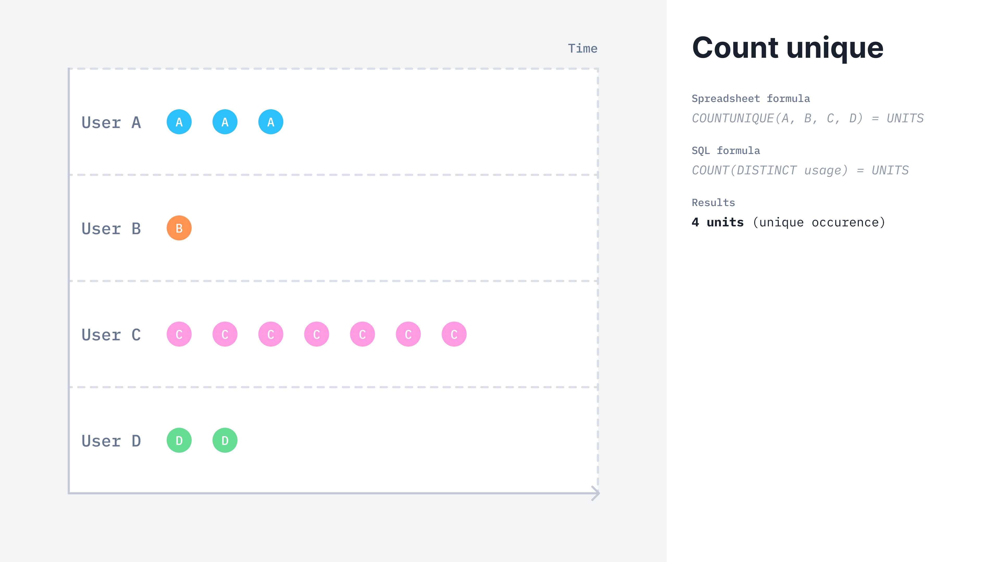

`Count unique` measures how many distinct values appear in an event property. Use it to track unique users, seats or request identifiers. Repeated events with the same value count once.

<Frame caption="Count unique calculation method">
  
</Frame>

## Configure the metric

Set `field_name` to the event property you want to measure.

Choose what happens when a billing cycle ends:

- `recurring: true`: Lago keeps the quantity and carries it into the next cycle.
- `recurring: false`: Lago resets the quantity, so each cycle starts fresh.

See [Metric recurrence](/v2/guide/billable-metrics/recurring-vs-metered).

## Create the metric

<Tabs>
  <Tab title="Dashboard">
    1. Go to **Billable metrics** in the side menu.
    2. Create a new billable metric.
    3. Enter a name, a code and an optional description.
    4. Select **Count unique** as the aggregation type.
    5. Choose whether the measured quantity carries over or resets at the end of each billing cycle.
    6. Select the event property you want to measure.
    7. Add filters if you want to group usage by dimensions such as region or provider.
    8. Click **Add billable metric**.

  </Tab>
  <Tab title="API">
    <CodeGroup>
    ```bash
    LAGO_URL="https://api.getlago.com"
    API_KEY="__YOUR_API_KEY__"

    curl --location --request POST "$LAGO_URL/api/v2/billable_metrics" \
      --header "Authorization: Bearer $API_KEY" \
      --header 'Content-Type: application/json' \
      --data-raw '{
          "billable_metric": {
            "name": "API requests",
            "code": "api_requests",
            "description": "Number of unique API requests.",
            "aggregation_type": "unique_count_agg",
            "field_name": "request_id",
            "recurring": false
          }
        }'
    ```
    </CodeGroup>
  </Tab>
</Tabs>

## Calculation example

The two example events below belong to `contract_example` and the same billing cycle. Their timestamps are January 16 and 17, 2027 at 00:00 UTC.

```json Event 1
{
  "transaction_id": "transaction_1",
  "external_contract_id": "contract_example",
  "code": "api_requests",
  "timestamp": 1800057600,
  "properties": {
    "request_id": "id_1"
  }
}
```

```json Event 2
{
  "transaction_id": "transaction_2",
  "external_contract_id": "contract_example",
  "code": "api_requests",
  "timestamp": 1800144000,
  "properties": {
    "request_id": "id_1"
  }
}
```

Both events contain `request_id: "id_1"`. Lago counts that value once, so the measured quantity is 1.

## Add or remove unique values

Events sent to a Count unique metric accept an `operation_type` property that controls whether the value is added to or removed from the count:

- `add`: adds the unique value. Optional. Lago adds by default when `operation_type` is omitted.
- `remove`: removes the unique value from the count. Required whenever you want to remove a unit.

```json Event removing a previously counted unique value
{
  "transaction_id": "transaction_3",
  "external_contract_id": "contract_example",
  "code": "api_requests",
  "timestamp": 1800230400,
  "properties": {
    "request_id": "id_1",
    "operation_type": "remove"
  }
}
```

<CardGroup cols={2}>
  <Card title="Aggregation examples" icon="table" href="/v2/guide/billable-metrics/aggregation-types/aggregation-examples">
    Compare how aggregation types calculate usage.
  </Card>
  <Card title="Metered products" icon="gauge" href="/v2/guide/product-catalog/metered-products">
    Connect your metric to a Product.
  </Card>
  <Card title="Create a billable metric (API)" icon="code" href="/v2/api-reference/billable-metrics/create">
    `POST /billable_metrics`
  </Card>
  <Card title="Ingest usage" icon="arrow-right-to-bracket" href="/v2/guide/events/ingesting-usage">
    Send usage events to Lago.
  </Card>
</CardGroup>
