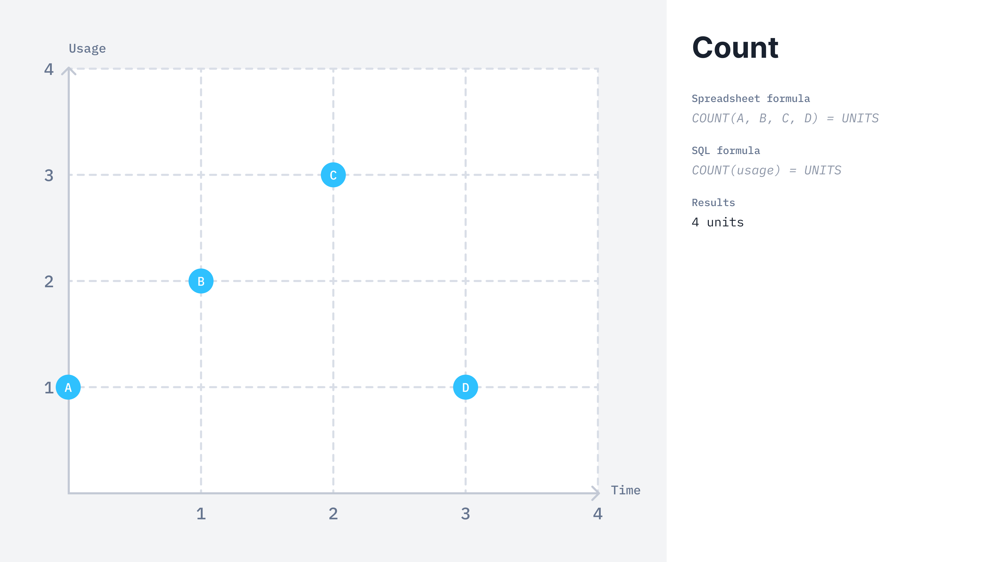

The Count aggregation (`count_agg`) tallies the number of events received during a billing period. Use it when each event is one billable action, such as one API call.

<Frame caption="Count calculation method">
  
</Frame>

## Create a count billable metric

<Tabs>
  <Tab title="Dashboard">
    1. Access the **Billable metrics** section in the side menu.
    2. Create a new billable metric.
    3. Define a name, a code and an optional description.
    4. Select **Count** as the aggregation type.
    5. Apply filters if any.
    6. Click **Add billable metric**.

    <Info>
      This metric is metered only. It cannot be recurring, and the aggregated value resets to 0 at the end of each billing period.
    </Info>
  </Tab>
  <Tab title="API">
    <CodeGroup>
    ```bash
    LAGO_URL="https://api.getlago.com"
    API_KEY="__YOUR_API_KEY__"

    curl --location --request POST "$LAGO_URL/api/v2/billable_metrics" \
      --header "Authorization: Bearer $API_KEY" \
      --header 'Content-Type: application/json' \
      --data-raw '{
          "billable_metric": {
            "name": "API calls",
            "code": "api_calls",
            "description": "Number of API calls",
            "aggregation_type": "count_agg",
            "recurring": false
          }
        }'
    ```
    </CodeGroup>
  </Tab>
</Tabs>

## Calculation example

Lago calculates `COUNT(events.code)` for the two events below, sent to `contract_example` in January 2027.

```json
// Event received #1
{
  "transaction_id": "transaction_1",
  "external_contract_id": "contract_example",
  "code": "api_calls",
  "timestamp": 1800057600,
  "properties": {}
}

// Event received #2
{
  "transaction_id": "transaction_2",
  "external_contract_id": "contract_example",
  "code": "api_calls",
  "timestamp": 1800144000,
  "properties": {}
}
```

Lago counts the events received, **resulting in a billable value of 2 units.** At the `calls_standard` rate of $0.01 per call, this is $0.02.

<CardGroup cols={2}>
  <Card title="Aggregation examples" icon="table" href="/v2/guide/billable-metrics/aggregation-types/aggregation-examples">
    The same events under every aggregation type.
  </Card>
  <Card title="Metered products" icon="gauge" href="/v2/guide/product-catalog/metered-products">
    Price the quantity this metric measures.
  </Card>
  <Card title="Create a billable metric (API)" icon="code" href="/v2/api-reference/billable-metrics/create">
    `POST /billable_metrics`
  </Card>
  <Card title="Ingest usage" icon="arrow-right-to-bracket" href="/v2/guide/events/ingesting-usage">
    Send events with `external_contract_id`.
  </Card>
</CardGroup>
