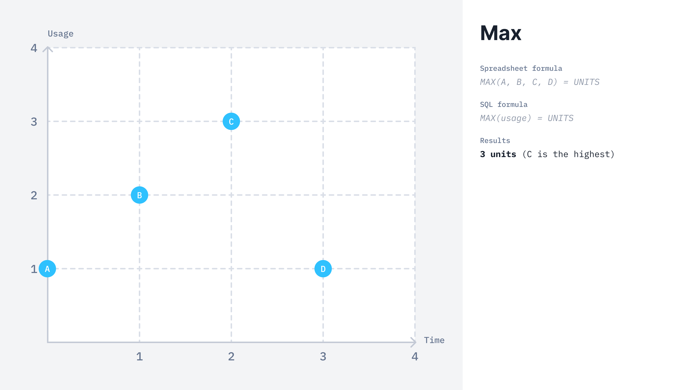

`Max` uses the highest value reported for an event property during a billing cycle. Use it to measure peak usage, such as the highest number of CPUs in use.

<Frame caption="Max calculation method">
  
</Frame>

## Configure the metric

Set `field_name` to the event property you want to measure.

Set `recurring` to `false`. This aggregation does not support carrying the quantity into the next billing cycle. Lago resets the measured quantity at the end of each cycle.

## Create the metric

<Tabs>
  <Tab title="Dashboard">
    1. Go to **Billable metrics** in the side menu.
    2. Create a new billable metric.
    3. Enter a name, a code and an optional description.
    4. Select **Max** as the aggregation type.
    5. Select the event property you want to measure.
    6. Add filters if you want to group usage by dimensions such as region or provider.
    7. Click **Add billable metric**.

  </Tab>
  <Tab title="API">
    <CodeGroup>
    ```bash
    LAGO_URL="https://api.getlago.com"
    API_KEY="__YOUR_API_KEY__"

    curl --location --request POST "$LAGO_URL/api/v2/billable_metrics" \
      --header "Authorization: Bearer $API_KEY" \
      --header 'Content-Type: application/json' \
      --data-raw '{
          "billable_metric": {
            "name": "API requests",
            "code": "api_requests",
            "description": "Peak number of API requests.",
            "aggregation_type": "max_agg",
            "field_name": "total_requests",
            "recurring": false
          }
        }'
    ```
    </CodeGroup>
  </Tab>
</Tabs>

## Calculation example

The two example events below belong to `contract_example` and the same billing cycle. Their timestamps are January 16 and 17, 2027 at 00:00 UTC.

```json Event 1
{
  "transaction_id": "transaction_1",
  "external_contract_id": "contract_example",
  "code": "api_requests",
  "timestamp": 1800057600,
  "properties": {
    "total_requests": 20
  }
}
```

```json Event 2
{
  "transaction_id": "transaction_2",
  "external_contract_id": "contract_example",
  "code": "api_requests",
  "timestamp": 1800144000,
  "properties": {
    "total_requests": 10
  }
}
```

The events report 20 and 10. Lago keeps the higher value, so the measured quantity is 20.

<CardGroup cols={2}>
  <Card title="Aggregation examples" icon="table" href="/v2/guide/billable-metrics/aggregation-types/aggregation-examples">
    Compare how aggregation types calculate usage.
  </Card>
  <Card title="Metered products" icon="gauge" href="/v2/guide/product-catalog/metered-products">
    Connect your metric to a Product.
  </Card>
  <Card title="Create a billable metric (API)" icon="code" href="/v2/api-reference/billable-metrics/create">
    `POST /billable_metrics`
  </Card>
  <Card title="Ingest usage" icon="arrow-right-to-bracket" href="/v2/guide/events/ingesting-usage">
    Send usage events to Lago.
  </Card>
</CardGroup>
