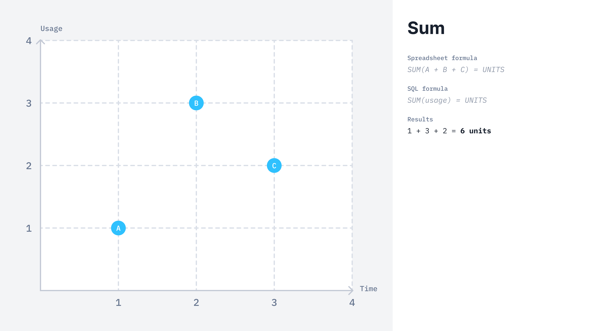

The Sum aggregation (`sum_agg`) adds up the values of one numeric event property over the billing period. Use it when each event carries a quantity, such as tokens, gigabytes or compute hours.

<Frame caption="Sum calculation method">
  
</Frame>

## Create a sum billable metric

<Tabs>
  <Tab title="Dashboard">
    1. Access the **Billable metrics** section in the side menu.
    2. Create a new billable metric.
    3. Define a name, a code and an optional description.
    4. Select **Sum** as the aggregation type.
    5. Define whether this metric is metered or recurring.
    6. Define the property to aggregate.
    7. Apply filters if any.
    8. Click **Add billable metric**.

    <Info>
      This metric can be metered or recurring. See [Recurring vs metered](/v2/guide/billable-metrics/recurring-vs-metered).
    </Info>
  </Tab>
  <Tab title="API">
    <CodeGroup>
    ```bash
    LAGO_URL="https://api.getlago.com"
    API_KEY="__YOUR_API_KEY__"

    curl --location --request POST "$LAGO_URL/api/v2/billable_metrics" \
      --header "Authorization: Bearer $API_KEY" \
      --header 'Content-Type: application/json' \
      --data-raw '{
          "billable_metric": {
            "name": "API requests",
            "code": "api_requests",
            "description": "Total number of API requests.",
            "aggregation_type": "sum_agg",
            "field_name": "total_requests",
            "recurring": false
          }
        }'
    ```
    </CodeGroup>
  </Tab>
</Tabs>

## Calculation example

Lago calculates `SUM(events.properties.total_requests)` for the two events below, sent to `contract_example` in January 2027.

```json
// Event received #1
{
  "transaction_id": "transaction_1",
  "external_contract_id": "contract_example",
  "code": "api_requests",
  "timestamp": 1800057600,
  "properties": {
    "total_requests": 20
  }
}

// Event received #2
{
  "transaction_id": "transaction_2",
  "external_contract_id": "contract_example",
  "code": "api_requests",
  "timestamp": 1800144000,
  "properties": {
    "total_requests": 10
  }
}
```

Lago adds up the values of the `total_requests` property, **resulting in a billable value of 30 units.**

<CardGroup cols={2}>
  <Card title="Aggregation examples" icon="table" href="/v2/guide/billable-metrics/aggregation-types/aggregation-examples">
    The same events under every aggregation type.
  </Card>
  <Card title="Metered products" icon="gauge" href="/v2/guide/product-catalog/metered-products">
    Price the quantity this metric measures.
  </Card>
  <Card title="Create a billable metric (API)" icon="code" href="/v2/api-reference/billable-metrics/create">
    `POST /billable_metrics`
  </Card>
  <Card title="Ingest usage" icon="arrow-right-to-bracket" href="/v2/guide/events/ingesting-usage">
    Send events with `external_contract_id`.
  </Card>
</CardGroup>
