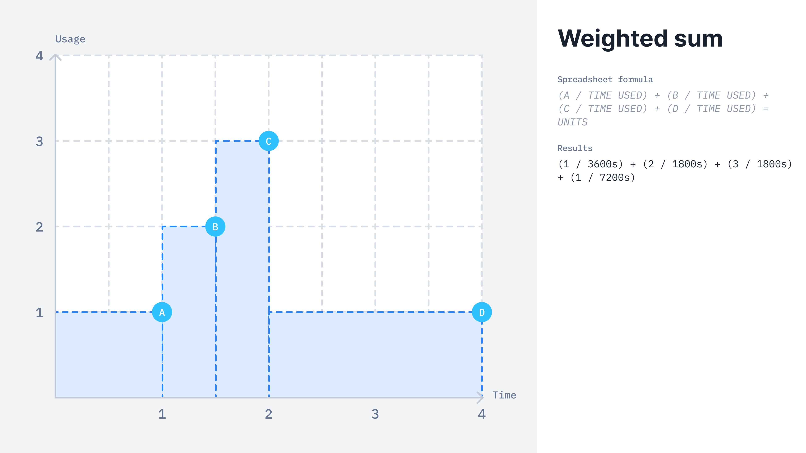

`Weighted sum` measures a quantity while accounting for how long it applies during a billing cycle. Use it for quantities that change over time, such as allocated storage or memory.

<Frame caption="Weighted sum calculation method">
  
</Frame>

## Configure the metric

Set `field_name` to the event property you want to measure.

`weighted_interval` is required and accepts `seconds` only.

Choose what happens when a billing cycle ends:

- `recurring: true`: Lago keeps the quantity and carries it into the next cycle.
- `recurring: false`: Lago resets the quantity, so each cycle starts fresh.

See [Metric recurrence](/v2/guide/billable-metrics/recurring-vs-metered).

## Create the metric

<Tabs>
  <Tab title="Dashboard">
    1. Go to **Billable metrics** in the side menu.
    2. Create a new billable metric.
    3. Enter a name, a code and an optional description.
    4. Select **Weighted sum** as the aggregation type.
    5. Choose whether the measured quantity carries over or resets at the end of each billing cycle.
    6. Select the event property you want to measure.
    7. Define the `weighted_interval` used for time proration (`seconds`).
    8. Add filters if you want to group usage by dimensions such as region or provider.
    9. Click **Add billable metric**.

  </Tab>
  <Tab title="API">
    <CodeGroup>
    ```bash
    LAGO_URL="https://api.getlago.com"
    API_KEY="__YOUR_API_KEY__"

    curl --location --request POST "$LAGO_URL/api/v2/billable_metrics" \
      --header "Authorization: Bearer $API_KEY" \
      --header 'Content-Type: application/json' \
      --data-raw '{
          "billable_metric": {
            "name": "GB seconds",
            "code": "gb_seconds",
            "description": "Gigabytes prorated per second used per period",
            "aggregation_type": "weighted_sum_agg",
            "weighted_interval": "seconds",
            "field_name": "gb",
            "recurring": false
          }
        }'
    ```
    </CodeGroup>
  </Tab>
</Tabs>

## Calculation example

Lago calculates `SUM(events.properties.gb) / (DATEDIFF(SECOND, timestamp.event_1, timestamp.event_2) + 1) * (DATEDIFF(SECOND, 'period_start', 'period_end') + 1)` for the two events below, sent to `contract_example` in January 2027.

```json Event 1
{
  "transaction_id": "transaction_1",
  "external_contract_id": "contract_example",
  "code": "gb_seconds",
  "timestamp": 1800057600,
  "properties": {
    "gb": 20
  }
}
```

```json Event 2
{
  "transaction_id": "transaction_2",
  "external_contract_id": "contract_example",
  "code": "gb_seconds",
  "timestamp": 1800144000,
  "properties": {
    "gb": 10
  }
}
```

The first event arrives on January 16, the second on January 17. January has 2,678,400 seconds. The first 20 GB is held for one day (86,400 seconds). The running total of 30 GB (20 + 10) is then held for 15 days (1,296,000 seconds) until the end of the month:

- (20 / 2,678,400) × 86,400 = 0.64516129032
- (30 / 2,678,400) × 1,296,000 = 14.5161290323
- 0.64516129032 + 14.5161290323 = **15.1612903226 units**

<CardGroup cols={2}>
  <Card title="Aggregation examples" icon="table" href="/v2/guide/billable-metrics/aggregation-types/aggregation-examples">
    Compare how aggregation types calculate usage.
  </Card>
  <Card title="Rounding" icon="arrow-up-1-9" href="/v2/guide/billable-metrics/rounding">
    Choose how to round the measured quantity.
  </Card>
  <Card title="Create a billable metric (API)" icon="code" href="/v2/api-reference/billable-metrics/create">
    `POST /billable_metrics`
  </Card>
  <Card title="Ingest usage" icon="arrow-right-to-bracket" href="/v2/guide/events/ingesting-usage">
    Send usage events to Lago.
  </Card>
</CardGroup>
