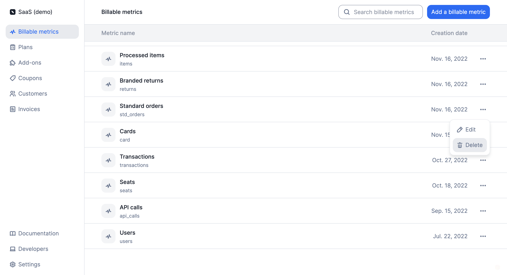

Deleting a billable metric soft-deletes it and stops billing the usage it measures. Delete a metric only when you no longer bill that usage anywhere, because the change reaches every plan and contract that prices it.

## What happens on deletion

`DELETE /billable_metrics/{code}`:

- Soft-deletes the metric, together with its pricing and alerts. The usage it measured stops being billed.
- Marks draft invoices that contain fees for this metric for refresh.
- Returns the metric with `deleted_at` set.

A metric referenced by a [product filter](/v2/guide/product-catalog/product-filters) cannot be deleted. Remove the product filter first.

<Warning>
  Deleting a billable metric is irreversible. It stops billing the usage it measures on every plan and contract that prices it, and refreshes draft invoices that contain its fees. Review where the metric is used before you send the request.
</Warning>

<Tabs>
  <Tab title="Dashboard">
    
  </Tab>
  <Tab title="API">
    <CodeGroup>
    ```bash Delete the storage metric
    LAGO_URL="https://api.getlago.com"
    API_KEY="__YOUR_API_KEY__"

    curl --location --request DELETE "$LAGO_URL/api/v2/billable_metrics/storage" \
      --header "Authorization: Bearer $API_KEY"
    ```
    </CodeGroup>
  </Tab>
</Tabs>

<CardGroup cols={2}>
  <Card title="Filters and dimensions" icon="filter" href="/v2/guide/billable-metrics/filters">
    Edit filters instead of deleting the metric.
  </Card>
  <Card title="Metered products" icon="gauge" href="/v2/guide/product-catalog/metered-products">
    Products that use the metric.
  </Card>
  <Card title="Delete a billable metric (API)" icon="code" href="/v2/api-reference/billable-metrics/delete">
    `DELETE /billable_metrics/{code}`
  </Card>
  <Card title="Retrieve a billable metric (API)" icon="code" href="/v2/api-reference/billable-metrics/retrieve">
    `GET /billable_metrics/{code}`
  </Card>
</CardGroup>
