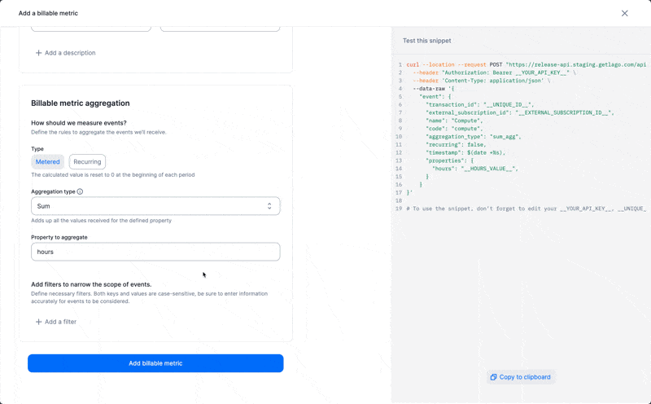

A filter is a dimension of a billable metric: a `key` and a list of allowed `values`, matched against each event's `properties`. Use filters when one metric needs several prices, such as per region or per model, without creating a metric per slice.

## How filters feed pricing

Metering and rating stay separate:

| Layer | Object | What you define |
| --- | --- | --- |
| Metering | Billable metric `filters` | The dimensions and allowed values, such as `region: [us-east-1, eu-west-1]`. |
| Product slice | [Product filter](/v2/guide/product-catalog/product-filters) | A slice of a metered product, built from the metric's keys and values, such as `region = eu-west-1`. |
| Rating | [Rate card](/v2/guide/rate-cards/overview) | The price of a product or of one product filter. |

A product filter's `values` must refer to keys and configured values on its product's billable metric. Define the dimension on the metric first, then create the product filter, then price it with a rate card targeting its `product_filter_code`.

Your product team can add a dimension without waiting on pricing. Your finance team can add a price without changing what you measure.

## Use cases

<AccordionGroup>
  <Accordion title="Regional pricing">
    You meter compute hours and launch in Europe. EU infrastructure costs more, so EU usage needs its own price.

    ```json
    "filters": [
      {
        "key": "region",
        "values": ["us-east-1", "us-east-2", "eu-west-1", "eu-central-1"]
      }
    ]
    ```

    Create product filters on the `compute` metered product, one for the US regions and one for the EU regions, and price each with its own rate card.
  </Accordion>

  <Accordion title="Per-model pricing (AI and LLM platforms)">
    You meter tokens. Each model has a different cost.

    ```json
    "filters": [
      {
        "key": "model",
        "values": ["llama", "mixtral", "gpt-4", "claude-sonnet"]
      }
    ]
    ```

    Each model becomes a product filter with its own per-token rate card.
  </Accordion>

  <Accordion title="Tier of service">
    You meter API calls. Real-time requests cost more to serve than batched ones.

    ```json
    "filters": [
      {
        "key": "tier",
        "values": ["realtime", "batch"]
      }
    ]
    ```
  </Accordion>

  <Accordion title="Combined dimensions (matrix pricing)">
    Filters combine. A `gpt-4` call in Europe is not priced like a `llama` call in the US.

    ```json
    "filters": [
      {
        "key": "region",
        "values": ["us-east-1", "eu-west-1"]
      },
      {
        "key": "model",
        "values": ["llama", "gpt-4"]
      }
    ]
    ```

    Each event carries both `region` and `model`. A product filter can match several keys, so one metric can carry four prices.
  </Accordion>
</AccordionGroup>

## Create filters

A DevOps company bills compute capacity by the hour. The `compute` metric sums `properties.hours`. Customers pick a cloud provider and a region, so the metric defines two filters: `provider` and `region`.

<Tabs>
  <Tab title="Dashboard">
    1. Create a new billable metric.
    2. Add a new filter.
    3. Define its key and values.

    <Frame caption="How to add filters">
      
    </Frame>
  </Tab>
  <Tab title="API">
    <CodeGroup>
    ```bash Compute with provider and region {14-23}
    LAGO_URL="https://api.getlago.com"
    API_KEY="__YOUR_API_KEY__"

    curl --location --request POST "$LAGO_URL/api/v2/billable_metrics" \
      --header "Authorization: Bearer $API_KEY" \
      --header 'Content-Type: application/json' \
      --data-raw '{
        "billable_metric": {
          "name": "Compute",
          "code": "compute",
          "aggregation_type": "sum_agg",
          "field_name": "hours",
          "recurring": false,
          "filters": [
            {
              "key": "provider",
              "values": ["aws", "google", "azure"]
            },
            {
              "key": "region",
              "values": ["us-east-1", "us-east-2", "eu-west-1", "ap-southeast-1"]
            }
          ]
        }
      }'
    ```
    </CodeGroup>

    Each filter needs a unique, non-empty `key` and a `values` array of strings. Null filters, malformed filters and non-string values are rejected before any change is saved.
  </Tab>
</Tabs>

An event carrying both dimensions:

```bash Event with filter values
LAGO_URL="https://api.getlago.com"
API_KEY="__YOUR_API_KEY__"

curl --location --request POST "$LAGO_URL/api/v2/events" \
  --header "Authorization: Bearer $API_KEY" \
  --header 'Content-Type: application/json' \
  --data-raw '{
    "event": {
      "transaction_id": "event_001",
      "external_contract_id": "contract_example",
      "code": "compute",
      "timestamp": 1800057600,
      "properties": {
        "hours": 0.07,
        "provider": "aws",
        "region": "us-east-1"
      }
    }
  }'
```

<Warning>
  Values are case-sensitive. An event must send the exact value to match. With the filters above, `"aws"` matches and `"AWS"` does not.
</Warning>

## Edit filters

On update, `filters` is the complete definition. It replaces the existing filters. An empty array removes them all.

Filter values referenced by product filters cannot be removed. Remove or change the product filter first.

```json Payload A
{
  "billable_metric": {
    "filters": [
      { "key": "region", "values": ["usa", "europe"] }
    ]
  }
}
```

```json Payload B
{
  "billable_metric": {
    "filters": [
      { "key": "region", "values": ["USA", "europe", "africa"] }
    ]
  }
}
```

Sending Payload B after Payload A:

1. `europe` stays.
2. `usa` is removed, unless a product filter references it. In that case the update is rejected.
3. `USA` is added. Keys and values are case-sensitive, so it is a new value.
4. `africa` is added.

New values are not priced automatically. Create a product filter and a rate card for each new slice you want to bill.

Once the metric is attached to a plan, only its name, description and permitted filter changes can be updated.

## Design guidance

- **Use a broad metric code** that can absorb future dimensions: `compute_events` rather than `compute_us_events`.
- **Send dimensions you might price on** as event properties, even before you filter on them. A filter can only match values that events carry.
- **Get the metric code right on day one.** You can add filter keys and values later, but events are matched to metrics by `code`.

<CardGroup cols={2}>
  <Card title="Product filters" icon="filter" href="/v2/guide/product-catalog/product-filters">
    Turn metric dimensions into priceable slices.
  </Card>
  <Card title="Rate cards" icon="tags" href="/v2/guide/rate-cards/overview">
    Price a product filter.
  </Card>
  <Card title="Create a billable metric (API)" icon="code" href="/v2/api-reference/billable-metrics/create">
    `POST /billable_metrics`
  </Card>
  <Card title="Create a product filter (API)" icon="code" href="/v2/api-reference/product-filters/create">
    `POST /products/{product_code}/filters`
  </Card>
</CardGroup>
