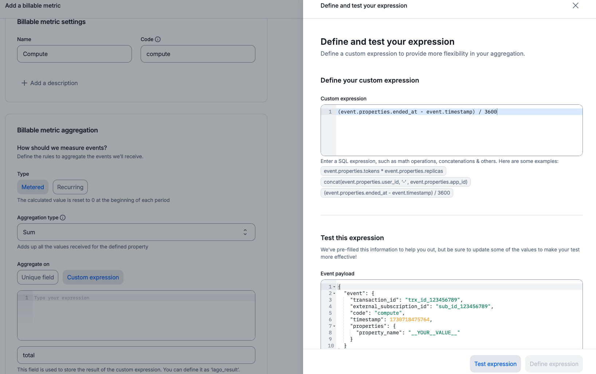
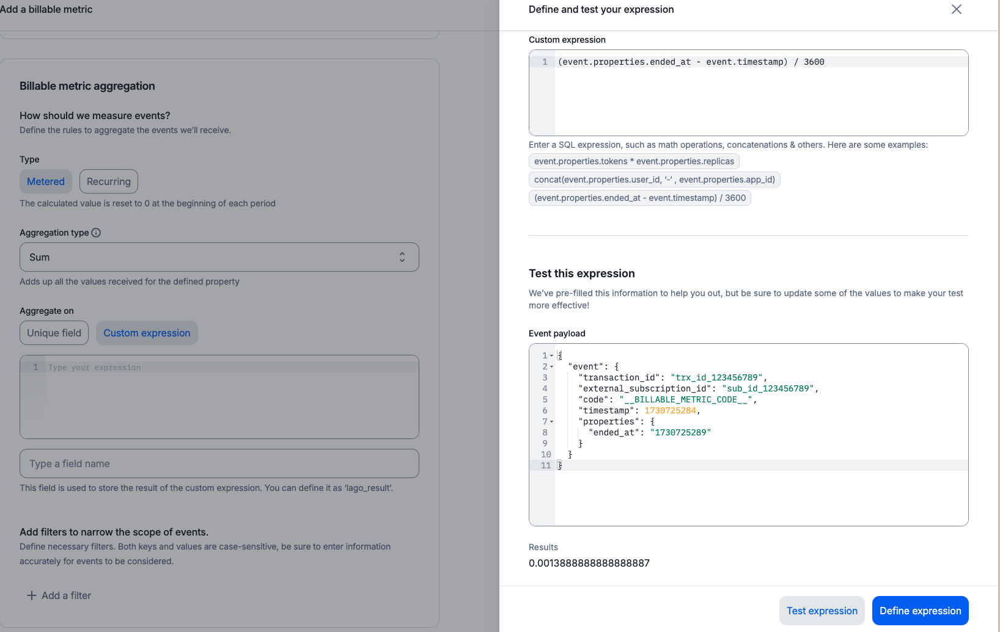

A SQL custom expression computes a value from each event before the billable metric aggregates it, such as `gb × replicas × hours`. Use it when the quantity you bill is not a single event property but a calculation over several.

## Create a custom expression

Set `expression` on the metric. Lago evaluates it on each event, then applies the aggregation type to the results. Custom expressions work with every aggregation type except Count.

<Tabs>
  <Tab title="Dashboard">
    1. Define the `name` and `code` of the billable metric.
    2. Choose an aggregation type.
    3. Select **Custom expression** as the aggregation option instead of **Unique field**.
    4. Enter your custom expression in the side panel.
    5. Test the custom expression.
    6. Save the billable metric.

    <Frame caption="Create a custom expression for a billable metric">
      
    </Frame>
  </Tab>
  <Tab title="API">
    <CodeGroup>
    ```bash Storage {13,14}
    LAGO_URL="https://api.getlago.com"
    API_KEY="__YOUR_API_KEY__"

    curl --location --request POST "$LAGO_URL/api/v2/billable_metrics" \
      --header "Authorization: Bearer $API_KEY" \
      --header 'Content-Type: application/json' \
      --data-raw '{
        "billable_metric": {
          "name": "Storage",
          "code": "storage",
          "description": "GB hours consumed",
          "aggregation_type": "sum_agg",
          "expression": "event.properties.gb * event.properties.replicas * (event.properties.ended_at - event.properties.started_at) / 3600",
          "field_name": "consumed_gb_hours",
          "recurring": false
        }
      }'
    ```

    ```bash Seats {13}
    LAGO_URL="https://api.getlago.com"
    API_KEY="__YOUR_API_KEY__"

    curl --location --request POST "$LAGO_URL/api/v2/billable_metrics" \
      --header "Authorization: Bearer $API_KEY" \
      --header 'Content-Type: application/json' \
      --data-raw '{
        "billable_metric": {
          "name": "Seats",
          "code": "seats",
          "description": "Number of seats used",
          "aggregation_type": "unique_count_agg",
          "expression": "CONCAT(event.properties.user_id, '\''-'\'' , event.properties.app_id)",
          "field_name": "seat_id",
          "recurring": true
        }
      }'
    ```
    </CodeGroup>
  </Tab>
</Tabs>

## Worked example

The `storage` metric above receives one event for `contract_example`:

```json
{
  "transaction_id": "storage_20270116_customer_example_001",
  "external_contract_id": "contract_example",
  "code": "storage",
  "timestamp": 1800057600,
  "properties": {
    "gb": 10,
    "replicas": 3,
    "started_at": 1800057600,
    "ended_at": 1800064800
  }
}
```

The expression gives 10 × 3 × (1800064800 − 1800057600) / 3600 = 10 × 3 × 2 = **60 GB hours**. Sum adds this to the other events of the period. At $0.05 per GB hour, this event contributes $3.00.

## Supported expressions
Lago supports a range of SQL custom expressions. Here are a few examples:

- **Concatenation:** `CONCAT(event.properties.user_id, '-', event.properties.app_id)`
- **Math operations:** `(event.properties.cpu_number * 25 * event.properties.duration_msec) + (event.properties.memory_mb * 0.000001 * event.properties.duration_msec)`
- **Rounding:** `ROUND(event.properties.duration_msec * 1000)`
- **Least/Greatest:** `LEAST(event.properties.memory_mb, 10.0)`

You can find the full list of supported expressions below:

- [Event attributes](#event-attributes)
- [Atoms](#atoms)
- [Operators](#operators)
- [Functions](#functions)
  - [`CONCAT`](#concat)
  - [`ROUND`](#round)
  - [`FLOOR`](#floor)
  - [`CEIL`](#ceil)
  - [`LEAST`](#least)
  - [`GREATEST`](#greatest)

If you need an expression Lago does not support yet, contact the Lago team or contribute it to the open-source project.

### Event attributes

Lago expressions may include the following event attributes:

- `event.code` (event code)
- `event.timestamp` (event timestamp)
- `event.properties.[property_name]` (event property)

For example, `event.properties.my_property` is a valid event attribute.

### Atoms

Lago expressions may include atoms:

- `123` (integer)
- `123.45` (decimal)
- `'Hello, world!'` (string)

### Operators

Lago expressions may include basic operators:

- `+` (addition)
- `-` (subtraction)
- `*` (multiplication)
- `/` (division)
- unary minus (`-12`)

### Functions

#### `CONCAT`

The `CONCAT` function is used to concatenate two or more strings.

```SQL
CONCAT(str1, str2[,strs,...])
```

**Parameters:**
- `str1`: The first string to concatenate
- `str2`: The second string to concatenate
- `strs`: (Optional) Additional strings to concatenate.

**Returns:** A string with the concatenated strings.

**Examples:**
- `CONCAT(event.properties.user_id, '-', event.properties.app_id)`

#### `ROUND`

The `ROUND` function is used to round a number to a specified number of decimal places.

```SQL
ROUND(value, precision)
```

**Parameters:**
- `value`: The number to round
- `precision`: (Optional) Number of decimal places. Defaults to `0`.

**Returns:** A number rounded to the specified precision.

**Examples:**
- `ROUND(14.2355)` returns `14`
- `ROUND(14.2355, 0)` returns `14`
- `ROUND(14.2355, 2)` returns `14.24`
- `ROUND(14.2355, -1)` returns `10`

#### `FLOOR`

The `FLOOR` function is used to round a number down to the nearest integer.

```SQL
FLOOR(value, precision)
```

**Parameters:**
- `value`: The number to round
- `precision`: (Optional) Number of decimal places. Defaults to `0`.

**Returns:** A number rounded down to the specified precision.

**Examples:**
- `FLOOR(16.2365)` returns `16`
- `FLOOR(16.2365, 0)` returns `16`
- `FLOOR(16.2365, 2)` returns `16.23`
- `FLOOR(16.2365, -1)` returns `10`

#### `CEIL`

The `CEIL` function is used to round a number up to the nearest integer.

```SQL
CEIL(value, precision)
```

**Parameters:**
- `value`: The number to round
- `precision`: (Optional) Number of decimal places. Defaults to `0`.

**Returns:** A number rounded up to the specified precision.

**Examples:**
- `CEIL(14.2345)` returns `15`
- `CEIL(14.2345, 0)` returns `15`
- `CEIL(14.2345, 2)` returns `14.24`
- `CEIL(14.2345, -1)` returns `20`

#### `LEAST`

The `LEAST` function is used to find the minimum of two or more numbers.

```SQL
LEAST(num1, num2[,nums,...])
```

**Parameters:**
- `num1`: The first number to check minimum value
- `num2`: The second number to check minimum value
- `nums`: (Optional) Additional numbers to check minimum value.

**Returns:** The minimum of the given numbers.

**Examples:**
- `LEAST(event.properties.disk1_usage_mb, event.properties.disk2_usage_mb, 10.0)`

#### `GREATEST`

The `GREATEST` function is used to find the maximum of two or more numbers.

```SQL
GREATEST(num1, num2[,nums,...])
```

**Parameters:**
- `num1`: The first number to check maximum value
- `num2`: The second number to check maximum value
- `nums`: (Optional) Additional numbers to check maximum value.

**Returns:** The maximum of the given numbers.

**Examples:**
- `GREATEST(event.properties.memory_mb, 10.0)`

## Test a custom expression

The Dashboard provides a testing tool for custom expressions. It runs your expression against a sample event, and you can override any field of that event. If the expression is invalid, Lago returns an error and you cannot save the metric until it is fixed.

- Reference any event field in your expression.
- Use precise paths: `event.timestamp` for the event timestamp, `event.properties.your_field` for a property.

<Frame caption="Test your custom expression">
  
</Frame>

<CardGroup cols={2}>
  <Card title="Aggregation types" icon="calculator" href="/v2/guide/billable-metrics/aggregation-types/overview">
    What happens to the computed values.
  </Card>
  <Card title="Ingest usage" icon="arrow-right-to-bracket" href="/v2/guide/events/ingesting-usage">
    Send the properties your expression reads.
  </Card>
  <Card title="Create a billable metric (API)" icon="code" href="/v2/api-reference/billable-metrics/create">
    `POST /billable_metrics`
  </Card>
  <Card title="Billable metric object (API)" icon="code" href="/v2/api-reference/billable-metrics/object">
    The `expression` field.
  </Card>
</CardGroup>
