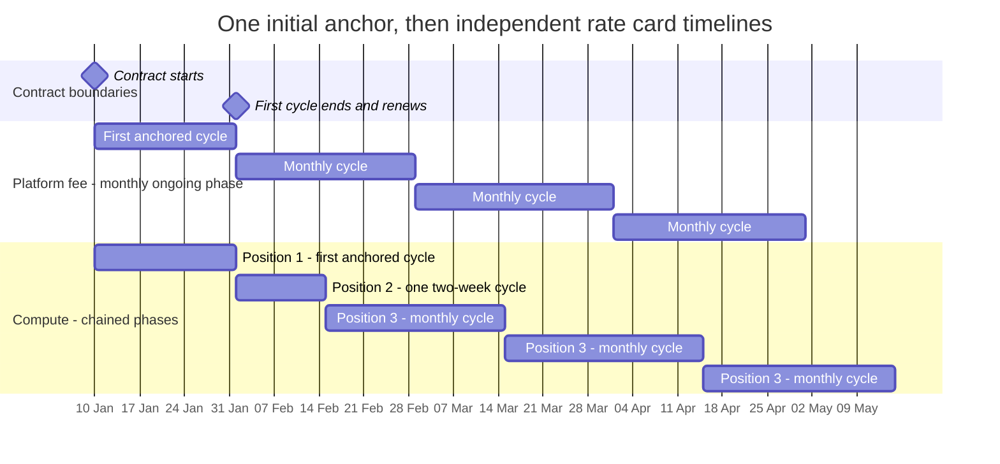
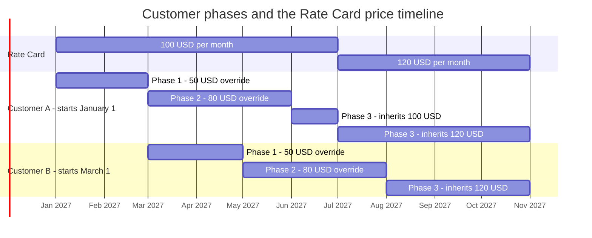

Each applied Rate Card on a Contract follows a billing timeline. Its billing interval determines the length of each cycle, and its phases define which pricing applies along the way.

## Start and first billing cycle

`started_at` sets when the Contract’s billing timeline begins. If phases are configured, their sequence starts from this date at position `1`. This also applies when `started_at` is in the past: phases follow that past date, not the date you create the Contract.

`billing_anchor_date` sets when the first billing cycle ends. The first cycle runs from `started_at` to this date. Each applied Rate Card uses the Contract’s anchor unless it has its own.

After the first cycle, each applied Rate Card follows its configured billing interval. A phase runs for its configured number of cycles, then the next phase begins. Later phases follow each other without realigning to the original anchor.

The anchor defines a cycle boundary, not a payment date. `billing_timing` determines whether billing happens in advance or in arrears. If the first cycle is shorter than the configured interval, the applicable proration rules determine its amount.

Timeline colors: purple for phase 1, amber for phase 2, blue for ongoing or inherited pricing, and gray for Contract boundaries.

## Independent Rate Card timelines

The Contract below starts on January 10, 2027, with `billing_anchor_date` set to February 1. Both cards complete their first cycle on February 1.

- **Platform fee**: one ongoing phase with a monthly interval.
- **Compute**: one anchored cycle at position `1`, then one two-week cycle at position `2`, then an ongoing monthly phase.

Compute's monthly phase starts on February 15, right after its two-week phase. Its next renewal is March 15. It does not shorten that month to renew on March 1. Platform fee keeps renewing on the first of each month.

The final phase of each card has `billing_interval_cycle_count: null`. The chart stops in May. Both timelines continue while the Contract remains in effect. Dates are UTC boundaries and show scheduling only, not invoice amounts.

## How phases interact with Rate changes

Each Contract follows its own phase sequence. A phase with a pricing override keeps that price when the Rate Card's active Rate changes. A phase without an override follows newly effective Rates, including changes that occur after the phase has started.

Customer A starts on January 1, 2027, and Customer B starts on March 1, 2027. Both receive two monthly cycles at 50 USD, followed by three at 80 USD, then pricing from the Rate Card. The Rate Card's price changes from 100 USD to 120 USD per month on July 1, 2027.

This example uses one fixed unit and full calendar-month periods in UTC, with no proration, taxes or other adjustments.

| Customer | June | July | August |
| --- | --- | --- | --- |
| A | 100 USD, inherited Rate | 120 USD, new Rate applies within phase 3 | 120 USD, inherited Rate |
| B | 80 USD, phase override | 80 USD, phase override | 120 USD, active Rate on entering phase 3 |

Customer A enters phase 3 on June 1 and follows the new Rate from July 1. Customer B keeps the 80 USD override through July, then inherits the active 120 USD Rate on August 1.

The price change does not restart either customer's phase sequence. Customer A's two phase 3 bars represent the same ongoing phase. The chart ends in October; phase 3 continues while the Contract remains in effect.

## Check the timeline

For each applied Rate Card, check the start, billing anchor, interval and phase cycle counts. Identify the phase and Rate used for the period you are reviewing. Check payment status separately from billing dates.

<CardGroup cols={2}>
  <Card title="Plan phase & overrides" icon="timeline" href="/v2/guide/plans/plan-phases">
    Configure a reusable phase sequence.
  </Card>
  <Card title="Contract overrides" icon="sliders" href="/v2/guide/contracts/overrides">
    Adjust one customer's pricing.
  </Card>
</CardGroup>
