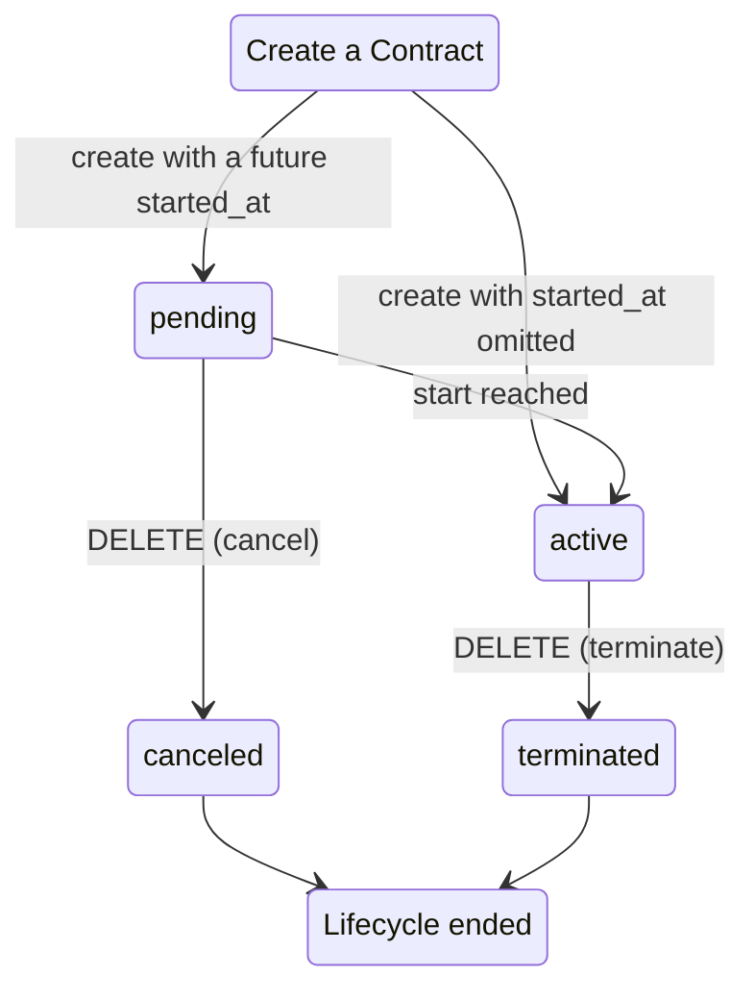

A Contract's status shows whether it is waiting to start, active or ended. Check the status before changing its terms or ending it.

## Statuses

| Status | What it means | When it applies |
| --- | --- | --- |
| `pending` | Scheduled, not started. The billing timeline has not begun. | `started_at` is in the future. |
| `active` | Started. Follows its configured billing timeline. Its applied Rate Cards and phases cannot be edited. | The Contract reached its start and has not ended. |
| `canceled` | Ended before it started. | A pending Contract is ended. |
| `terminated` | Ended after becoming active. Its billing history remains available. | An active Contract is ended. |

Contract status describes the agreement, not money. Check [invoices](/v2/guide/invoicing/overview) and [payments](/v2/guide/payments/payment-providers) separately to see what was billed, paid or remains due.

## Transitions



- **Create.** Omitting `started_at` starts the Contract now. A future timestamp creates a `pending` Contract.
- **Activate.** A pending Contract becomes `active` at its start. On a pending Contract, updating `started_at` to the current time or earlier activates it.
- **End.** `DELETE /contracts/{external_id}` ends the lifecycle. It cancels a pending Contract and terminates an active one. It does not delete the record. See [End or cancel a Contract](/v2/guide/contracts/end-or-cancel).

Do not try to set `status` directly. The field is read-only. Use the documented actions and date fields.

### Example

A Contract scheduled to start on January 1, 2027 is `pending` before that date and `active` from it. Ending it while pending sets `canceled` and fills `canceled_at`. Ending it while active sets `terminated` and fills `terminated_at`.

## What each status allows

| Action | `pending` | `active` |
| --- | --- | --- |
| Edit applied Rate Cards and phases | Yes | No |
| Edit `started_at` | Yes. The current time or earlier activates the Contract. | No. Only the stored value is accepted. |
| [Current usage](/v2/guide/contracts/current-usage) | Returns no usage | Returns usage for open billing windows |
| `DELETE /contracts/{external_id}` | Cancels | Terminates |

Canceled and terminated Contracts are history. Read them with the `status` parameter below.

## Read Contracts by status

`GET /contracts/{external_id}` returns the pending or active Contract. Pass `status` to select a historical `terminated` or `canceled` Contract with the same `external_id`.

After a Contract ends, a new Contract can use the same `external_id`. Only one pending or active Contract can use it at a time.

`GET /contracts` accepts `status[]` and defaults to `active`. Pass several values to list more.

<CodeGroup>
```bash Retrieve a terminated contract
LAGO_URL="https://api.getlago.com"
API_KEY="__YOUR_API_KEY__"

curl --location --request GET "$LAGO_URL/api/v2/contracts/contract_example?status=terminated" \
  --header "Authorization: Bearer $API_KEY"
```

```bash List pending and active contracts for a customer
LAGO_URL="https://api.getlago.com"
API_KEY="__YOUR_API_KEY__"

curl --location --globoff --request GET "$LAGO_URL/api/v2/contracts?external_customer_id=customer_example&status[]=pending&status[]=active" \
  --header "Authorization: Bearer $API_KEY"
```
</CodeGroup>

## Contract dates

| Field | Set by |
| --- | --- |
| `started_at` | You, at creation. Defaults to now. |
| `ended_at` | You, optionally. Must be after the start and not already in the past. |
| `canceled_at` | Lago, when a pending Contract is canceled. |
| `terminated_at` | Lago, when an active Contract is terminated. |

## Check the status

Retrieve the Contract after changing its start or ending it. Check its `status` and the corresponding dates. Review invoices and payments separately to check financial outcomes.

<CardGroup cols={2}>
  <Card title="End or cancel a Contract" icon="circle-stop" href="/v2/guide/contracts/end-or-cancel">
    End the billing timeline and review billing records.
  </Card>
  <Card title="Contracts" icon="file-signature" href="/v2/guide/contracts/overview">
    Start date, anchor and inherited terms.
  </Card>
  <Card title="Retrieve a Contract (API)" icon="code" href="/v2/api-reference/contracts/retrieve">
    `GET /contracts/{external_id}`
  </Card>
  <Card title="List Contracts (API)" icon="code" href="/v2/api-reference/contracts/list">
    `GET /contracts`
  </Card>
</CardGroup>
