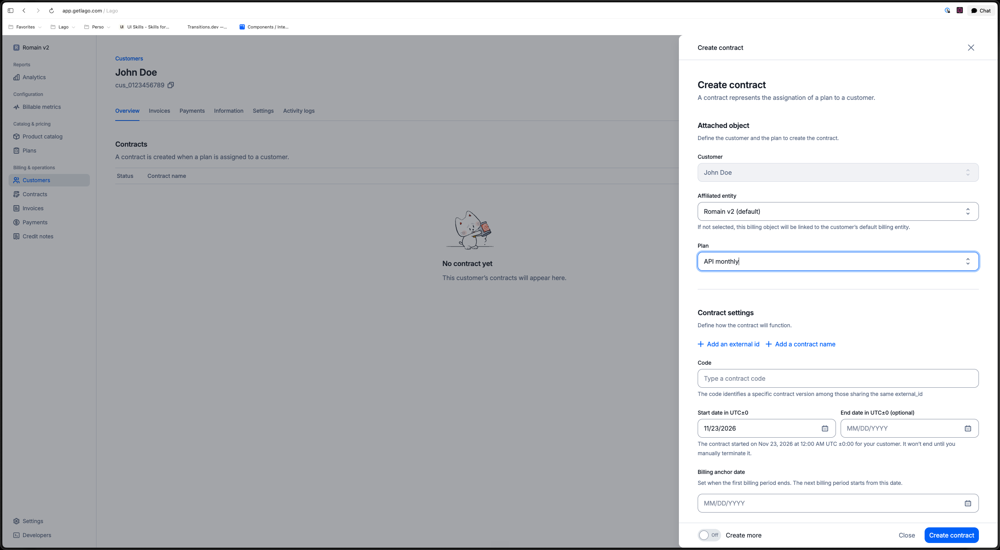

A Contract connects a customer to a Plan and defines when their billing starts. It brings the Plan's applied Rate Cards, quantities and phases into that customer's agreement.

Use a Contract to start a customer's offer. If the customer needs different terms, configure [Contract overrides](/v2/guide/contracts/overrides) before the Contract starts.

## How Contracts work

The Plan defines the reusable offer. The Contract identifies the customer, applies the offer and sets when billing starts.

| From the Plan | What the Contract uses |
| --- | --- |
| Applied Rate Cards | Products and Product filters in the offer, with their billing settings. |
| Fixed quantities | The `units` configured for fixed Products. |
| Rate phases | The ordered sequence of pricing terms on each applied Rate Card. |
| Phase overrides | Pricing configured for a phase, such as an introductory price or a different billing interval. |

Usage events identify the Contract through `external_contract_id`, which matches its `external_id`, not its `code`. See [Ingest usage](/v2/guide/events/ingesting-usage).

## Before you start

Create the [customer](/v2/guide/customers/customer-management) and [Plan](/v2/guide/plans/overview). A Contract requires a Plan. Applying it to a Contract locks the Plan's configuration; see [Manage plan changes](/v2/guide/plans/manage-plan-changes).

Prepare these fields:

| Field | Purpose |
| --- | --- |
| `external_id` | Your identifier for the Contract. It can be reused after a Contract ends. Only one pending or active Contract can use it at a time. |
| `code` | Required. Identifies one specific Contract among those sharing the same `external_id`. |
| `external_customer_id` | The customer to bill. This cannot change after creation. |
| `plan_code` | The Plan to apply. |

For optional fields and the complete schema, see [Create a Contract](/v2/api-reference/contracts/create).

## Set the start and billing dates

Set `started_at` to choose when the Contract starts. Omitting it starts the Contract now. A future timestamp creates a `pending` Contract.

Use `billing_anchor_date` to define the end of its first billing cycle. Each applied Rate Card then follows its configured billing interval and phase sequence. See [Billing timeline](/v2/guide/contracts/billing-timeline) for cycle boundaries and phases.

<span id="anchor-the-first-cycle" />
<span id="independent-rate-card-timelines" />
<span id="follow-active-pricing" />
<span id="a-scheduled-introductory-offer" />

The scheduling diagrams and Rate-change example are now in [Billing timeline](/v2/guide/contracts/billing-timeline).

## Create a Contract

<Tabs>
  <Tab title="Dashboard">
1. Open the customer's page and the **Create contract** form.
2. Check the `Customer`, review the `Affiliated entity` and select the `Plan`.
3. Under **Contract settings**, click **Add an external id** to enter your Contract identifier. Enter the required `Code` to identify this specific Contract. You can also click **Add a contract name** to give it a name.
4. Set the start date. Check the timezone shown in the form, and optionally set an end date.
5. Set the `Billing anchor date` to define when the first billing period ends. See [Billing timeline](/v2/guide/contracts/billing-timeline) for how billing cycles follow this date.
6. Review the settings and click **Create contract**.

<Frame caption="Create a Contract in the Dashboard">
  
</Frame>
  </Tab>
  <Tab title="API">
This request connects `customer_example` to the Plan `api_monthly`. The Contract starts on January 1, 2027, and its first billing cycle ends on February 1.

```bash Create contract_example
LAGO_URL="https://api.getlago.com"
API_KEY="__YOUR_API_KEY__"

curl --location --request POST "$LAGO_URL/api/v2/contracts" \
  --header "Authorization: Bearer $API_KEY" \
  --header 'Content-Type: application/json' \
  --data-raw '{
    "contract": {
      "external_id": "contract_example",
      "code": "contract_example_2027",
      "external_customer_id": "customer_example",
      "plan_code": "api_monthly",
      "started_at": "2027-01-01T00:00:00Z",
      "billing_anchor_date": "2027-02-01"
    }
  }'
```
  </Tab>
</Tabs>

For a complete billing walkthrough, see [Your first invoice](/v2/guide/introduction/your-first-invoice).

## Check the Contract

Retrieve the Contract by its `external_id` and `code`, including its applied Rate Cards. Check the code, customer, Plan, status and start date. Then check the fixed quantities, phase sequence and any overrides.

```bash Retrieve it with its applied rate cards
LAGO_URL="https://api.getlago.com"
API_KEY="__YOUR_API_KEY__"

curl --location --globoff --request GET "$LAGO_URL/api/v2/contracts/contract_example?code=contract_example_2027&expands[]=applied_rate_cards" \
  --header "Authorization: Bearer $API_KEY"
```

Use the same `code` to retrieve this Contract after it ends, even if another Contract now uses its `external_id`. See [Contract lifecycle](/v2/guide/contracts/lifecycle#retrieve-a-specific-contract).

Use [Current usage](/v2/guide/contracts/current-usage) for provisional amounts and [invoices and fees](/v2/guide/invoicing/fees) for billed results. Check invoice and payment status separately.

You can edit applied Rate Cards and phases while the Contract is `pending`. Once it is `active`, these settings are locked. Inherited Rate prices can still change; see [Billing timeline](/v2/guide/contracts/billing-timeline#how-phases-interact-with-rate-changes).

<CardGroup cols={2}>
  <Card title="Billing timeline" icon="arrows-spin" href="/v2/guide/contracts/billing-timeline">
    Understand billing cycles, phases and Rate changes.
  </Card>
  <Card title="Contract overrides" icon="sliders" href="/v2/guide/contracts/overrides">
    Adjust one customer's pricing before the start.
  </Card>
  <Card title="Create a contract (API)" icon="code" href="/v2/api-reference/contracts/create">
    `POST /contracts`
  </Card>
  <Card title="Retrieve a contract (API)" icon="code" href="/v2/api-reference/contracts/retrieve">
    `GET /contracts/{external_id}`
  </Card>
</CardGroup>
