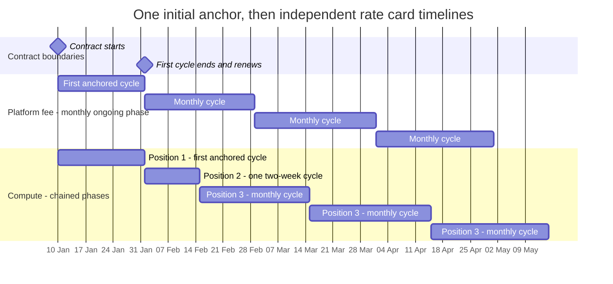

A [contract](/v2/api-reference/contracts/object) applies a plan's billing terms to one customer and starts that customer's billing timeline. Create a contract whenever a customer starts buying an offer. It replaces the subscription of the legacy (v1) model.

## How it fits together

The [plan](/v2/guide/plans/overview) defines the reusable offer. The contract identifies the customer, applies the offer and sets when billing starts.

Create a contract with `plan_code` to use an existing plan. The plan supplies the initial applied rate cards, with their phases and overrides. The API also supports contracts without a plan, which use directly attached rate cards. This guide follows the plan-based setup.

Usage events reach the contract through `external_contract_id`, which matches the contract's `external_id`. See [Ingest usage](/v2/guide/events/ingesting-usage).

## What the contract inherits

| From the plan | What it means for the contract |
| --- | --- |
| Applied rate cards | The products and product filters in the offer, with their rate card billing settings. |
| Fixed quantities | The `units` used for fixed products. |
| Rate phases | The ordered sequence of terms on each applied rate card, with each phase's `position` and `billing_interval_cycle_count`. |
| Phase overrides | The `rate_override` used during each phase, such as an introductory price or a different interval. |

Each [contract applied rate card](/v2/api-reference/contract-applied-rate-cards/object) follows its own phase sequence. Cards with different intervals or cycle counts move through their phases at different times.

Attaching a plan to a contract locks the plan. See [Manage plan changes](/v2/guide/plans/manage-plan-changes).

## Contract fields

| Field | Required | Meaning |
| --- | --- | --- |
| `external_id` | Yes | Your identifier for the contract. Only one pending or active contract can use a given `external_id` at a time. |
| `external_customer_id` | Yes | The [customer](/v2/guide/customers/customer-management). Immutable after creation. |
| `plan_code` | No | The plan to apply. Plan-less contracts use directly attached rate cards. |
| `name` | No | Contract name, for example `Annual agreement`. |
| `started_at` | No | Start timestamp. Defaults to now. A future start creates a `pending` contract. |
| `billing_anchor_date` | No | Date the first billing cycle ends and renews. |
| `billing_time` | No | `calendar` or `anniversary`: whether billing aligns to the calendar or the contract anniversary. |
| `ended_at` | No | Optional end timestamp. Must be after the start and not already in the past. |
| `consolidate_invoice` | No | Whether invoices can consolidate compatible contracts. |
| `purchase_order_number` | No | Purchase order reference. |
| `invoice_custom_section` | No | `skip_invoice_custom_sections` and `invoice_custom_section_codes`. |

## Start the billing timeline

`started_at` sets when the contract starts. Creating the record and starting its billing timeline can happen at different times.

- Omit `started_at` to start now.
- Set a future `started_at` to create a `pending` contract. Its billing timeline begins at the scheduled start.
- At the start, the customer begins each inherited phase sequence at position `1`. They do not join another customer's phase or skip phases because the plan already exists.

## Anchor the first cycle

`billing_anchor_date` defines when the first billing cycle ends and renews. The first cycle runs from `started_at` to that anchor. An applied rate card can carry its own `billing_anchor_date`, which defaults to the contract anchor.

From that first renewal, each applied rate card follows its own timeline. Its effective rate or phase override defines the interval. Its phase cycle count decides when the next phase starts.

Phases chain: the next phase starts where the previous one ends. Later phases are not realigned to the original anchor date.

The rate card's `billing_timing` still decides advance or arrears billing. The anchor is a cycle boundary, not a payment date. When the first cycle is shorter than the configured interval, its amount depends on the applicable proration rules.

### Independent rate card timelines

The contract below starts on January 10, 2027, with `billing_anchor_date` set to February 1. Both cards complete their first cycle on February 1.

- **Platform fee**: one ongoing phase with a monthly interval.
- **Compute**: one anchored cycle at position `1`, then one two-week cycle at position `2`, then an ongoing monthly phase.



Compute's monthly phase starts on February 15, right after its two-week phase. Its next renewal is March 15. It does not shorten that month to renew on March 1. Platform fee keeps renewing on the first of each month.

The final phase of each card has `billing_interval_cycle_count: null`. The chart stops in May. Both timelines continue while the contract remains in effect. Dates are UTC boundaries and show scheduling only, not invoice amounts.

## Follow active pricing

A contract's phase timeline is separate from the rate card's price timeline. While a phase has a price override, the customer keeps that price. When a phase has `rate_override: null`, it follows the rate card's active rate. The inherited price is not frozen at contract creation.

A new [rate](/v2/guide/rate-cards/rates) applies to contracts that do not override its price. It does not skip or shorten their introductory phases.

### A scheduled introductory offer

You create a contract on February 15, 2027, with `started_at` set to March 1, 2027 and `billing_anchor_date` set to April 1, 2027. The plan holds the fixed-service offer from [Plan phases and overrides](/v2/guide/plans/plan-phases): two monthly cycles at $50, three at $80, then the active rate.

| Period | Position | Applied pricing |
| --- | --- | --- |
| February 15 to 28 | Pending | The billing timeline has not started. |
| March to April | `1` | $50 per month from the phase override. |
| May to July | `2` | $80 per month from the phase override. |
| August onward | `3` | The active rate card price. |

If the active rate changes from $100 to $120 on July 1, this customer still pays the overridden $80 for July. They inherit $120 when they reach position `3` on August 1. This illustration assumes full monthly periods in UTC, one fixed unit and no tax, proration or other adjustment.

## Example: the first invoice baseline

Contract `contract_example` connects `customer_example` to plan `api_monthly`. It has no phase overrides. It starts on January 1, 2027, and its first cycle ends on the February 1 anchor.

For a full January with 2,000 API calls:

| Invoice line | Quantity | Unit price | Amount |
| --- | --- | --- | --- |
| Monthly service | 1 | $100.00 | $100.00 |
| API calls | 2,000 | $0.01 | $20.00 |
| **Subtotal before tax** | | | **$120.00** |

## Create a contract

Create the [customer](/v2/guide/customers/customer-management) and finish the plan first. Choose `started_at` and `billing_anchor_date` before you create the contract.

<Tabs>
  <Tab title="Dashboard">
    <Note>
      Dashboard steps for contracts are not documented yet. Use the API tab while the API is in beta.
    </Note>
  </Tab>
  <Tab title="API">
    <CodeGroup>
    ```bash Create contract_example
    LAGO_URL="https://api.getlago.com"
    API_KEY="__YOUR_API_KEY__"

    curl --location --request POST "$LAGO_URL/api/v2/contracts" \
      --header "Authorization: Bearer $API_KEY" \
      --header 'Content-Type: application/json' \
      --data-raw '{
        "contract": {
          "external_id": "contract_example",
          "external_customer_id": "customer_example",
          "plan_code": "api_monthly",
          "started_at": "2027-01-01T00:00:00Z",
          "billing_anchor_date": "2027-02-01"
        }
      }'
    ```

    ```bash Retrieve it with its applied rate cards
    LAGO_URL="https://api.getlago.com"
    API_KEY="__YOUR_API_KEY__"

    curl --location --request GET "$LAGO_URL/api/v2/contracts/contract_example?expands[]=applied_rate_cards" \
      --header "Authorization: Bearer $API_KEY"
    ```
    </CodeGroup>

    `GET /contracts/{external_id}` returns the live pending or active contract. Supported expansions are `applied_rate_cards`, `plan`, `customer` and `invoice_custom_sections`. See [Expansions](/v2/api-reference/expansions).
  </Tab>
</Tabs>

## Changes and overrides

You can edit a contract and its pricing while it is `pending`. Once a contract is `active`, its applied rate cards and phases cannot be edited. See [Contract overrides](/v2/guide/contracts/overrides).

The contract keeps following its configured phases and inherited pricing rules. Plan phase overrides still apply. Phases without a price override follow the rate card's active rate.

## Verify billing

1. Retrieve the contract and its applied rate cards. Check the customer, plan, start, `status` and `effective_billing_anchor_date`.
2. For each applied rate card, check the target, the fixed quantity, the phase positions, cycle counts and overrides.
3. Identify the active phase before you compute an expected charge. Check whether its price is overridden or inherited, and use its effective interval.
4. Use [contract current usage](/v2/guide/contracts/current-usage) for open periods. Use [invoices and fees](/v2/guide/invoicing/fees) for billed results. Check invoice and payment status separately.

<AccordionGroup>
  <Accordion title="What is the difference between a contract and a subscription?">
    A contract is the v2 object that applies a plan to a customer. Events target it with `external_contract_id` instead of `external_subscription_id`. Each applied rate card on a contract follows its own phase timeline. See [Contracts vs subscriptions](/v2/guide/introduction/contracts-vs-subscriptions).
  </Accordion>
  <Accordion title="Can I reuse a contract external_id?">
    Yes, once the previous contract has ended. Only one pending or active contract can use a given `external_id` at a time. To read an ended one, pass `status=terminated` or `status=canceled` to `GET /contracts/{external_id}`.
  </Accordion>
  <Accordion title="Can I create a contract that starts in the future?">
    Yes. Set a future `started_at`. The contract is `pending` until that start, and you can still edit it and its overrides.
  </Accordion>
  <Accordion title="Can I edit an active contract?">
    Not its pricing. Applied rate cards and phases can be edited only while the contract is `pending`.
  </Accordion>
  <Accordion title="Do price changes on a rate card reach existing contracts?">
    Yes, for phases with `rate_override: null`. A phase with an override keeps its price until the next phase starts.
  </Accordion>
</AccordionGroup>

<CardGroup cols={2}>
  <Card title="Contract lifecycle" icon="arrows-spin" href="/v2/guide/contracts/lifecycle">
    Pending, active, canceled and terminated.
  </Card>
  <Card title="Contract overrides" icon="sliders" href="/v2/guide/contracts/overrides">
    Adjust one customer's pricing before the start.
  </Card>
  <Card title="Create a contract (API)" icon="code" href="/v2/api-reference/contracts/create">
    `POST /contracts`
  </Card>
  <Card title="Retrieve a contract (API)" icon="code" href="/v2/api-reference/contracts/retrieve">
    `GET /contracts/{external_id}`
  </Card>
</CardGroup>
