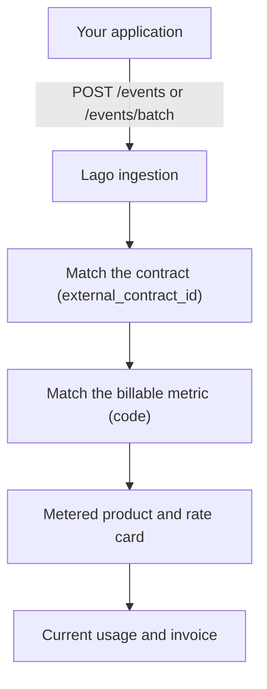
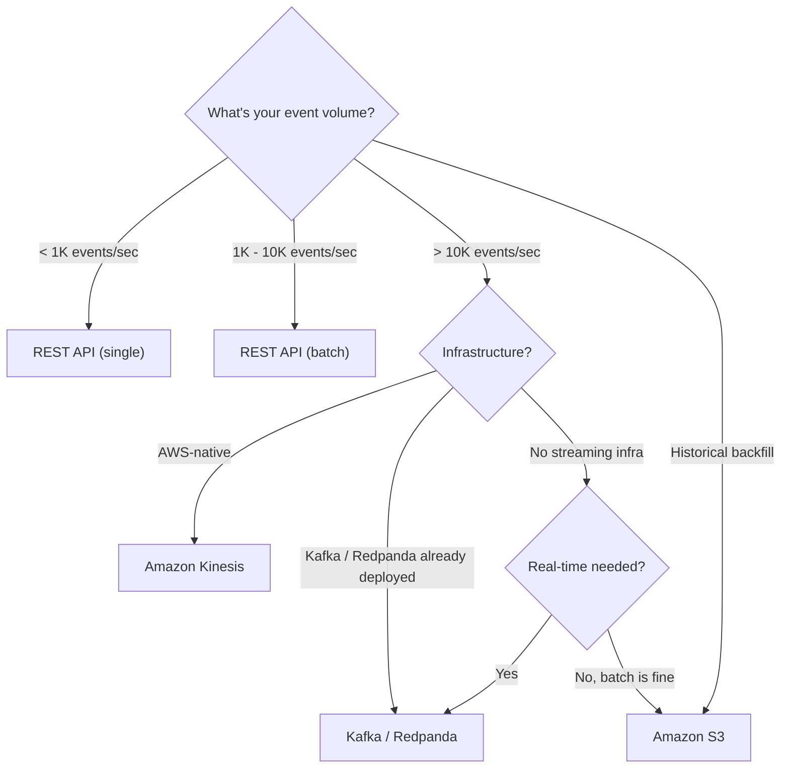

Send usage events to tell Lago what your customers consumed, such as API calls, compute hours or tokens. Each event identifies the Contract it belongs to with `external_contract_id` and the billable metric it feeds with `code`.

This guide explains how to design events, send them to Lago, and handle retries and late arrivals.

For a visual explanation of what happens after an event reaches Lago, [follow the usage ingestion pipeline](https://getlago.com/platform/usage-metering/ingestion), from API intake to deduplication, aggregation and the wallet's ongoing balance. Use this guide for the event fields, delivery methods and retry rules you need to implement.



## Designing your events

An event describes what happened, which Contract it belongs to, and the values you want to measure. Include properties such as token counts, compute hours, model or region.

Start with this question: **what usage do you want to measure?**

### Event schema

```json
{
  "transaction_id": "txn_20240314_cust8832_inference_00142",
  "external_contract_id": "contract_8832",
  "code": "ai_inference",
  "timestamp": 1710421740,
  "properties": {
    "model": "gpt-4",
    "tokens_in": 820,
    "tokens_out": 1500,
    "region": "us-east-1"
  }
}
```

| Field | What it describes |
| --- | --- |
| `transaction_id` | Your event identifier, used in deduplication. |
| `external_contract_id` | The Contract the usage belongs to. |
| `code` | The billable metric the event feeds. |
| `timestamp` | When usage happened, in Unix seconds. |
| `properties` | Values and dimensions describing the usage. |

<AccordionGroup>
  <Accordion title="transaction_id (required)">
    A unique ID you generate. Lago uses it for **deduplication**: if the same event arrives twice, it is billed once. Which copy Lago keeps depends on your event store, see [Idempotency and deduplication](#idempotency-and-deduplication).

    <Tip>
      **Good practice:** Don't use random UUIDs. Embed the customer, event type, and timestamp so you can trace a billed amount back to its source event without guessing:
      ```
      {type}_{date}_{customer}_{category}_{sequence}

      # Examples
      inf_20240314_cust42_gpt4_00831
      compute_20240314_org7_a100_useast_001
      pay_20240314_acct3391_card_00092
      ```
    </Tip>

    <Warning>
      If your Lago organization uses the ClickHouse-based event pipeline (designed for high-volume processing), event uniqueness is maintained with **both** `transaction_id` and `timestamp` fields:
      - If both are new to Lago, the event is ingested
      - If both have already been received, the new event **replaces** the previous one
      - If the `transaction_id` has been received but with a different `timestamp`, the two events are distinct and both are billed
      Always send `timestamp` explicitly on this pipeline. When you omit it, Lago sets it to the ingestion time, which differs on every call, so a retry without an explicit `timestamp` is stored and billed as a separate event.
    </Warning>
  </Accordion>

  <Accordion title="external_contract_id">
    Identifies the Contract the usage belongs to. Send its `external_id` as `external_contract_id`.
    If the `external_contract_id` does not match an active Contract in Lago, the event is ingested but not post-processed.
  </Accordion>

  <Accordion title="code (required)">
    Maps to a [billable metric](/v2/guide/billable-metrics/create-billable-metrics) you've defined in Lago (e.g., `ai_inference`, `api_calls`, `storage_gb`). Treat the `code` as a stable API contract between your application and your billing configuration.
    If the `code` does not match a billable metric in Lago, the event is ingested but not post-processed.
  </Accordion>

  <Accordion title="timestamp (optional)">
    When the event happened, as a **Unix timestamp**. Lago uses this to assign the event to the correct billing period.

    We typically log events using **timestamps in seconds**, such as `1741219251`. When higher precision is required, you can use **millisecond accuracy** in the format `1741219251.590`, where the dot acts as the decimal separator.

    <Info>
      If you do not specify a timestamp, Lago automatically uses the reception time of the event.
    </Info>
  </Accordion>

  <Accordion title="properties (optional)">
    Key-value pairs describing the usage you want to measure, such as token counts, regions and instance types. A property value can be any JSON value, so `strings`, `integers`, `floats`, `uuids` and `timestamps` all work.

    Lago ignores properties that don't match a billable metric, so **include dimensions you might price on in the future**. Extra fields cost nothing but give you pricing flexibility later.

    Events sent to a Count unique billable metric accept an `operation_type` property to control whether the unique value is added to or removed from the count:
    - `add`: Adds the unique value. **Optional**: Lago adds by default if `operation_type` is omitted.
    - `remove`: Removes the unique value from the count. **Required** whenever you want to explicitly remove a unit.

    <Warning>
      If your Lago organization uses the ClickHouse-based event pipeline (designed for high-volume processing), numeric values are stored with 26 decimal places, which caps them at approximately 1.70 × 10¹² (1,701,411,834,604). Currently, both the numeric value of an event property and the aggregated value of a billable metric over a billing period (for example, a Sum) must stay below this limit. Values above it overflow and may be reported as 0 or as an incorrect value in current usage and on invoices. The Postgres event store is not affected.
    </Warning>

  </Accordion>

  <Accordion title="precise_total_amount_cents (optional)">
    A finite amount in cents, supplied as a number or decimal string.
  </Accordion>
</AccordionGroup>

---

## Use cases in detail

<Tabs>
  <Tab title="AI / LLM">
    **Billing model:** Per-token pricing, rates vary by model and sometimes by input vs. output tokens.

    **Event design:** One event per inference request. Properties carry `model`, `tokens_in`, `tokens_out`, and any other dimensions you price on.

    ```json
    {
      "transaction_id": "inf_20240314150900_cust42_gpt4_00831",
      "external_contract_id": "contract_42",
      "code": "llm_tokens",
      "timestamp": 1710421740,
      "properties": {
        "model": "gpt-4",
        "tokens_in": 820,
        "tokens_out": 1500,
        "latency_ms": 1230,
        "stream": true
      }
    }
    ```

    **Billable metric setup:** Create a metric `llm_tokens` with aggregation type Sum and a custom expression like `event.properties.tokens_in + event.properties.tokens_out`. Use `model` as a Product filter to apply different per-token rates for GPT-4, GPT-3.5, Claude, etc.

    <Tip>
      Include `latency_ms` and `stream` in properties even if you don't price on them today. Lago ignores unused properties, but having the data means you can add latency-based tiers or streaming surcharges later without re-instrumenting.
    </Tip>

    **Volume consideration:** A busy AI platform might generate thousands of inference events per second. At low volume, send every event via REST API. At high volume, stream through Kafka or pre-aggregate to one event per customer per model per hour.
  </Tab>

  <Tab title="Cloud / GPU">
    **Billing model:** Per compute-hour pricing, rates vary by instance type, region, and on-demand vs. spot.

    **Event design:** One event per compute session (or per billing interval within a long-running session). Properties carry the full instance specification.

    ```json
    {
      "transaction_id": "compute_20240314_org7_a100_useast_0001",
      "external_contract_id": "contract_org7",
      "code": "compute_hours",
      "timestamp": 1710421740,
      "properties": {
        "instance_type": "gpu-a100-80gb",
        "region": "us-east-1",
        "hours": 1.0,
        "spot": false,
        "gpu_count": 8,
        "vcpus": 96,
        "memory_gb": 1024
      }
    }
    ```

    **Billable metric setup:** Metric `compute_hours` with Sum aggregation on the `hours` property. Use Product filters on `instance_type` and `region` to apply dimension-specific rates. With Lago's "most specific match wins" filter algorithm, you can set a default rate and override for specific instance types without creating hundreds of separate metrics.

    <Info>
      A Nasdaq-listed GPU cloud provider runs this exact pattern in production, processing **10M events/month** across **400+ machine instance types**, all billed on a single `compute_hours` metric. They pre-aggregate to one event per customer per instance type per day.
    </Info>

    <Tip>
      **Handling long-running sessions:** For VMs that run for days or weeks, emit a heartbeat event every hour rather than a single event at termination. This way, if a session crashes, you've already captured usage up to the last heartbeat.
    </Tip>
  </Tab>

  <Tab title="Fintech">
    **Billing model:** Per-transaction pricing, potentially with volume tiers, and rates that vary by payment method and geography.

    **Event design:** One event per transaction processed. Properties carry the transaction details your pricing needs.

    ```json
    {
      "transaction_id": "pay_20240314_acct3391_card_00092",
      "external_contract_id": "contract_3391",
      "code": "transactions",
      "timestamp": 1710421740,
      "properties": {
        "amount_cents": 15000,
        "currency": "USD",
        "payment_method": "card",
        "card_brand": "visa",
        "country": "US",
        "is_3ds": true
      }
    }
    ```

    **Billable metric setup:** For per-transaction flat fees, use Count aggregation on the `transactions` metric with Product filters on `payment_method` (different rates for card vs. ACH vs. wire). For percentage-based fees, use a custom expression like `event.properties.amount_cents * 0.029` or set up pricing tiers in your Rate Card configuration.

    <Info>
      A major global payments company runs Lago self-hosted, processing **thousands of transactions per second**. They started on Postgres (validated at 10K events/sec) and later migrated to ClickHouse + Kafka for higher throughput, with the same event format, the same pricing config and zero billing logic changes.
    </Info>

    **Currency handling:** Include `currency` in properties and use Product filters or custom expressions to handle multi-currency pricing. For FX, you can either convert at the event level (include `amount_usd_cents` as a derived property) or let Lago handle it through metric expressions.
  </Tab>

  <Tab title="API Platform">
    **Billing model:** Per-request pricing with tiers (free tier, then pay-per-use), rates may vary by endpoint category or response size.

    **Event design:** One event per API request. Properties carry the endpoint, status, and any dimensions relevant to pricing.

    ```json
    {
      "transaction_id": "api_20240314_app221_search_00004871",
      "external_contract_id": "contract_app221",
      "code": "api_requests",
      "timestamp": 1710421740,
      "properties": {
        "endpoint": "/v2/search",
        "category": "premium",
        "method": "POST",
        "response_bytes": 4096,
        "status_code": 200,
        "api_version": "2024-03"
      }
    }
    ```

    **Billable metric setup:** For tiered pricing (first 10K requests free, then $0.001/request), use Count aggregation. For pricing by category, use Product filters on `category` (e.g., "standard" vs. "premium"). For pricing by response size, use Sum aggregation on `response_bytes`.

    <Tip>
      **Should you bill failed requests?** If you want to exclude 4xx/5xx responses, add a billable metric filter that only counts events where `status_code` is in the 200 range. Include `status_code` in every event either way. It is useful for analytics even if you don't price on it.
    </Tip>

    **Volume consideration:** API platforms often have the highest event frequency. A platform serving 100M API calls/day generates ~1,150 events/sec. The REST API handles this easily. Above 10K requests/sec, consider Kafka or client-side pre-aggregation (one event per app per endpoint per hour).
  </Tab>

  <Tab title="Storage / CDN">
    **Billing model:** Per-GB pricing for storage or bandwidth, measured periodically or on transfer.

    **Event design:** For storage, emit a periodic measurement event (e.g., daily snapshot of GB stored). For bandwidth/transfer, emit one event per transfer or per time window.

    ```json
    {
      "transaction_id": "storage_20240314_org55_snapshot",
      "external_contract_id": "contract_org55",
      "code": "storage_gb",
      "timestamp": 1710460800,
      "properties": {
        "gb_stored": 2450.7,
        "tier": "hot",
        "region": "eu-west-1",
        "object_count": 1847293
      }
    }
    ```

    **Billable metric setup:** For storage, use Max or Latest aggregation on `gb_stored` to bill on peak or end-of-period usage. For bandwidth, use Sum on `gb_transferred`.

    <Tip>
      **Snapshot events vs. delta events:** For storage billing, periodic snapshots (one event per day with total GB stored) are simpler and more reliable than tracking every write/delete. This is also a natural pre-aggregation pattern: one event per day per customer instead of thousands.
    </Tip>
  </Tab>

  <Tab title="Marketplace">
    **Billing model:** Platform takes a percentage of each transaction (e.g., 2.9% + $0.30), or a flat take rate.

    **Event design:** One event per marketplace transaction, with the GMV amount.

    ```json
    {
      "transaction_id": "mkt_20240314_seller8821_order_00293",
      "external_contract_id": "contract_seller8821",
      "code": "marketplace_gmv",
      "timestamp": 1710421740,
      "properties": {
        "order_amount_cents": 8500,
        "currency": "USD",
        "category": "electronics",
        "buyer_country": "US"
      }
    }
    ```

    **Billable metric setup:** Use a custom expression to calculate the platform fee: e.g., `event.properties.order_amount_cents * 0.029 + 30` for a 2.9% + $0.30 model. Alternatively, use `precise_total_amount_cents` to compute the fee in your application and pass the exact amount to Lago.

    <Info>
      **Why `precise_total_amount_cents`?** When fee calculations involve complex business rules (tiered take rates, negotiated seller rates, promotional discounts), it's often cleaner to compute the fee in your backend and pass the result to Lago rather than encoding all that logic in metric expressions.
    </Info>
  </Tab>
</Tabs>

---

## Event design best practices

<CardGroup cols={2}>
  <Card title="Send more data than you need today">
    Properties are flexible: include dimensions you might price on in the future. Lago ignores properties that don't match a billable metric, so extra fields cost nothing but give you pricing flexibility later.
  </Card>
  <Card title="Make transaction_id meaningful">
    Don't use random UUIDs. Embed the customer, event type, and timestamp so you can trace a billed amount back to its source event without guessing.
  </Card>
  <Card title="One event per billable action">
    If a customer makes 3 API calls, send 3 events, not 1 event with a count of 3. This gives you maximum flexibility. The exception is pre-aggregation at very high volumes.
  </Card>
  <Card title="Use timestamp accurately">
    Lago assigns events to billing periods based on `timestamp`, not arrival time. Late-arriving events are placed in the correct historical period. This matters for reconciliation and billing accuracy.
  </Card>
  <Card title="Treat code as a contract">
    The `code` ties your event to a [billable metric](/v2/guide/billable-metrics/create-billable-metrics). If you rename a metric, you need to update the `code` in your events. Treat it as a stable API contract.
  </Card>
  <Card title="Test with a single event first">
    Send one event via the REST API and verify it appears in `GET /events?transaction_id=...` before scaling to batch or streaming delivery.
  </Card>
  <Card title="Carry who consumed it">
    Add the department, team, user or API key behind each event as properties. [Governance](/guide/governance/overview) uses them to attribute usage across your customer's organization.
  </Card>
</CardGroup>

---

## Delivery methods

Lago accepts events through multiple channels. All methods use the same event schema and produce identical billing results.



| Method | When to use |
| --- | --- |
| **REST API** | Most integrations. Simplest setup. Start here. |
| **REST API (batch)** | Groups events in one request. The default maximum is 100 events; deployments can configure a different maximum. |
| **Agent SDK** | LLM token billing. Wraps your provider client (Bedrock, Mistral, etc.) and emits token events automatically. |
| **Kafka / Redpanda** | Real-time, high-volume production pipelines. |
| **Amazon Kinesis** | AWS-native streaming architectures. |
| **Amazon S3** | Historical backfills, migrations, periodic batch loads. |

<Tip>
  **Start with the REST API.** You can migrate to streaming later without changing your event schema, billable metrics, or pricing configuration. Many customers start on REST and switch to Kafka only when they outgrow it.
</Tip>

For the full list of available ingestion sources, see [Metering ingestion sources](/guide/events/metering-source).

### REST API

The API key needs `event` write permission. A successful response acknowledges ingestion; newly accepted events may not appear in the events list immediately.

<Info>
  Replace `__LAGO_API_URL__` with `api.getlago.com` or `api.eu.getlago.com` for Lago Cloud, or your own instance URL for self-hosted deployments.
</Info>

<Tabs>
  <Tab title="Single event">
    ```bash
    LAGO_URL="https://__LAGO_API_URL__"
    API_KEY="__YOUR_API_KEY__"

    curl -X POST "$LAGO_URL/api/v2/events" \
      -H "Authorization: Bearer $API_KEY" \
      -H "Content-Type: application/json" \
      -d '{
        "event": {
          "transaction_id": "txn_20240314_cust42_api_00001",
          "external_contract_id": "contract_42",
          "code": "api_calls",
          "timestamp": 1710421740,
          "properties": {"tokens": 1500}
        }
      }'
    ```
  </Tab>
  <Tab title="Batch">
    The default maximum is 100 events per request. Deployments can configure a different maximum.

    ```bash
    LAGO_URL="https://__LAGO_API_URL__"
    API_KEY="__YOUR_API_KEY__"

    curl -X POST "$LAGO_URL/api/v2/events/batch" \
      -H "Authorization: Bearer $API_KEY" \
      -H "Content-Type: application/json" \
      -d '{
        "events": [
          {
            "transaction_id": "txn_001",
            "external_contract_id": "contract_42",
            "code": "api_calls",
            "timestamp": 1710421740,
            "properties": {"tokens": 1500}
          },
          {
            "transaction_id": "txn_002",
            "external_contract_id": "contract_42",
            "code": "api_calls",
            "timestamp": 1710421741,
            "properties": {"tokens": 2200}
          }
        ]
      }'
    ```

    <Warning>
      **Batches are atomic.** If a single event is invalid, Lago rejects the entire batch with a `422` and persists nothing. The valid events in the same request are dropped too. "Invalid" covers a missing `transaction_id` or `code`, a `timestamp` Lago cannot parse (`invalid_format`), a custom expression that fails to evaluate, and, on the Postgres event store only, a duplicate `transaction_id` (`value_already_exist`). The response reports failures by the event's **index in the array you sent**, not by `transaction_id`. Keep your array order so you can trace an index back to its source event. Validate and de-duplicate before batching.

      An `external_contract_id` that matches no Contract does not fail the batch: those events are ingested and skipped at post-processing. On the ClickHouse event store, duplicate `transaction_ids` do not fail the batch either: they are accepted with a 200 and resolved by deduplication instead. Don't rely on a 422 to catch duplicates; de-duplicate before you send.
    </Warning>
  </Tab>
</Tabs>

### Client libraries

See the client library documentation for installation and supported operations:

- [Python](https://github.com/getlago/lago-python-client)
- [JavaScript](https://github.com/getlago/lago-javascript-client)
- [Ruby](https://github.com/getlago/lago-ruby-client)
- [Go](https://github.com/getlago/lago-go-client)

The [REST API examples](#rest-api) above show the event payload for a Contract.

### Agent SDK

The [Agent SDK guide](/guide/ai-agents/agent-sdk/overview) describes how to capture token usage from provider clients. See the [Python](https://github.com/getlago/lago-agent-sdk-python) and [JavaScript / TypeScript](https://github.com/getlago/lago-agent-sdk-js) repositories for SDK configuration and supported operations.

### Kafka / Redpanda configuration

Kafka ingestion requires the **ClickHouse event store** (see [Architecture](/guide/events/usage-performances#architecture-how-lago-processes-events-at-scale)). Self-hosted instances enable it with `LAGO_CLICKHOUSE_ENABLED` and `LAGO_DEFAULT_EVENT_STORE=clickhouse`. See [Configuring the event store](/v2/guide/lago-self-hosted/docker#configuring-the-event-store).

<AccordionGroup>
  <Accordion title="Lago Cloud">
    Lago Cloud includes a managed Kafka endpoint. Contact the team for your connection details (broker address, credentials, topic name). No infrastructure to deploy.
  </Accordion>
  <Accordion title="Reader / producer tuning">
    Lago can directly consume events from your Kafka topic (which will require opening access to your Kafka broker / topic). Alternatively, you can send your events to a dedicated topic on our infrastructure (AWS VPC Peering or PrivateLink).

    In this second case, these settings have the biggest impact on throughput:

    | Setting | Recommended | Why |
    | --- | --- | --- |
    | `linger.ms` | 20-100ms | Batches messages for fewer, larger network calls |
    | `batch.num.messages` | 500-5000 | Larger batches = higher throughput |
    | `compression.type` | `lz4` | 60-80% bandwidth reduction at 1M events/sec |
    | `enable.idempotence` | `true` | Exactly-once delivery to broker |
    | Message key | `external_contract_id` | Preserves per-customer ordering |

    <Info>
      **Partition count:** Aim for partition count >= number of event processor instances. More partitions = more consumer parallelism.
    </Info>

    <Warning>
      **Consumer lag monitoring:** This is your #1 operational metric. Alert when lag exceeds your latency budget (e.g., > 100K messages).
    </Warning>
  </Accordion>
  <Accordion title="Redpanda on Kubernetes (self-hosted)">
    Minimal production deployment:

    ```yaml
    apiVersion: cluster.redpanda.com/v1alpha1
    kind: Redpanda
    metadata:
      name: redpanda
    spec:
      chartRef: {}
      clusterSpec:
        statefulset:
          replicas: 3
        auth:
          sasl:
            enabled: true
            users:
              - name: lago
                password: <your-password>
        resources:
          memory: { container: { max: 4Gi } }
          cpu: { cores: 2 }
        storage:
          persistentVolume: { size: 100Gi }
    ```

    See [Redpanda Operator docs](https://docs.redpanda.com/current/deploy/deployment-option/self-hosted/kubernetes/) for TLS, rack awareness, and tiered storage.

    <Note>
      ClickHouse on Kubernetes documentation is coming soon.
    </Note>
  </Accordion>
</AccordionGroup>

### Amazon Kinesis configuration

<Accordion title="Kinesis setup">
  We can read events directly from your Kinesis stream. We'll need:

  - Kinesis Stream ARN
  - Credentials:
    - Role ARN to assume, or
    - IAM Access Keys
</Accordion>

### Amazon S3 configuration

<AccordionGroup>
  <Accordion title="File format">
    Newline-delimited JSON (`.jsonl` or `.jsonl.gz`). Target 100MB-1GB per compressed file.

    <Info>
      When retrying an import, resend the original event payloads, including their timestamps. See [Idempotency and deduplication](#idempotency-and-deduplication).
    </Info>
  </Accordion>
  <Accordion title="S3 setup">
    We generally provide an S3 bucket on our infrastructure where you can deliver your files, along with credentials to upload new files.

    If you prefer to provide your own S3 bucket, an SQS queue is required to capture new file uploads (configurable on the S3 bucket properties/notifications). We would need:

    - S3 bucket
    - S3 Region
    - SQS URL
    - Credentials:
      - Role ARN to assume, or
      - IAM Access Keys
  </Accordion>
</AccordionGroup>


## Idempotency and deduplication

Lago deduplicates re-ingested events through the `transaction_id`, so a re-sent event is billed once. Deduplication works **across delivery methods**: a REST event isn't billed again if the same ID arrives via Kafka.

The deduplication key and the resolution rule depend on which event store your organization runs on:

| | Postgres event store | ClickHouse event store |
|---|---|---|
| Deduplication key | `transaction_id` + `external_contract_id` | `transaction_id` + `timestamp` + `external_contract_id` + `code` |
| Repeat ingestion | Rejected with a `422` (`value_already_exist`) | Accepted with a `200`; the latest copy **replaces** the earlier one |
| Which copy is billed | The first one received | The most recently ingested one |

<Warning>
  On the ClickHouse event store, the `timestamp` is part of the deduplication key. A retry that carries the same `transaction_id` but a **different** `timestamp` is a distinct event and **is billed again**. Because Lago defaults `timestamp` to the ingestion time when you omit it, every retry of a timestamp-less event produces a new billable event.

  **Send `timestamp` explicitly, and resend the original payload verbatim on retry.** Done that way, retries are safe on both stores: REST timeout? Resend. Kafka consumer restart? Reprocess. S3 import interrupted? Re-trigger.
</Warning>

Fees billed **in advance** are protected separately: Lago deduplicates their fees on `transaction_id` alone, so a duplicate can't produce a second in-advance fee on either store, regardless of `timestamp`.

Design your IDs to be **deterministic** (derived from source data), not random. This makes retries automatic and debugging straightforward.


## Handling edge cases

<AccordionGroup>
  <Accordion title="Late-arriving events">
    Events that arrive after a billing period has closed are assigned to the correct historical period based on `timestamp`. If the invoice has already been finalized, the event is not included in that billing cycle. However, if it matches a recurring billable metric, it impacts the next billing cycle.
  </Accordion>

  <Accordion title="Correcting events">
    - With Postgres: duplicates are rejected with a 422 and there is no replacement. A new `transaction_id` identifies a separate event; it does not replace the original.
    - With ClickHouse: send a new event with the same `transaction_id` and the same `timestamp`, carrying the updated properties. The new event replaces the original. A different `timestamp` creates a second billable event instead of amending the first.
  </Accordion>

  <Accordion title="Events before Contract start">
    Events with a `timestamp` before the Contract's `started_at` date are ingested, but ignored during post-processing and aggregation. Validate your timestamps if you're backfilling historical data.
  </Accordion>

  <Accordion title="Events for terminated Contracts">
    Events for Contracts that have been terminated are ingested, but ignored during post-processing. This is a safety mechanism: you don't need to stop your event pipeline the instant a Contract ends.
    You can still send usage events with timestamp before the Contract `terminated_at` if you want to amend a draft invoice.
  </Accordion>
</AccordionGroup>


## Verifying your integration

**Test with a single event first.** Send one event via the REST API, then retrieve it with `GET /events?transaction_id=...` to confirm Lago received and parsed it correctly.

**Reconciliation pattern:** Compare your source-of-truth event count against Lago. Use `GET /events` filtered by `external_contract_id`, `timestamp_from`, and `timestamp_to`, then compare against your internal logs. If the counts differ, check your filters, timestamps and ingestion responses. Newly accepted events may not appear immediately.

**What to watch on your side:**
- **REST API response codes:** 200 = accepted, 422 = validation error (missing `transaction_id` or `code`, invalid `timestamp`, failing expression, or a duplicate `transaction_id` on the Postgres event store), 429 = rate limited (retry safely), 5xx = server-side error (investigate before retrying)
- **At invoice time:** compare line item quantities against your own event counts per Contract per billing period. If they diverge, check for late arrivals outside the billing window.


## Rate limits

Lago enforces per-organization rate limits on the REST API, with the highest limits on event ingestion. If you exceed them you receive a `429 Too Many Requests` response with `X-RateLimit-Limit`, `X-RateLimit-Remaining`, and `X-RateLimit-Reset` headers. Retrying after a `429` is safe as long as you resend the identical payload, timestamp included (see [Idempotency and deduplication](#idempotency-and-deduplication)). See [Rate limits](/api-reference/rate-limits) for the full limits and retry guidance.

<Info>
  Kafka, Kinesis, and S3 connectors are not subject to REST API rate limits. Their throughput is bounded by your broker or infrastructure capacity.
</Info>
