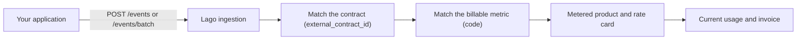

A usage event records one billable action, such as an API call, and tells Lago which contract it belongs to through `external_contract_id`. Send events whenever a customer on a contract consumes a metered product, and Lago aggregates them with the matching billable metric into fees.

The mechanism is the same as in the legacy (v1) model. Two things change: events target a contract with `external_contract_id`, and you send them to the v2 endpoints `POST /events` and `POST /events/batch`. `external_subscription_id` is not supported in v2 and returns `422`.



## Event schema

```json
{
  "event": {
    "transaction_id": "api_20270114_customer_example_00001",
    "external_contract_id": "contract_example",
    "code": "api_calls",
    "timestamp": 1799916000,
    "properties": {
      "endpoint": "/search",
      "region": "us-east-1"
    }
  }
}
```

| Field | Required | Meaning |
| --- | --- | --- |
| `transaction_id` | Yes | Identifier you supply for the event. |
| `code` | Yes | Code of the [billable metric](/v2/guide/billable-metrics/create-billable-metrics) the event feeds. |
| `external_contract_id` | No | `external_id` of the [contract](/v2/guide/contracts/overview) the usage belongs to. |
| `timestamp` | No | Unix timestamp in seconds. Defaults to the request time. Must be on or after 1970-01-01 and before 2300-01-01. Deployment-specific limits may also apply. Decimals add precision, for example `1799916000.123`. |
| `properties` | No | Event properties. Defaults to an empty object. Carries the values the metric aggregates and the dimensions product filters match. |
| `precise_total_amount_cents` | No | Finite amount in cents, as a number or decimal string. |

<Info>
  Send `external_contract_id` on every billable event. It is how Lago knows which contract, plan and rate cards apply.
</Info>

### How an event reaches a price

1. `external_contract_id` selects the contract and its applied rate cards.
2. `code` selects the billable metric.
3. The [metered product](/v2/guide/product-catalog/metered-products) built on that metric, and any matching [product filter](/v2/guide/product-catalog/product-filters), select the rate card.
4. The metric's aggregation type turns the events into a quantity. The rate turns the quantity into an amount.

Product filters match on `properties`. Filter values are case-sensitive: if the metric allows `us-east-1`, an event with `US-EAST-1` does not match.

## Send one event

<Tabs>
  <Tab title="Dashboard">
    Events are sent from your application through the API. The Dashboard does not create events.
  </Tab>
  <Tab title="API">
    <CodeGroup>
    ```bash Send one API call event
    LAGO_URL="https://api.getlago.com"
    API_KEY="__YOUR_API_KEY__"

    curl --location --request POST "$LAGO_URL/api/v2/events" \
      --header "Authorization: Bearer $API_KEY" \
      --header 'Content-Type: application/json' \
      --data-raw '{
        "event": {
          "transaction_id": "api_20270114_customer_example_00001",
          "external_contract_id": "contract_example",
          "code": "api_calls",
          "timestamp": 1799916000
        }
      }'
    ```
    </CodeGroup>

    The API key needs `event` write permission. Use `https://api.eu.getlago.com` for the EU region.
  </Tab>
</Tabs>

## Send a batch

`POST /events/batch` accepts an `events` array. The default maximum is 100 events per request. Deployments can configure a different maximum.

```bash Send two events in one request
LAGO_URL="https://api.getlago.com"
API_KEY="__YOUR_API_KEY__"

curl --location --request POST "$LAGO_URL/api/v2/events/batch" \
  --header "Authorization: Bearer $API_KEY" \
  --header 'Content-Type: application/json' \
  --data-raw '{
    "events": [
      {
        "transaction_id": "api_20270114_customer_example_00002",
        "external_contract_id": "contract_example",
        "code": "api_calls",
        "timestamp": 1799916001
      },
      {
        "transaction_id": "api_20270114_customer_example_00003",
        "external_contract_id": "contract_example",
        "code": "api_calls",
        "timestamp": 1799916002
      }
    ]
  }'
```

## What a success response means

A `200` acknowledges ingestion. On ClickHouse-based organizations, the product event pipeline must be configured, and success does not mean enrichment is complete. Newly accepted events may not appear in `GET /events` right away.

| Status | Meaning |
| --- | --- |
| `200` | Accepted. |
| `400`, `422` | Invalid request, for example a payload with `external_subscription_id`. Fix the payload before retrying. |
| `401`, `403` | Invalid API key, or missing `event` write permission or product catalog access. |
| `404` | A referenced resource was not found. |

## Example: 2,000 API calls

`contract_example` uses plan `api_monthly`. The metered product `api_calls_product` runs on the `api_calls` metric, which uses COUNT (`count_agg`). Each API call is one event.

| What you send | What Lago computes |
| --- | --- |
| 2,000 events with `code: "api_calls"` and `external_contract_id: "contract_example"`, timestamped in January 2027 | COUNT = 2,000 units on `api_calls_usd` |
| | 2,000 × $0.01 = $20.00 |
| | Plus the fixed $100.00 monthly service |
| | **$120.00 before tax** for January |

Sending one event with a property of `2000` does not count as 2,000 calls with COUNT. COUNT counts events. To send a pre-aggregated quantity, use a SUM metric on a numeric property.

## Event design best practices

<CardGroup cols={2}>
  <Card title="Send more data than you need today">
    Include dimensions you might price on later in `properties`. A product filter can only match values the events already carry.
  </Card>
  <Card title="Make transaction_id meaningful">
    Derive it from source data: event type, date, customer and a sequence. It lets you trace a billed amount back to its source.
  </Card>
  <Card title="One event per billable action">
    Three API calls are three events. Pre-aggregate only at very high volume, with a SUM metric.
  </Card>
  <Card title="Set timestamp explicitly">
    Lago defaults `timestamp` to the request time. Send the time the usage happened, and resend the same payload verbatim on retry.
  </Card>
  <Card title="Treat code as a contract">
    `code` ties the event to a billable metric. Renaming the metric means updating every event producer.
  </Card>
  <Card title="Test with one event first">
    Send one event, then find it with `GET /events?transaction_id=...` before you scale up.
  </Card>
</CardGroup>

## Count unique metrics

Events sent to a Count unique metric accept an `operation_type` property:

- `add`: adds the unique value. Optional. Lago adds by default.
- `remove`: removes the unique value from the count.

See [Count unique](/v2/guide/billable-metrics/aggregation-types/count-unique).

## Verify your integration

1. Send one event to a test contract with an open billing period.
2. List it with `GET /events?external_contract_id=contract_example`. See [Retrieve usage](/v2/guide/events/retrieve-usage).
3. Check the quantity in [contract current usage](/v2/guide/contracts/current-usage).
4. Compare your own event count per contract and period with Lago's `events_count`.

<CardGroup cols={2}>
  <Card title="Retrieve usage" icon="magnifying-glass-chart" href="/v2/guide/events/retrieve-usage">
    List events and read current usage.
  </Card>
  <Card title="Create billable metrics" icon="ruler" href="/v2/guide/billable-metrics/create-billable-metrics">
    Define what events measure.
  </Card>
  <Card title="Ingest an event (API)" icon="code" href="/v2/api-reference/events/create">
    `POST /events`
  </Card>
  <Card title="Ingest a batch (API)" icon="code" href="/v2/api-reference/events/batch">
    `POST /events/batch`
  </Card>
</CardGroup>
