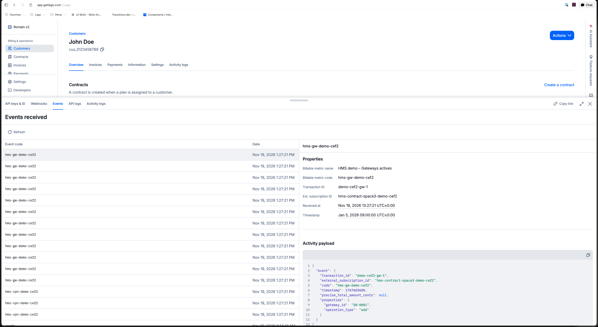
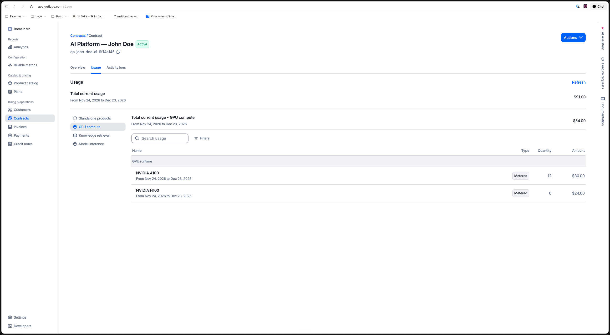

Find the events Lago received and review the quantities and amounts calculated for a Contract’s open billing periods.

## List events

Find received usage events to check your integration or investigate missing usage.

<Tabs>
  <Tab title="Dashboard">
1. Click **Developers** in the sidebar.
2. Open the **Events** tab.
3. Select an event to view its details and payload.

<Frame caption="View received events in the Dashboard">
  
</Frame>
  </Tab>
  <Tab title="API">
Use `GET /events` to find events by Contract, billable metric, transaction ID or the time the usage happened. Your API key needs `event` read permission.

The response is split into pages. Use the returned cursors to retrieve additional pages.

| Query parameter | Effect |
| --- | --- |
| `external_contract_id` | Events for one Contract. |
| `code` | Events for one billable metric code. |
| `transaction_id` | Events with this transaction identifier. |
| `timestamp_from` | Include events at or after this time. Use an ISO 8601 date or timestamp. A date without a time means midnight UTC. |
| `timestamp_to` | Include events at or before this time. Use an ISO 8601 date or timestamp. A date without a time means midnight UTC. |
| `limit` | Records per page. Values outside the supported range return `400`. |
| `after`, `before` | Use the values returned in `next_cursor` or `prev_cursor` to navigate the results. |
| `include_total_count` | Request `total_count` on the first page. If `total_count_estimated` is `true`, the count is an estimate. |

<CodeGroup>
```bash Events for contract_example in January 2027
LAGO_URL="https://api.getlago.com"
API_KEY="__YOUR_API_KEY__"

curl --location --request GET "$LAGO_URL/api/v2/events?external_contract_id=contract_example&code=api_calls&timestamp_from=2027-01-01T00:00:00Z&timestamp_to=2027-01-31T23:59:59Z&limit=100" \
  --header "Authorization: Bearer $API_KEY"
```

```bash Find events by transaction ID
LAGO_URL="https://api.getlago.com"
API_KEY="__YOUR_API_KEY__"

curl --location --request GET "$LAGO_URL/api/v2/events?transaction_id=api_20270114_customer_example_00001" \
  --header "Authorization: Bearer $API_KEY"
```
</CodeGroup>

### Read the response

Each event returns `transaction_id`, `external_contract_id`, `code`, `properties`, `precise_total_amount_cents` and `timestamp` (UTC, microsecond precision). The response also includes cursors for navigating the results.

```json Response (trimmed)
{
  "events": [
    {
      "transaction_id": "api_20270114_customer_example_00001",
      "external_contract_id": "contract_example",
      "code": "api_calls",
      "precise_total_amount_cents": null,
      "properties": {},
      "timestamp": "2027-01-14T08:40:00.000000Z"
    }
  ],
  "meta": {
    "next_cursor": null,
    "prev_cursor": null
  }
}
```

<a id="order-and-pagination"></a>

### Read additional pages

1. Copy `meta.next_cursor` from the response.
2. Send it as `after` in your next request, keeping the same filters.
3. Continue until there is no next cursor.

Use the cursor exactly as returned. Do not build it from event fields.

The order of results depends on the event store:

- ClickHouse-based organizations return enriched events ordered by `timestamp`, `external_contract_id`, `code` and `transaction_id`, all descending.
- PostgreSQL-based organizations order by creation time and identifier, both descending.

See [Pagination](/v2/api-reference/pagination).

### If an event is missing

1. Check the response to your ingestion request. A `422` means the event was rejected.
2. Check that your retrieval filters match the event's `external_contract_id`, `code` and `transaction_id`.
3. Check that its `timestamp` falls within your `timestamp_from` and `timestamp_to` range.
4. Check the remaining result pages.
5. If the event was just accepted, wait and repeat the retrieval request. Newly accepted events may not appear immediately.
  </Tab>
</Tabs>

## Retrieve current usage

Review a Contract’s calculated quantities and amounts for its open billing periods, grouped by applied Rate Card. These values can change before invoicing.

<Tabs>
  <Tab title="Dashboard">
1. Open the Contract from the customer’s page or the Contract list.
2. Click the **Usage** tab.
3. Browse usage by Product category, if applicable.
4. Review the quantities, amounts and billing periods.

<Frame caption="Review a Contract’s current usage by Product category">
  
</Frame>
  </Tab>
  <Tab title="API">
Your API key needs `customer_usage` read permission.

<CodeGroup>
```bash Current usage of contract_example
LAGO_URL="https://api.getlago.com"
API_KEY="__YOUR_API_KEY__"

curl --location --request GET "$LAGO_URL/api/v2/contracts/contract_example/current_usage" \
  --header "Authorization: Bearer $API_KEY"
```

```bash Metered products only
LAGO_URL="https://api.getlago.com"
API_KEY="__YOUR_API_KEY__"

curl --location --request GET "$LAGO_URL/api/v2/contracts/contract_example/current_usage?product_type=metered" \
  --header "Authorization: Bearer $API_KEY"
```
</CodeGroup>

### Filter results

| Query parameter | Effect |
| --- | --- |
| `rate_card_code` | One applied Rate Card. |
| `product_code` | One Product. |
| `product_filter_code` | One Product filter. |
| `product_type` | `fixed` or `metered`. |
| `apply_taxes` | Whether to apply taxes. |

### Read the response

`GET /contracts/{external_id}/current_usage` reads the pending or active Contract.

- Pending Contracts have no usage.
- Totals cover the open billing windows of every applied Rate Card. Because each card follows its own timeline, totals may span several future invoices.
- Amounts are in cents of the Contract's billing `currency`.
- The data is provisional. The billing windows are still open and new events keep accruing.

| Field | Meaning |
| --- | --- |
| `external_contract_id`, `external_customer_id` | The Contract and its customer. |
| `currency` | Billing currency. |
| `amount_cents` | Amount excluding tax. |
| `taxes_amount_cents` | Tax amount. |
| `total_amount_cents` | Amount including tax. |
| `rate_cards[]` | One entry per applied Rate Card billing window. |

For each `rate_cards[]` entry, check:

| Field | Meaning |
| --- | --- |
| `rate_card_code`, `product_code`, `product_filter_code` | The applied Rate Card and the Product or Product filter it prices. |
| `rate_phase_code`, `rate_source` | The phase and pricing source used for the window. |
| `rate_model`, `rate_properties` | Pricing settings used in the calculation. |
| `units` | Calculated quantity, as a decimal string. |
| `events_count` | Number of matching events. This may differ from the measured quantity. |
| `amount_cents` | Amount excluding tax for the window. |
| `from_datetime`, `to_datetime` | Start and end of the billing window. |

See the [API reference](/v2/api-reference/contracts/retrieve-current-usage) for the complete response.

### Example

`contract_example` started on January 1, 2027 on Plan `api_monthly`. While January's billing period is still open, 2,000 matching `api_calls` events have been received. This example uses Count, so the measured quantity and event count are both 2,000. It illustrates full monthly prices in USD, with no tax, proration, spending minimum or other adjustment. The response below is illustrative and trimmed to the fields used in the reconciliation.

<Accordion title="View the response example">

```json Response (illustrative, trimmed)
{
  "current_usage": {
    "external_contract_id": "contract_example",
    "external_customer_id": "customer_example",
    "currency": "USD",
    "amount_cents": 12000,
    "taxes_amount_cents": 0,
    "total_amount_cents": 12000,
    "rate_cards": [
      {
        "rate_card_code": "monthly_service_usd",
        "product_code": "monthly_service",
        "product_type": "fixed",
        "billable_metric_code": null,
        "billing_timing": "arrears",
        "rate_source": "rate",
        "rate_model": "standard",
        "units": "1",
        "events_count": 0,
        "amount_cents": 10000
      },
      {
        "rate_card_code": "api_calls_usd",
        "product_code": "api_calls_product",
        "product_type": "metered",
        "billable_metric_code": "api_calls",
        "billing_timing": "arrears",
        "rate_source": "rate",
        "rate_model": "standard",
        "units": "2000",
        "events_count": 2000,
        "amount_cents": 2000
      }
    ]
  }
}
```

</Accordion>

| Rate card | Units | Unit price | `amount_cents` |
| --- | --- | --- | --- |
| `monthly_service_usd` | 1 | 100.00 USD | 10000 |
| `api_calls_usd` | 2,000 | 0.01 USD | 2000 |
| **Total** | | | **12000 (120.00 USD)** |

`amount_cents` is in minor units: `12000` is 120.00 USD. Do not multiply it by 100 again.
  </Tab>
</Tabs>

Each applied Rate Card can follow a different billing period. The combined total may span several future invoices. Use [invoice fees](/v2/guide/invoicing/fees) to review billed results.

### If usage is missing

1. Check the Contract is `active`. Pending Contracts have no usage.
2. List the events for the Contract with `GET /events?external_contract_id=contract_example`. See [List events](#list-events).
3. Check each event's `code` matches the billable metric of the metered Product.
4. Check event timestamps fall inside the window's `from_datetime` and `to_datetime`.
5. If an event was accepted but is not visible yet, retrieve usage again after processing. Do not resend the event just to refresh the result.

<CardGroup cols={2}>
  <Card title="Ingest usage" icon="arrow-right-to-bracket" href="/v2/guide/events/ingesting-usage">
    Send usage events for a Contract.
  </Card>
  <Card title="List events (API)" icon="code" href="/v2/api-reference/events/list">
    `GET /events`
  </Card>
  <Card title="Retrieve Contract current usage (API)" icon="code" href="/v2/api-reference/contracts/retrieve-current-usage">
    `GET /contracts/{external_id}/current_usage`
  </Card>
  <Card title="Fees" icon="receipt" href="/v2/guide/invoicing/fees">
    Billed results after the window closes.
  </Card>
</CardGroup>
