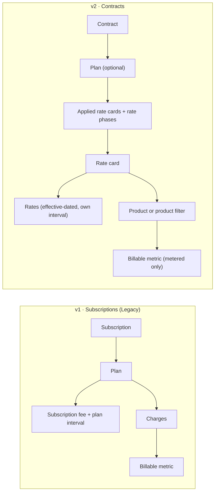

Lago v2 replaces the subscription with the contract: a contract applies billing terms to one customer, and its pricing comes from a product catalog of products, rate cards and effective-dated rates. Use this page to map v1 concepts to v2, and to decide which API version a new integration should use.

<Info>
API v2 is in beta (`2.0.0-beta`), served under `/api/v2`. API v1 (`/api/v1`) stays supported. The two versions document separate objects: v2 invoice and fee endpoints return contract invoices and product fees, not v1 subscription fees.
</Info>

## What changed

In v1, a plan holds charges, and a charge prices one billable metric with a charge model. The plan also carries the subscription fee and a single billing interval.

In v2, pricing is split into reusable layers:

- A **[product](/v2/guide/product-catalog/products)** names what you sell. It is `fixed` (configured quantity) or `metered` (quantity from a billable metric).
- A **[rate card](/v2/guide/rate-cards/overview)** targets one product or one [product filter](/v2/guide/product-catalog/product-filters). It holds `currency`, `billing_timing` and `proration`.
- A **[rate](/v2/guide/rate-cards/rates)** holds the price: `rate_model`, `rate_properties`, `effective_from` and its own billing interval. A rate card keeps a timeline of rates.
- A **[plan](/v2/guide/plans/overview)** is a set of applied rate cards, all in one currency. Each applied rate card can carry `units` and a sequence of `rate_phases`.
- A **[contract](/v2/guide/contracts/overview)** applies a plan, or rate cards attached directly, to one customer.

## V1 to V2 glossary

| V1 (Subscriptions) | V2 (Contracts) | What changed | Migration note |
| --- | --- | --- | --- |
| Subscription | [Contract](/v2/guide/contracts/overview) | Applies terms to one customer. The plan is optional. | Create contracts with `POST /api/v2/contracts`. |
| `external_subscription_id` | `external_contract_id` | Events target a contract. | The v2 events list rejects `external_subscription_id`. |
| Subscription statuses | Contract statuses | Same four values: `pending`, `active`, `terminated`, `canceled`. | A contract ended while pending is `canceled`. Ended while active, `terminated`. |
| Plan with charges | Plan with applied rate cards | A plan references reusable rate cards instead of owning its charges. | All applied rate cards share the plan currency. At most one per product or filter. |
| Charge | Applied rate card + rate | Not a 1:1 mapping. The rate card holds billing settings, the rate holds the price. | One v1 charge usually becomes one product, one rate card and one rate. |
| Charge model and `properties` | `rate_model` and `rate_properties` | Set on the rate. Tiers use `to_value` only. | See [pricing models](/v2/guide/rate-cards/pricing-models/overview). |
| Charge filters | [Product filters](/v2/guide/product-catalog/product-filters) | Filters are catalog objects on a metered product. A rate card can target one. | Declare the keys and values on the billable metric first. |
| Plan subscription fee | Fixed product + rate card + `standard` rate, applied with `units` | The recurring fee is a product like any other. | See [fixed products](/v2/guide/product-catalog/fixed-products). |
| Plan interval | Rate `billing_interval_count` + `billing_interval_unit` | Each rate has its own interval: `day`, `week`, `month` or `year`. | A monthly fee and a yearly fee can live in one plan. |
| Charge `pay_in_advance` | Rate card `billing_timing` | Enum `arrears` or `advance`, set per rate card. | Volume pricing is arrears only. |
| Charge `prorated` | Rate card `proration` | Boolean on the rate card. | Locked once a rate exists. |
| Charge `min_amount_cents` | Rate `min_amount_cents` | Applies per rate billing interval. Arrears only. | See [spending minimums](/v2/guide/rate-cards/spending-minimums). |
| Plan overrides at subscription creation | Contract overrides through `rate_override` on rate phases | Allowed only while the contract is `pending`. | See [contract overrides](/v2/guide/contracts/overrides). |
| Subscription `billing_time` | Contract `billing_time` | Same values: `calendar` or `anniversary`. Contracts add `billing_anchor_date`, which sets when the first billing cycle ends. | See [contract lifecycle](/v2/guide/contracts/lifecycle). |

Not mapped: trial periods, plan upgrades and downgrades, and plan-level minimum commitments have no documented v2 equivalent yet. Do not assume v1 behavior carries over.

## Same example, both versions

The running example is $100 per month plus $0.01 per API call. In v1, that is a plan with a $100 subscription fee and one standard charge on `api_calls`. In v2, it is:

| v2 object | Code | Setting |
| --- | --- | --- |
| Product category | `api_services` | Groups both products |
| Fixed product | `monthly_service` | No billable metric |
| Metered product | `api_calls_product` | `billable_metric_code: "api_calls"` |
| Rate card + rate | `monthly_service_usd` / `monthly_standard` | `standard`, `amount: "100"`, 1 month |
| Rate card + rate | `api_calls_usd` / `calls_standard` | `standard`, `amount: "0.01"`, 1 month |
| Plan | `api_monthly` | Both rate cards, `units: "1"` on the fixed one |
| Contract | `contract_example` | `customer_example` on `api_monthly` |

2,000 calls in a full month bill $100 + $20 = $120 before tax in both versions. [Your first invoice](/v2/guide/introduction/your-first-invoice) builds the v2 side step by step.

## Which version should I use?

- **Use v2 (Contracts)** for a new integration that needs a shared product catalog, effective-dated price changes, different billing intervals in one offer, or phased introductory pricing. The v2 endpoints require the product catalog to be enabled for your organization.
- **Use v1 (Subscriptions)** for an existing integration built on subscriptions, or when you depend on a feature that the v2 documentation does not cover yet.
- v1 is not deprecated. API v2 is in beta.

Legacy (v1): [Assign a plan to a customer](/guide/subscriptions/assign-plan) · [Plans](/guide/plans/overview) · [Charge models](/guide/plans/charges/charge-models/standard)

## FAQ

<AccordionGroup>
  <Accordion title="Is a contract the same thing as a subscription?">
    It plays the same role: it applies billing terms to one customer and drives invoicing. A contract differs in where pricing lives. Its terms come from applied rate cards, each with its own rates, billing interval and phase sequence, instead of from charges on a plan.
  </Accordion>
  <Accordion title="Can I send v1 events to a v2 contract?">
    Events use the same ingestion mechanism, but a v2 event targets a contract with `external_contract_id` on `POST /api/v2/events` or `POST /api/v2/events/batch`. The v2 events list rejects `external_subscription_id`. See [usage ingestion](/v2/guide/events/ingesting-usage).
  </Accordion>
  <Accordion title="Where did the plan interval go?">
    Each rate carries `billing_interval_count` and `billing_interval_unit`. Two rate cards in the same plan can bill on different intervals, for example a yearly platform fee and monthly usage.
  </Accordion>
  <Accordion title="Does a price change in v2 affect existing customers?">
    When a new rate becomes active, every plan and contract using that rate card picks up its price, unless the plan or contract overrides the price for the current phase. See [rates](/v2/guide/rate-cards/rates).
  </Accordion>
  <Accordion title="Is there an automated migration from v1 to v2?">
    No migration tool is documented. v1 subscriptions and v2 contracts are separate objects. To move an offer, recreate its pricing in the product catalog and create contracts for the customers.
  </Accordion>
</AccordionGroup>

<CardGroup cols={2}>
  <Card title="Your first invoice" icon="rocket" href="/v2/guide/introduction/your-first-invoice">
    Product, rate card, plan, contract, events, invoice.
  </Card>
  <Card title="Product catalog" icon="boxes-stacked" href="/v2/guide/product-catalog/overview">
    Categories, products and filters.
  </Card>
  <Card title="Rate cards" icon="tags" href="/v2/guide/rate-cards/overview">
    Billing settings and effective-dated rates.
  </Card>
  <Card title="API v2 reference" icon="code" href="/v2/api-reference/intro">
    Endpoints under `/api/v2`.
  </Card>
</CardGroup>
