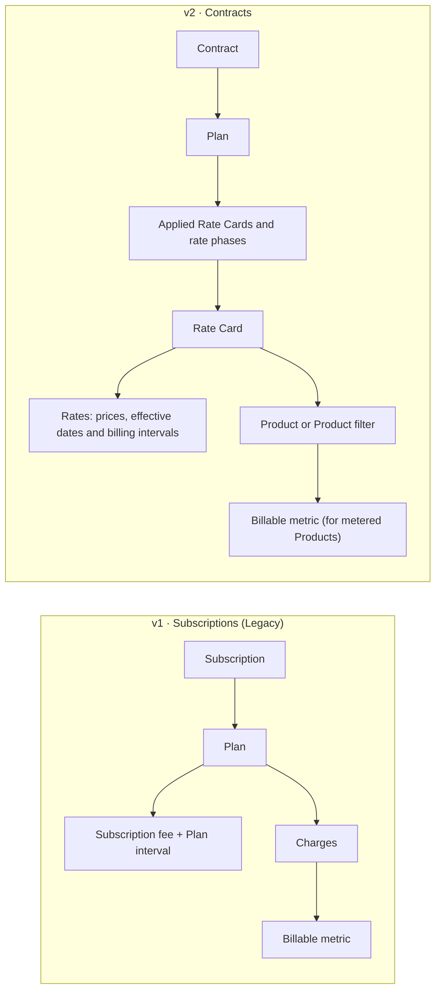

Subscriptions and Contracts both apply billing terms to a customer. They organize pricing differently.

With subscriptions, pricing is configured on a Plan through fees and charges. With Contracts, Products, Rate Cards and Rates define pricing that you can reuse across Plans.

Use this page to compare the models and understand how their objects and API fields relate.

<Info>
API v2 is in beta (`2.0.0-beta`), served under `/api/v2`. API v1 (`/api/v1`) stays supported. The two versions document separate objects: v2 invoice and fee endpoints return Contract invoices and Product fees, not v1 subscription fees.
</Info>

## What changed

In v1, a Plan holds charges, and a charge prices one billable metric with a charge model. The Plan also carries the subscription fee and a single billing interval.

In v2, pricing is split into reusable layers:

- A [Product](/v2/guide/product-catalog/products) defines what you sell. A fixed Product uses a configured quantity. A metered Product uses a billable metric to measure usage.
- A [Rate Card](/v2/guide/rate-cards/overview) holds Rates and shared billing settings for a Product or [Product filter](/v2/guide/product-catalog/product-filters), including currency, billing timing and adjustments for part of a billing period.
- A [Rate](/v2/guide/rate-cards/rates) defines the price, pricing model, effective date and billing interval.
- A [Plan](/v2/guide/plans/overview) combines applied Rate Cards in one currency. Each applied Rate Card can define `units` and a sequence of `rate_phases`.
- A [Contract](/v2/guide/contracts/overview) applies billing terms to a customer.

## Compare the billing models

| Subscriptions (v1) | Contracts (v2) | What changed |
| --- | --- | --- |
| Subscription | [Contract](/v2/guide/contracts/overview) | Applies terms to one customer. |
| Plan with charges | Plan with applied Rate Cards | A Plan references reusable Rate Cards instead of owning its charges. |
| Charge | Applied Rate Card + Rate | Not a 1:1 mapping. The Rate Card holds billing settings, the Rate holds the price. |
| Charge filters | [Product filters](/v2/guide/product-catalog/product-filters) | Filters are catalog objects on a metered Product. A Rate Card can target one. |
| Plan subscription fee | Fixed Product + Rate Card + `standard` Rate, applied with `units` | The recurring fee is a Product like any other. |
| Plan interval | Billing interval on each Rate | Each Rate has its own billing interval. |

## API field mappings

The table below maps fields and statuses between the two APIs.

| Subscriptions (v1) | Contracts (v2) | What changed | API details |
| --- | --- | --- | --- |
| `external_subscription_id` | `external_contract_id` | Events target a Contract. | The v2 events list rejects `external_subscription_id`. |
| Subscription statuses | Contract statuses | Same four values: `pending`, `active`, `terminated`, `canceled`. | A Contract ended while pending is `canceled`. Ended while active, `terminated`. |
| Charge model and `properties` | `rate_model` and `rate_properties` | Set on the Rate. Tiers use `to_value` only. | See [pricing models](/v2/guide/rate-cards/pricing-models/overview). |
| Plan interval | `billing_interval_count` and `billing_interval_unit` on each Rate | Each Rate has its own interval: `day`, `week`, `month` or `year`. | A monthly fee and a yearly fee can live in one Plan. |
| Charge `pay_in_advance` | Rate Card `billing_timing` | Enum `arrears` or `advance`, set per Rate Card. | Volume pricing is arrears only. |
| Charge `prorated` | Rate Card `proration` | Boolean on the Rate Card. | Locked once a Rate exists. |
| Charge `min_amount_cents` | Rate `min_amount_cents` | Applies per Rate billing interval. Arrears only. | See [spending minimums](/v2/guide/rate-cards/spending-minimums). |
| Plan overrides at subscription creation | Contract overrides through `rate_override` on rate phases | Allowed only while the Contract is `pending`. | See [Contract overrides](/v2/guide/contracts/overrides). |
| Subscription `billing_time` | Contract `billing_time` | Same values: `calendar` or `anniversary`. Contracts add `billing_anchor_date`, which sets when the first billing cycle ends. | See [Contract lifecycle](/v2/guide/contracts/lifecycle). |

### Related API details

- Create Contracts with `POST /api/v2/contracts`.
- All applied Rate Cards share the Plan currency. At most one per Product or filter.
- One v1 charge usually becomes one Product, one Rate Card and one Rate.
- Before creating Product filters, declare their keys and values on the billable metric.
- For the subscription fee mapping, see [fixed Products](/v2/guide/product-catalog/fixed-products).

Rate Cards use `currency`, `billing_timing` and `proration` for shared billing settings. Rates use `rate_model`, `rate_properties` and `effective_from` for pricing and effective dates. A Rate Card keeps a timeline of Rates.

Not mapped: trial periods, Plan upgrades and downgrades, and Plan-level minimum commitments have no documented v2 equivalent yet. Do not assume v1 behavior carries over.

## Same example, both versions

Consider an offer with a $100 monthly fee and $0.01 per API call.

With subscriptions, the Plan contains the subscription fee and a standard charge for API calls. With Contracts, the same offer uses the following Products, Rate Cards and Plan:

| v2 object | Code | Setting |
| --- | --- | --- |
| Product category | `api_services` | Groups both Products |
| Fixed Product | `monthly_service` | No billable metric |
| Metered Product | `api_calls_product` | `billable_metric_code: "api_calls"` |
| Rate Card + Rate | `monthly_service_usd` / `monthly_standard` | `standard`, `amount: "100"`, 1 month |
| Rate Card + Rate | `api_calls_usd` / `calls_standard` | `standard`, `amount: "0.01"`, 1 month |
| Plan | `api_monthly` | Both Rate Cards, `units: "1"` on the fixed one |
| Contract | `contract_example` | `customer_example` on `api_monthly` |

For a full month with one fixed unit and 2,000 API calls, both examples total $120 before tax, with no discounts, credits or adjustments for a partial billing period. [Your first invoice](/v2/guide/introduction/your-first-invoice) builds the v2 side step by step.

## Which version should I use?

- **Use v2 (Contracts)** for a new integration that needs a shared Product Catalog, effective-dated price changes, different billing intervals in one offer, or phased introductory pricing. The v2 endpoints require the Product Catalog to be enabled for your organization.
- **Use v1 (Subscriptions)** for an existing integration built on subscriptions, or when you depend on a feature that the v2 documentation does not cover yet.
- v1 is not deprecated. API v2 is in beta.

Legacy (v1): [Assign a Plan to a customer](/guide/subscriptions/assign-plan) · [Plans](/guide/plans/overview) · [Charge models](/guide/plans/charges/charge-models/standard)

## FAQ

<AccordionGroup>
  <Accordion title="Is a Contract the same thing as a subscription?">
    It plays the same role: it applies billing terms to one customer and drives invoicing. A Contract differs in where pricing lives. Its terms come from applied Rate Cards, each with its own Rates, billing interval and phase sequence, instead of from charges on a Plan.
  </Accordion>
  <Accordion title="Can I send v1 events to a v2 Contract?">
    Events use the same ingestion mechanism, but a v2 event targets a Contract with `external_contract_id` on `POST /api/v2/events` or `POST /api/v2/events/batch`. The v2 events list rejects `external_subscription_id`. See [usage ingestion](/v2/guide/events/ingesting-usage).
  </Accordion>
  <Accordion title="Where did the Plan interval go?">
    Each Rate carries `billing_interval_count` and `billing_interval_unit`. Two Rate Cards in the same Plan can bill on different intervals, for example a yearly platform fee and monthly usage.
  </Accordion>
  <Accordion title="Does a price change affect existing customers?">
    When a new Rate becomes active, every Plan and Contract using that Rate Card picks up its price, unless the Plan or Contract overrides the price for the current phase. See [Rates](/v2/guide/rate-cards/rates).
  </Accordion>
  <Accordion title="Is there an automated migration from v1 to v2?">
    No migration tool is documented. v1 subscriptions and v2 Contracts are separate objects. To move an offer, recreate its pricing in the Product Catalog and create Contracts for the customers.
  </Accordion>
</AccordionGroup>

<CardGroup cols={2}>
  <Card title="Your first invoice" icon="rocket" href="/v2/guide/introduction/your-first-invoice">
    Build the $100 monthly fee plus $0.01 per API call example.
  </Card>
  <Card title="Product Catalog" icon="boxes-stacked" href="/v2/guide/product-catalog/overview">
    Define the Products you sell and their filters.
  </Card>
  <Card title="Rate Cards" icon="tags" href="/v2/guide/rate-cards/overview">
    Configure billing settings and prices over time.
  </Card>
  <Card title="API reference" icon="code" href="/v2/api-reference/intro">
    Find endpoints and request fields under `/api/v2`.
  </Card>
</CardGroup>
