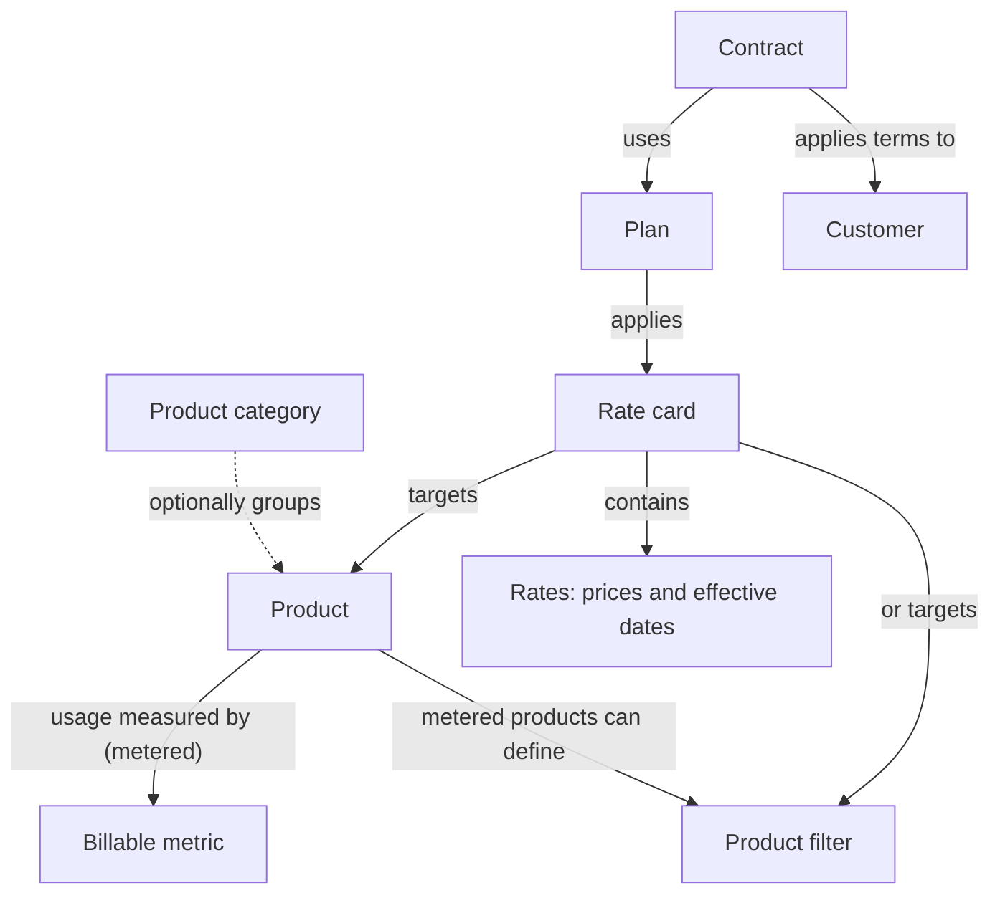

Lago is the contract-based billing engine: it turns your pricing and your customers' usage into invoices. You define what you sell in a product catalog, price it with rate cards and rates, bundle the pricing into a plan, and apply it to a customer with a contract.

<Info>
API v2 is in beta (`2.0.0-beta`). The subscription-based engine stays supported as [Legacy (v1): Welcome to Lago](/guide/introduction/welcome-to-lago). To compare the two models, read [Contracts vs subscriptions](/v2/guide/introduction/contracts-vs-subscriptions).
</Info>

This documentation follows one example: a monthly fee of $100, plus $0.01 for each API call. With 2,000 calls in a month, the invoice is $120 before tax. [Your first invoice](/v2/guide/introduction/your-first-invoice) builds it end to end.

## Five-step billing workflow

The workflow below explains how usage becomes a billed amount. Fixed products do not need usage events.

### 1. Usage ingestion

An [event](/v2/api-reference/events/create) records something your customer consumed. In the example, your application sends one event per API call, addressed to the customer's contract with `external_contract_id`.

Events can carry properties that describe the usage, such as a region. Properties let you price subsets of usage differently when your pricing needs that detail.

### 2. Metrics aggregation

A [billable metric](/v2/guide/billable-metrics/create-billable-metrics) defines how Lago measures usage from events. For API calls, a `COUNT` metric (`count_agg`) counts the matching events.

2,000 matching events give a billable quantity of 2,000 calls. The metric measures the quantity. Pricing decides what that quantity costs.

### 3. Pricing and packaging

Pricing connects what you sell to the terms each customer receives. Each object has one role.

| Object | Purpose | In the example |
| --- | --- | --- |
| [Product category](/v2/guide/product-catalog/product-categories) | Groups products. Optional. | `api_services` groups the monthly service and API calls. |
| [Product](/v2/guide/product-catalog/products) | What you charge for. A fixed product has no billable metric. A metered product uses one to measure consumption. | Fixed `monthly_service` and metered `api_calls_product`. |
| [Product filter](/v2/guide/product-catalog/product-filters) | A subset of a metered product's usage, priced separately. | None in the baseline. A variation could split calls by region. |
| [Rate card](/v2/guide/rate-cards/overview) | Billing settings and rates for one product or product filter: currency, billing timing, proration. | `monthly_service_usd` and `api_calls_usd`. |
| [Rate](/v2/guide/rate-cards/rates) | How much to charge, with which rate model, from which date, on which billing interval. | `monthly_standard` at $100 per month, `calls_standard` at $0.01 per call. |
| [Plan](/v2/guide/plans/overview) | Combines rate cards into a reusable offer. | `api_monthly`. |
| [Contract](/v2/guide/contracts/overview) | Applies billing terms to one customer. | `contract_example` for `customer_example`. |

A product can belong to a product category or stand alone. A category organizes products. It never sets a price.

The diagram shows how the objects relate. Arrows describe relationships, not setup order.

Each rate card targets either a product or one of its filters. It holds the shared billing settings and the rates that define pricing over time. The `api_calls_usd` rate card targets `api_calls_product`. Its rate sets the price at $0.01 per call. A later rate can introduce a new price from a specified date.

The plan brings the offer together. The contract connects those terms to the customer. Every invoice line traces back to a product, a rate card, a rate and a quantity.

### 4. Invoicing

Lago calculates fees from the customer's contract and the billed quantities. The rate's billing interval and the rate card's billing timing decide when fees are invoiced.

For one full monthly period, with one fixed unit, 2,000 API calls, and no proration, discounts, credits or taxes:

| Product | Rate | Quantity | Period | Amount before tax |
| --- | --- | --- | --- | --- |
| Monthly service | $100 per month | 1 fixed unit | Full monthly period | $100.00 |
| API calls | $0.01 per call | 2,000 calls | Same full monthly period | $20.00 |
| **Total** | | | | **$120.00** |

The fixed line is $100 × 1. The usage line is $0.01 × 2,000 = $20. Together, $120 before tax. To reconcile a line, check its product, rate, quantity and billing period.

### 5. Payments

An invoice records what your customer owes. A payment records money received toward that balance.

Lago connects billing to payment collection through [payment providers](/v2/guide/payments/payment-providers). You can also [record payments received outside Lago](/v2/guide/payments/record-manual-payments).

Invoice status and payment status are separate. A finalized invoice does not mean the customer has paid.

## Where to go next

| Your goal | Start here |
| --- | --- |
| Measure customer consumption | [Billable metrics](/v2/guide/billable-metrics/create-billable-metrics) and [usage ingestion](/v2/guide/events/ingesting-usage) |
| Define products, filters and reusable pricing | [Product catalog](/v2/guide/product-catalog/overview) and [rate cards](/v2/guide/rate-cards/overview) |
| Build an offer and apply it to a customer | [Plans](/v2/guide/plans/overview) and [contracts](/v2/guide/contracts/overview) |
| Understand and verify invoice lines | [Invoicing](/v2/guide/invoicing/overview) |
| Collect and reconcile payments | [Payments](/v2/guide/payments/payment-providers) |

Task guides use **Dashboard** and **API** tabs where both paths exist. They share the same concepts and the same example.

<CardGroup cols={2}>
  <Card title="Your first invoice" icon="rocket" href="/v2/guide/introduction/your-first-invoice">
    Build the $100 + $0.01 per call example end to end, from billable metric to invoice.
  </Card>
  <Card title="Contracts vs subscriptions" icon="code-compare" href="/v2/guide/introduction/contracts-vs-subscriptions">
    What changed from v1 and which version to use.
  </Card>
  <Card title="Lago Cloud" icon="cloud" href="/guide/lago-cloud">
    Use the hosted Lago service.
  </Card>
  <Card title="API reference" icon="code" href="/v2/api-reference/intro">
    Base URLs, authentication, pagination and errors for `/api/v2`.
  </Card>
</CardGroup>
