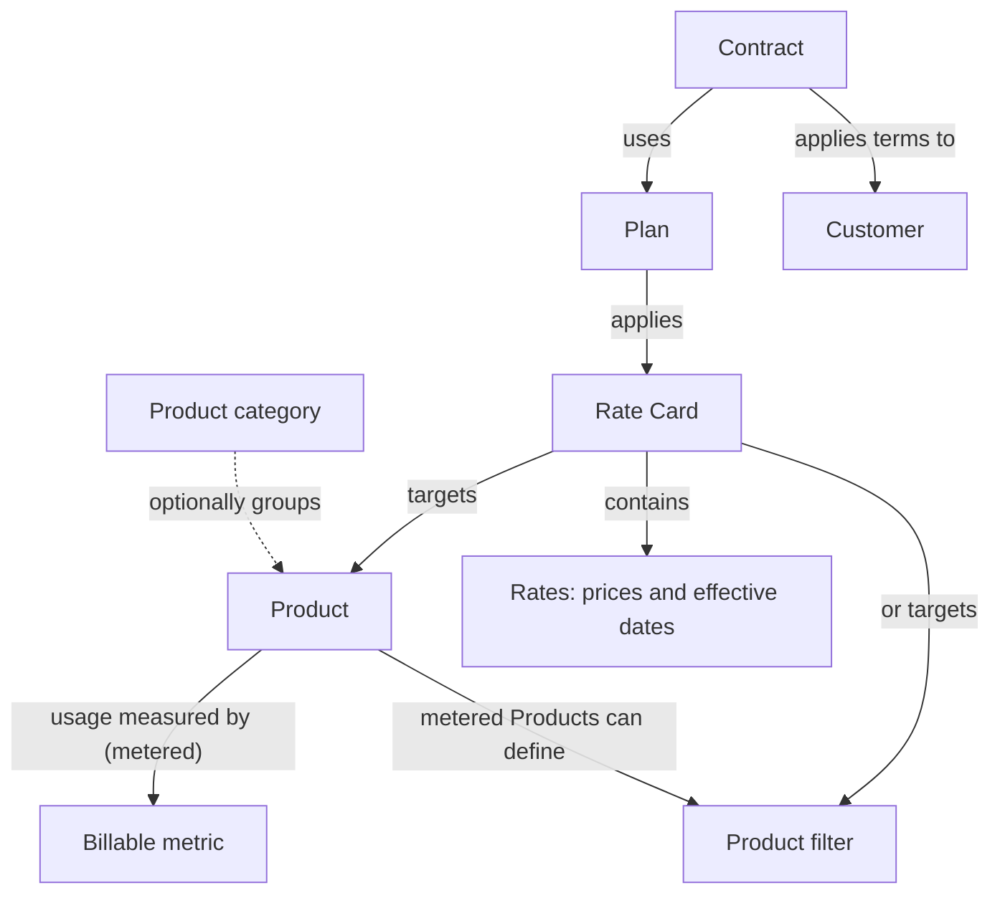

Lago turns your pricing and your customers' usage into invoices.

Define what you sell as Products and configure their pricing with Rate Cards and Rates. Combine that pricing into a Plan, then use a Contract to apply the billing terms to a customer.

<Info>
API v2 is in beta (`2.0.0-beta`). The subscription-based engine stays supported as [Legacy (v1): Welcome to Lago](/guide/introduction/welcome-to-lago). To compare the two models, read [Contracts vs subscriptions](/v2/guide/introduction/contracts-vs-subscriptions).
</Info>

This guide uses an example with a $100 monthly fee and $0.01 per API call. For a full month with one fixed unit and 2,000 calls, the total is $120 before tax, with no discounts, credits or adjustments for a partial billing period.

Follow [Your first invoice](/v2/guide/introduction/your-first-invoice) to build this example.

## How billing works

The sections below explain how usage, pricing, invoices and payments fit together. Fixed Products do not need usage events.

### 1. Record usage

An [event](/v2/api-reference/events/create) records your customer's usage. In this example, your application sends one event for each API call. The `external_contract_id` field identifies the customer's Contract.

Events can include properties such as region. You can use these properties to price groups of usage differently.

### 2. Measure usage

A [billable metric](/v2/guide/billable-metrics/create-billable-metrics) defines how Lago measures usage from events. In this example, the Count aggregation (`count_agg`) counts API call events.

With 2,000 matching events, the billable quantity is 2,000 calls. The metric determines the quantity; the Rate determines the price.

### 3. Define pricing

Pricing connects what you sell to the terms each customer receives. Each object has one role.

| Object | Purpose | In the example |
| --- | --- | --- |
| [Product category](/v2/guide/product-catalog/product-categories) | An optional way to group Products. | `api_services` groups the monthly service and API calls. |
| [Product](/v2/guide/product-catalog/products) | What you bill your customer for. A fixed Product has no billable metric. A metered Product uses a billable metric to measure usage. | Fixed `monthly_service` and metered `api_calls_product`. |
| [Product filter](/v2/guide/product-catalog/product-filters) | A group of a metered Product's usage that you price separately. | Not used in this example. You could use a filter to price calls by region. |
| [Rate Card](/v2/guide/rate-cards/overview) | Holds Rates and shared billing settings for a Product or Product filter, including currency, billing timing and proration—adjustments for part of a billing period. | `monthly_service_usd` and `api_calls_usd`. |
| [Rate](/v2/guide/rate-cards/rates) | Defines the price, pricing model, effective date and billing interval. | `monthly_standard` at $100 per month, `calls_standard` at $0.01 per call. |
| [Plan](/v2/guide/plans/overview) | Combines applied Rate Cards into a reusable offer. | `api_monthly`. |
| [Contract](/v2/guide/contracts/overview) | Applies billing terms to a customer. | `contract_example` for `customer_example`. |

A Product can belong to a Product category or stand alone. A category organizes Products. It never sets a price.

The diagram shows how the objects relate. Arrows describe relationships, not setup order.

Each Rate Card targets either a Product or one of its filters. It holds the shared billing settings and the Rates that define pricing over time. The `api_calls_usd` Rate Card targets `api_calls_product`. Its Rate sets the price at $0.01 per call. A later Rate can introduce a new price from a specified date.

The Plan brings the offer together. The Contract connects those terms to the customer. In this example, each invoice line relates to a Product, a Rate Card, a Rate and a quantity.

### 4. Calculate invoice amounts

Lago calculates fees from the customer's Contract and the billed quantities. The Rate's billing interval and the Rate Card's billing timing decide when fees are invoiced.

For one full monthly period, with one fixed unit, 2,000 API calls, and no proration, discounts, credits or taxes:

| Product | Rate | Quantity | Period | Amount before tax |
| --- | --- | --- | --- | --- |
| Monthly service | $100 per month | 1 fixed unit | Full monthly period | $100.00 |
| API calls | $0.01 per call | 2,000 calls | Same full monthly period | $20.00 |
| **Total** | | | | **$120.00** |

To check an invoice line, compare its Product, Rate, quantity and billing period with the Contract's billing terms.

### 5. Collect and record payments

An invoice records what your customer owes. You can collect payments through a [payment provider](/v2/guide/payments/payment-providers) or [record payments received outside Lago](/v2/guide/payments/record-manual-payments).

A finalized invoice does not mean the customer has paid.

## Where to go next

| Your goal | Start here |
| --- | --- |
| Measure customer consumption | [Billable metrics](/v2/guide/billable-metrics/create-billable-metrics) and [usage ingestion](/v2/guide/events/ingesting-usage) |
| Define Products, filters and reusable pricing | [Product Catalog](/v2/guide/product-catalog/overview) and [Rate Cards](/v2/guide/rate-cards/overview) |
| Build an offer and apply it to a customer | [Plans](/v2/guide/plans/overview) and [Contracts](/v2/guide/contracts/overview) |
| Understand and verify invoice lines | [Invoicing](/v2/guide/invoicing/overview) |
| Collect and reconcile payments | [Payments](/v2/guide/payments/payment-providers) |

Where both options are available, task guides include **Dashboard** and **API** instructions.

<CardGroup cols={2}>
  <Card title="Your first invoice" icon="rocket" href="/v2/guide/introduction/your-first-invoice">
    Create a Contract and invoice a $100 monthly fee plus $0.01 per API call.
  </Card>
  <Card title="Contracts vs subscriptions" icon="code-compare" href="/v2/guide/introduction/contracts-vs-subscriptions">
    Compare the contract-based and subscription-based billing models.
  </Card>
  <Card title="Lago Cloud" icon="cloud" href="/guide/lago-cloud">
    Use the hosted Lago service.
  </Card>
  <Card title="API reference" icon="code" href="/v2/api-reference/intro">
    Base URLs, authentication, pagination and errors for `/api/v2`.
  </Card>
</CardGroup>
