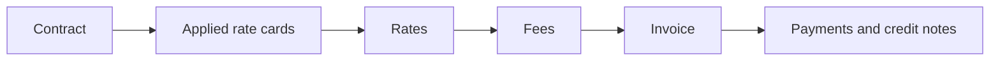

An [invoice](/v2/api-reference/invoices/retrieve) is the billing document Lago generates from the fees of one or more [contracts](/v2/guide/contracts/overview). Use the invoice endpoints to read what a customer owes, follow its payment status and run the few actions a finalized or draft invoice supports.

<Info>
The v2 invoice endpoints return product catalog invoices only. `GET /invoices` lists contract invoices and invoices that contain contract fees. Invoices that only exist in the legacy engine return `404` on retrieval.
</Info>

## How an invoice is built

Each [rate](/v2/guide/rate-cards/rates) that applies to a contract produces a [fee](/v2/guide/invoicing/fees) for the billing period. Lago groups the fees on an invoice, applies taxes, then computes the totals.



## Worked example

The running example uses contract `contract_example` with two applied rate cards, both billed in arrears in USD:

- `monthly_service_usd`: rate `monthly_standard`, $100 per month.
- `api_calls_usd`: rate `calls_standard`, $0.01 per call.

The customer sends 2,000 API calls in the period. Assume a 20% tax rate is assigned (see [Taxes](/v2/guide/taxes)).

```
INVOICE: contract_example, one monthly period, USD

monthly_service      1 x $100.00          $100.00
api_calls_product    2,000 x $0.01         $20.00
------------------------------------------------
Fees (excl. tax)                          $120.00
Tax (20%)                                  $24.00
------------------------------------------------
Total                                     $144.00
```

On the invoice object, this reads as:

| Field | Value |
| --- | --- |
| `fees_amount_cents` | `12000` |
| `sub_total_excluding_taxes_amount_cents` | `12000` |
| `taxes_amount_cents` | `2400` |
| `sub_total_including_taxes_amount_cents` | `14400` |
| `total_amount_cents` | `14400` |
| `total_due_amount_cents` | `14400` until a payment or credit note settles it |

Each line is a fee with `product_code`, `rate_card_code`, `rate_code`, `units` and `amount_cents`. Request `expands[]=fees` to get them inline.

## Invoice types

`invoice_type` tells you why the invoice exists. The list filter accepts two values:

| `invoice_type` | Meaning |
| --- | --- |
| `contract` | Periodic invoice for a contract. |
| `advance_fees` | Invoice for fees billed in advance. The v1 name was `advance_charges`. |

The invoice object can also return legacy types (`subscription`, `add_on`, `credit`, `one_off`, `progressive_billing`) for invoices that mix legacy and contract fees.

## Statuses

`status` follows the invoice lifecycle. `payment_status` tracks collection separately.

| Field | Values |
| --- | --- |
| `status` | `generating`, `draft`, `open`, `finalized`, `voided`, `failed`, `closed`, `pending`, `deleted` |
| `payment_status` | `pending`, `succeeded`, `failed` |

The list endpoint filters on `status[]` with `draft`, `finalized`, `voided`, `failed` and `pending`.

## Available actions

| Action | Endpoint | Applies to |
| --- | --- | --- |
| Refresh | `PUT /invoices/{lago_id}/refresh` | Draft invoices. See [Draft invoices](/v2/guide/invoicing/draft-invoices). |
| Finalize | `PUT /invoices/{lago_id}/finalize` | Draft invoices. |
| Delete | `DELETE /invoices/{lago_id}` | Draft invoices not synced to an external integration. |
| Download PDF | `POST /invoices/{lago_id}/download_pdf` | Finalized invoices. See [Download invoices](/v2/guide/invoicing/download-invoices). |
| Resend email | `POST /invoices/{lago_id}/resend_email` | Finalized invoices. Premium license. |
| Void | `POST /invoices/{lago_id}/void` | Eligible invoices. See [Void invoices](/v2/guide/invoicing/void). |
| Retry payment | `POST /invoices/{lago_id}/retry_payment` | See [Payment retries](/v2/guide/payments/payment-retries). |
| Payment URL | `POST /invoices/{lago_id}/payment_url` | See [Payment retries](/v2/guide/payments/payment-retries). |
| Retry taxes | `POST /invoices/{lago_id}/retry_taxes` | Invoices whose tax processing failed. |
| Lose dispute | `POST /invoices/{lago_id}/lose_dispute` | Invoices with a payment dispute. |
| Update | `PUT` or `PATCH /invoices/{lago_id}` | Only `payment_status` is editable. Voided invoices reject updates. |

## List and retrieve invoices

<Tabs>
  <Tab title="Dashboard">
    1. Open **Invoices** in the side menu, or open a customer and select the **Invoices** tab;
    2. Use the filters to narrow the list; and
    3. Click an invoice to see its fees, taxes and payments.
  </Tab>
  <Tab title="API">
    The list is cursor-paginated and ordered by `issuing_date`, newest first. Filters include `external_customer_id`, `status[]`, `payment_status[]`, `invoice_type`, `currency`, `billing_entity_codes[]`, `issuing_date_from`, `issuing_date_to`, `amount_from`, `amount_to`, `payment_overdue`, `partially_paid`, `payment_dispute_lost`, `settlements[]` and `search_term`. See [Pagination](/v2/api-reference/pagination).

    <CodeGroup>
    ```bash List finalized invoices of a customer
    LAGO_URL="https://api.getlago.com"
    API_KEY="__YOUR_API_KEY__"

    curl --location --request GET "$LAGO_URL/api/v2/invoices?external_customer_id=customer_example&status[]=finalized&limit=20" \
      --header "Authorization: Bearer $API_KEY"
    ```

    ```bash Retrieve an invoice with its fees
    LAGO_URL="https://api.getlago.com"
    API_KEY="__YOUR_API_KEY__"
    INVOICE_ID="__YOUR_INVOICE_ID__"

    curl --location --request GET "$LAGO_URL/api/v2/invoices/$INVOICE_ID?expands[]=fees&expands[]=applied_taxes" \
      --header "Authorization: Bearer $API_KEY"
    ```
    </CodeGroup>

    Supported expansions on retrieval: `fees`, `applied_taxes`, `customer`, `contracts`, `applied_invoice_custom_sections` and `error_details`. Expanding more than 1,000 fees returns `400 expansion_too_large`. Use [`GET /fees`](/v2/api-reference/fees/list) for larger invoices.

    To list the invoices of one customer, you can also call [`GET /customers/{customer_external_id}/invoices`](/v2/api-reference/customers/list-invoices).
  </Tab>
</Tabs>

## Retry taxes

When tax processing fails, for example with a tax provider, retry it once the cause is fixed.

<CodeGroup>
```bash Retry invoice taxes
LAGO_URL="https://api.getlago.com"
API_KEY="__YOUR_API_KEY__"
INVOICE_ID="__YOUR_INVOICE_ID__"

curl --location --request POST "$LAGO_URL/api/v2/invoices/$INVOICE_ID/retry_taxes" \
  --header "Authorization: Bearer $API_KEY"
```
</CodeGroup>

Request `expands[]=error_details` on retrieval to see why the previous attempt failed.

## Mark a payment dispute as lost

When a customer disputes a payment and you lose the dispute, record it on the invoice. The invoice then exposes `payment_dispute_lost_at`.

<Warning>
Marking a dispute as lost changes the financial record of the invoice. Check the invoice identifier before you call the endpoint, and review the change before you run it in production.
</Warning>

<CodeGroup>
```bash Mark a dispute as lost
LAGO_URL="https://api.getlago.com"
API_KEY="__YOUR_API_KEY__"
INVOICE_ID="__YOUR_INVOICE_ID__"

curl --location --request POST "$LAGO_URL/api/v2/invoices/$INVOICE_ID/lose_dispute" \
  --header "Authorization: Bearer $API_KEY"
```
</CodeGroup>

## Update the payment status

If you collect payments outside Lago and do not record them as [manual payments](/v2/guide/payments/record-manual-payments), you can set `payment_status` directly. It is the only editable field.

<CodeGroup>
```bash Set an invoice as paid
LAGO_URL="https://api.getlago.com"
API_KEY="__YOUR_API_KEY__"
INVOICE_ID="__YOUR_INVOICE_ID__"

curl --location --request PATCH "$LAGO_URL/api/v2/invoices/$INVOICE_ID" \
  --header "Authorization: Bearer $API_KEY" \
  --header 'Content-Type: application/json' \
  --data-raw '{
    "invoice": {
      "payment_status": "succeeded"
    }
  }'
```
</CodeGroup>

## FAQ

<AccordionGroup>
  <Accordion title="Why does GET /api/v2/invoices not return some of my invoices?">
    The v2 list returns contract invoices and invoices containing contract fees. Invoices produced only by the legacy engine are excluded, and retrieving one by `lago_id` returns `404`.
  </Accordion>
  <Accordion title="Can I create a one-off invoice or preview an invoice?">
    No. The API has no `POST /invoices` and no invoice preview endpoint. Invoices come from contracts. For an open period, read [current usage](/v2/guide/contracts/current-usage) instead of a preview.
  </Accordion>
  <Accordion title="Which invoice fields can I edit?">
    Only `payment_status`, through `PUT` or `PATCH /invoices/{lago_id}`. Voided invoices reject updates. To correct amounts on a finalized invoice, issue a [credit note](/v2/guide/invoicing/credit-notes/overview).
  </Accordion>
  <Accordion title="How do I get every fee of a large invoice?">
    `expands[]=fees` is limited to 1,000 fees. For larger invoices, call `GET /fees?lago_invoice_id=...` and page through the results.
  </Accordion>
</AccordionGroup>

## Next steps

<CardGroup cols={2}>
  <Card title="Fees" icon="receipt" href="/v2/guide/invoicing/fees">
    Read the line items behind an invoice.
  </Card>
  <Card title="Draft invoices" icon="pen-to-square" href="/v2/guide/invoicing/draft-invoices">
    Refresh, finalize or delete a draft.
  </Card>
  <Card title="Credit notes" icon="file-invoice-dollar" href="/v2/guide/invoicing/credit-notes/overview">
    Correct a finalized invoice.
  </Card>
  <Card title="List invoices (API)" icon="code" href="/v2/api-reference/invoices/list">
    Filters, pagination and response schema.
  </Card>
</CardGroup>
