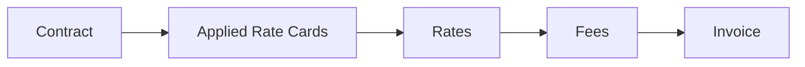

An invoice brings together the fees billed to a customer. It shows the billed items, taxes and total amount due.

Lago generates invoices from your [Contracts](/v2/guide/contracts/overview) and their billing settings. Invoice status tracks the document's lifecycle. Payment status tracks payment separately.

<span id="how-an-invoice-is-built" />

## How invoices are calculated

Lago calculates fees from the pricing applied to a Contract. It groups the fees on an invoice and calculates the taxes and totals.

Each fee identifies the Product, quantity and pricing used. See [Fees](/v2/guide/invoicing/fees) for the line-item details.



## Read an invoice

Review the billed items, billing periods, taxes and total. Check the amount still due separately from the invoice total.

| Detail | What it tells you |
| --- | --- |
| Fees | The items billed and their calculated amounts. |
| Billing periods | The dates covered by each fee. |
| Taxes | The taxes applied to the invoice. |
| Invoice total | The total amount on the invoice. |
| Amount due | The amount still outstanding. |

### Worked example

For one full monthly billing period, `contract_example` has a $100 fixed fee and 2,000 API calls at $0.01 each. Both are billed in arrears in USD. This example applies 20% tax, with no discounts, proration, credits or payments.

The applied Rate Cards are `monthly_service_usd`, with Rate `monthly_standard`, and `api_calls_usd`, with Rate `calls_standard`.

| Item | Calculation | Amount |
| --- | --- | ---: |
| Monthly service | 1 × $100.00 | $100.00 |
| API calls | 2,000 × $0.01 | $20.00 |
| Subtotal before tax | | $120.00 |
| Tax | $120.00 × 20% | $24.00 |
| **Total** | | **$144.00** |

With no payments or credits applied, the amount due is also $144.00. See [Taxes](/v2/guide/taxes) for tax configuration.

<Accordion title="View the example's API amounts">
These illustrative values show how the example maps to invoice fields. In USD, `12000` represents $120.00.

| Field | Value |
| --- | --- |
| `fees_amount_cents` | `12000` |
| `sub_total_excluding_taxes_amount_cents` | `12000` |
| `taxes_amount_cents` | `2400` |
| `sub_total_including_taxes_amount_cents` | `14400` |
| `total_amount_cents` | `14400` |
| `total_due_amount_cents` | `14400` |

Each line is a fee with `product_code`, `rate_card_code`, `rate_code`, `units` and `amount_cents`. Request `expands[]=fees` to include the fees when retrieving the invoice.
</Accordion>

For open billing periods, use [current usage](/v2/guide/events/retrieve-usage#retrieve-current-usage) to review provisional quantities and amounts.

<span id="statuses" />

## Invoice and payment statuses

An invoice's `status` describes the billing document. Its `payment_status` describes payment. A finalized invoice is not necessarily paid.

| Field | Purpose |
| --- | --- |
| `status` | Follow the invoice lifecycle, including `draft`, `finalized` or `voided` states. |
| `payment_status` | Check whether payment is `pending`, `succeeded` or `failed`. |

See [Draft invoices](/v2/guide/invoicing/draft-invoices), [Void invoices](/v2/guide/invoicing/void) and [Payment retries](/v2/guide/payments/payment-retries) for the actions available in each situation. The [API reference](/v2/api-reference/invoices/retrieve) lists all supported status values.

<span id="list-and-retrieve-invoices" />

## Find invoices

<Tabs>
  <Tab title="Dashboard">
1. Open **Invoices** in the sidebar.
2. Use the filters to narrow the list.
3. Select an invoice.
4. Review its fees, taxes and payments.

You can also open a customer and select the **Invoices** tab.
  </Tab>
  <Tab title="API">
Use `GET /invoices` to list invoices. Filter by customer, status, date or other supported criteria. Results use cursor pagination and are ordered by `issuing_date`, newest first. See [List invoices](/v2/api-reference/invoices/list) for the available filters and [Pagination](/v2/api-reference/pagination) for navigating results.

Use `GET /invoices/{lago_id}` to retrieve an invoice. Add `expands[]=fees` and `expands[]=applied_taxes` to include its fees and taxes.

<CodeGroup>
```bash List finalized invoices of a customer
    LAGO_URL="https://api.getlago.com"
    API_KEY="__YOUR_API_KEY__"

    curl --location --globoff --request GET "$LAGO_URL/api/v2/invoices?external_customer_id=customer_example&status[]=finalized&limit=20" \
      --header "Authorization: Bearer $API_KEY"
    ```

```bash Retrieve an invoice with its fees
    LAGO_URL="https://api.getlago.com"
    API_KEY="__YOUR_API_KEY__"
    INVOICE_ID="__YOUR_INVOICE_ID__"

    curl --location --globoff --request GET "$LAGO_URL/api/v2/invoices/$INVOICE_ID?expands[]=fees&expands[]=applied_taxes" \
      --header "Authorization: Bearer $API_KEY"
    ```
</CodeGroup>

Expanding more than 1,000 fees returns `400 expansion_too_large`. For larger invoices, use `GET /fees?lago_invoice_id=...` and page through the results. See [List fees](/v2/api-reference/fees/list).

See [Retrieve an invoice](/v2/api-reference/invoices/retrieve) for the full list of supported expansions. You can also list a customer's invoices with [`GET /customers/{customer_external_id}/invoices`](/v2/api-reference/customers/list-invoices).

<span id="invoice-types" />

The list returns Contract invoices and invoices containing Contract fees. Invoices produced only by the legacy engine are excluded; retrieving one returns `404`.

The `invoice_type` list filter accepts `contract` and `advance_fees`. The latter was named `advance_charges` in v1. Invoices containing both legacy and Contract fees can return legacy invoice types; see the [invoice schema](/v2/api-reference/invoices/retrieve).
  </Tab>
</Tabs>

<span id="retry-taxes" />
<span id="mark-a-payment-dispute-as-lost" />
<span id="update-the-payment-status" />

For specific operations, see the API references for [retrying invoice taxes](/v2/api-reference/invoices/retry-taxes), [recording a lost payment dispute](/v2/api-reference/invoices/lose-dispute) and [updating payment status](/v2/api-reference/invoices/update). To record money collected outside Lago, see [Record manual payments](/v2/guide/payments/record-manual-payments).

<span id="available-actions" />
<span id="next-steps" />

<CardGroup cols={2}>
  <Card title="Fees" icon="receipt" href="/v2/guide/invoicing/fees">
    Read the line items behind an invoice.
  </Card>
  <Card title="Draft invoices" icon="pen-to-square" href="/v2/guide/invoicing/draft-invoices">
    Refresh, finalize or delete a draft.
  </Card>
  <Card title="Void invoices" icon="ban" href="/v2/guide/invoicing/void">
    Void an eligible invoice.
  </Card>
  <Card title="Download and resend invoices" icon="download" href="/v2/guide/invoicing/download-invoices">
    Download a PDF or resend an invoice email.
  </Card>
  <Card title="Credit notes" icon="file-invoice-dollar" href="/v2/guide/invoicing/credit-notes/overview">
    Correct a finalized invoice.
  </Card>
  <Card title="Payment retries" icon="rotate-right" href="/v2/guide/payments/payment-retries">
    Follow up on payment collection.
  </Card>
</CardGroup>
