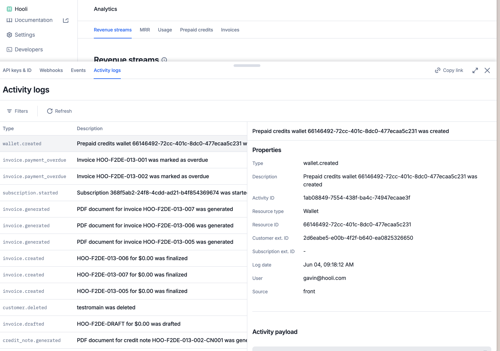
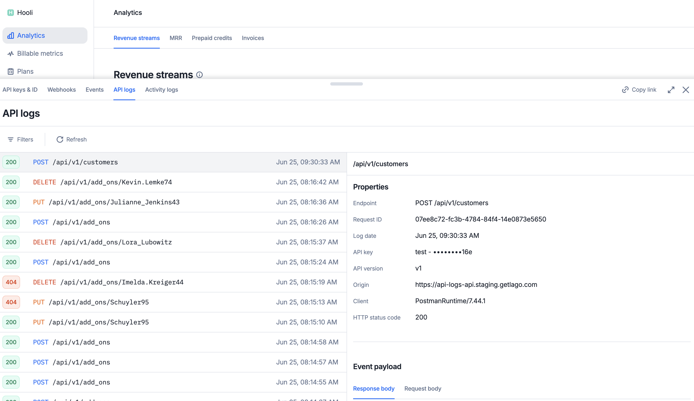

Lago keeps three audit trails: activity logs record changes to billing objects, API logs record API requests, and security logs record security-sensitive actions such as API key rotation. Use them to answer who changed what, when, and through which channel.

<Info>
All three require a premium license and available log storage. Security logs must also be enabled for the organization. For roles, retention by plan and the full list of security events, see [Audit logs](/guide/security/audit-logs) and [Security logs](/guide/security/security-logs).
</Info>

All lists are cursor-paginated, newest first. `page` and `per_page` are rejected. Date filters accept an ISO 8601 date or timestamp. A date is interpreted as midnight UTC. No expansions are supported on retrieval.

## Activity logs

An activity log records an action on a billing object, from the Dashboard, the API or the system.

| Field | Meaning |
| --- | --- |
| `activity_id` | Log identifier. |
| `activity_type` | What happened, for example `customer.created`. |
| `activity_source` | Origin, for example `api`. |
| `activity_object` | The recorded object. |
| `activity_object_changes` | The recorded changes. |
| `user_email` | The member who triggered it, when known. |
| `resource_type`, `resource_id` | The affected object. |
| `external_customer_id` | The related customer. |
| `logged_at` | When the action happened. |

Filters: `from_date`, `to_date`, `activity_types[]`, `activity_sources[]`, `user_emails[]`, `resource_types[]`, `resource_ids[]` and `external_customer_id`. Results stay within the configured retention period.

<Tabs>
  <Tab title="Dashboard">
    1. Click **Developers** in the side menu;
    2. Open the **Activity logs** tab; and
    3. Filter and open an entry to see its payload.

    <Frame caption="Activity logs in the Developers Console">
      
    </Frame>
  </Tab>
  <Tab title="API">
    <CodeGroup>
    ```bash List customer activity from the API
    LAGO_URL="https://api.getlago.com"
    API_KEY="__YOUR_API_KEY__"

    curl --location --request GET "$LAGO_URL/api/v2/activity_logs?external_customer_id=customer_example&activity_sources[]=api&from_date=2027-01-01" \
      --header "Authorization: Bearer $API_KEY"
    ```

    ```bash Retrieve one activity log
    LAGO_URL="https://api.getlago.com"
    API_KEY="__YOUR_API_KEY__"
    ACTIVITY_ID="__YOUR_ACTIVITY_ID__"

    curl --location --request GET "$LAGO_URL/api/v2/activity_logs/$ACTIVITY_ID" \
      --header "Authorization: Bearer $API_KEY"
    ```
    </CodeGroup>
  </Tab>
</Tabs>

## API logs

An API log records one API request and its response.

| Field | Meaning |
| --- | --- |
| `request_id` | Request identifier. |
| `http_method`, `http_status` | Method and response status. |
| `request_path` | Path called, for example `/api/v2/customers`. |
| `api_version` | API version, for example `v2`. |
| `client` | API client, for example `curl`. |
| `request_origin` | Origin of the request. |
| `request_body`, `request_response` | Request and response bodies. |
| `logged_at` | When the request was logged. |

Filters: `from_date`, `to_date`, `http_methods[]`, `http_statuses[]`, `request_paths[]`, `clients[]` and `api_version`. `http_statuses[]` takes status codes or the groups `succeeded` (codes up to 399) and `failed` (codes above 399). Groups take precedence over codes, and selecting both groups returns no matches.

<Tabs>
  <Tab title="Dashboard">
    1. Click **Developers** in the side menu;
    2. Open the **API logs** tab; and
    3. Filter and open a request to see its bodies.

    <Frame caption="API logs in the Developers Console">
      
    </Frame>
  </Tab>
  <Tab title="API">
    <CodeGroup>
    ```bash List failed v2 requests
    LAGO_URL="https://api.getlago.com"
    API_KEY="__YOUR_API_KEY__"

    curl --location --request GET "$LAGO_URL/api/v2/api_logs?api_version=v2&http_statuses[]=failed" \
      --header "Authorization: Bearer $API_KEY"
    ```

    ```bash Retrieve one API log
    LAGO_URL="https://api.getlago.com"
    API_KEY="__YOUR_API_KEY__"
    REQUEST_ID="__YOUR_REQUEST_ID__"

    curl --location --request GET "$LAGO_URL/api/v2/api_logs/$REQUEST_ID" \
      --header "Authorization: Bearer $API_KEY"
    ```
    </CodeGroup>
  </Tab>
</Tabs>

## Security logs

A security log records a security-sensitive event, such as a user invitation or an API key rotation.

| Field | Meaning |
| --- | --- |
| `log_id` | Log identifier. |
| `log_type` | Category, for example `user`. |
| `log_event` | Event, for example `user.login`. |
| `user_email` | The member involved, when known. |
| `resources` | Resources related to the event. |
| `device_info` | Device details, when available. |
| `logged_at` | When the event happened. |

Filters: `from_date`, `to_date`, `user_ids[]`, `api_key_ids[]`, `log_types[]` and `log_events[]`. `to_date` is required: a request without it returns `422`. Retention is fixed at 90 days, and older records are excluded.

<Tabs>
  <Tab title="Dashboard">
    1. Open **Team & Security**;
    2. Select the **Security logs** tab; and
    3. Filter the list.
  </Tab>
  <Tab title="API">
    <CodeGroup>
    ```bash List API key events
    LAGO_URL="https://api.getlago.com"
    API_KEY="__YOUR_API_KEY__"

    curl --location --request GET "$LAGO_URL/api/v2/security_logs?log_types[]=api_key&from_date=2027-01-01&to_date=2027-01-31" \
      --header "Authorization: Bearer $API_KEY"
    ```

    ```bash Retrieve one security log
    LAGO_URL="https://api.getlago.com"
    API_KEY="__YOUR_API_KEY__"
    LOG_ID="__YOUR_LOG_ID__"

    curl --location --request GET "$LAGO_URL/api/v2/security_logs/$LOG_ID" \
      --header "Authorization: Bearer $API_KEY"
    ```
    </CodeGroup>
  </Tab>
</Tabs>

## API key permissions

Each log type needs its own read permission on the API key: `activity_log`, `api_log` or `security_log`. See [API keys](/guide/security/api-keys).

## Next steps

<CardGroup cols={2}>
  <Card title="Webhooks" icon="bolt" href="/v2/guide/webhooks">
    Receive events instead of polling logs.
  </Card>
  <Card title="List activity logs (API)" icon="code" href="/v2/api-reference/activity-logs/list">
    Filters and response schema.
  </Card>
  <Card title="List API logs (API)" icon="code" href="/v2/api-reference/api-logs/list">
    Filters and response schema.
  </Card>
  <Card title="List security logs (API)" icon="code" href="/v2/api-reference/security-logs/list">
    Filters and response schema.
  </Card>
</CardGroup>
