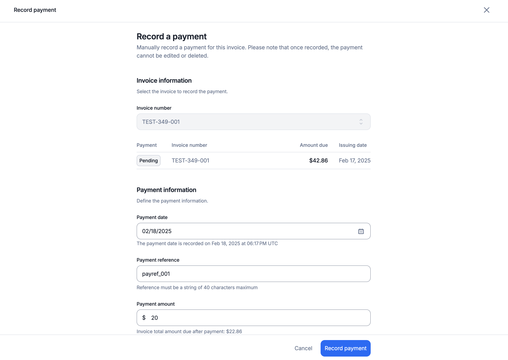

A manual payment records money you collected outside a payment provider, such as a bank transfer or a cheque, against an existing invoice. Use it to keep `total_paid_amount_cents` and `total_due_amount_cents` accurate when Lago does not run the collection.

<Info>
Recording a manual payment requires premium access and an eligible invoice. Lago checks invoice eligibility, except for supported advance-fee payments.
</Info>

## Fields

| Field | Meaning |
| --- | --- |
| `invoice_id` | `lago_id` of the invoice being paid. |
| `amount_cents` | Amount paid, a positive integer in cents. Required. |
| `reference` | Your payment reference, such as a transfer number. Required. |
| `paid_at` | Payment timestamp. Defaults to now. |

## Worked example

The `contract_example` invoice totals $144.00. The customer pays by bank transfer in two parts:

| Payment | `amount_cents` | `total_paid_amount_cents` | `total_due_amount_cents` |
| --- | --- | --- | --- |
| Before any payment | | `0` | `14400` |
| Transfer 1, reference `wire_transfer_123` | `10000` | `10000` | `4400` |
| Transfer 2, reference `wire_transfer_124` | `4400` | `14400` | `0` |

After the first transfer, the invoice matches the `partially_paid=true` list filter.

## Record a payment

<Warning>
Recording a payment changes the amount due on the invoice. Check the invoice identifier and the amount, and review the request before you run it in production.
</Warning>

<Tabs>
  <Tab title="Dashboard">
    1. Open an unpaid invoice;
    2. Click **Record payment**;
    3. Select the payment date;
    4. Enter the payment reference;
    5. Enter the amount, partial or full; and
    6. Confirm.

    <Frame caption="Record a manual payment">
      
    </Frame>
  </Tab>
  <Tab title="API">
    <CodeGroup>
    ```bash Record a manual payment
    LAGO_URL="https://api.getlago.com"
    API_KEY="__YOUR_API_KEY__"

    curl --location --request POST "$LAGO_URL/api/v2/payments" \
      --header "Authorization: Bearer $API_KEY" \
      --header 'Content-Type: application/json' \
      --data-raw '{
        "payment": {
          "invoice_id": "__LAGO_INVOICE_ID__",
          "amount_cents": 10000,
          "reference": "wire_transfer_123",
          "paid_at": "2027-02-05T10:00:00Z"
        }
      }'
    ```
    </CodeGroup>

    The response returns the payment with `payment_type: "manual"`, `payable_type: "Invoice"` and `lago_invoice_ids`.
  </Tab>
</Tabs>

## List payments

`GET /payments` lists manual and provider payments, including payments attached to a payment request, newest first. Filter with `external_customer_id`, `invoice_id`, `created_at_from` and `created_at_to`. The `invoice_id` filter also returns payments made through a payment request that covers the invoice.

<CodeGroup>
```bash List payments for an invoice
LAGO_URL="https://api.getlago.com"
API_KEY="__YOUR_API_KEY__"
INVOICE_ID="__YOUR_INVOICE_ID__"

curl --location --request GET "$LAGO_URL/api/v2/payments?invoice_id=$INVOICE_ID" \
  --header "Authorization: Bearer $API_KEY"
```
</CodeGroup>

`GET /payments/{lago_id}` returns one payment. No expansions are supported. To list one customer's payments, call [`GET /customers/{customer_external_id}/payments`](/v2/api-reference/customers/list-payments).

## Next steps

<CardGroup cols={2}>
  <Card title="Payment receipts" icon="receipt" href="/v2/guide/payments/receipts">
    Receipts generated for each payment.
  </Card>
  <Card title="Invoices" icon="file-invoice" href="/v2/guide/invoicing/overview">
    Amounts due and payment statuses.
  </Card>
  <Card title="Create a payment (API)" icon="code" href="/v2/api-reference/payments/create">
    Request and response schema.
  </Card>
  <Card title="List payments (API)" icon="code" href="/v2/api-reference/payments/list">
    Filters and response schema.
  </Card>
</CardGroup>
