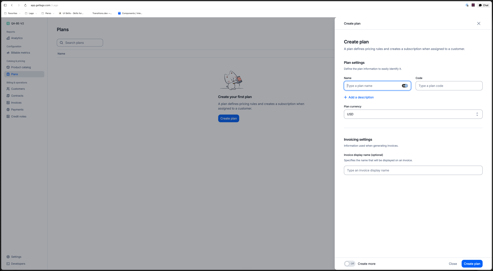
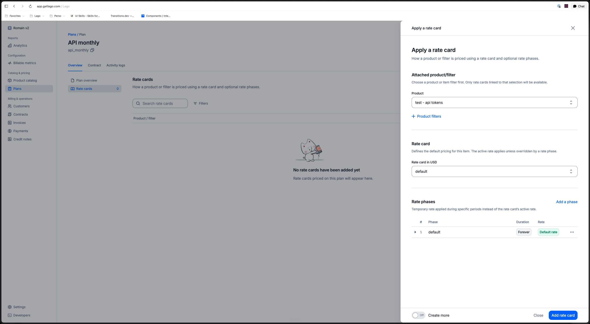

A Plan brings together applied Rate Cards in one currency. Use it to define an offer that you can share across customers. Each Contract connects a customer to a Plan.

Rates define prices and billing intervals. On the Plan, you can set quantities for fixed Products and use phases to define introductory or ongoing pricing.

## How Plans work

Applying a Rate Card adds it to the Plan as an [applied Rate Card](/v2/api-reference/plan-applied-rate-cards/object). This is where you configure its quantity and phases.

For a fixed Product, `units` sets the quantity as a decimal string. A null value uses the default quantity. For a metered Product, the billable metric measures the quantity from events.

Use [Plan phase & overrides](/v2/guide/plans/plan-phases) to define a pricing sequence.

## Before you start

Create the [Rate Cards](/v2/guide/rate-cards/overview) you want to apply. Every Rate Card must use the Plan's currency. Only one Rate Card may price each Product or Product filter combination on a Plan.

Plan endpoints require the Product catalog to be enabled. Your API key needs `plan` read or write permission for Plans, and `plan_rate_card` read or write permission for applied Rate Cards and phases.

## Example

The Plan `api_monthly` brings together two Rate Cards in USD:

| Applied Rate Card | Product | Rate | Quantity |
| --- | --- | --- | --- |
| `monthly_service_usd` | `monthly_service` (fixed) | `monthly_standard`: 100 USD per month | `units: "1"` |
| `api_calls_usd` | `api_calls_product` (metered on `api_calls`) | `calls_standard`: 0.01 USD per call | Measured from events |

This illustration covers one full monthly billing period. Both Rate Cards bill in arrears with `proration: false`. It assumes no spending minimum or other adjustment. For 2,000 API calls:

| Fee | Quantity | Unit price | Amount before tax |
| --- | --- | --- | --- |
| Monthly service | 1 | 100.00 USD | 100.00 USD |
| API calls | 2,000 | 0.01 USD | 20.00 USD |
| **Calculated total** | | | **120.00 USD** |

## Create the Plan

<Tabs>
  <Tab title="Dashboard">
1. Open **Plans** and click **Create plan**.
2. Enter the Plan's `Name` and `Code`.
3. Select its `Plan currency`. For the example above, select USD.
4. Optionally, click **Add a description** and enter an `Invoice display name (optional)`.
5. Click **Create plan**.

<Frame caption="Create a Plan in the Dashboard">
  
</Frame>
  </Tab>
  <Tab title="API">
Create the Plan with a name, code and currency.

```bash 1. Create the plan
LAGO_URL="https://api.getlago.com"
API_KEY="__YOUR_API_KEY__"

curl --location --request POST "$LAGO_URL/api/v2/plans" \
  --header "Authorization: Bearer $API_KEY" \
  --header 'Content-Type: application/json' \
  --data-raw '{
    "plan": {
      "name": "API monthly",
      "code": "api_monthly",
      "currency": "USD"
    }
  }'
```

The Plan also accepts `description`, `invoice_display_name` (defaults to the name when blank) and `tax_codes`.
  </Tab>
</Tabs>

## Apply Rate Cards

<Tabs>
  <Tab title="Dashboard">
1. Open the Plan and select **Rate cards** under **Overview**. Open the **Apply a rate card** form.
2. Select the `Product`. To apply pricing to a Product filter, click **Product filters** and choose the filter.
3. Select the Rate Card for that Product or filter. For a USD Plan, the field is labeled `Rate card in USD`.
4. Review **Rate phases**. To configure a pricing sequence, click **Add a phase**. See [Plan phase & overrides](/v2/guide/plans/plan-phases) for phase settings.
5. Click **Add rate card**. Repeat for each Rate Card you want to apply.

<Frame caption="Apply a Rate Card to a Plan in the Dashboard">
  
</Frame>
  </Tab>
  <Tab title="API">
Apply the fixed Product's Rate Card with a quantity of one.

```bash 2. Apply the fixed rate card
LAGO_URL="https://api.getlago.com"
API_KEY="__YOUR_API_KEY__"

curl --location --request POST "$LAGO_URL/api/v2/plans/api_monthly/applied_rate_cards" \
  --header "Authorization: Bearer $API_KEY" \
  --header 'Content-Type: application/json' \
  --data-raw '{
    "applied_rate_card": {
      "rate_card_code": "monthly_service_usd",
      "units": "1"
    }
  }'
```

Apply the metered Product's Rate Card. Its quantity is measured from events.

```bash 3. Apply the metered rate card
LAGO_URL="https://api.getlago.com"
API_KEY="__YOUR_API_KEY__"

curl --location --request POST "$LAGO_URL/api/v2/plans/api_monthly/applied_rate_cards" \
  --header "Authorization: Bearer $API_KEY" \
  --header 'Content-Type: application/json' \
  --data-raw '{
    "applied_rate_card": {
      "rate_card_code": "api_calls_usd"
    }
  }'
```
  </Tab>
</Tabs>

## Check the Plan

Retrieve the Plan and list its applied Rate Cards. Check the currency, Product or Product filter, fixed quantities and any phases or overrides before creating a Contract.

```bash List applied rate cards
LAGO_URL="https://api.getlago.com"
API_KEY="__YOUR_API_KEY__"

curl --location --request GET "$LAGO_URL/api/v2/plans/api_monthly/applied_rate_cards" \
  --header "Authorization: Bearer $API_KEY"
```

<CardGroup cols={2}>
  <Card title="Plan phase & overrides" icon="timeline" href="/v2/guide/plans/plan-phases">
    Add introductory pricing and ongoing terms.
  </Card>
  <Card title="Contracts" icon="file-signature" href="/v2/guide/contracts/overview">
    Connect a customer to the Plan.
  </Card>
  <Card title="Create a plan (API)" icon="code" href="/v2/api-reference/plans/create">
    `POST /plans`
  </Card>
  <Card title="Create an applied rate card (API)" icon="code" href="/v2/api-reference/plan-applied-rate-cards/create">
    `POST /plans/{plan_code}/applied_rate_cards`
  </Card>
</CardGroup>
