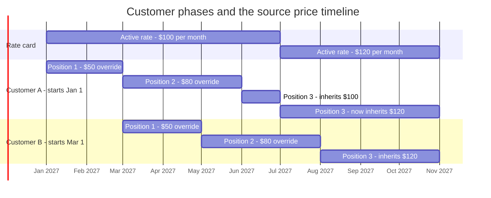

A [rate phase](/v2/api-reference/plan-rate-phases/object) is one step in the pricing sequence of an applied rate card: it runs for a number of billing cycles and either inherits the active rate or uses a `rate_override`. Use phases for introductory pricing followed by ongoing terms, such as two months at $50, three months at $80, then the list price.

## How phases work

Rate phases belong to an applied rate card on a plan. Each phase has:

| Field | Meaning |
| --- | --- |
| `code` | Unique within the applied rate card. |
| `position` | One-based order: `1`, then `2`, then `3`. A complete sequence uses positions 1 through the number of phases. |
| `name` | Optional display name. |
| `billing_interval_cycle_count` | Number of billing cycles the phase runs. `null` means indefinite. |
| `rate_override` | Pricing used while the phase is active. `null` means the phase inherits the rate card's active rate. |

The plan defines a reusable sequence. Each customer follows it on their own [contract](/v2/guide/contracts/overview) timeline, independently of when the plan was created or when new rates were introduced.

### The last phase runs indefinitely

The last phase always has `billing_interval_cycle_count: null`. No earlier phase may be indefinite. Every earlier phase has a positive cycle count.

The two `null` values mean different things:

- `billing_interval_cycle_count: null`: the phase never expires.
- `rate_override: null`: the phase inherits the active rate.

An indefinite phase can still carry a pricing override.

## Cycles and interval

One billing cycle is one billing interval. The interval comes from the phase's override when it sets one. Otherwise it comes from the source rate.

- `billing_interval_count`: number of interval units.
- `billing_interval_unit`: `day`, `week`, `month` or `year`.
- `billing_interval_cycle_count`: how many times the interval repeats before the phase ends.

For a finite phase: **phase duration = interval count × interval unit × billing cycles.**

| Interval count | Interval unit | Billing cycles | Phase duration |
| --- | --- | --- | --- |
| `1` | `month` | `2` | 2 months |
| `3` | `month` | `2` | 6 months: two three-month cycles |
| `1` | `year` | `1` | 1 year |
| `1` | `month` | `null` | Monthly cycles, no scheduled end |

A six-month phase made of two three-month cycles has two billing cycles, not six monthly ones. The rate card's `billing_timing` (`advance` or `arrears`) decides when each cycle is billed.

## What an override can change

A `rate_override` can set:

- `rate_model` and `rate_properties`
- `billing_interval_count` and `billing_interval_unit` (omit or null to inherit the rate's interval)
- `min_amount_cents` (arrears billing only)
- `pricing_unit_conversion_rate` (required when the rate card uses a pricing unit)

Structural rate card fields such as `currency`, `billing_timing` and `proration` stay on the rate card. They are not overridable.

## Worked example

Start from the fixed `monthly_service_usd` rate card, whose active rate is $100 per month. Apply one unit on a plan `introductory_offer` with three phases:

| Position | Phase | Billing cycles | Interval | Rate override | Fixed fee |
| --- | --- | --- | --- | --- | --- |
| `1` | `introductory` | `2` | 1 month | Standard, $50 | $50 per month for 2 months |
| `2` | `transition` | `3` | 1 month | Standard, $80 | $80 per month for 3 months |
| `3` | `ongoing` | `null` | Inherited: 1 month | `null` | Active rate, initially $100 per month |

The finite phases cover five monthly cycles: 2 × $50 + 3 × $80 = **$340 before tax**.

Invoice lines for the first five months, one fixed unit, no tax:

| Month | Phase | Invoice line | Amount |
| --- | --- | --- | --- |
| 1 | `introductory` | Monthly service × 1 | $50.00 |
| 2 | `introductory` | Monthly service × 1 | $50.00 |
| 3 | `transition` | Monthly service × 1 | $80.00 |
| 4 | `transition` | Monthly service × 1 | $80.00 |
| 5 | `transition` | Monthly service × 1 | $80.00 |
| 6 onward | `ongoing` | Monthly service × 1 | Active rate |

This illustration assumes full monthly periods in UTC, one fixed unit and no tax, proration or other adjustment.

### Two separate timelines

A customer's phase timeline is separate from the rate card's price timeline. A customer inherits the active rate only when they reach a phase with `rate_override: null`. They use the rate active at that point, not the rate active when their contract was created.

Customer A starts on January 1, 2027. Customer B starts on March 1, 2027. Both get two monthly cycles at $50, then three at $80. The rate card's active rate changes from $100 to $120 on July 1.



On July 1, Customer A is at position `3` and inherits $120. Customer B is still at position `2` and keeps the $80 override until August 1. Only then does Customer B reach position `3` and inherit $120.

The price change leaves each phase sequence intact. Customer A's two ongoing bars are the same phase, position `3`. The chart stops in October. Position `3` continues while the contract remains in effect.

## Configure phases

Define `rate_phases` when you apply a rate card to an editable plan:

1. Set each phase's `code` and consecutive `position`, starting at `1`.
2. Set `billing_interval_cycle_count` on each finite phase. Use `null` on the last phase.
3. Add a `rate_override` where pricing differs from the source rate. Use `null` to inherit the active rate.

`rate_phases` must be the complete sequence. Omitted or null creates one default indefinite phase. An explicit empty list is rejected.

<Tabs>
  <Tab title="Dashboard">
    <Note>
      Dashboard steps for plan phases are not documented yet. Use the API tab while the API is in beta.
    </Note>
  </Tab>
  <Tab title="API">
    <CodeGroup>
    ```bash Apply a rate card with three phases
    LAGO_URL="https://api.getlago.com"
    API_KEY="__YOUR_API_KEY__"

    curl --location --request POST "$LAGO_URL/api/v2/plans/introductory_offer/applied_rate_cards" \
      --header "Authorization: Bearer $API_KEY" \
      --header 'Content-Type: application/json' \
      --data-raw '{
        "applied_rate_card": {
          "rate_card_code": "monthly_service_usd",
          "units": "1",
          "rate_phases": [
            {
              "code": "introductory",
              "position": 1,
              "billing_interval_cycle_count": 2,
              "rate_override": {
                "rate_model": "standard",
                "rate_properties": { "amount": "50" },
                "billing_interval_count": 1,
                "billing_interval_unit": "month"
              }
            },
            {
              "code": "transition",
              "position": 2,
              "billing_interval_cycle_count": 3,
              "rate_override": {
                "rate_model": "standard",
                "rate_properties": { "amount": "80" },
                "billing_interval_count": 1,
                "billing_interval_unit": "month"
              }
            },
            {
              "code": "ongoing",
              "position": 3,
              "billing_interval_cycle_count": null,
              "rate_override": null
            }
          ]
        }
      }'
    ```

    ```bash Update one phase
    LAGO_URL="https://api.getlago.com"
    API_KEY="__YOUR_API_KEY__"

    curl --location --request PATCH "$LAGO_URL/api/v2/plans/introductory_offer/applied_rate_cards/monthly_service_usd/rate_phases/transition" \
      --header "Authorization: Bearer $API_KEY" \
      --header 'Content-Type: application/json' \
      --data-raw '{
        "rate_phase": {
          "billing_interval_cycle_count": 4
        }
      }'
    ```
    </CodeGroup>
  </Tab>
</Tabs>

## Edit a phase sequence

You can change phases while the plan is editable. Parent locking rules apply: once a contract uses the plan, it is locked.

| Action | Endpoint | Behavior |
| --- | --- | --- |
| List | `GET .../rate_phases` | Returns the complete list in position order, without cursor metadata. |
| Insert | `POST .../rate_phases` | Inserts one phase and renumbers later positions. Without `position`, a finite phase is inserted before the final indefinite phase. |
| Update | `PUT` or `PATCH .../rate_phases/{code}` | Partial update. `rate_override: null` removes the override so the phase inherits the active rate. It does not make the phase indefinite. |
| Delete | `DELETE .../rate_phases/{code}` | Removes the phase and renumbers later positions. The final indefinite phase and the only remaining phase cannot be deleted. |

## Verify phases and pricing

Retrieve the applied rate card and list its phases. Check positions, cycle counts and the effective interval of each phase. Confirm that only the last phase has `billing_interval_cycle_count: null`.

For each billed period, identify the active phase and whether its price is overridden or inherited. Then reconcile the fee's quantity, unit price and service period. In [contract current usage](/v2/guide/contracts/current-usage), `rate_source` is `phase_override` or `rate`.

<AccordionGroup>
  <Accordion title="What happens after the last finite phase?">
    The next phase starts. The last phase has `billing_interval_cycle_count: null` and runs while the contract remains in effect.
  </Accordion>
  <Accordion title="Does a customer who joins later skip introductory phases?">
    No. Every contract starts the sequence at position `1` on its own timeline, whenever it starts.
  </Accordion>
  <Accordion title="If the list price changes, do customers in an introductory phase pay the new price?">
    No. A phase with a `rate_override` keeps its overridden price. Customers pick up the active rate when they reach a phase with `rate_override: null`.
  </Accordion>
  <Accordion title="Can a phase change billing timing or currency?">
    No. `currency`, `billing_timing` and `proration` are structural rate card fields and are not overridable. A phase can change the rate model, properties, interval and minimum amount.
  </Accordion>
</AccordionGroup>

<CardGroup cols={2}>
  <Card title="Contract overrides" icon="sliders" href="/v2/guide/contracts/overrides">
    Override phases for one customer on a pending contract.
  </Card>
  <Card title="Pricing models" icon="calculator" href="/v2/guide/rate-cards/pricing-models/overview">
    Rate models you can use in an override.
  </Card>
  <Card title="Create a rate phase (API)" icon="code" href="/v2/api-reference/plan-rate-phases/create">
    `POST .../rate_phases`
  </Card>
  <Card title="Update a rate phase (API)" icon="code" href="/v2/api-reference/plan-rate-phases/update">
    `PUT .../rate_phases/{code}`
  </Card>
</CardGroup>
