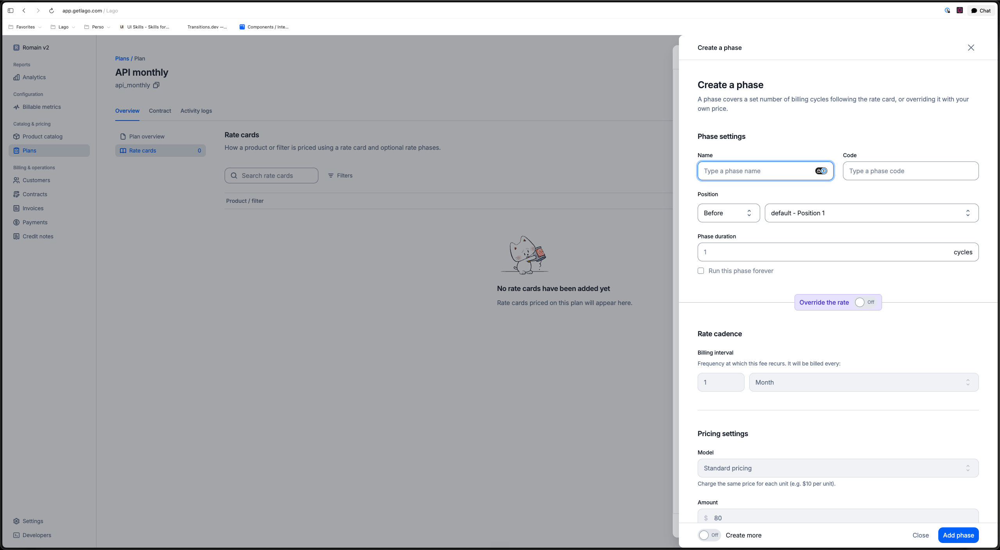
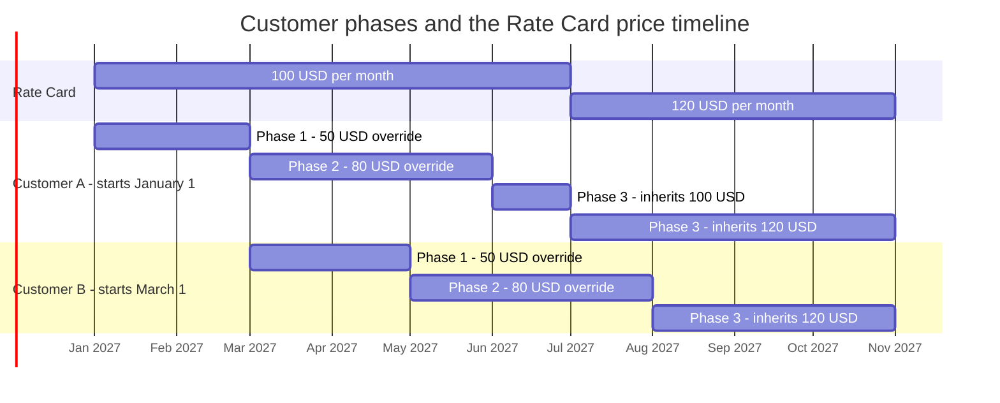

A phase defines the pricing used for part of an applied Rate Card's billing sequence. Use phases to offer introductory pricing followed by ongoing terms.

For example, you can apply a price of 50 USD per month for two billing cycles, then 80 USD per month for three cycles, followed by pricing from the Rate Card.

## How phases work

Rate phases belong to an applied Rate Card on a Plan. Each phase has:

| Field | Meaning |
| --- | --- |
| `code` | Unique within the applied Rate Card. |
| `position` | One-based order: `1`, then `2`, then `3`. A complete sequence uses positions 1 through the number of phases. |
| `name` | Optional display name. |
| `billing_interval_cycle_count` | Number of billing cycles the phase runs. `null` means indefinite. |
| `rate_override` | Pricing used while the phase is active. `null` means the phase inherits the Rate Card's active Rate. |

The Plan defines a reusable sequence. Each customer's [Contract](/v2/guide/contracts/overview) follows its own phase sequence.

### The last phase runs indefinitely

The last phase always has `billing_interval_cycle_count: null`. No earlier phase may be indefinite. Every earlier phase has a positive cycle count.

The two `null` values mean different things:

- `billing_interval_cycle_count: null`: the phase has no scheduled end.
- `rate_override: null`: the phase inherits the active Rate.

An indefinite phase can still carry a pricing override.

## Billing cycles and phase duration

One billing cycle is one billing interval. The interval comes from the phase's override when it sets one. Otherwise it comes from the source Rate.

- `billing_interval_count`: number of interval units.
- `billing_interval_unit`: `day`, `week`, `month` or `year`.
- `billing_interval_cycle_count`: how many times the interval repeats before the phase ends.

A phase's duration depends on its billing interval and the number of cycles it runs. Two monthly cycles last two months. Two three-month cycles last six months.

| Interval count | Interval unit | Billing cycles | Phase duration |
| --- | --- | --- | --- |
| `1` | `month` | `2` | 2 months |
| `3` | `month` | `2` | 6 months: two three-month cycles |
| `1` | `year` | `1` | 1 year |
| `1` | `month` | `null` | Monthly cycles, no scheduled end |

A six-month phase made of two three-month cycles has two billing cycles, not six monthly ones. The Rate Card's `billing_timing` (`advance` or `arrears`) decides when each cycle is billed.

## What an override can change

A `rate_override` can set:

- `rate_model` and `rate_properties`
- `billing_interval_count` and `billing_interval_unit` (omit or null to inherit the Rate's interval)
- `min_amount_cents` (arrears billing only)

Structural Rate Card fields such as `currency`, `billing_timing` and `proration` stay on the Rate Card. They are not overridable.

## Before you start

Create the Plan and Rate Card before configuring phases. You can change the phase sequence only while the Plan is editable. Once a Contract uses the Plan, its phases are locked.

When you provide `rate_phases`, include the complete sequence. Omitting it or setting it to null creates one default indefinite phase. An explicit empty list is rejected.

## Configure phases

<Tabs>
  <Tab title="Dashboard">
1. In the **Apply a rate card** form, click **Add a phase**.
2. Enter the phase's `Name` and `Code`.
3. Set its `Position` relative to an existing phase.
4. Enter the number of billing cycles in `Phase duration`. Only the final phase can have no scheduled end.
5. Leave **Override the rate** off to use pricing from the Rate Card. Turn it on to configure pricing for this phase, using the billing interval and pricing settings.
6. Click **Add phase** and review the phase sequence before adding the Rate Card to the Plan.

<Frame caption="Configure a phase in the Dashboard">
  
</Frame>
  </Tab>
  <Tab title="API">
Define `rate_phases` when you apply a Rate Card to the Plan:

1. Set each phase's `code` and consecutive `position`, starting at `1`.
2. Set `billing_interval_cycle_count` on each finite phase. Use `null` on the last phase.
3. Add a `rate_override` where pricing differs from the source Rate. Use `null` to inherit the active Rate.

```bash Apply a rate card with three phases
LAGO_URL="https://api.getlago.com"
API_KEY="__YOUR_API_KEY__"

curl --location --request POST "$LAGO_URL/api/v2/plans/introductory_offer/applied_rate_cards" \
  --header "Authorization: Bearer $API_KEY" \
  --header 'Content-Type: application/json' \
  --data-raw '{
    "applied_rate_card": {
      "rate_card_code": "monthly_service_usd",
      "units": "1",
      "rate_phases": [
        {
          "code": "introductory",
          "position": 1,
          "billing_interval_cycle_count": 2,
          "rate_override": {
            "rate_model": "standard",
            "rate_properties": { "amount": "50" },
            "billing_interval_count": 1,
            "billing_interval_unit": "month"
          }
        },
        {
          "code": "transition",
          "position": 2,
          "billing_interval_cycle_count": 3,
          "rate_override": {
            "rate_model": "standard",
            "rate_properties": { "amount": "80" },
            "billing_interval_count": 1,
            "billing_interval_unit": "month"
          }
        },
        {
          "code": "ongoing",
          "position": 3,
          "billing_interval_cycle_count": null,
          "rate_override": null
        }
      ]
    }
  }'
```
  </Tab>
</Tabs>

## Example

The fixed Product's Rate Card, `monthly_service_usd`, has an active Rate of 100 USD per month. Apply one unit to the Plan `introductory_offer` with the three phases above.

This illustration assumes full monthly periods in UTC, one fixed unit and no proration, spending minimum or other adjustment. Amounts are before tax.

| Position | Phase | Billing cycles | Interval | Pricing |
| --- | --- | --- | --- | --- |
| `1` | `introductory` | `2` | 1 month | Standard override: 50 USD per month |
| `2` | `transition` | `3` | 1 month | Standard override: 80 USD per month |
| `3` | `ongoing` | `null` | Inherited from the Rate | No override; pricing comes from the Rate Card |

The first two phases cover five monthly cycles. Their calculated total is 2 × 50 USD + 3 × 80 USD = **340 USD before tax**.

## How phases interact with Rate changes

Each Contract follows its own phase sequence. A phase with a pricing override keeps that price when the Rate Card's active Rate changes. A phase without an override follows newly effective Rates, including changes that occur after the phase has started.

Using the three phases above, Customer A starts on January 1, 2027, and Customer B starts on March 1, 2027. Both receive two monthly cycles at 50 USD, followed by three at 80 USD, then pricing from the Rate Card. The Rate Card's price changes from 100 USD to 120 USD per month on July 1, 2027.

This example uses one fixed unit and full calendar-month periods in UTC, with no proration, taxes or other adjustments.



| Customer | June | July | August |
| --- | --- | --- | --- |
| A | 100 USD, inherited Rate | 120 USD, new Rate applies within phase 3 | 120 USD, inherited Rate |
| B | 80 USD, phase override | 80 USD, phase override | 120 USD, active Rate on entering phase 3 |

Customer A enters phase 3 on June 1 and follows the new Rate from July 1. Customer B keeps the 80 USD override through July, then inherits the active 120 USD Rate on August 1.

The price change does not restart either customer's phase sequence. Customer A's two phase 3 bars represent the same ongoing phase. The chart ends in October; phase 3 continues while the Contract remains in effect.

## Edit a phase sequence

You can edit phases while the Plan is unused.

| Action | Behavior |
| --- | --- |
| [List phases](/v2/api-reference/plan-rate-phases/list) | Returns the phases in position order. |
| [Insert a phase](/v2/api-reference/plan-rate-phases/create) | Inserts one phase and renumbers later positions. Without `position`, a finite phase is inserted before the final indefinite phase. |
| [Update a phase](/v2/api-reference/plan-rate-phases/update) | Accepts partial updates. `rate_override: null` removes the override; it does not make the phase indefinite. |
| [Delete a phase](/v2/api-reference/plan-rate-phases/delete) | Removes the phase and renumbers later positions. The final indefinite phase and the only remaining phase cannot be deleted. |

The following edit changes the transition phase from three cycles to four. It is separate from the example above: the first two phases would then last six monthly cycles, so the five-cycle total of 340 USD would no longer apply.

```bash Update one phase
LAGO_URL="https://api.getlago.com"
API_KEY="__YOUR_API_KEY__"

curl --location --request PATCH "$LAGO_URL/api/v2/plans/introductory_offer/applied_rate_cards/monthly_service_usd/rate_phases/transition" \
  --header "Authorization: Bearer $API_KEY" \
  --header 'Content-Type: application/json' \
  --data-raw '{
    "rate_phase": {
      "billing_interval_cycle_count": 4
    }
  }'
```

## Check phases and pricing

List the applied Rate Card's phases and check their order, cycle counts and billing intervals. Confirm that only the final phase has no scheduled end.

For a billed period, check which phase and pricing settings were used before comparing the quantity and fee. See [Contract current usage](/v2/guide/contracts/current-usage) to inspect usage and [Rates](/v2/guide/rate-cards/rates#check-which-rate-was-used) to check which Rate was used.

<CardGroup cols={2}>
  <Card title="Contract overrides" icon="sliders" href="/v2/guide/contracts/overrides">
    Override phases for one customer on a pending Contract.
  </Card>
  <Card title="Pricing models" icon="calculator" href="/v2/guide/rate-cards/pricing-models/overview">
    Choose a pricing model for an override.
  </Card>
  <Card title="Create a rate phase (API)" icon="code" href="/v2/api-reference/plan-rate-phases/create">
    `POST .../rate_phases`
  </Card>
  <Card title="Update a rate phase (API)" icon="code" href="/v2/api-reference/plan-rate-phases/update">
    `PUT .../rate_phases/{code}`
  </Card>
</CardGroup>
