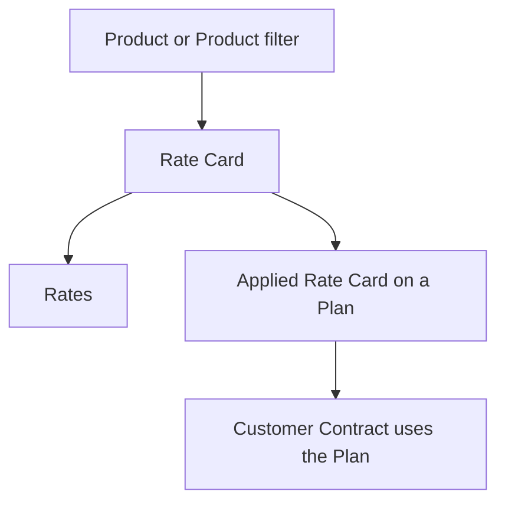

A Rate Card defines billing settings for one Product or Product filter, including currency, billing timing and proration. Its [Rates](/v2/guide/rate-cards/rates) define the prices, billing intervals and dates when those prices take effect.

Apply Rate Cards to a Plan, then use that Plan in a customer Contract.

<a id="how-it-fits-together"></a>

## How catalog and pricing fit together

Your [Product catalog](/v2/guide/product-catalog/overview) defines what you sell. Rate Cards and Rates define how you bill for it. A Product category groups Products; it is not a pricing target.

| Object | Defines |
| --- | --- |
| Product or Product filter | What you price. |
| Rate Card | Currency, billing timing and proration. |
| Rate | Price, pricing model, billing interval and effective date. |
| Plan | The applied Rate Cards included in an offer. |
| Contract | The Plan used for a customer. |



Applied Rate Cards can carry a fixed quantity (`units`) and a sequence of `rate_phases` on Plans and Contracts. See [Plan phases](/v2/guide/plans/plan-phases) and [Contract overrides](/v2/guide/contracts/overrides) for configuration details.

## Billing settings

Set the currency, billing timing and proration on the Rate Card:

- `currency` identifies the currency used for pricing, such as `USD`.
- `billing_timing` selects billing in advance (`advance`) or in arrears (`arrears`, the default).
- `proration` controls whether fees are adjusted for part of a billing period. It defaults to `false`.

These settings affect which pricing models and options are available. For example, Volume pricing and spending minimums require arrears billing. Check [model availability](/v2/guide/rate-cards/pricing-models/overview#model-availability) before creating a Rate.

## Rate card fields

| Field | Required | Description |
| --- | --- | --- |
| `name`, `code` | Yes | Label and unique code. |
| `product_code` | Yes | Product being priced. Fixed at creation. |
| `product_filter_code` | No | Filter on that product. Null prices the product without a filter. Fixed at creation. |
| `currency` | Yes | ISO 4217 code, such as `USD`. |
| `billing_timing` | No | `arrears` (default) or `advance`. |
| `proration` | No | Whether fees are prorated. Default `false`. |
| `display_on_invoice` | No | Whether generated fees are shown on invoices. Default `true`. |
| `regroup_paid_fees` | No | `invoice` or `null`. Only for hidden advance fees (`display_on_invoice: false`). Null keeps paid fees standalone. |
| `tax_codes` | No | Taxes to assign. An empty array clears them. |
| `rates` | No | Initial rates. If one fails validation, the card and its rates roll back. |
| `description` | No | Internal description. |

## Example

These two Rate Cards use USD, `billing_timing: "arrears"` and `proration: false`:

| Rate Card | Product | Rate |
| --- | --- | --- |
| `monthly_service_usd` | `monthly_service` (fixed) | `monthly_standard`: 100 USD per month for one unit. |
| `api_calls_usd` | `api_calls_product` (metered) | `calls_standard`: 0.01 USD per API call, billed monthly. |

A Rate Card can also target a Product filter, such as Compute → Flex 512MiB. See [Your first invoice](/v2/guide/introduction/your-first-invoice) for the complete billing example.

## Create a rate card

Choose the Product or Product filter before creation; the target cannot change later. Set the currency and billing settings before creating the first Rate. See [update restrictions](#update-a-rate-card) for the fields that become locked.

The following request creates `api_calls_usd` with its first Rate.

<CodeGroup>
```bash Create a rate card with its first rate
LAGO_URL="https://api.getlago.com"
API_KEY="__YOUR_API_KEY__"

curl --location --request POST "$LAGO_URL/api/v2/rate_cards" \
  --header "Authorization: Bearer $API_KEY" \
  --header 'Content-Type: application/json' \
  --data-raw '{
    "rate_card": {
      "name": "API calls USD",
      "code": "api_calls_usd",
      "product_code": "api_calls_product",
      "currency": "USD",
      "billing_timing": "arrears",
      "proration": false,
      "rates": [
        {
          "code": "calls_standard",
          "effective_from": "2027-01-01T00:00:00Z",
          "rate_model": "standard",
          "rate_properties": { "amount": "0.01" },
          "billing_interval_count": 1,
          "billing_interval_unit": "month"
        }
      ]
    }
  }'
```
</CodeGroup>

<a id="verify-pricing"></a>

## Check the Rate Card

Retrieve the Rate Card and check its Product, currency, billing settings and Rates. Use `GET /api/v2/rate_cards/api_calls_usd`. Supported expansions are `active_rate`, `rates`, `taxes`, `product` and `product_filter`. `active_rate` is null until a rate becomes effective. `rates` are sorted by `effective_from`, newest first.

<a id="apply-a-rate-card"></a>

## Apply to a Plan

Apply the Rate Card to an editable Plan with `POST /api/v2/plans/{plan_code}/applied_rate_cards`. All Rate Cards on a Plan share its currency, and only one Rate Card may price each Product and filter combination. See [Plans](/v2/guide/plans/overview).

Use the Plan in a customer Contract. See [Contract overrides](/v2/guide/contracts/overrides) for Contract-specific configuration.

<a id="change-and-lock-rules"></a>

## Update a Rate Card

`PUT` and `PATCH` accept partial updates.

- The Product and Product filter are fixed at creation.
- Once any rate exists, `currency`, `billing_timing`, `proration`, `regroup_paid_fees` and `display_on_invoice` cannot change.
- `code` and `currency` cannot change while the Rate Card is attached to a Plan or Contract.
- `tax_codes` stay editable.

To use different billing timing or proration after a Rate exists, create a new Rate Card.

## Delete a Rate Card

<Warning>
`DELETE /api/v2/rate_cards/{code}` deletes an unused rate card and its rates. A card attached to a plan cannot be deleted.
</Warning>

<CardGroup cols={2}>
  <Card title="Rates" icon="clock-rotate-left" href="/v2/guide/rate-cards/rates">
    Effective-dated prices and billing intervals.
  </Card>
  <Card title="Pricing models" icon="chart-line" href="/v2/guide/rate-cards/pricing-models/overview">
    Standard, graduated, volume and more.
  </Card>
  <Card title="Create a rate card" icon="code" href="/v2/api-reference/rate-cards/create">
    `POST /rate_cards`
  </Card>
  <Card title="The rate card object" icon="code" href="/v2/api-reference/rate-cards/object">
    Every rate card field.
  </Card>
</CardGroup>
