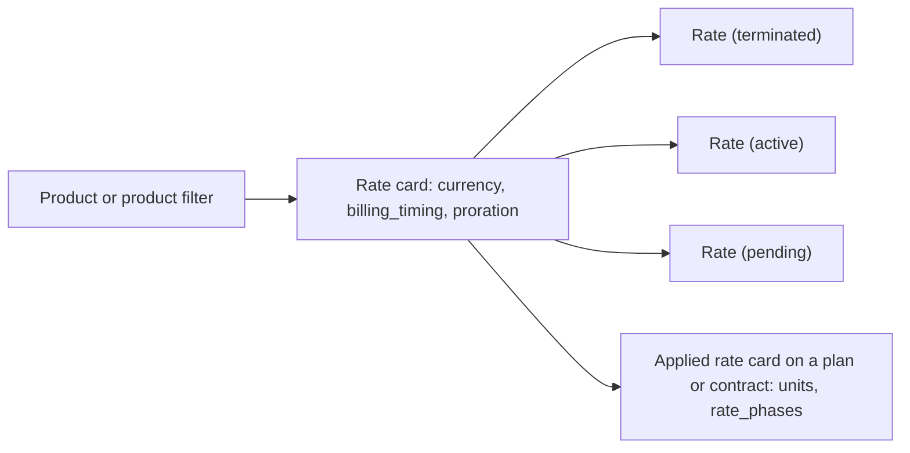

A [rate card](/v2/api-reference/rate-cards/object) defines reusable billing settings for one product or one product filter: currency, billing timing and proration, plus the [rates](/v2/guide/rate-cards/rates) that set its price over time. Create one rate card per pricing target and currency, then apply it to [plans](/v2/guide/plans/overview) and [contracts](/v2/guide/contracts/overview).

## How it fits together

- A rate card targets exactly one `product_code`, or one `product_filter_code` on that product. The target is fixed at creation.
- It owns `currency`, `billing_timing` and `proration`.
- It contains rates. Each rate owns the rate model, the price, the billing interval and the effective date.
- An **applied rate card** attaches the reusable card to a plan or a contract. It can carry a fixed quantity (`units`) and a sequence of rate phases.

A product category is never a pricing target. It only groups the resulting fees.



## Rate card fields

| Field | Required | Description |
| --- | --- | --- |
| `name`, `code` | Yes | Label and unique code. |
| `product_code` | Yes | Product being priced. Fixed at creation. |
| `product_filter_code` | No | Filter on that product. Null prices the product without a filter. Fixed at creation. |
| `currency` | Yes | ISO 4217 code, such as `USD`. |
| `billing_timing` | No | `arrears` (default) or `advance`. |
| `proration` | No | Whether fees are prorated. Default `false`. |
| `display_on_invoice` | No | Whether generated fees are shown on invoices. Default `true`. |
| `regroup_paid_fees` | No | `invoice` or `null`. Only for hidden advance fees (`display_on_invoice: false`). Null keeps paid fees standalone. |
| `applied_pricing_unit_code` | No | Pricing unit code, or null to price in currency. |
| `tax_codes` | No | Taxes to assign. An empty array clears them. |
| `rates` | No | Initial rates. If one fails validation, the card and its rates roll back. |
| `description` | No | Internal description. |

`billing_timing` and `proration` limit which rate models and options are available. See the [availability matrix](/v2/guide/rate-cards/pricing-models/overview).

## Example

The running example uses two rate cards, both USD, `arrears` and `proration: false`:

| Rate card | Targets | Rate | Full-month amount |
| --- | --- | --- | --- |
| `monthly_service_usd` | `monthly_service` (fixed) | `monthly_standard`: $100 per month | $100 × 1 unit = $100.00 |
| `api_calls_usd` | `api_calls_product` (metered) | `calls_standard`: $0.01 per call | $0.01 × 2,000 = $20.00 |

The invoice for a full month shows two fees totaling $120.00 before tax. For a cloud catalog, a card can target a filter instead, such as Compute → Flex 512MiB.

## Create a rate card

<Tabs>
  <Tab title="Dashboard">
    Create a rate card with these values:
    1. **Name**: `API calls USD`, **Code**: `api_calls_usd`
    2. **Product**: `api_calls_product` (no filter)
    3. **Currency**: USD
    4. **Billing timing**: arrears
    5. **Proration**: off
    6. Add the rate `calls_standard`: standard model, amount 0.01, billing interval 1 month, effective from January 1, 2027.

    <Note>
    The fields match the API. Screen-by-screen Dashboard steps for v2 are not documented yet.
    </Note>
  </Tab>
  <Tab title="API">
    <CodeGroup>
    ```bash Create a rate card with its first rate
    LAGO_URL="https://api.getlago.com"
    API_KEY="__YOUR_API_KEY__"

    curl --location --request POST "$LAGO_URL/api/v2/rate_cards" \
      --header "Authorization: Bearer $API_KEY" \
      --header 'Content-Type: application/json' \
      --data-raw '{
        "rate_card": {
          "name": "API calls USD",
          "code": "api_calls_usd",
          "product_code": "api_calls_product",
          "currency": "USD",
          "billing_timing": "arrears",
          "proration": false,
          "rates": [
            {
              "code": "calls_standard",
              "effective_from": "2027-01-01T00:00:00Z",
              "rate_model": "standard",
              "rate_properties": { "amount": "0.01" },
              "billing_interval_count": 1,
              "billing_interval_unit": "month"
            }
          ]
        }
      }'
    ```
    </CodeGroup>
  </Tab>
</Tabs>

## Verify pricing

Retrieve the card with `GET /api/v2/rate_cards/api_calls_usd`. Supported expansions are `active_rate`, `rates`, `taxes`, `product` and `product_filter`. `active_rate` is null until a rate becomes effective. `rates` are sorted by `effective_from`, newest first.

## Apply a rate card

Apply the card to an editable plan with `POST /api/v2/plans/{plan_code}/applied_rate_cards`. All cards on a plan share its currency, and only one card may price each product and filter combination. See [plans](/v2/guide/plans/overview). A contract can also receive cards directly while it is `pending`. See [contract overrides](/v2/guide/contracts/overrides).

## Change and lock rules

`PUT` and `PATCH` accept partial updates.

- The product and product filter are fixed at creation.
- Once any rate exists, `currency`, `applied_pricing_unit_code`, `billing_timing`, `proration`, `regroup_paid_fees` and `display_on_invoice` cannot change.
- `code` and `currency` cannot change while the card is attached to a plan or contract.
- `tax_codes` stay editable.

Set the structural fields before you create the first rate.

<Warning>
`DELETE /api/v2/rate_cards/{code}` deletes an unused rate card and its rates. A card attached to a plan cannot be deleted.
</Warning>

## FAQ

<AccordionGroup>
  <Accordion title="What is the difference between a rate card and a rate?">
    The rate card holds settings that stay stable: the target product or filter, currency, billing timing and proration. The rate holds the price: rate model, `rate_properties`, billing interval, spending minimum and effective date. One card keeps a timeline of rates.
  </Accordion>
  <Accordion title="Can one rate card price several products?">
    No. A rate card targets exactly one product, or one filter on that product. Create one card per pricing target.
  </Accordion>
  <Accordion title="How do I bill in advance?">
    Set `billing_timing: "advance"` on the rate card before creating its first rate. Some models are arrears only, such as `volume`, and spending minimums require arrears. Check the [availability matrix](/v2/guide/rate-cards/pricing-models/overview).
  </Accordion>
  <Accordion title="How do I change a price for existing customers?">
    Add a new rate with a later `effective_from`. When it becomes active, plans and contracts using the card inherit it, unless they override the price in their current phase. See [rates](/v2/guide/rate-cards/rates).
  </Accordion>
  <Accordion title="Can I change billing timing after launch?">
    No. Once a rate exists, `billing_timing` and `proration` are locked. Create a new rate card with the new settings.
  </Accordion>
</AccordionGroup>

<CardGroup cols={2}>
  <Card title="Rates" icon="clock-rotate-left" href="/v2/guide/rate-cards/rates">
    Effective-dated prices and billing intervals.
  </Card>
  <Card title="Pricing models" icon="chart-line" href="/v2/guide/rate-cards/pricing-models/overview">
    Standard, graduated, volume and more.
  </Card>
  <Card title="Create a rate card" icon="code" href="/v2/api-reference/rate-cards/create">
    `POST /rate_cards`
  </Card>
  <Card title="The rate card object" icon="code" href="/v2/api-reference/rate-cards/object">
    Every rate card field.
  </Card>
</CardGroup>
