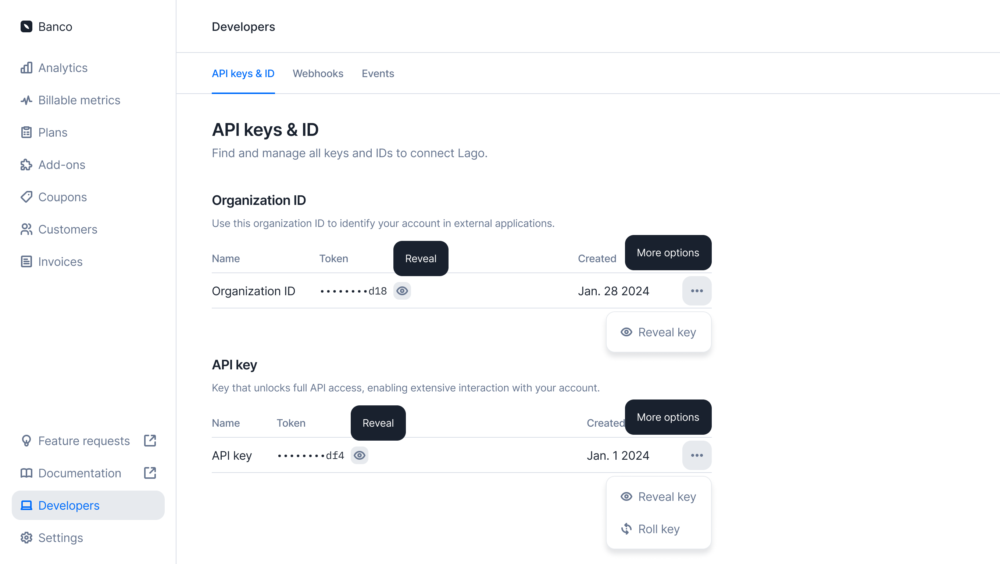
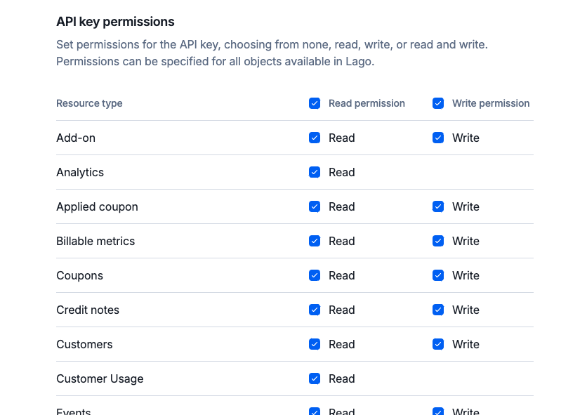

API keys authenticate requests to Lago. Create keys for your integrations and configure the access each one needs.

## Access requirements

Creating additional keys and scheduling rotation require a premium license. Configuring permissions requires the enterprise add-on.

## Reveal a key

1. Open **Developers**.
2. Open **API keys**.
3. Find the key.
4. Click **Reveal**.
5. Copy the key.

<Frame caption="Reveal an API key">
  
</Frame>

## Create an API key

1. Open **Developers**.
2. Open **API keys**.
3. Click **Add a key**.
4. Optionally, enter a name that identifies the integration.
5. Create the key.

The key is active once created. Organization admins receive an email notification.

## Set API key permissions

Choose read, write or read-and-write access for each API object the integration needs. Requests without the required permission are rejected.

<Frame caption="API key permissions">
  
</Frame>

## Rotate an API key

### Rotate API key instantly

Immediate rotation invalidates the previous key. Update integrations that use it with the replacement key.

1. Open **Developers**.
2. Open **API keys**.
3. Select the key.
4. Click **Rotate API key**.
5. Choose immediate rotation.

Organization admins receive an email notification when a key is rotated.

### Schedule an API key rotation

Use scheduled rotation when you need time to update your integrations. Review the rotation time shown for the key before confirming. Available options include one hour, 24 hours, 48 hours and seven days.

## Delete an API key

Deleting a key immediately stops requests from authenticating with it. Update integrations that use the key before deleting it. You cannot delete your organization’s last API key.

1. Open **Developers**.
2. Open **API keys**.
3. Select the key to delete.
4. Click the delete button.

## Check last use

The `Last used` field helps you identify keys that are still in use. Requests to the events endpoint do not update this field.
