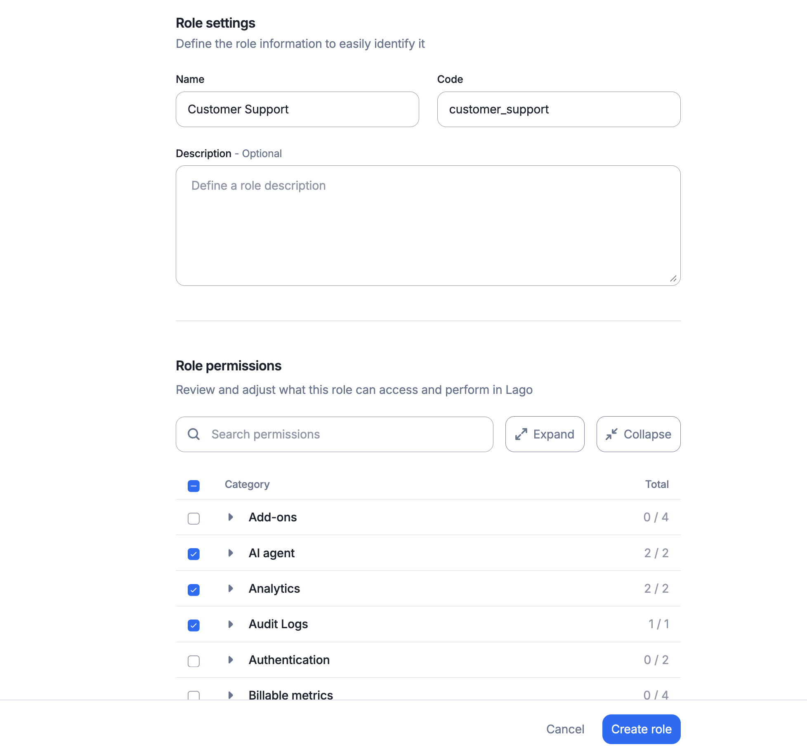

Roles define what each team member can view and change. Assign a built-in role or create a custom role with the permissions your team needs.

## Built-in roles

Lago provides Admin, Account manager, and Finance & analyst roles. Review the [permission definitions](https://github.com/getlago/lago-api/blob/main/config/permissions.yml) before choosing a role for your team.

The account creator receives the Admin role by default.

## Create a custom role

Custom roles require the relevant premium add-on. Updating a role’s permissions updates access for users assigned to that role. Keep at least one role with administrative permissions.

1. Open **Settings**.
2. Open **Roles & Permissions**.
3. Click **Create Role**.
4. Enter a name.
5. Enter a code.
6. Enter a description.
7. Select the permissions.
8. Save the role.
9. Assign team members to the role.

<Frame caption="Create a custom role">
  
</Frame>

## Related settings

[API key permissions](/v2/guide/security/api-keys#set-api-key-permissions) control access for integrations. [Single sign-on](/v2/guide/security/sso) controls how team members sign in.
