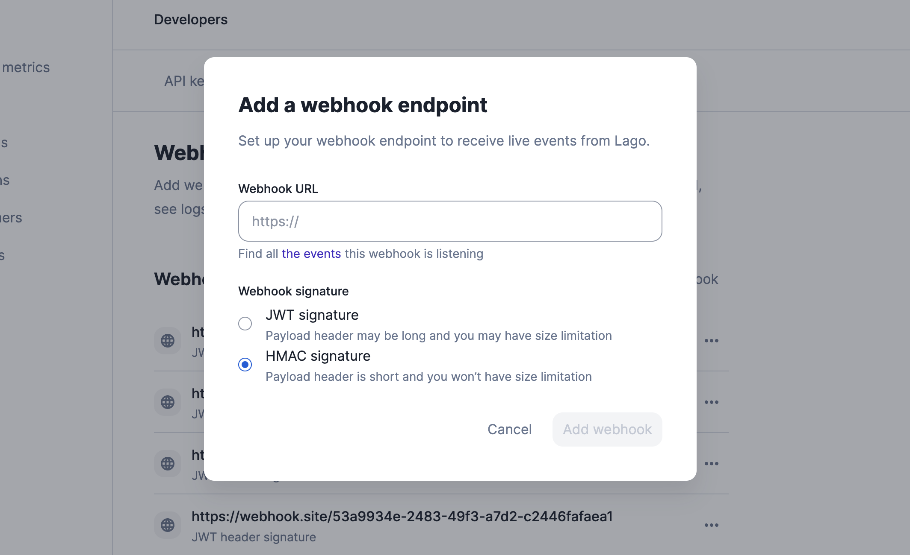
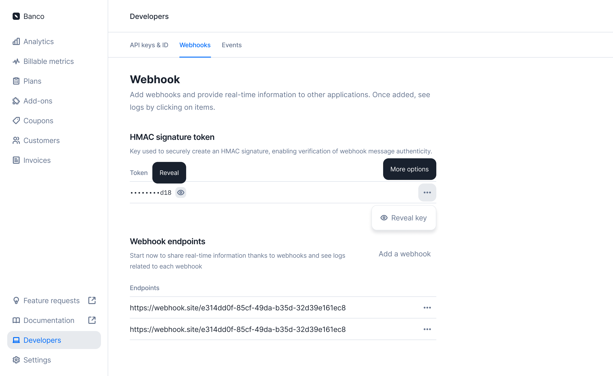

A [webhook endpoint](/v2/api-reference/webhook-endpoints/retrieve) is a public URL where Lago sends event notifications, such as a finalized invoice or a started contract. Register one when your application needs to react to billing activity without polling the API.

<Warning>
The v2 spec documents how to manage webhook endpoints and lists the event type names. It does not document the event payloads for v2 objects such as contracts, rate cards or products. Do not build parsers for those payloads from the legacy (v1) reference until the v2 payload formats are published.
</Warning>

## Endpoint fields

| Field | Meaning |
| --- | --- |
| `webhook_url` | Public URL receiving webhook requests. Private addresses are rejected. |
| `name` | Optional endpoint name. |
| `signature_algo` | `jwt` or `hmac`. |
| `event_types` | Event types to deliver. `null` or `["*"]` selects all events. An empty array selects none. Names are trimmed, lowercased and deduplicated. |

Your organization can have at most ten endpoints, each with a distinct URL.

## Create a webhook endpoint

<Tabs>
  <Tab title="Dashboard">
    1. Go to **Developers** in the side menu;
    2. Open the **Webhooks** tab;
    3. Click **Add an endpoint**;
    4. Enter the name and URL;
    5. Choose the HMAC or JWT signature;
    6. Select the events to listen to; and
    7. Click **Create endpoint**.
  </Tab>
  <Tab title="API">
    <CodeGroup>
    ```bash Create a webhook endpoint
    LAGO_URL="https://api.getlago.com"
    API_KEY="__YOUR_API_KEY__"

    curl --location --request POST "$LAGO_URL/api/v2/webhook_endpoints" \
      --header "Authorization: Bearer $API_KEY" \
      --header 'Content-Type: application/json' \
      --data-raw '{
        "webhook_endpoint": {
          "name": "Billing webhooks",
          "webhook_url": "https://hooks.example.com/lago",
          "signature_algo": "hmac",
          "event_types": ["contract.started", "contract.terminated", "invoice.created"]
        }
      }'
    ```
    </CodeGroup>
  </Tab>
</Tabs>

## Signature

Choose the signature when you create the endpoint, or change it later with an update.

- `jwt` embeds the payload in the signature header, so the header can grow large.
- `hmac` sends a short signature header.

<Tabs>
  <Tab title="Dashboard">
    <Frame caption="Webhook endpoint signature">
      
    </Frame>

    To find your HMAC signature token, go to **Developers** > **Webhooks**, then reveal and copy the **HMAC signature token**.

    <Frame caption="Locate your HMAC signature token">
      
    </Frame>
  </Tab>
  <Tab title="API">
    Set `signature_algo` to `jwt` or `hmac` on create or update.
  </Tab>
</Tabs>

## Event types

`event_types` accepts the names listed in the spec. Event types related to v2 objects:

| Area | Event types |
| --- | --- |
| Contracts | `contract.created`, `contract.updated`, `contract.started`, `contract.terminated`, `contract.canceled` |
| Contract rate cards | `contract_rate_card.created`, `contract_rate_card.updated`, `contract_rate_card.deleted` |
| Plans | `plan.created`, `plan.updated`, `plan_rate_card.created`, `plan_rate_card.updated`, `plan_rate_card.deleted` |
| Rate cards and rates | `rate_card.created`, `rate_card.updated`, `rate_card.deleted`, `rate_card_rate.created`, `rate_card_rate.updated`, `rate_card_rate.deleted` |
| Products | `product.created`, `product.updated`, `product.deleted`, `product_category.created`, `product_category.updated`, `product_category.deleted`, `product_filter.created`, `product_filter.updated`, `product_filter.deleted` |
| Invoices | `invoice.created`, `invoice.drafted`, `invoice.generated`, `invoice.ready_to_finalize`, `invoice.voided`, `invoice.deleted`, `invoice.payment_status_updated`, `invoice.payment_overdue`, `invoice.payment_failure`, `invoice.payment_dispute_lost`, `invoice.resynced` |
| Credit notes | `credit_note.created`, `credit_note.generated`, `credit_note.refund_failure` |
| Payments | `payment.succeeded`, `payment.requires_action`, `payment_provider.error`, `payment_receipt.created`, `payment_receipt.generated`, `payment_request.created`, `payment_request.payment_failure`, `payment_request.payment_status_updated` |
| Customers | `customer.created`, `customer.updated`, `customer.checkout_url_generated`, `customer.payment_provider_created`, `customer.payment_provider_error` |

The spec enum also contains legacy event types, such as subscription and wallet events. See the [Create webhook endpoint](/v2/api-reference/webhook-endpoints/create) reference for the full list.

## List, update and delete endpoints

`PUT` and `PATCH` accept partial updates. Omitted fields are unchanged.

<CodeGroup>
```bash List webhook endpoints
LAGO_URL="https://api.getlago.com"
API_KEY="__YOUR_API_KEY__"

curl --location --request GET "$LAGO_URL/api/v2/webhook_endpoints" \
  --header "Authorization: Bearer $API_KEY"
```

```bash Listen to all events
LAGO_URL="https://api.getlago.com"
API_KEY="__YOUR_API_KEY__"
WEBHOOK_ENDPOINT_ID="__YOUR_WEBHOOK_ENDPOINT_ID__"

curl --location --request PATCH "$LAGO_URL/api/v2/webhook_endpoints/$WEBHOOK_ENDPOINT_ID" \
  --header "Authorization: Bearer $API_KEY" \
  --header 'Content-Type: application/json' \
  --data-raw '{
    "webhook_endpoint": {
      "event_types": ["*"]
    }
  }'
```

```bash Delete a webhook endpoint
LAGO_URL="https://api.getlago.com"
API_KEY="__YOUR_API_KEY__"
WEBHOOK_ENDPOINT_ID="__YOUR_WEBHOOK_ENDPOINT_ID__"

curl --location --request DELETE "$LAGO_URL/api/v2/webhook_endpoints/$WEBHOOK_ENDPOINT_ID" \
  --header "Authorization: Bearer $API_KEY"
```
</CodeGroup>

<Warning>
Deleting an endpoint permanently deletes it and its delivery records. Your application stops receiving events at that URL. Review the change before you run it in production.
</Warning>

## Delivery logs

To inspect deliveries, go to **Developers** > **Webhooks**, click the endpoint and open the **Deliveries** tab. The v2 API does not expose delivery records.

<Frame caption="Webhook logs">
  
</Frame>

## Next steps

<CardGroup cols={2}>
  <Card title="Logs" icon="list" href="/v2/guide/logs">
    Activity, API and security logs.
  </Card>
  <Card title="Contracts" icon="file-signature" href="/v2/guide/contracts/overview">
    The objects behind contract events.
  </Card>
  <Card title="Create a webhook endpoint (API)" icon="code" href="/v2/api-reference/webhook-endpoints/create">
    Request schema and full event type list.
  </Card>
  <Card title="List webhook endpoints (API)" icon="code" href="/v2/api-reference/webhook-endpoints/list">
    Response schema.
  </Card>
</CardGroup>
