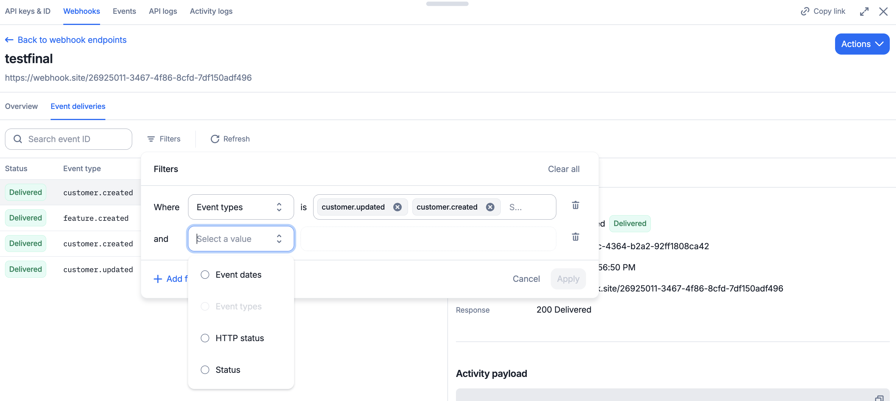

Webhooks notify your application when billing events occur, such as an invoice being finalized or a Contract starting. Add an endpoint to receive the events your application needs.

<span id="endpoint-fields" />
<span id="create-a-webhook-endpoint" />

## Create an endpoint

Use a public URL that can receive webhook requests. Your organization can have up to ten endpoints, each with a distinct URL.

<Tabs>
  <Tab title="Dashboard">
    1. Open **Developers**.
    2. Open the **Webhooks** tab.
    3. Click **Add an endpoint**.
    4. Enter a name.
    5. Enter the endpoint URL.
    6. Select **Standard Webhooks** as the signature.
    7. Select the events to receive.
    8. Click **Create endpoint**.
  </Tab>
  <Tab title="API">
    New endpoints use `standard_webhooks` by default.

    ```bash Create a webhook endpoint
    LAGO_URL="https://api.getlago.com"
    API_KEY="__YOUR_API_KEY__"

    curl --location --request POST "$LAGO_URL/api/v2/webhook_endpoints" \
      --header "Authorization: Bearer $API_KEY" \
      --header 'Content-Type: application/json' \
      --data-raw '{
        "webhook_endpoint": {
          "name": "Billing webhooks",
          "webhook_url": "https://hooks.example.com/lago",
          "signature_algo": "standard_webhooks",
          "event_types": ["contract.started", "contract.terminated", "invoice.created"]
        }
      }'
    ```
  </Tab>
</Tabs>

<span id="event-types" />

## Choose events

Select the events your application needs. For example, use `contract.started` to react to a Contract starting, or `invoice.created` to react to a finalized invoice.

In the API, `event_types` selects the events delivered to an endpoint. `null` or `["*"]` selects all events; an empty array selects none. See the [endpoint API reference](/v2/api-reference/webhook-endpoints/create) for the full event list.

<span id="signature" />

## Verify signatures

Lago signs each delivery with your endpoint’s signing key. Verify the raw request body and the `webhook-id`, `webhook-timestamp` and `webhook-signature` headers with a [Standard Webhooks library](https://www.standardwebhooks.com/#resources) before processing the event.

Each endpoint has its own signing key, prefixed with `whsec_`. To find it in the Dashboard, open **Developers** > **Webhooks**, select the endpoint, then reveal its signing key.

Through the API, retrieve the endpoint with `expands[]=signing_keys`. Reading signing keys requires `webhook_endpoint` write permission; the API returns `403` without it.

```bash Retrieve the endpoint signing keys
LAGO_URL="https://api.getlago.com"
API_KEY="__YOUR_API_KEY__"
WEBHOOK_ENDPOINT_ID="__YOUR_WEBHOOK_ENDPOINT_ID__"

curl --globoff --location --request GET "$LAGO_URL/api/v2/webhook_endpoints/$WEBHOOK_ENDPOINT_ID?expands[]=signing_keys" \
  --header "Authorization: Bearer $API_KEY"
```

The `signing_keys` array is ordered oldest first. Use the most recent key’s `secret_key` for verification. Store it securely in your application instead of retrieving it for every delivery.

Pass the request body to the verification library exactly as received. Parsing and serializing the JSON again can change the body and invalidate the signature. Keep the library’s timestamp checks enabled to protect against replayed messages.

<Accordion title="Existing endpoint compatibility">
  New endpoints created through `/api/v2/webhook_endpoints` use Standard Webhooks. Existing JWT and HMAC endpoints continue to work. See the [shared signature reference](/api-reference/webhooks/format---signature) for those algorithms.
</Accordion>

## Handle deliveries and retries

Return `200`, `201`, `202` or `204` to acknowledge a delivery. Lago retries failed deliveries. By default, it makes up to three attempts: the initial delivery and two retries.

Use `webhook-id` to identify messages you have already processed. The identifier stays the same when Lago retries a message. Verify the signature before using the identifier or processing the payload.

On self-hosted instances, `LAGO_WEBHOOK_ATTEMPTS` sets the total number of attempts. `LAGO_WEBHOOK_TIMEOUT_SECONDS` sets the request timeout, which defaults to 30 seconds.

<span id="list-update-and-delete-endpoints" />

## Manage endpoints

`PUT` and `PATCH` accept partial updates. Omitted fields are unchanged.

<CodeGroup>
```bash List webhook endpoints
LAGO_URL="https://api.getlago.com"
API_KEY="__YOUR_API_KEY__"

curl --location --request GET "$LAGO_URL/api/v2/webhook_endpoints" \
  --header "Authorization: Bearer $API_KEY"
```

```bash Listen to all events
LAGO_URL="https://api.getlago.com"
API_KEY="__YOUR_API_KEY__"
WEBHOOK_ENDPOINT_ID="__YOUR_WEBHOOK_ENDPOINT_ID__"

curl --location --request PUT "$LAGO_URL/api/v2/webhook_endpoints/$WEBHOOK_ENDPOINT_ID" \
  --header "Authorization: Bearer $API_KEY" \
  --header 'Content-Type: application/json' \
  --data-raw '{
    "webhook_endpoint": {
      "event_types": ["*"]
    }
  }'
```

```bash Delete a webhook endpoint
LAGO_URL="https://api.getlago.com"
API_KEY="__YOUR_API_KEY__"
WEBHOOK_ENDPOINT_ID="__YOUR_WEBHOOK_ENDPOINT_ID__"

curl --location --request DELETE "$LAGO_URL/api/v2/webhook_endpoints/$WEBHOOK_ENDPOINT_ID" \
  --header "Authorization: Bearer $API_KEY"
```
</CodeGroup>

<Warning>
Deleting an endpoint permanently deletes it and its delivery records. Your application stops receiving events at that URL.
</Warning>

<span id="delivery-logs" />

## Inspect delivery logs

1. Open **Developers**.
2. Open the **Webhooks** tab.
3. Select an endpoint.
4. Open **Deliveries**.
5. Filter the deliveries.
6. Select a delivery to inspect its payload, response and retry count.

Use the delivery details to investigate failures before retrying a delivery. Delivery records are available in the Dashboard; the endpoint-management API does not provide delivery records.

<Frame caption="Webhook deliveries">
  
</Frame>

## Next steps

<CardGroup cols={2}>
  <Card title="Logs" icon="list" href="/v2/guide/logs">
    Investigate recorded activity and API requests.
  </Card>
  <Card title="Create a webhook endpoint (API)" icon="code" href="/v2/api-reference/webhook-endpoints/create">
    Endpoint fields and supported event types.
  </Card>
</CardGroup>
