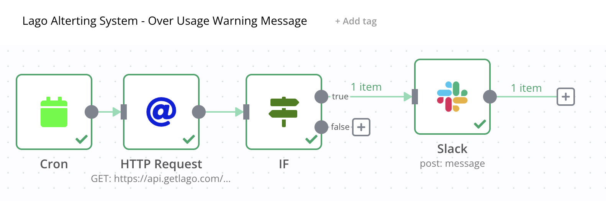
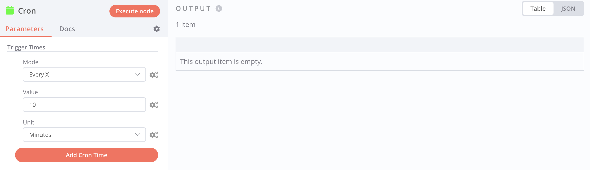

n8n is an automation tool for developers that can poll the Lago API on a schedule and act on the result. Use it to warn customers or your team when usage on a contract crosses a threshold before the invoice is issued.

## Overconsumption alerting example (with n8n)

When a customer overconsumes during a period, you might need to warn them. This happens with cloud or API products. Automatic billing should not leave your customers with a bad surprise when they open their invoices.

<Frame caption="n8n alerting workflow">
  
</Frame>

The workflow:
1. Uses a **Cron** node to call the Lago API every X minutes, hours or days.
2. Calls [`GET /api/v2/contracts/{external_id}/current_usage`](/v2/api-reference/contracts/retrieve-current-usage) to fetch the contract's current usage.
3. Uses an **IF** node to fire only above a spend threshold.
4. **Sends a message** when the threshold is reached. This example uses Slack. An emailing tool or a CRM works too.

## 1st node: Cron expression to repeat tasks at a defined interval

The first node triggers the automation at a defined interval.
1. Add a new **Node**.
2. Select **CRON** as a new application node.
3. Set the **Mode** to `Every X`.
4. Set the **Value** to `10` and the **Unit** to `Minutes`.

The flow then runs every 10 minutes. Change the value and the unit to your preferred interval.

<Frame caption="Cron expression">
  
</Frame>

## 2nd node: fetch the contract's current usage with an HTTP request

This node fetches current usage from the Lago API.
1. Add a new **Node**.
2. Select **HTTP Request** as a new application node.
3. Set the method to `GET` and the URL to the [contract current usage](/v2/api-reference/contracts/retrieve-current-usage) endpoint, with the contract's `external_id` in the path.
4. Set the `Authorization` header to `Bearer __YOUR_API_KEY__` and the `Content-Type` header to `application/json`.
5. Execute the node to fetch the payload from the Lago API.

The node sends the same request as this one:

```bash
LAGO_URL="https://api.getlago.com"
API_KEY="__YOUR_API_KEY__"

curl --location --request GET "$LAGO_URL/api/v2/contracts/contract_example/current_usage" \
  --header "Authorization: Bearer $API_KEY" \
  --header 'Content-Type: application/json'
```

The response wraps the usage in a `current_usage` object. It holds `external_contract_id`, `external_customer_id`, `currency`, `amount_cents`, `taxes_amount_cents`, `total_amount_cents` and a `rate_cards` array with the usage of each applied rate card (`rate_card_code`, `product_code`, `units`, `events_count`, `amount_cents`, `from_datetime`, `to_datetime`). The next node reads its fields with the `current_usage` prefix.

<Info>
Current usage covers the contract's open billing windows. Totals may span more than one upcoming invoice. Pending contracts have no usage. Pass `apply_taxes=false` to skip tax calculation, or filter with `rate_card_code`, `product_code`, `product_filter_code` or `product_type`. The API key needs `customer_usage` read permission.
</Info>

## 3rd node: IF conditional statement to trigger messages under conditions

This node triggers the alert only when your customer exceeds a threshold. Those limits depend on your product and your paid features.

In this example, the alert fires **when the contract's current usage goes over $200, before tax**. You could also use the `units` of one entry in `rate_cards`.

1. Add a new **Node**.
2. Select **IF** as a new application node.
3. Create a condition for the **TRUE** branch (when conditions are met).
4. **Value 1** is the parameter of your condition, here `current_usage.amount_cents`.
5. **Operation** is the comparison. Select `Larger or Equal` and set **Value 2** to `20000`. Amounts are in cents, so a $200 threshold is `20000`.

You can add as many conditions as you need, and you can add an action for the `FALSE` branch.

## 4th node: send an alert message to Slack

This last node sends the message. This example uses a Slack channel, but you could also email your customers when they pass their usage limits.

1. Add a new **Node**.
2. Select **Slack** as a new application node.
3. Select the targeted **Slack Account** and **Slack Channel**.
4. Choose the option to **POST** a **Message**.
5. **Define a message** and use the variables of the payload (for example `current_usage.rate_cards[0].product_name` and `current_usage.rate_cards[0].units`) to give context about current usage.

<Tip>
After you connect your Slack account, authorize the application's bot to post messages in the targeted channel.
</Tip>

<CardGroup cols={2}>
  <Card title="Contract current usage" icon="gauge" href="/v2/guide/contracts/current-usage">
    What current usage returns for a contract.
  </Card>
  <Card title="Retrieve contract current usage" icon="code" href="/v2/api-reference/contracts/retrieve-current-usage">
    `GET /api/v2/contracts/{external_id}/current_usage` reference.
  </Card>
</CardGroup>
