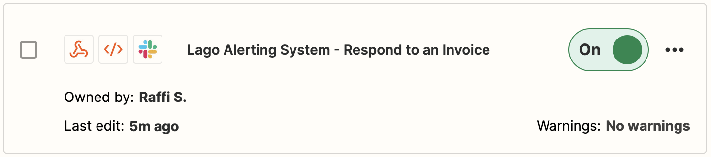
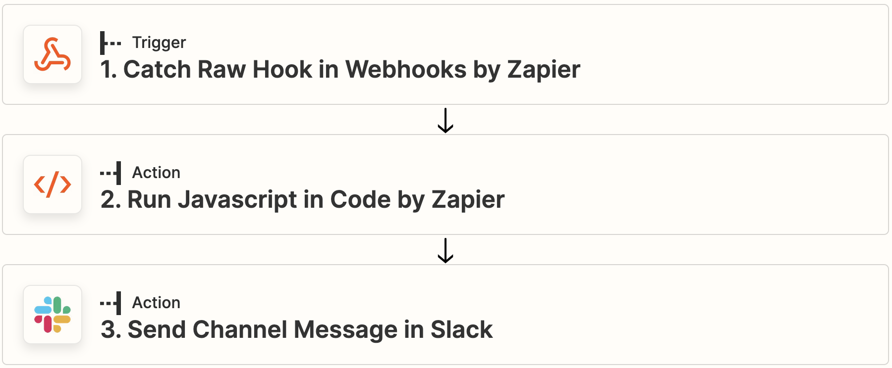
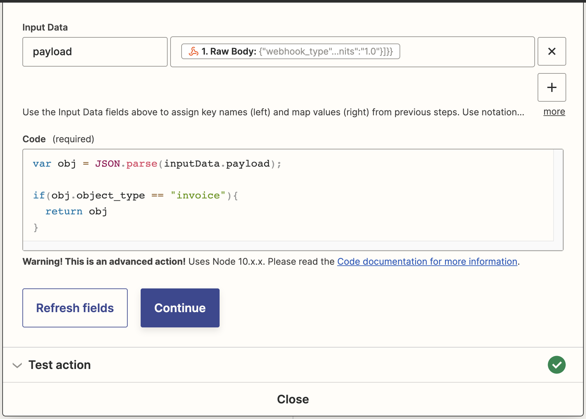
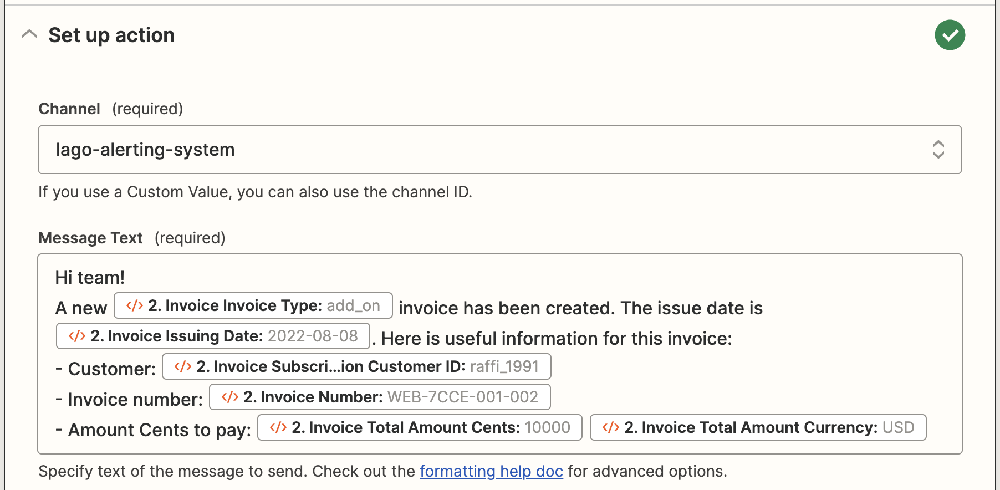
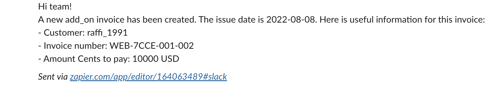

Zapier is a no-code automation tool that can catch Lago webhooks and forward them to other apps. Use it to alert your team in Slack whenever Lago issues an invoice.

## Invoice alerting example (with Zapier)

<Frame caption="Invoice alerting flow">
  
</Frame>

In this example, you **build an alert that fires whenever a new invoice is emitted**. This workflow uses:
1. Lago's webhook when a new invoice is emitted.
2. Zapier as an automation tool, to catch, transform and send the data.
3. Slack as the receiver, to alert your team when a new invoice is created.

<Frame caption="Zapier alerting flow">
  
</Frame>

<Note>
V2 lists the webhook event types (including `invoice.created`) but does not document V2 webhook payloads yet. The fields below come from the invoice webhook. Check the payload you receive and confirm field names with the Lago team before you rely on them.
</Note>

## 1. Catch a webhook when a new invoice is emitted

Lago creates an invoice when a contract's billing period closes. The invoice payload gives a detailed view of what was invoiced. The first action is to catch it with a webhook:

1. In Zapier, create a new Zap.
2. Use **Webhooks by Zapier** as the trigger of this Zap.
3. Select the **Catch Raw Hook** event trigger.
4. Copy the Zapier webhook URL and register it as a [webhook endpoint](/v2/guide/webhooks) in Lago (**Developers** > **Webhooks** > **Add a webhook**, or [`POST /api/v2/webhook_endpoints`](/v2/api-reference/webhook-endpoints/create)).
5. Catch your first webhook when an invoice is emitted.

## 2. Run a script to transform the webhook

In Zapier, create a second action by clicking the `+` icon. This action formats the webhook into fields you can use in a message.

1. Select **Code by Zapier** as a new *Event Action*.
2. Click **Javascript** as the code language.
3. Create a field called `payload`. Its value is the full **Raw body** of the webhook you received.
4. Run the script below in the **Code** section.
5. Test the action. If valid, it returns a breakdown of fields.

```javascript
var obj = JSON.parse(inputData.payload);

if(obj.object_type == "invoice"){
  return obj
}
```

<Frame caption="Script to transform the invoice payload">
  
</Frame>

## 3. Send a message to a Slack channel

Use the fields returned by the script to build a Slack message.

In Zapier, create a third action by clicking the `+` icon.

1. Select **Slack** as a new app action.
2. Select the **Send Channel Message** action.
3. Choose the targeted **Slack Account**.
4. Choose the targeted **Slack Channel**.
5. Create a message with the fields returned by the payload.

Once you test and validate the Zap, a Slack message is sent whenever Lago emits a new invoice.

<Frame caption="Slack message template in Zapier">
  
</Frame>

<Frame caption="Slack message received in the channel">
  
</Frame>

<CardGroup cols={2}>
  <Card title="Webhooks (v2)" icon="webhook" href="/v2/guide/webhooks">
    Register and manage webhook endpoints.
  </Card>
  <Card title="Create a webhook endpoint" icon="code" href="/v2/api-reference/webhook-endpoints/create">
    `POST /api/v2/webhook_endpoints` reference.
  </Card>
</CardGroup>
