The Salesforce CRM integration installs a Lago package in Salesforce and syncs billing data between the two systems through webhooks and the Lago API. Use it when your sales team works in Salesforce and needs to see Lago customers, invoices and credit notes on the Account.

<Note>
Contract-level sync details for V2 are not documented yet. The package's subscription, plan, add-on and coupon objects and flows are documented for the legacy v1 engine only. Check with the Lago team before you rely on the Salesforce package with V2 contracts. Legacy (v1): [Salesforce CRM](/integrations/crm/salesforce-crm).
</Note>

<Info>

**PREMIUM ADD-ON** ✨

This integration is only available to users with a specific paying add-on. Please
**[contact us](mailto:hello@getlago.com)** to get access to the Salesforce CRM integration.

</Info>

## I. Integration configuration
### Create integration for Salesforce on Lago side
Contact us to get premium access to the Lago Salesforce package. Log in to Lago as an admin user, navigate to **Settings** > **Integrations** > **Salesforce** (allowed only if the team has enabled it for your account), and click "Create new". Enter the following details:
- Name
- Code
- Salesforce Instance (URL of your Salesforce instance)

<Frame caption="Create new Salesforce integration in Lago">
  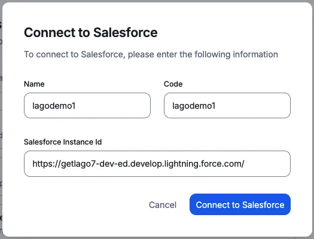
</Frame>

Note the integration code shown in the connection details, you need it later:

<Frame caption="Salesforce integration connection details">
  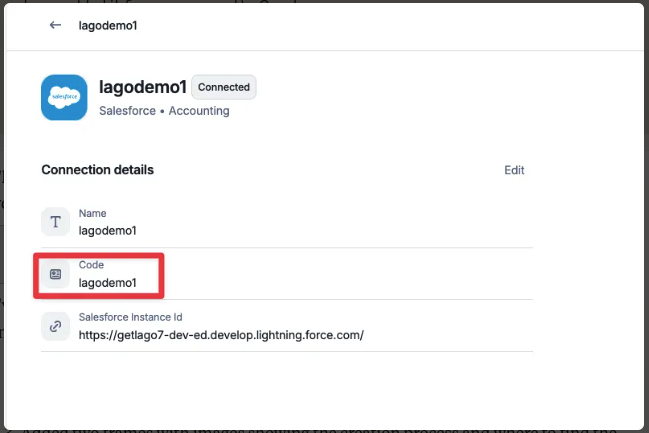
</Frame>


### Install Salesforce CRM package

Click the link we provide to open the installation page, then follow the instructions. Contact us if you need help during the installation.

<Frame caption="Install Lago Salesforce App package">
  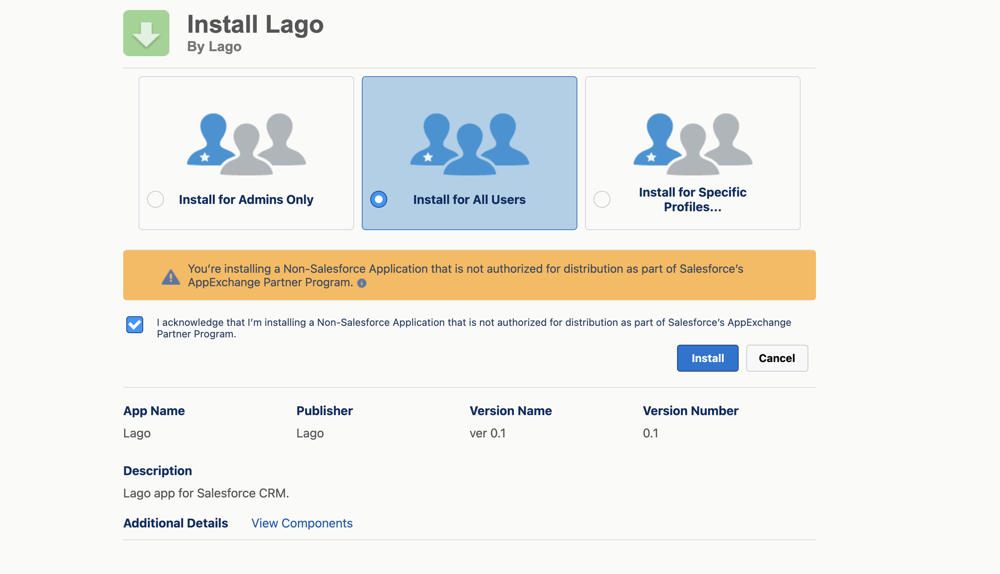
</Frame>


Follow these steps:

1. We recommend selecting the **"Install for all users"** option;
2. Click on the **"Install" button**;
3. Make sure to **check the box to grant access to these third-party websites**; and
4. Once completed, you'll have **successfully installed** the Lago Salesforce App.


<Info>
The installation can take a few minutes. You receive an email confirmation once it is finished.
</Info>


### Webhook config: sync real-time data
After installation in Salesforce CRM, set up a webhook URL in Salesforce to receive real-time data from Lago. 
This involves **configuring a new "Site" in Salesforce's setup section**. 
Note that the four main actions described below must be performed by a Salesforce admin, and are only required during the initial setup.

<Steps titleSize="h3">
  <Step title="Access the Site section in Salesforce" titleSize="h3">
    1. Click the gear icon in the upper right to access **Salesforce Setup**;
    2. Search and navigate to the Sites section; and
    3. Create a new Site (see picture below).

    <Frame caption="Create a new Site in Salesforce">
      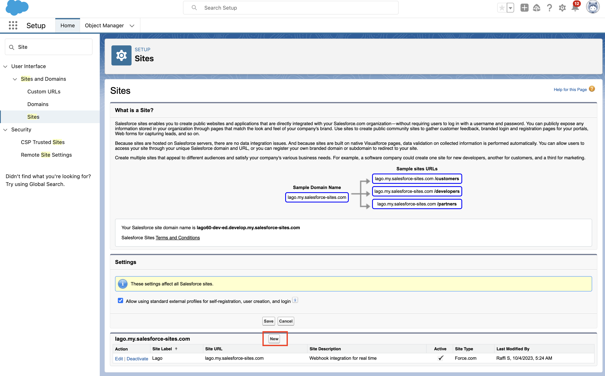
    </Frame>
  </Step>
  <Step title="Create a new Site in Salesforce" titleSize="h3">
    When creating a new site, follow these steps:
    1. Set a unique **Site Label**;
    2. Specify a unique **Site Name**;
    3. Optionally, add a **Site Description**;
    4. Ensure the **Site Contact** and **Default Record Owner** are filled;
    5. Set the **Default Web Address** prefix to `getPushNotification`;
    6. Choose `SiteLogin` as the **Active Site Home Page**; and
    7. Don't forget to **save the new site**; and
    8. **Activate the newly created site** by going to the Site Details and clicking the `Activate` button.

    <Frame caption="New site creation flow in Salesforce">
      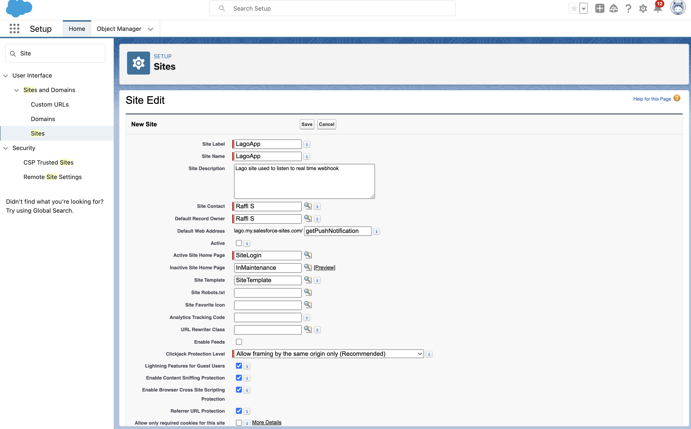
    </Frame>
  </Step>
  <Step title="Edit Public Access Settings in Salesforce" titleSize="h3">
    To edit Public Access Settings for your new Site:
    1. Visit the site and click **Public Access Settings**; 
    2. In the **Enabled Apex Class Access** section, click "edit";
    3. Add `LagoWebHookSubscriptionController` to **Enabled Apex Classes**; and
    4. Save your changes.

    <Frame caption="Edit Salesforce's site Public Access Settings">
      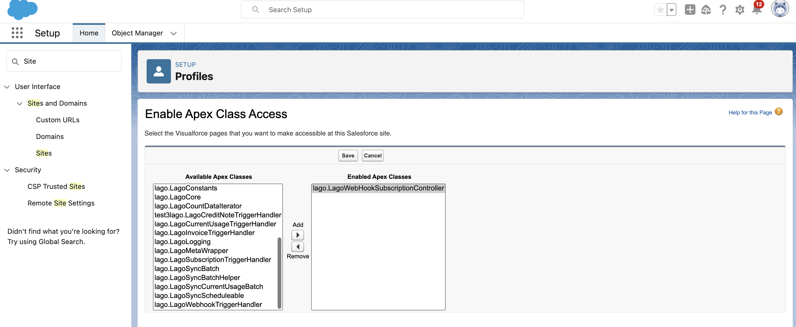
    </Frame>
  </Step>
    <Step title="Paste the Webhook URL into Your Lago App" titleSize="h3">
      To set up the webhook URL for real-time data syncing between Lago and Salesforce, follow these steps:
      1. Return to your newly created site;
      2. Locate the **Custom URLs** section;
      3. Copy the **domain name** *(e.g., lago.my.salesforce-sites.com)*;
      4. Add the `https://` prefix to this domain name (e.g., `https://lago.my.salesforce-sites.com`); and
      5. Append `/services/apexrest/lago/api/Webhooks/incoming/pushDetails/` to the domain name (e.g., `https://lago.my.salesforce-sites.com/services/apexrest/lago/api/Webhooks/incoming/pushDetails/`).

      <Frame caption="Find Salesforce's site domain name">
        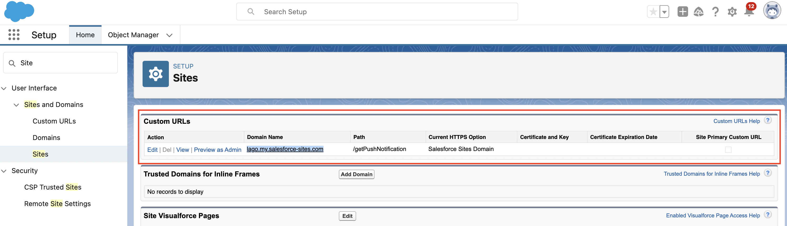
      </Frame>

      Now, go to your Lago app and paste this webhook into the webhook settings:

      1. Within Lago, navigate to **Developers**;
      2. Visit the **Webhooks** tab;
      3. Choose `HMAC` as the **mandatory signature type**;
      4. Paste your Salesforce webhook URL; and
      5. Save this webhook endpoint.

      You are now ready to sync real-time data from Lago to Salesforce.

      <Frame caption="Paste Salesforce webhook URL to Lago">
        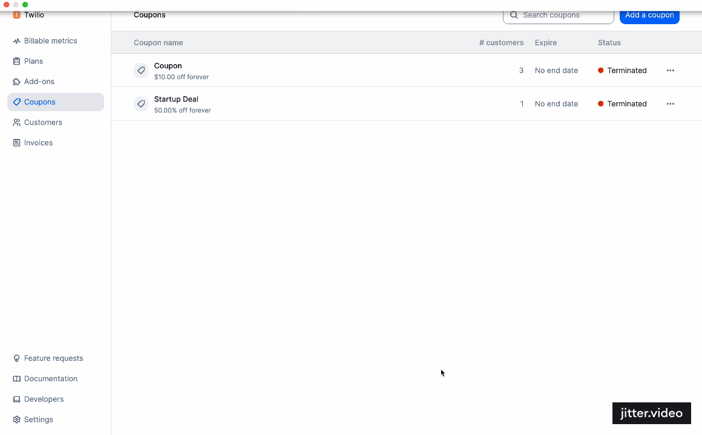
      </Frame>
  </Step>
</Steps>


### Establish and finalize connection
<Frame caption="Connect your Lago instance to Salesforce Lago App">
  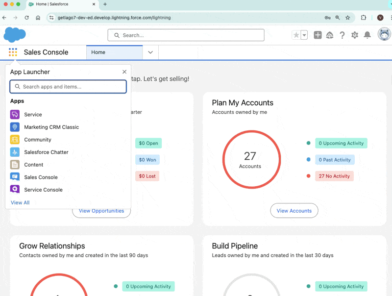
</Frame>

**Option 1: Configure a standard API Base URL**
To establish a connection between your Lago instance and the Salesforce Package, follow these steps:

1. Access Salesforce and locate the **App Launcher**;
2. Find and open the Lago app you recently installed;
3. Within the Lago Base Configuration tab:
  - Provide your **Lago API Key** (located in Lago's Developer Section)
  - Enter your Lago **API base URL**. Do not append an API version path to the URL. By default, the valid URL is `https://api.getlago.com/`. 
  If you want to change the API base URL to another one (e.g., `https://api.eu.getlago.com/` or a custom self-hosted one), please follow option 2.
  - Enter lago app URL (**Front End Base URL**). By default, the valid URL is `https://app.getlago.com/` (it will be different for self-hosted).
  - Enter Lago Integration code from Step 1 [`Salesforce integration on Lago`](#create-integration-for-salesforce-on-lago-side)
4. **"Save and validate"** your connection; and
  - If the **Lago API Key** is valid then only **Start Data Sync** button will be enabled.
5. Click the **"Start Data Sync"** to finalize the connection between Lago and Salesforce.

<Warning>
Please note that data synchronization is available only for Lago customers with an `external_salesforce_id` and an existing Salesforce Account.
</Warning>

**Option 2: Configure a custom API Base URL**
If you use your own Lago API base URL (self-hosting) or one for a different server instance, 
you can customize it directly in Salesforce: 
1. Navigate to Salesforce's Setup;
2. Search for and select Remote Site Settings;
3. Find and access the remote site for the Lago App;
4. Click the Edit button to modify the remote site's details;
5. Update the Remote Site URL with your preferred URL; and
6. Save the changes.

## II. Sync data from Lago to Salesforce
If your webhook endpoint is configured correctly, your **customer and billing data flow in real time**.

### Sync customers to Salesforce (> v2.7)
<Info>
If you already have Lago customers to synchronize with Salesforce, contact our team to start the migration.
</Info>

To establish a new customer connection between Lago and Salesforce, follow these steps:

1. Navigate to the customer creation screen in Lago
2. Complete the standard customer information fields
3. Expand the 'Connect to external apps' section at the bottom of the form
4. Select Salesforce and choose the integration established during the initial setup
5. Choose the appropriate synchronization method:
- For new Salesforce customers: Enable the Create automatically this customer option
- For existing Salesforce customers: Enter the corresponding 'Salesforce Account ID'


<Frame caption="Customer external apps connection interface">
  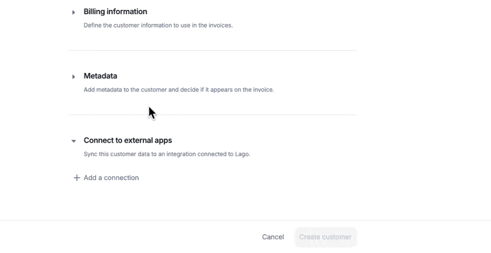
</Frame>

<Info>
The system handles account creation in Salesforce based on your configuration:

For Salesforce instances with Person Accounts enabled:

When `Customer Type` is set to `Individual`: Creates a Person Record type account.

When `Customer Type` is `Company` or unspecified: Creates a standard company account using the default record type for the running user

For Salesforce instances without Person Accounts:
Creates all accounts using the default record type associated with the running user
</Info>


<Warning>
Important considerations for customer record management:

Synchronized customer records have specific update restrictions in Salesforce to maintain data integrity

When using the Lago Integration Code (available for >= v2.7):

The system sets `sync_with_provider` to `true`.
This setting allows future updates from Lago in Salesforce.


Without the Lago Integration Code (for < v2.7):

We don't keep the data in sync from Lago to Salesforce. Only the initial sync is available from Lago to Salesforce, see the section below.

</Warning>


### Sync customers to Salesforce (< v2.7)
To synchronize Lago Customer data with Salesforce Accounts (native object), ensure that your 
Salesforce Account is created first, and that the Lago Customer's `external_salesforce_id` is explicitly populated.

1. Begin by creating a new Account in Salesforce or accessing an existing one;
2. Next, create a customer in Lago and populate the `external_salesforce_id` field for a Lago Customer with the Salesforce Account Id; and
3. Your Salesforce Account and Lago Customer are now synchronized.

<Warning>
Billing data will not sync unless these requirements are met. 
Lago does not create Salesforce Accounts.
Before syncing billing data, you need to create or retrieve an existing Account in Salesforce 
and populate the Lago customer field called `external_salesforce_id`.
</Warning>

<Frame caption="Salesforce Account with Lago Customer information">
  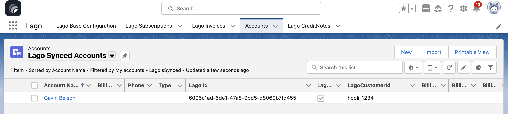
</Frame>

### Sync invoices to Salesforce
<Frame caption="Sync invoices data from Lago to Salesforce">
  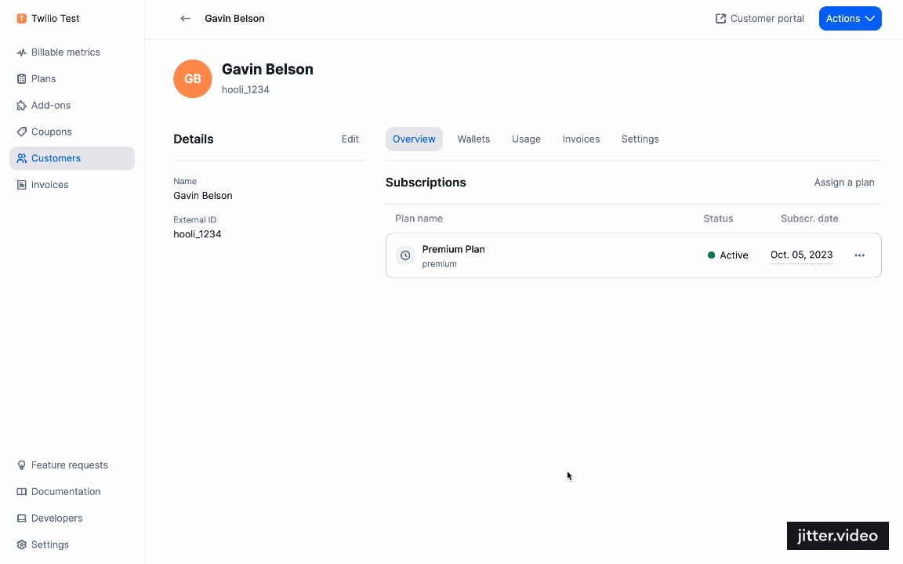
</Frame>

Whenever an invoice is issued for a Lago Customer, the invoice details will be automatically 
synced in real time with Salesforce, using the `Lago Invoices` custom object.

Here is a list of invoice fields that are automatically synced:
- Invoice Number;
- Invoice Payment Status;
- Invoice Type;
- Invoice Issuing Date;
- Invoice Amount;
- Invoice File URL; and
- Invoice Currency.


### Sync credit notes to Salesforce
Whenever a credit note is issued for a Lago Invoice, the credit note details will be automatically 
synced in real time with Salesforce, using the `Lago CreditNotes` custom object.

### Schedule sync from Lago to Salesforce
We also provide an option to schedule the data sync from Lago to Salesforce.
  - `LagoSyncScheduleable`: a schedulable class which helps us schedule either all the data or any one of them.
  - To schedule the sync of any _ONE_ of the object:
    - Create a new instance of class by passing one of the following strings: `CUSTOMER`, `INVOICE`, `CREDITNOTE`
      - Ex: To sync invoices from Lago to Salesforce everyday at 1PM, execute below anonymous code in Anonymous window in Developer Console. ([click here to learn more about CRON expression](https://developer.salesforce.com/docs/atlas.en-us.apexcode.meta/apexcode/apex_scheduler.htm))
        ```
        //Create a new instance. Pass 'INVOICE' in brackets.
        lago.LagoSyncScheduleable syncInvoice = new lago.LagoSyncScheduleable('INVOICE');
        //CRON expression to schedule a job everyday at 1 PM
        String schedule_cron = '0 0 13 * * ?';
        //schedule(name, cron_expression, class_instance)
        System.schedule('Sync Lago Invoice', schedule_cron, syncInvoice);
        ```
  - To schedule the sync of _ALL_ the objects:
    - create a new instance of class by passing `true`
      - Ex: To sync **all** objects from lago to Salesforce everyday at 1PM, execute below anonymous code in Anonymous window in Developer Console. ([click here to learn more about CRON expression](https://developer.salesforce.com/docs/atlas.en-us.apexcode.meta/apexcode/apex_scheduler.htm))
        ```
        //Create a new instance. Pass true in brackets.
        lago.LagoSyncScheduleable syncAll = new lago.LagoSyncScheduleable(true);
        //CRON expression to schedule a job everyday at 1 PM
        String schedule_cron = '0 0 13 * * ?';
        //schedule(name, cron_expression, class_instance)
        System.schedule('Sync Lago all', schedule_cron, syncAll);
        ```


## III. Actions from Salesforce to Lago
Beyond syncing data from Lago to Salesforce, you can initiate actions in Lago directly from Salesforce with Salesforce `Flows`. Lago provides a customizable template for creating customers from Salesforce Accounts.

### Create customers
#### Flow: `Lago Template - Create Customer in Lago on Account Create`
<Frame caption="Use Lago template to create a customer on Account creation">
  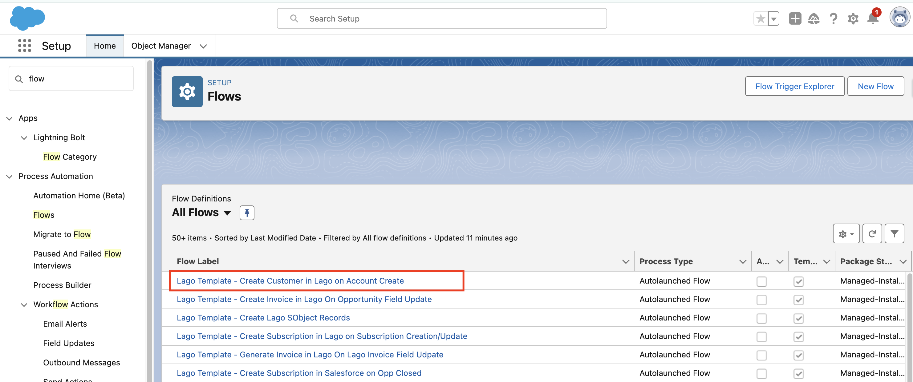
</Frame>


To create a customer in Lago when a Salesforce Account is created, use the Flow template provided by Lago.

1. Log into your Salesforce instance;
2. Access the Setup section via the settings wheel icon in Salesforce;
3. Find and select `Flows` under Process Automation in the sidebar;
4. Locate and open the `Lago Template - Create Customer in Lago on Account Create`;
5. Click 'Save As' to create and save your own version of the template; and
6. Do not forget to click the `Activate` button to activate your flow. 

You can **modify this flow, including the trigger conditions and the field mappings**.
By default, the action starts when a Lago ID is absent. You can also customize how fields are mapped from your Salesforce instance to Lago. You can also set the `customer type` to 'Individual' or 'Company' when you create a customer from Salesforce in Lago.

<Frame caption="Customize the flow">
  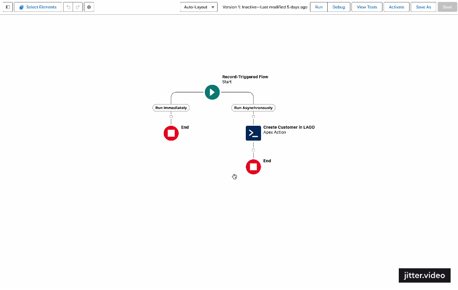
</Frame>


### Get invoice PDF

We can also get the invoice PDF directly from Salesforce.

1. Go to the Lago Invoice tab;
2. Open an invoice that is already synced; and
3. Click `Get Invoice pdf`, the PDF opens in a new tab.


### Get invoice line item details
We can fetch Invoice line items manually for any invoices if required.

1. Go to Lago Invoice tab > Open any Invoice which is already synced.
2. Click on `Lago Sync Invoice Line Item` button. If button is not present on the layout, please add it on Page layout or Lightning record page.
3. All lago items will be synced and available in `Lago Line Items` child custom object.


  <Frame caption="Get Invoice line items">
      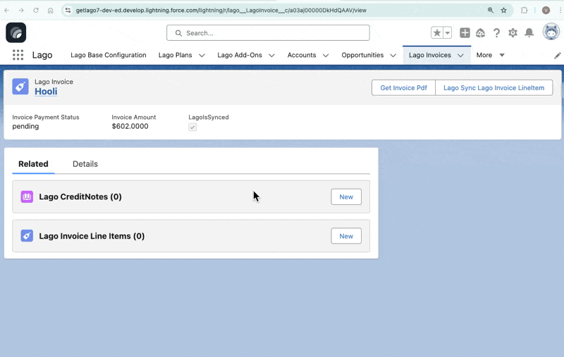
  </Frame>

## Debugging & logs

Every action and data transfer between Lago and Salesforce is logged. The logs are accessible through the Lago package:

1. Navigate to 'Lago Base Configuration', the starting point for the debugging tools; and
2. Access Logs: Click on the 'Logs' tab to view a detailed record of all activities.

You can refresh the logs to keep them current, or delete the ones you no longer need.

<CardGroup cols={2}>
  <Card title="Customer management (v2)" icon="user" href="/v2/guide/customers/customer-management">
    Create customers and link them to integrations.
  </Card>
  <Card title="Create a customer" icon="code" href="/v2/api-reference/customers/create">
    `POST /api/v2/customers` reference, including `external_salesforce_id`.
  </Card>
</CardGroup>
